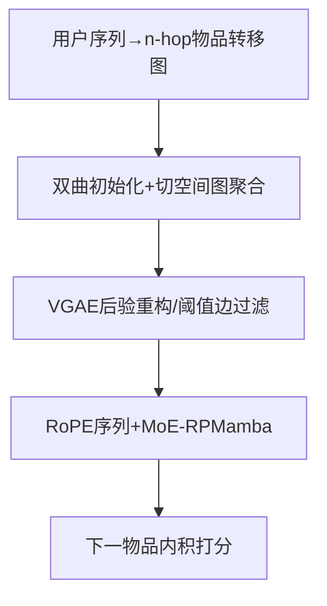
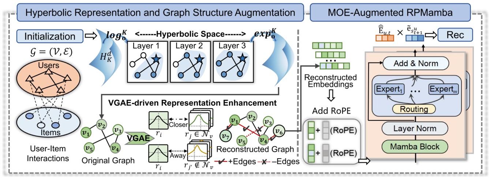

# Hyperbolic-Enhanced Mixture-of-Experts Mamba for Sequential Recommendation (双曲增强专家混合 Mamba 序列推荐)

- **会议/期刊**: AAAI 2026
- **作者与机构**: Yuwen Liu, Lianyong Qi, Xingyuan Mao 等；中国石油大学（华东）、Macquarie University、字节跳动等
- **推荐链路定位**: 排序（下一物品预测）
- **研究方向**: 序列与会话推荐 / 图神经网络与知识图谱推荐
- **论文原文**: [论文原文链接](https://eprints.lancs.ac.uk/id/eprint/235608/1/AAAI_2026-Hyperbolic-Enhanced_Mixture.pdf)
- **开源代码**: 暂未开源

## TL;DR (1分钟核心速览)

针对序列推荐中欧氏空间难保物品层级、Mamba 静态 FFN 难适配动态偏好，HM2Rec 以双曲 GCN+VGAE 重构物品图，再用 RoPE 与 MoE 替换 Mamba 的 FFN；在 Books/Toys/NYC/TKY 按 HR/NDCG@10/20 评估，HR@20 最高相对提升 6.12%，但划分与排序协议未明。

## Background & Motivation (背景与核心矛盾)

- **主流范式**: 序列推荐从 RNN、Transformer 演进到 Mamba；后者以状态空间建模长序列，兼顾效果与线性效率。
- **前人局限**: 现有模型多在欧氏空间学习物品表征，难以刻画物品转移的层级与高阶关系；同时 Mamba4Rec 等仍依赖静态 FFN，无法按 token 动态适配多兴趣上下文。
- **核心洞察 (Key Insight)**: 用户序列中的物品转移并非平坦共现，而呈树状/层级结构；双曲空间可低失真嵌入层级，VGAE 可把噪声边转为分布化结构先验。
- **本文切入点**: 用“双曲图结构增强 + 动态专家序列建模”同时补足结构先验与上下文适应性。

## Method (核心方法设计)

### 1. 整体框架 (Overall Architecture)

先从全体用户序列构建 n-hop 物品转移图；将物品欧氏嵌入经 exp 映射到双曲流形，在切空间做邻域聚合，再经 VGAE 重构邻接、按阈值 b 过滤弱边；随后把重构物品表示送入带 RoPE 的 RPMamba，并用 MoE 替代 FFN，最终以内积完成下一物品打分。

<figure class="paper-figure" markdown="span">
  <figcaption>图1：我们提出的 HM2Rec 的总体架构。</figcaption>
</figure>

### 2. 关键设计拆解 (Key Designs)

1. **双曲图卷积 + VGAE 结构增强**：欧氏 GCN 难保层级且对噪声边敏感 $\to$先将嵌入映射到双曲流形，在切空间聚合$\boldsymbol{v}_i^{l+1,T}=\boldsymbol{v}_i^{l,T}+\sum_{j\in N_i}\frac{1}{|N_i|}\boldsymbol{v}_j^{l,T}$，再 exp 回流形；VGAE 以$q(\boldsymbol{r}_i|\boldsymbol{R}^H,A)=\mathcal{N}(\boldsymbol{\mu}_i,\operatorname{diag}(\boldsymbol{\sigma}_i^2))$ 重建邻接。直觉是双曲半径可指数级容纳层级，VGAE 将确定性边转为分布，抑制错误转移。
2. **RoPE + MoE 的 RPMamba**：静态 FFN 无法按上下文切换变换 $\to$在序列中加入 RoPE 保留相对位置，再用稀疏专家替换 FFN：$\operatorname{MOE}(\boldsymbol{x}_i)=\sum_{k=1}^{K}\alpha_{i,k}\operatorname{Expert}_k(\boldsymbol{x}_i)$，$\alpha_{i,k}=\operatorname{softmax}(g_k(\boldsymbol{x}_i))$，仅 top-M 专家激活。不同 token 路由到不同轻量 MLP，适配多兴趣与上下文漂移。
3. **训练目标、负采样与推理**：每时间步随机采 1 个均匀负样本，并用前缀子序列增广；总损失 $\mathcal{L}=\alpha\tilde{\mathcal{L}}_{reco}+\beta\mathcal{L}_{main}+\gamma\|\theta\|_2^2$，其中$\tilde{\mathcal{L}}_{reco}$为 VGAE 重构损失减 KL。推理用$\hat{y}=\bar{\boldsymbol{E}}_{u,t}\cdot\tilde{\boldsymbol{e}}_{s_{t+1}}$ 内积排序。Mamba 为线性序列开销、MoE 仅 top-M 激活，但 VGAE 需全图邻接重构，图规模大时是瓶颈。

## Experimental Setup & Evaluation Protocol (实验设置与评估协议)

- **数据集与预处理**: Books/Toys 过滤交互数 <3 的用户/物品；NYC/TKY 过滤 <5。

| 数据集 | #Users | #Items | #Interactions | 密度 | 平均长度/场景 |
| :--- | :---: | :---: | :---: | :---: | :--- |
| Books | 93,043 | 54,756 | 506,637 | 9.94e-5 | 5.45；Amazon 图书 |
| Toys | 116,429 | 54,784 | 478,460 | 1.12e-4 | 4.11；Amazon 玩具 |
| NYC | 1,083 | 9,989 | 179,468 | 1.66e-2 | 165.71；Foursquare 签到 |
| TKY | 2,293 | 15,177 | 494,807 | 1.42e-2 | 215.79；Foursquare 签到 |

- **数据划分与防穿越 (Splitting Strategy)**: 原文仅交代过滤阈值，未说明是 Leave-One-Out、比例划分还是全局时间戳切分，存在协议缺口。
- **排名评测协议 (Ranking Protocol)**: 仅报告 HR@K、NDCG@K（K=10,20），未说明 Full-Ranking 或 Sampled Ranking，也未给测试候选规模；训练负采样为每时间步 1 个随机负样本。
- **对比基线与超参设置**: 对比 RNN、Transformer、GNN、对比学习与 Mamba 系共 18 个基线；嵌入维度 Books/Toys=32、NYC/TKY=128，2 层 GCN，n-hop=3，曲率 K=1，专家数 4/5，阈值 b=0.5/0.3/0.6；未报告显著性检验。

## Key Experimental Results (实验关键数据)

### 1. 主实验对比 (Main Results)

下表统一取 HR@20/NDCG@20；`H/N` 分别表示 HR@20 与 NDCG@20。

| 模型 | Books H/N | Toys H/N | NYC H/N | TKY H/N |
| :--- | :---: | :---: | :---: | :---: |
| TiSASRec | 0.7958/0.5630 | 0.6594/0.4117 | 0.8601/0.7454 | 0.9185/0.8054 |
| FEARec | 0.7950/0.5603 | 0.6701/0.4218 | 0.8763/0.7395 | 0.9115/0.8042 |
| MAERec | 0.8348/0.5736 | 0.6900/0.4346 | 0.8421/0.6447 | 0.8853/0.6688 |
| DuoRec | 0.8328/0.5943 | 0.6265/0.3822 | 0.8726/0.7306 | 0.9211/0.8021 |
| MCLRec | 0.8351/0.5909 | 0.6304/0.3855 | 0.8768/0.7455 | 0.9206/0.7930 |
| Mamba4Rec | 0.8100/0.5824 | 0.6876/0.4395 | 0.8680/0.7264 | 0.9220/0.8057 |
| **HM2Rec** | **0.8487/0.6209** | **0.7262/0.4629** | **0.8984/0.7781** | **0.9368/0.8353** |
| Improv.(HR/N) | 1.63%/4.48% | 5.25%/5.32% | 2.46%/4.37% | 1.60%/3.67% |

### 2. 消融实验 (Ablation Study)

| 变体 | Books HR@20 | Books NDCG@20 | NYC HR@20 | NYC NDCG@20 |
| :--- | :---: | :---: | :---: | :---: |
| w/o Hyperbolic | 0.8162 | 0.6022 | 0.8857 | 0.7473 |
| w/o VGAE | 0.8047 | 0.5936 | 0.8809 | 0.7113 |
| w/o RoPE | 0.8125 | 0.5982 | 0.8747 | 0.7389 |
| w/o MOE | 0.8335 | 0.6015 | 0.8910 | 0.7584 |
| **HM2Rec** | **0.8487** | **0.6209** | **0.8984** | **0.7781** |

### 3. 关键实验发现 (Key Findings)

- **VGAE 是最敏感的“去噪阀”**：去掉后 NYC NDCG@20 从 0.7781 降至 0.7113，相对损失约 8.6%；Books NDCG@20 亦下降 4.4%，说明结构重构与阈值剪边比单纯图聚合更关键。
- **双曲与 MoE 各自贡献稳定但量级不同**：去掉双曲使 Books HR@20 降 3.8%、NYC NDCG@20 降 3.96%；去掉 MoE 使 NYC NDCG@20 降 2.5%，证明层级几何与动态路由互补。
- **收益在稀疏短序列上最大**：Toys 上 HR@20/NDCG@20 相对最强基线提升 5.25%/5.32%，而 TKY 上 Mamba4Rec 已达 0.9220/0.8057，HM2Rec 仅提升 1.60%/3.67%，说明长而稠密的签到序列中结构先验边际收益变小。

## Highlights & Limitations (亮点、对比与审稿批判)

- **与代表作对比 (vs. Prior Work)**: 相比 Mamba4Rec，本文补上物品结构先验并用 MoE 打破静态 FFN；相比 HGCN/HGSR 等双曲推荐，本文把双曲结构增强接入动态序列建模；相比 MCLRec，本文显式建模下一物品时序而非仅全局协同。
- **可迁移亮点**: RoPE+MoE 可直接移植到其他 SSM 推荐骨干；VGAE + 阈值剪边可作为序列编码前的“图去噪预训练”，缓解稀疏/噪声交互。
- **审稿级局限批判**: 其一，划分方式、候选集与 Full/Sampled Ranking 均未交代，复现与公平比较存疑；其二，超参强依赖数据集（b、K、专家数均逐集调），且 VGAE 全图重构在百万物品级场景的扩展性与推理延迟未充分讨论。

## Rating (四维评分)

- **方法创新性 (Novelty)**: ⭐⭐⭐⭐ （双曲图结构增强与 MoE-Mamba 的组合较完整，但各组件均为已有技术的领域适配）
- **评估协议与实验扎实度 (Protocol & Experiments)**: ⭐⭐⭐ （四数据集与消融充分，但划分/排序协议缺失、无显著性检验，削弱结论强度）
- **写作与数学规范度 (Clarity & Rigor)**: ⭐⭐⭐⭐ （双曲映射、VGAE 与 MoE 公式清晰，复杂度与超参敏感性分析尚可）
- **工业落地与复现价值 (Industrial & Practical Value)**: ⭐⭐⭐ （Mamba/MoE 效率友好，但 VGAE 图重构与逐数据集调参增加落地成本，且未开源）

