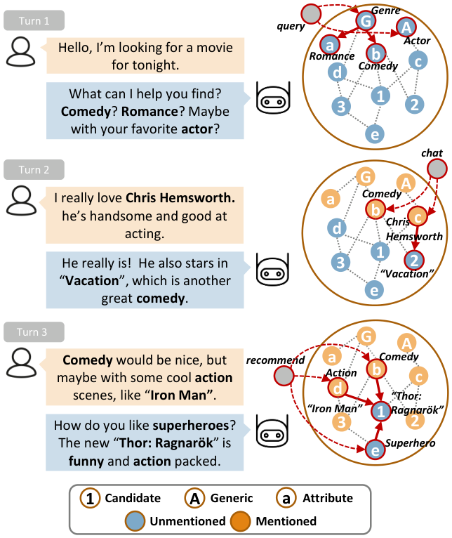
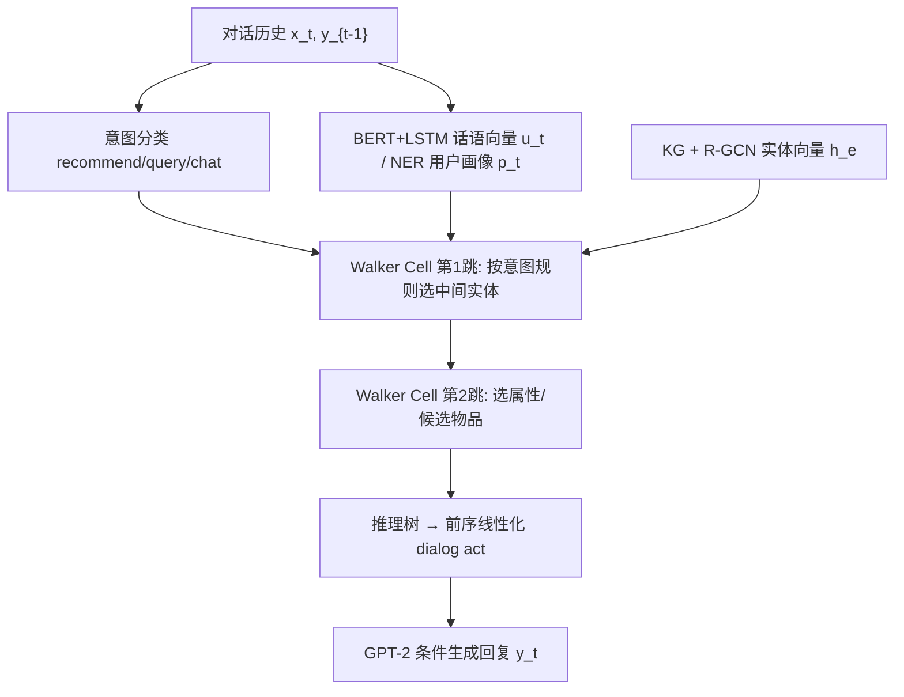

# CR-Walker: Tree-Structured Graph Reasoning and Dialog Acts for Conversational Recommendation (树状图推理与对话动作驱动的对话推荐)

- **会议/期刊**: EMNLP 2021 (Main)
- **作者与机构**: Wenchang Ma, Ryuichi Takanobu, Minlie Huang (清华大学 CoAI / 阿里巴巴)
- **推荐链路定位**: 端到端生成式（多轮对话中同时完成实体选择、推荐与回复生成）
- **研究方向**: 对话推荐与智能体仿真 / 图神经网络与知识图谱推荐
- **论文原文**: [https://aclanthology.org/2021.emnlp-main.139.pdf](https://aclanthology.org/2021.emnlp-main.139.pdf)
- **开源代码**: [https://github.com/truthless11/CR-Walker](https://github.com/truthless11/CR-Walker)

## TL;DR (1分钟核心速览)

对话推荐系统的两大痛点：背景知识只被当作"特征增强"而未做多路径推理，且选出的实体无法被有策略地组织进回复。CR-Walker 先以 3 类系统意图（recommend / query / chat）确定动作，再用 walker cell 在 KG 上按意图定制的两跳规则做**树状推理**（每跳可多选），把推理树前序线性化为 dialog act 拼入 GPT-2 输入，让"选了哪些实体"直接决定"怎么表达"。ReDial 全库排序下 Coverage 14.7（+20.5% vs KGSF）、知识 F1 47.7（+43.7% vs DCR）；GoRecDial T@1 81.1（+4.2% vs GoRecDial）；人工评测在流畅度/连贯性/信息量/有效性四项均显著优于人类参考答案（$p<0.05$）。

## Background & Motivation (背景与核心矛盾)

- **主流范式**: 一类是 recommendation-biased CRS（KBRD、KGSF、DCR），用 KG/R-GCN 增强用户画像与实体表示，再用模板或 RNN 生成回复；另一类是 dialog-biased CRS，靠自由文本隐式理解偏好。
- **前人局限**: (1) 知识仅作为表征增强，单跳直接打分，无法像"用户喜欢 Hemsworth $\to$Vacation$\to$Comedy$\to$ 推荐 Thor"那样沿多条路径串联实体；(2) 大多数工作停在"推断出实体"，不做回复层面的动作规划，选中的实体以什么口径说出去完全不受控。
- **核心洞察 (Key Insight)**: 对话推荐本质上是 task-oriented dialog，其"策略层"应当显式化——把意图 + 命中实体 + 实体的层级关系打包成一个 dialog act，则推荐决策与语言生成被同一个中间变量耦合。
- **本文切入点**: 以树（而非 Moon et al. 的单链）承载多路径推理，并让这棵树同时充当推荐证据与生成控制信号。

<figure class="paper-figure" markdown="span">
  <figcaption>图1：示例对话的前三轮。左侧展示对话，KG 上的实体以粗体标出。每轮对话右侧的图展示 CR-Walker 的推理过程，推理树用红色标记。本文中，候选项用数字表示，通用类别/属性用大写/小写字母表示。橙色/蓝色表示该实体在前文中被提及/未被提及。</figcaption>
</figure>

## Method (核心方法设计)

### 1. 整体框架 (Overall Architecture)

对话历史经 BERT+LSTM 得到话语向量 $u_t$，经 spaCy NER + 模糊匹配链接出已提及实体并自注意力池化为用户画像$p_t$；KG（DBpedia 构建，含候选物品 / 属性 / 泛类三层）经 R-GCN 编码为实体向量$h_e$。意图分类器先定 recommend/query/chat，随后 walker cell 从意图出发做两跳扩展得到推理树；树按前序遍历线性化为 `[intent ( ... )( ... )]` 形式的 token 序列，与$u_t$ 拼接喂入 GPT-2 自回归生成回复。训练时意图、两跳选择（logistic 回归）与生成（MLE）联合优化。

### 2. 关键设计拆解 (Key Designs)

1. **意图定制推理规则（把 KG 搜索空间砍到可学习）**: 全库 KG 两跳邻居爆炸，作者为每种意图写死合法实体集合——recommend: 已提及属性 $\to$候选物品（+已提及物品的属性）；query: 泛类$\to$属性；chat: 已提及实体$\to$ 全实体。这一步不是工程琐碎，而是使两跳树推理在百万级 KG 上可训练、且让"意图"真正约束"选什么"。

2. **Walker Cell 与门控上下文融合（多选树扩展）**: 单跳推理的关键是上下文该向话语还是向画像倾斜。cell 用门控产生上下文 $c_t^{(n)}$，并把各跳上下文累加后与实体向量内积打分：
$\gamma^{(n)}=\sigma(\mathbf{w}\cdot[u_t;p_t;i_t;h_e])$，$c_t^{(n)}=\gamma^{(n)}u_t+(1-\gamma^{(n)})p_t$，
$\hat{s}_{e'}=\sigma\big(h_{e'}\cdot\sum_{j=1}^{n}c_t^{(j)}\big)$。
$\hat{s}_{e'}>\tau$即入选，故每跳可保留多个实体，天然形成树——累加$\sum_{j\le n}c_t^{(j)}$ 让第二跳"记得"第一跳为何出发，避免同一物品因不同父节点被重复解释。

3. **Dialog Act 前序线性化与联合训练**: 树被序列化为带括号的 token 串，括号编码选择层级与顺序，直接把结构化决策注入 PLM 的词表空间（无需额外 adapter）。总损失 $\mathcal{L}=\mathcal{L}_{int}+\sum_{n=1}^{2}\lambda_n\mathcal{L}_n+\mathcal{L}_{gen}$，其中选择项为逐实体 logistic 损失$\mathcal{L}_n=\sum_{e}\sum_{e'\in\mathcal{Z}_e^{(n)}}\big[-s_{e'}\log\hat{s}_{e'}-(1-s_{e'})\log(1-\hat{s}_{e'})\big]$，标签$s_{e'}\in\{0,1\}$来自语料实体链接的弱监督，**无负采样**（每跳候选集已由规则裁剪）；推理时首跳宽度上限$m$、Top-p 采样解码，开销集中在 R-GCN 预计算 + 两次全候选打分。

## Experimental Setup & Evaluation Protocol (实验设置与评估协议)

- **数据集与预处理**（统计与构图细节原文置于附录，此处仅列公开规模）：

| 数据集 | #Dialogues | 候选物品 | 交互/场景说明 |
| :--- | :---: | :---: | :--- |
| ReDial | ~11.3k | 6,281 movies | AMT 众包双人角色扮演（recommender/seeker），单轮可提多部电影，多标签 Recall 评测 |
| GoRecDial | ~9.1k | 每轮 5 候选 | ParlAI 收集，seeker 带 5 部观看历史，recommender 从 5 部候选中选出正确一部 |

- **数据划分与防穿越**: 按对话整体划分 train/valid/test（同原数据集设定），不存在单轮泄漏；每轮 $t$仅使用$y_{t-1},x_t$及之前历史构造$u_t$，并对历史截断$l_{max}=3$ 以应对话题漂移。
- **排名评测协议**: ReDial 为**全库排序（Full-Ranking，候选为数据集中全部电影实体，非采样）**，指标 Recall@1/10/50 与 Coverage（测试集被推荐过的候选物品占比）；GoRecDial 为**受限候选排序（5 选 1）**，指标 T@k（每轮命中率）与 C@k（对话结束命中率）。生成侧用 corpus-level BLEU、Distinct-2/3，知识侧按**泛类层面**（如只说"类型"而不苛求具体类型）计算 Precision/Recall/F1。
- **对比基线与超参**: ReDial 对比 ReDial、DCR、KBRD、KGSF（后者额外引入 ConceptNet 词图谱）；GoRecDial 对比 BERT、R-GCN+GPT、GoRecDial。R-GCN/实体向量维度 $d$与 BERT/GPT-2 隐层对齐；人工评测 300 条样本 × 3 名 AMT 标注者、3 级量表，显著性用$t$-test（$p<0.05$）。

## Key Experimental Results (实验关键数据)

### 1. 主实验对比 (Main Results)

ReDial（推荐 + 生成合并表，† 表示额外引入 ConceptNet）：

| Model | R@1 | R@10 | R@50 | Cov. | BLEU | Dist-2 | Dist-3 | Know-F1 |
| :--- | :---: | :---: | :---: | :---: | :---: | :---: | :---: | :---: |
| ReDial | 2.3 | 12.9 | 28.7 | 5.8 | 21.9 | 3.72 | 5.24 | 24.0 |
| DCR | 2.7 | 14.8 | 30.6 | 1.5 | 21.9 | 1.91 | 3.12 | 40.8 |
| KBRD | 3.0 | 16.3 | 33.8 | 11.2 | 22.8 | 4.92 | 9.21 | 35.9 |
| KGSF | 3.9 | 18.3 | **37.8** | 12.2 | 18.6 | 4.00 | 5.34 | 33.2 |
| **CR-Walker** | 3.7 | 17.6 | 37.1 | 14.7 | 26.6 | **21.2** | **48.1** | **47.7** |
| -depth=1 | 2.9 | 14.9 | 34.3 | 11.4 | **28.0** | 19.2 | 40.8 | 45.1 |
| +ConceptNet† | **4.0** | **18.7** | 37.6 | **15.2** | – | – | – | – |
| *Improv. (vs 最强单-KG KBRD)* | *+23.3%* | *+8.0%* | *+9.8%* | *+31.3%* | *+16.7%* | *+330.9%* | *+422.3%* | *+32.9%* |

GoRecDial：

| Model | T@1 | T@3 | C@1 | C@3 | BLEU |
| :--- | :---: | :---: | :---: | :---: | :---: |
| BERT | 25.5 | 66.3 | 26.4 | 68.3 | 23.9 |
| R-GCN+GPT | 75.6 | 95.7 | 76.1 | 96.3 | 25.2 |
| GoRecDial | 77.8 | 97.1 | 78.2 | 97.7 | 27.4 |
| **CR-Walker** | **81.1** | **97.5** | **81.3** | **98.1** | **29.6** |
| *Improv.* | *+4.2%* | *+0.4%* | *+4.0%* | *+0.4%* | *+8.0%* |

### 2. 消融实验 (Ablation Study)

| 配置 | R@1 | R@10 | R@50 | Cov. | BLEU | Dist-3 | Know-F1 |
| :--- | :---: | :---: | :---: | :---: | :---: | :---: | :---: |
| CR-Walker（两跳树推理） | **3.7** | **17.6** | **37.1** | **14.7** | 26.6 | **48.1** | **47.7** |
| w/o 第 1 跳（-depth=1，直接打分第 2 跳） | 2.9 | 14.9 | 34.3 | 11.4 | **28.0** | 40.8 | 45.1 |
| $\Delta$ | -21.6% | -15.3% | -7.5% | -22.4% | +5.3% | -15.2% | -5.5% |

（宽度消融见图 3：首跳可选节点数 $m$增大时多数指标单调上升，$m$ 超过约 6 后 R@1 有轻微回落，说明多路径优于单路径但存在边际递减。）

### 3. 关键实验发现 (Key Findings)

1. **推理深度是推荐增益的主因，而非 PLM 规模**: 去掉首跳推理（-depth=1）后 R@1 从 3.7 掉到 2.9（-21.6%）、Coverage 从 14.7 掉到 11.4，而此时框架已等价于 R-GCN+GPT 式直推——证明涨点来自"沿中间属性绕一跳"，而非文本侧增强。
2. **多实体选择显著提升多样性与知识命中**: CR-Walker 的 Distinct-2 达 21.2（KBRD 4.92，约 4.3 倍）、知识 F1 47.7，但 BLEU 仅 26.6，低于自身 -depth=1 的 28.0；作者归因为模型常走出与标注不同的合法推理树、生成"合理但不逐字匹配"的回复——即 BLEU 与多样性的经典权衡，需人工评测兜底。
3. **显式动作规划优于纯 PLM 与人类即兴回复**: 意图准确率仅 67.8%，但当模型意图与人类意图**不一致**时，人类参考回复四项指标全面下滑（如信息量 2.26$\to$1.99），而 CR-Walker 基本持平（2.33）；在相同意图子集上提升虽小，说明其优势主要来自"总会给出有效 query/recommend 动作"而非单纯语言更流畅。单 KG 下 R@1 3.7 略低于 KGSF 3.9（后者额外用了 ConceptNet），补上 ConceptNet 后升至 4.0 反超，说明树推理与外部词图谱信号可叠加。

## Highlights & Limitations (亮点、对比与审稿批判)

- **与代表作对比 (vs. Prior Work)**: 相比 KBRD/KGSF 把 KG 当作"更好的 embedding"、单跳直推目标物品，CR-Walker 把 KG 当作**推理路径生成器**，中间实体既是推荐证据又是生成素材；相比 Moon et al. 的单链推理（依赖细粒度路径标注），本文以弱监督实体链接 + 树结构支持每跳多选，无需路径级人工标注；相比纯 GPT-2 基线，本文用显式 dialog act 把"推荐哪一个"从隐变量变成可控输入，信息量/有效性提升显著。
- **可迁移亮点**: (1) "结构化决策树 $\to$前序括号序列$\to$ PLM 输入"是一种极轻量的结构-文本对齐手段，可直接搬到多跳 QA、可解释推荐理由生成；(2) 用**意图定制的合法邻居裁剪**替代负采样，既降复杂度又提升可解释性，适合大规模 KG 上的在线候选收缩。
- **审稿级局限批判**: (1) 推理规则（表 1）与两跳上限均为人工硬编码，遇到否定反馈（"不要喜剧"）或话题跳转即失效，作者也承认需额外语言理解模块；(2) ReDial 上意图准确率仅 67.8%、且 BLEU 与知识 Precision 均非最优，"结构更好但字面更差"的收益难以用自动指标完全辩护；树宽 $m$、阈值$\tau$、历史窗$l_{max}=3$ 三个超参敏感，线上需重调。

## Rating (四维评分)

- **方法创新性 (Novelty)**: ⭐⭐⭐⭐ （把 dialog act 从传统任务型对话的槽位抽象升级为"带层级的推理树"，实现推荐决策与语言生成的显式耦合，思路干净且有别于单链推理）
- **评估协议与实验扎实度 (Protocol & Experiments)**: ⭐⭐⭐⭐ （ReDial 全库排序 + Coverage 多样性 + 两类数据集 + 300 样本人工评测与显著性检验较完整，但生成指标依赖 corpus-level BLEU/Distinct，意图准确率偏低未做误差分析）
- **写作与数学规范度 (Clarity & Rigor)**: ⭐⭐⭐⭐ （walker cell 公式与联合损失定义清晰、图的动机示例直观；扣分在于推理规则细节与数据集统计全部塞进附录，正文缺复杂度分析）
- **工业落地与复现价值 (Industrial & Practical Value)**: ⭐⭐⭐ （代码已开源、R-GCN 可离线预计算，但依赖 DBpedia 实体链接与手工规则，跨域迁移需重写规则表，且 GPT-2 逐 token 生成延迟对实时对话偏高）

