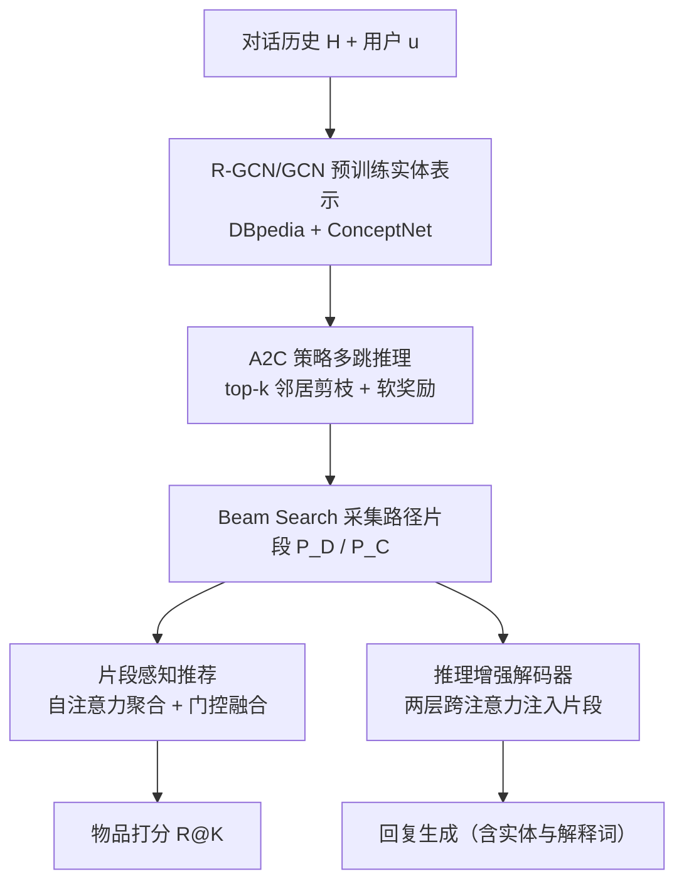
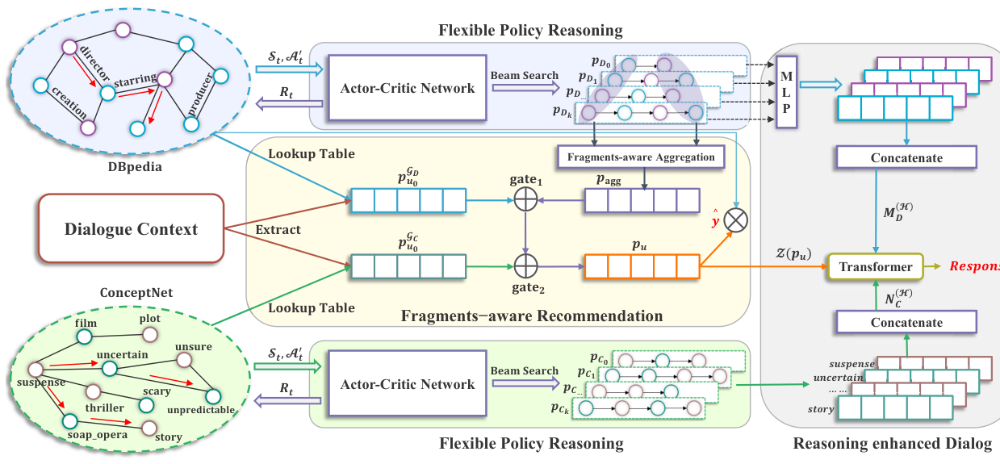
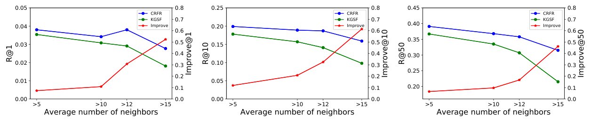

# CRFR: Improving Conversational Recommender Systems via Flexible Fragments Reasoning on Knowledge Graphs (基于知识图谱柔性片段推理的对话推荐改进)

- **会议/期刊**: EMNLP 2021 (Main)
- **作者与机构**: Jinfeng Zhou, Bo Wang, Ruifang He, Yuexian Hou（天津大学智能与计算学部；人民网传播内容认知国家重点实验室）
- **推荐链路定位**: 端到端生成式（推荐打分 + 回复生成联合）
- **研究方向**: 对话推荐与智能体仿真 / 图神经网络与知识图谱推荐
- **论文原文**: [论文原文链接](https://aclanthology.org/2021.emnlp-main.355.pdf)
- **开源代码**: 暂未开源

## TL;DR (1分钟核心速览)

对话上下文稀疏，现有 KG 增强 CRS 只用 GCN 隐式聚合邻居，无法追踪用户兴趣的**高阶显式迁移**；而 KG 本身不完整，完整推理路径往往不存在。CRFR 把兴趣迁移建模为 MDP，在物品图 DBpedia 与概念图 ConceptNet 上用 A2C 策略做多跳推理，用 beam search 采出"柔性路径片段集合"替代单一完整路径，再以片段感知推荐模块与 Token 级融合解码器增强推荐与回复。在 ReDial（8:1:1 划分、全库排序）上 R@10 由 KGSF 的 0.183 提升到 0.202（+10.4%），Item Ratio 由 0.324 升至 0.383。

## Background & Motivation (背景与核心矛盾)

- **主流范式**: KBRD / KGSF 等用 R-GCN、GCN 把上下文中提及实体的邻域信息编码进用户表示，在 ReDial 上取得 SOTA。
- **前人局限 1**: 隐式邻域聚合把高阶关系压缩为多轮聚合的副产品，无法给出"从某演员/导演走到某电影"的显式多跳证据链；树状扩展方法（Ma et al.）又不以目标物品为导向，搜索方向散乱。
- **前人局限 2**: 真实 KG 稀疏不完整，在有限跳数内往往**不存在**完整兴趣迁移路径，追求单一最优路径会直接失败。
- **核心洞察 (Key Insight)**: 兴趣迁移不必用一条完整路径表示——指向正确方向的**局部路径片段**集合已足以定位用户兴趣子空间，且片段天然由逻辑相连实体构成，可直接充当推荐理由。
- **本文切入点**: 用策略引导的显式多跳推理替代无向随机游走/树扩展，用"片段集合"替代"完整路径"，并让片段同时进入推荐与生成两个模块。

## Method (核心方法设计)

### 1. 整体框架 (Overall Architecture)

输入为 $n$轮对话历史$H$与用户$u$，以及物品图$\mathcal{G}_D$（DBpedia）与概念图$\mathcal{G}_C$（ConceptNet）。先以 R-GCN/GCN 预训练实体表示并对齐到同一语义空间；随后两个 A2C 智能体分别以$s_0=\mathbf{p}_{u_0}$（$H$中实体的聚合嵌入）为起点，在两张图上逐步选边，训练收敛后用 beam search 采出 top 概率的路径片段集$\mathcal{P}_D,\mathcal{P}_C$。物品图片段经片段感知推荐模块融合为用户偏好$\mathbf{p}_u$ 并与物品内积打分；两张图的片段向量再注入 Transformer 解码器的两层额外多头注意力，实现 Token 级可解释回复生成。

<figure class="paper-figure" markdown="span">
  <figcaption>图2：CRFR概览。策略推理灵活地在DBpedia（GD）和ConceptNet（GC）中获取高阶路径片段，这些片段有益于推荐和对话。这里，pDi和pCi分别是GD和GC中的推理路径片段。pu是最终的用户偏好表示。</figcaption>
</figure>

### 2. 关键设计拆解 (Key Designs)

1. **柔性策略推理（Flexible Policy Reasoning）**：痛点是无向随机游走缺乏兴趣导向且邻居爆炸。状态 $s_t=[\mathbf{p}_{u_0};\mathbf{h}_t;\mathbf{e}_t]$；对邻居众多的节点先按$g(u,a)=\mathbf{p}_{u_0}^{\top}\mathbf{e}_a$打分保留 top-$k$构造剪枝动作空间$A'_t$，把组合爆炸压到可控规模。奖励采用软阈值形式（$\mathbf{e}_T$ 为目标实体嵌入）：
$$R_t=\begin{cases}\alpha, & \mathrm{sim}(\mathbf{e}_T,\mathbf{e}_{a_t})\ge\epsilon_1\\ \mathrm{sim}(\mathbf{e}_T,\mathbf{e}_{a_t})+\beta, & \epsilon_1>\mathrm{sim}\ge\epsilon_2\\ \max(0,\mathrm{sim}(\mathbf{e}_T,\mathbf{e}_{a_t})), & \text{otherwise}\end{cases}$$
   软奖励避免"只有命中目标才给分"的稀疏问题，使中间步也能获得梯度，策略因而学到"朝感兴趣实体方向走"的语义。

2. **片段感知推荐（Fragments-aware Aggregation）**：起点实体矩阵 $\mathbf{B}(H)$与终点实体矩阵$\mathbf{D}(H)$各经自注意力聚成$\mathbf{b},\mathbf{d}$，再做乘法+加法双通道交互：
$$\mathbf{p}_{agg}=\mathrm{ReLU}\big(W^1_{agg}(\mathbf{b}\odot\mathbf{d})\big)+\mathrm{ReLU}\big(W^2_{agg}(\mathbf{b}+\mathbf{d})\big)$$
   随后门控 $\eta=\sigma(W_g[\mathbf{p}_{agg}\|\mathbf{p}_{u_0}])$，$\mathbf{p}_u=\eta\cdot\mathbf{p}_{agg}+(1-\eta)\cdot\mathbf{p}_{u_0}$。直觉：$\odot$捕获"起点-终点"共现的迁移模式，$+$ 保留各自实体强度，门控则按对话上下文自适应决定片段信息占比，避免片段噪声污染原始上下文表示。

3. **训练目标、负采样与推理开销**：四阶段训练——KG 表示预训练 → 策略梯度 $\nabla J=\mathbb{E}_\pi[\nabla_\theta\log\pi_\theta(a_t,s_t,A'_t)(G_t-q(a_t))]$→ 推荐交叉熵$\mathcal{L}_{Rec}$→ 生成负对数似然$\mathcal{L}_{Gen}$，总目标为$\mathcal{L}=\mathcal{L}_{Rec}+\mathcal{L}_{Gen}$（策略部分单独优化）。推荐采用全库 softmax 交叉熵，**不使用负采样**；推理时每轮需两次 beam search + 一次解码，路径搜索为主要额外开销。

## Experimental Setup & Evaluation Protocol (实验设置与评估协议)

- **数据集与预处理**: ReDial 为电影域多轮对话语料，提及电影人工标注，未标注实体用 NER 抽取并链接到 DBpedia 节点。

| 数据集 | #Users | #Items | #Interactions | 稀疏度/密度 | 特征/场景说明 |
| :--- | :---: | :---: | :---: | :---: | :--- |
| ReDial | 原文未报告 | 原文未报告（全库电影候选） | 10,006 段对话 / 182,150 条 utterance | 极稀疏（对话级） | 电影推荐，双 KG：DBpedia + ConceptNet |

- **数据划分与防穿越 (Splitting Strategy)**: 按 **8:1:1 比例划分**训练/验证/测试，未采用时间戳切分。
- **排名评测协议 (Ranking Protocol)**: **Full-Ranking 全库排序**（对 ReDial 全部电影打分取 top-$k$），指标为 Recall@1/10/50；显著性检验为$t$-test，$p<0.05$。
- **对比基线与超参设置**: 基线含 Popularity、TextCNN、REDIAL、KBRD（单 KG）、KGSF（双 KG 互信息对齐 SOTA）；Embedding 维度与策略网络层数原文置于附录，动作空间 top-$k$ 对两图分别设超参。

## Key Experimental Results (实验关键数据)

### 1. 主实验对比 (Main Results)

| Model | R@1 | R@10 | R@50 |
| :--- | :---: | :---: | :---: |
| Popularity | 0.012 | 0.061 | 0.179 |
| TextCNN | 0.013 | 0.068 | 0.191 |
| REDIAL | 0.024 | 0.140 | 0.320 |
| KBRD | 0.032 | 0.166 | 0.345 |
| KGSF (SOTA) | 0.037 | 0.183 | 0.371 |
| **CRFR** | **0.040** | **0.202** | **0.399** |
| Improv. vs KGSF | +8.1% | +10.4% | +7.5% |
| CRFR +RandomWalk | 0.033 | 0.170 | 0.361 |

### 2. 消融实验 (Ablation Study)

| 变体 | Dist-2 | Dist-3 | Dist-4 | Item Ratio | 2ER | Inner-Con. | Inter-Con. |
| :--- | :---: | :---: | :---: | :---: | :---: | :---: | :---: |
| **CRFR 完整** | **0.345** | **0.516** | **0.639** | **0.383** | **0.331** | **0.130** | **0.076** |
| w/o Concept ($\mathcal{G}_C$) | 0.298 | 0.407 | 0.478 | 0.335 | 0.261 | 0.083 | 0.052 |
| w/o DBpedia ($\mathcal{G}_D$) | 0.355 | 0.503 | 0.594 | 0.267 | 0.247 | 0.078 | 0.045 |
| w/o Preference（去 Token 级偏好注入） | 0.287 | 0.374 | 0.422 | 0.240 | 0.171 | 0.106 | 0.043 |

### 3. 关键实验发现 (Key Findings)

1. **方向性推理是主要增益来源**：把策略推理换成无向 RandomWalk，R@10 从 0.202 掉到 0.170（−15.8%），反而退回 KGSF 水平，说明收益来自"兴趣导向的选边"而非多跳本身。
2. **邻居越稠密，显式推理的相对优势越大**：如图 3 所示，随 KG 节点平均邻居数从 >5 增至 >15，CRFR 与 KGSF 的 R@50 差距持续拉大——隐式邻域聚合把噪声一起平均进来，而显式路径在噪声中仍能定向。
3. **两张图与 Token 级融合分工明确**：去 ConceptNet 使 Dist-3 从 0.516 降到 0.407（措辞多样性），去 DBpedia 使 Item Ratio 从 0.383 降到 0.267（实体命中率），而去 Token 级偏好注入使 2ER 从 0.331 崩到 0.171、Item Ratio 降到 0.240，是三者中最关键的一环。

<figure class="paper-figure" markdown="span">
  <figcaption>图3：显式推理的效果。随着邻居平均数量的增加，我们模型的性能始终高于SOTA基线，且提升越来越显著。</figcaption>
</figure>

## Highlights & Limitations (亮点、对比与审稿批判)

- **与代表作对比 (vs. Prior Work)**: 相比 KBRD/KGSF 的 GCN 隐式聚合，CRFR 给出可展示的多跳证据链，直接提升解释性；相比树状扩展（Ma et al.），它由目标物品的相似度奖励驱动，搜索有明确方向；相比单路径推理（Moon et al.），它用片段集合绕开 KG 不完整这一硬约束。
- **可迁移亮点**: ①"片段而非完整路径"的思路可直接迁移到 KG 增强的序列推荐与冷启动物品归因；②起点/终点矩阵的 $\odot$与$+$ 双通道交互 + 门控，是一个轻量且通用的"外部知识与上下文"融合算子。
- **审稿级局限批判**: ①奖励与 beam search 均以**目标实体嵌入 $\mathbf{e}_T$** 为参照，训练阶段使用真实目标尚可解释为监督信号，但片段选择与目标高度耦合，存在"向标签泄漏"的隐忧，论文未给出不使用目标信号的对照；②全程依赖 RL + beam search + 解码三段式推理，在线多轮场景的时延预算未做任何分析，且仅在 ReDial 单一中等规模数据集上验证，缺少跨域（如电商、音乐）泛化实验与 NDCG/MRR 等排序指标。

## Rating (四维评分)

- **方法创新性 (Novelty)**: ⭐⭐⭐⭐ （"柔性片段推理 + 双异质 KG 分工"思路清晰，是对隐式聚合范式的实质性替代，但 RL 选边框架本身并非全新）
- **评估协议与实验扎实度 (Protocol & Experiments)**: ⭐⭐⭐ （全库排序与 $t$ 检验规范、自动+人工+案例三重评估较完整，但仅单数据集、仅 Recall 指标、无目标信号对照）
- **写作与数学规范度 (Clarity & Rigor)**: ⭐⭐⭐⭐ （MDP 五要素与各融合算子定义明确、公式排版清晰，但四阶段训练流程的损失权重与超参细节下放附录）
- **工业落地与复现价值 (Industrial & Practical Value)**: ⭐⭐⭐ （无开源代码，双 KG 构图与在线 RL 推理开销较大，但"片段即解释"对可解释推荐产品化有直接借鉴价值）

