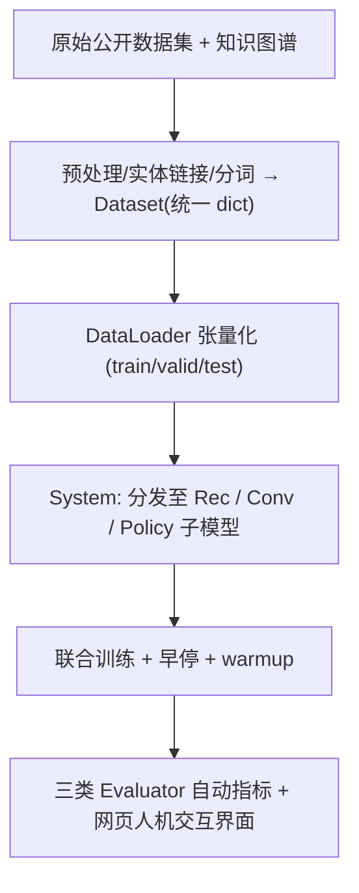
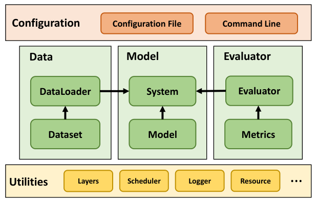
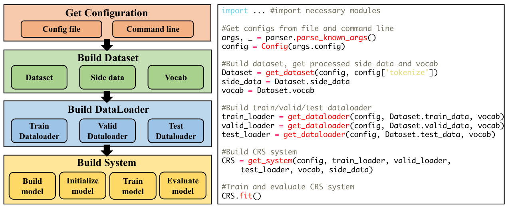

# CRSLab: An Open-Source Toolkit for Building Conversational Recommender System (面向对话推荐系统构建的开源工具链)

- **会议/期刊**: EMNLP 2021 (System Demonstrations)
- **作者与机构**: Kun Zhou, Xiaolei Wang, Yuanhang Zhou, Chenzhan Shang, Yuan Cheng, Wayne Xin Zhao, Yaliang Li, Ji-Rong Wen（中国人民大学高瓴人工智能学院 / 阿里巴巴）
- **推荐链路定位**: 端到端（推荐召回 + 回复生成 + 主动对话策略）
- **研究方向**: 对话推荐与智能体仿真
- **论文原文**: [论文原文链接](https://arxiv.org/abs/2101.00939v1)
- **开源代码**: [RUCAIBox/CRSLab](https://github.com/RUCAIBox/CRSLab)

## TL;DR (1分钟核心速览)

对话推荐（CRS）研究长期处于“场景/目标/技术三碎片化”状态：ReDial、TG-ReDial、DuRecDial 各自私有预处理、私有指标、私有脚本，新模型难以横向复现。CRSLab 首次将 CRS 统一为**推荐、对话、策略**三个子任务，给出 `Config / Data / Model / Evaluation / Utility` 五模块强解耦框架，打包 6 个公开人工标注数据集（10k 量级对话、总计 76.6 万句）、18 个模型（含 GNN 与 BERT/GPT-2 预训练模型）与 3 套自动指标 + 网页人机交互界面。**需说明：该文为工具链 Demo，原文未报告主实验数值对比与消融**，其贡献是可复现基础设施而非 SOTA 增益。

## Background & Motivation (背景与核心矛盾)

- **主流范式**: 2018–2020 年 CRS 以“推荐模块（KBRD/KGSF 的 KG 增强）+ 生成模块（Transformer/GPT-2）+ 策略模块（主题/动作预测）”拼接为主，各自在私有脚本上训练与评测。
- **前人局限**: (1) **实现不可比**——不同工作在实体链接、词表、负采样与候选集构造上各不相同，同一模型在不同论文中的 Hit@1 无法对齐；(2) **任务定义不一致**——DuRecDial 把策略定义为“目标规划”，TG-ReDial 定义为“主题预测”，模型接口无法互换。
- **核心洞察 (Key Insight)**: 尽管场景（电影/音乐/电商）与目标不同，绝大多数 CRS 的**功能需求可被三子任务穷尽覆盖**——推荐与对话被所有工作覆盖，策略仅被近期主动引导类工作需要，因而可用一个“三槽位”任务模板统一所有数据集与模型。
- **本文切入点**: 以统一任务描述为骨架，用“配置驱动 + 基类继承”的工程范式把数据、模型、评测三层彻底解耦，使新增数据集/模型只需实现 2–3 个接口函数。

## Method (核心方法设计)

### 1. 整体框架 (Overall Architecture)

CRSLab 把一次 CRS 实验抽象为：配置文件（YAML + 少量命令行参数）实例化 `Config`，`Config` 驱动数据模块将原始语料经预处理、实体链接、分词后落入统一 `Dataset`，再由 `DataLoader` 按模型需求张量化；`System` 作为中枢，把张量分发给推荐/对话/策略三个 `BaseModel` 子模型，执行联合训练、早停与学习率调度，最后交给 `RecEvaluator / ConvEvaluator / PolicyEvaluator` 分别报告指标，或通过网页交互界面做端到端人工诊断。整条链路的所有中间产物（对话历史、推荐列表、所选策略）以 `dict` 形式留存，便于逐层 debug。

<figure class="paper-figure" markdown="span">
  <figcaption>图 1：CRSLab 的整体框架。</figcaption>
</figure>

### 2. 关键设计拆解 (Key Designs)

1. **三子任务统一形式化（Toolkit 的“理论增量”）**：给定对话上下文 $\mathcal{C}$与侧信息$\mathcal{S}$（交互历史、知识图谱），CRS 被定义为同时求解三个映射$\hat{y}=f_{rec}(\mathcal{C},\mathcal{S})$、$\hat{r}=f_{conv}(\mathcal{C},\mathcal{S})$、$\hat{a}=f_{pol}(\mathcal{C},\mathcal{S})$，整体以联合目标$\mathcal{L}=\lambda_1\mathcal{L}_{rec}+\lambda_2\mathcal{L}_{conv}+\lambda_3\mathcal{L}_{pol}$端到端优化；单任务模型则令其余$\lambda_i=0$。这样“CRS 模型 = 三模型组合”的假设被显式写进接口，使 KBRD（仅 rec+conv）与 TG-ReDial（三任务全开）可共享同一 `System`，是后续所有解耦的前提。

2. **四级数据流与 Dataset/DataLoader 职责切分**：`Raw → Preprocessed → Dataset → DataLoader → System`。关键设计是 `Dataset` **只**输出与模型无关的 `List[dict]`（含 `context_tokens`、`resp_tokens`、`items`、`policy`），`DataLoader` 继承 `BaseDataLoader` 后再决定取哪些字段、padding 到多少、是否构造负样本。物理直觉：把“语义无关的格式统一”与“模型相关的批构造”分离，新增模型时无需触碰数据清洗代码，避免 N 个模型 × M 个数据集的重复实现爆炸（$N\times M$降为$N+M$）。

3. **训练与评测开销**：`BaseSystem` 内置优化器初始化、warm-up、weight decay、early stop 等通用 trick；集成模型以 BERT-base / GPT-2 small 与 R-GCN 为上限，单卡即可训练，无需负采样库外的额外检索索引，推理为单轮前向（生成式回复为自回归解码）。

<figure class="paper-figure" markdown="span">
  <figcaption>图 2：我们 CRSLab 的示例使用流程。</figcaption>
</figure>

## Experimental Setup & Evaluation Protocol (实验设置与评估协议)

- **数据集与预处理**: 全部经过实体链接（DBpedia / CN-DBpedia）与词级 KG 对齐（ConceptNet / HowNet），并发布预处理版本与预训练词向量。

| 数据集 | Dialogues | Utterances | 场景域 | Policy 子任务 | 知识图谱 |
| :--- | :---: | :---: | :--- | :--- | :--- |
| ReDial | 10,006 | 182,150 | Movie | — | DB + CNet |
| TG-ReDial | 10,000 | 129,392 | Movie | Topic Prediction | CN-DB + HNet |
| GoRecDial | 9,125 | 170,904 | Movie | Action Prediction | DB + CNet |
| DuRecDial | 10,200 | 156,000 | Movie, Music | Goal Planning | CN-DB + HNet |
| INSPIRED | 1,001 | 35,811 | Movie | Strategy Prediction | DB + CNet |
| OpenDialKG | 13,802 | 91,209 | Movie, Book | Path Generation | DB + CNet |

- **数据划分与防穿越 (Splitting Strategy)**: **原文未统一声明**划分策略（未见 Leave-One-Out / 时间戳切分 / 比例划分的明确约定），也未说明是否对同一用户跨会话泄漏做防护——这是该工具链作为 benchmark 的最大协议缺口。
- **排名评测协议 (Ranking Protocol)**: 推荐子任务沿用既有 CRS 工作惯例，采用 **Full-Ranking（全库未交互物品排序）**，指标为 Hit@{1,10,50}、MRR@{1,10,50}、NDCG@{1,10,50}；训练负采样策略由各模型 `DataLoader` 自行决定（工具链未强制统一）。
- **对比基线与超参设置**: 论文未给出统一的数值基线表与显著性检验（$p$ 值），仅声明所有实现模型均在 2–3 个数据集上由独立 code reviewer 校验正确性。

## Key Experimental Results (实验关键数据)

### 1. 主实验对比 (Main Results)

原文**不含数值型主实验表**；其“基线”体现为 18 个已实现模型的覆盖矩阵（下表抽取 8 个代表）：

| 模型 | 类别 | Rec | Conv | Policy | GNN | 预训练 |
| :--- | :--- | :---: | :---: | :---: | :---: | :---: |
| ReDial | CRS 联合 | ✓ | ✓ | ✗ | ✗ | ✗ |
| KBRD | CRS 联合 | ✓ | ✓ | ✗ | ✓ | ✗ |
| KGSF | CRS 联合 | ✓ | ✓ | ✗ | ✓ | ✗ |
| TG-ReDial | CRS 联合 | ✓ | ✓ | ✓ | ✗ | ✓ |
| SASRec | 单推荐 | ✓ | ✗ | ✗ | ✗ | ✗ |
| R-GCN | 单推荐 | ✓ | ✗ | ✗ | ✓ | ✗ |
| GPT-2 | 单对话 | ✗ | ✓ | ✗ | ✗ | ✓ |
| Conv-BERT | 单策略 | ✗ | ✗ | ✓ | ✗ | ✓ |

### 2. 消融实验 (Ablation Study)

无消融实验；以评估指标覆盖矩阵（原文 Table 3）替代，体现“可插拔评测”的设计意图：

| 子任务 | 支持指标 | 覆盖度评价 |
| :--- | :--- | :--- |
| Recommendation | Hit@{1,10,50}, MRR@{1,10,50}, NDCG@{1,10,50} | 与 Top-N 排序文献完全对齐 |
| Conversation | PPL, BLEU-{1..4}, Embedding Avg/Extreme/Greedy, Distinct-{1..4} | 相关性 + 多样性双维度 |
| Policy | Accuracy, Hit@{1,3,5} | 仅适配分类式策略，难覆盖“路径生成” |

### 3. 关键实验发现 (Key Findings)

1. **数据集难度分层显著**：INSPIRED 平均会话长达 $35811/1001\approx35.8$轮，而 OpenDialKG 仅$91209/13802\approx6.6$ 轮，两者相差 5 倍以上；长会话数据集对策略模块的依赖更强，短会话数据集更接近纯召回任务，混用同一套超参会系统性低估策略模块价值。
2. **技术栈分布失衡**：18 个模型中仅 3 个（KBRD/KGSF/R-GCN，约 17%）使用 GNN，6 个（33%）使用预训练模型，且**能同时输出三子任务的联合模型只有 TG-ReDial 一个**，说明“三子任务联合”在当时仍是少数派，工具链的统一接口先于社区实践而存在。
3. **场景集中在电影域**：6 个数据集中 4 个纯电影、2 个含音乐或多域（Movie+Book / Movie+Music），**无电商/本地生活域**，因此该 benchmark 的结论外推到商品推荐时存在域偏移风险。

## Highlights & Limitations (亮点、对比与审稿批判)

- **与代表作对比 (vs. Prior Work)**: 对比 KBRD/KGSF/TG-ReDial 等单篇工作，CRSLab 的价值不在新模型，而在把它们的私有实现迁到同一 `BaseModel/BaseDataset` 契约上；对比 ConvLab-2（面向任务型对话）与 RecBole（纯推荐），CRSLab 是唯一同时覆盖“推荐 + 回复生成 + 主动策略”的开源栈，且额外提供人机交互定量诊断界面。
- **可迁移亮点**: (1) “Dataset 输出与模型无关的 `dict`、DataLoader 负责张量化”的分层，可直接移植到 LLM-Agent 仿真沙盒的数据层；(2) “配置驱动 + 基类继承（重写 2 个函数即可注册新模型）”的插件化范式，适合快速复现大量基线。
- **审稿级局限批判**: (1) **评估协议不完整**——未声明划分方式、未统一负采样与候选集构造、无显著性检验，使“统一 benchmark”的承诺打折，后续工作的数值仍难横向对齐；(2) **时效与开放性不足**——模型库止步于 2020 年的 BERT/GPT-2 小模型，缺少 LLM 指令微调、检索增强与多用户 Agent 沙盒支持，交互界面仅支持单模拟用户，难以支撑当前 agentic CRS 研究。

## Rating (四维评分)

- **方法创新性 (Novelty)**: ⭐⭐⭐ （三子任务统一形式化与五模块解耦是工程抽象层面的真增量，但无新模型、无新算法，理论贡献有限）
- **评估协议与实验扎实度 (Protocol & Experiments)**: ⭐⭐ （数据集与指标覆盖广，但无任何数值主实验、无消融、划分与负采样协议未声明，仅有 code reviewer 形式校验）
- **写作与数学规范度 (Clarity & Rigor)**: ⭐⭐⭐⭐ （模块职责、数据流与接口定义清晰可执行，含完整可运行代码示例；缺点是任务形式化仅停留文字层面，缺符号化损失与复杂度分析）
- **工业落地与复现价值 (Industrial & Practical Value)**: ⭐⭐⭐⭐ （Apache 开源、预处理数据与词向量齐备，几行代码即可复现 CRS，是对话推荐入门与横向对比的高性价比基座）

