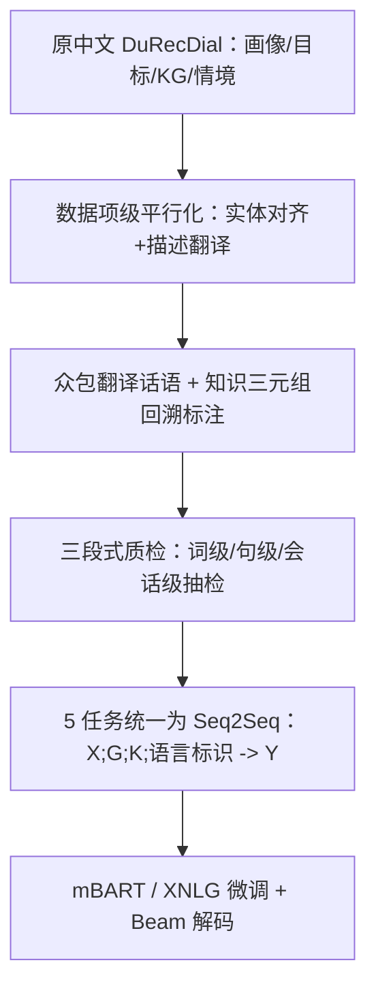
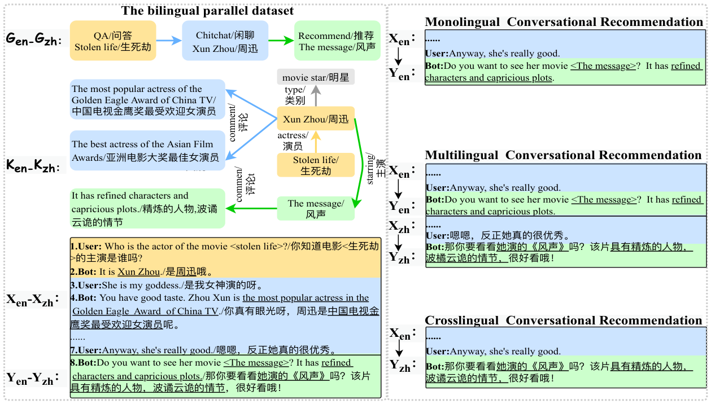

# DuRecDial 2.0: A Bilingual Parallel Corpus for Conversational Recommendation (面向对话推荐的中英双语平行语料)

- **会议/期刊**: EMNLP 2021
- **作者与机构**: Zeming Liu, Haifeng Wang, Zheng-Yu Niu, Hua Wu, Wanxiang Che（哈工大 SCIR / 百度）
- **推荐链路定位**: 端到端生成式（对话式推荐的回复生成与知识落地）
- **研究方向**: 对话推荐与智能体仿真
- **论文原文**: [论文原文链接](https://arxiv.org/abs/2109.08877v1)
- **开源代码**: [开源代码仓库链接](https://github.com/liuzeming01/DuRecDial)

## TL;DR (1分钟核心速览)

对话推荐（CRS）数据集此前清一色单语，无法验证"另一语言数据能否帮到本语言推荐"。本文发布首个中英**数据项级平行**语料 DuRecDial 2.0（8.2k 对齐对话、16.5k 双向对话、255k 平行话语、123k 平行知识三元组），并在其上定义单语 2 个、多语 1 个、跨语 2 个共 5 个任务，用 mBART/XNLG 建立基线。以生成式评测（F1 / BLEU / Knowledge P-R-F1 / LS / UTC + 人工打分）衡量：跨语 EN→ZH（Task 5）相对单语中文（Task 2）F1 从 46.29% → 55.69%（+20.3% 相对），对话级推荐成功率 20% → 33%，sign test $p<0.05$。

## Background & Motivation (背景与核心矛盾)

- **主流范式**: 现有 CRS 语料（REDIAL、GoRecDial、INSPIRED、DuRecDial、TG-ReDial）均为单语；模型侧统一把"上下文 + 对话目标 + 知识"拼成源端序列，交由 Seq2Seq 生成推荐回复。
- **前人局限**: 其一，无任何公开的多语/跨语 CRS 语料，跨语言迁移在推荐场景完全空白；其二，单语中文数据下模型对难见实体（中文影人/影片）生成错误率高，知识错误直接拖垮推荐成功率。
- **核心洞察 (Key Insight)**: 多语预训练模型（mBART/XNLG）已具备跨语表征共享能力，若把"画像-目标-知识-上下文-回复"这类**结构化数据项**先对齐、再翻译话语，则英文侧数据等价于中文任务的一次"隐式数据增广"，且不引入实体漂移。
- **本文切入点**: 不做新模型，而是构造平行语料并系统测度"跨语数据增益"的方向性与边界。

## Method (核心方法设计)

### 1. 整体框架 (Overall Architecture)

流程为三段闭环：先构造**平行数据项**（平行知识图谱、平行用户画像、平行任务模板、平行会话情境），再由通过多轮质检的众包译者以"每 1000 句为一批"翻译话语并标注所用知识三元组；随后把 5 个任务全部规约为"多语 Seq2Seq 生成"——源端拼接 context、goal、knowledge 及目标语言标识，目标端输出回复，用 mBART/XNLG 微调后自回归解码。

<figure class="paper-figure" markdown="span">
  <figcaption>图1：DuRecDial 2.0 数据集上单语、多语和跨语言对话推荐示意图。我们用不同颜色表示不同目标。G、K、X、Y 分别表示对话目标、知识、上下文和回复。</figcaption>
</figure>

### 2. 关键设计拆解 (Key Designs)

1. **数据项级平行构造（先对齐实体，再翻译话语）**：机器翻译直译会漂移 "周迅/《生死劫》"这类中文域实体。作者改为先建平行 KG——影片/影人/音乐/餐饮/POI 的英文名从 4-6 个站点爬取，**至少两站一致**才直接采用，否则众包在多候选中裁决或另行翻译；画像、goal sequence、会话情境均通过"实体替换 + 描述翻译"派生平行版。结果是 16,556 平行实体、254 平行属性、123,298 平行三元组（人工抽检 100 条准确率 >97%），实体级一致性为后续知识准确率提供下限保障。
2. **三段式质检的众包翻译协议**：100 段对话试译后由 3 名数据专家按词级（实体是否与 KG 一致、有无错别字）、句级（准确/口语化/无冗余）、会话级（连贯且与原对话平行）三维度抽检 20%。错误率 >10% 直接淘汰、>3% 返修；二轮 <2% 通过、三轮 <1% 才通过，最终仅留 23 名译者；正式阶段每批抽检 10–20%。该协议使数据质量人工评分为 0.93（0/1 判），并解释了为何"人工翻译语料 > 机器翻译语料"。
3. **五任务的统一建模与训练目标**：单语 (1) $(X_{en},G_{en},K_{en},Y_{en})$、(2)$(X_{zh},G_{zh},K_{zh},Y_{zh})$；多语 (3) 两语实例混入同一训练集、单模型双语言；跨语 (4)$(X_{zh},G_{en},K_{en},Y_{en})$、(5)$(X_{en},G_{zh},K_{zh},Y_{zh})$。统一损失为标准自回归交叉熵$\mathcal{L}=-\sum_{t}\log p_\theta(y_t\mid y_{<t},[X;G;K;\ell])$，$\ell\in\{\text{EN},\text{ZH}\}$ 为目标语言标识；XNLG 另按原有 XM-LM/AE 目标微调编码器与解码器。**全流程无负采样、无候选打分**，推理为 Beam Search 自回归生成，开销随回复长度线性增长，与知识库规模无关。

## Experimental Setup & Evaluation Protocol (实验设置与评估协议)

- **数据集与预处理**: 沿 DuRecDial 的切分沿用其划分，但剔除自动翻译质量差的 news 域，保留 6 域；无 `5-core` 过滤（对话语料不适用 k-core）。

| 数据集 | 语言 | 平行 | #Dialogs | #Utterances | 对话类型 | 领域 |
| :--- | :---: | :---: | :---: | :---: | :--- | :--- |
| REDIAL | EN | ✗ | 10k | 163k | Rec + chitchat | Movie |
| GoRecDial | EN | ✗ | 9k | 170k | Rec | Movie |
| DuRecDial | ZH | ✗ | 10.2k | 156k | Rec/chitchat/QA/task | 7 域 |
| TG-ReDial | ZH | ✗ | 10k | 129k | Rec | Movie |
| **DuRecDial 2.0** | **EN-ZH** | **✓** | **16.5k** | **255k** | 4 类 | 6 域 |

- **数据划分与防穿越 (Splitting Strategy)**: 复用 DuRecDial 的 train/dev/test 划分（原语料为会话级留出），中英两侧共享同一划分索引，**保证平行对齐不跨集**；无时间戳切分（语料为人工构造，无自然时间序）。
- **排名评测协议 (Ranking Protocol)**: 本文**不做 Full-Ranking 或 Sampled Ranking**——任务是自由文本生成，故改为：自动指标 F1、BLEU-1/2、DISTINCT-1/2、Knowledge P/R/F1（生成文本中的实体三元组与标注正解比对）、**LS**（多轮内是否推进至推荐目标）与 **UTC**（是否跟随用户新话题）；人工侧在 turn 级评 Fluency/Appropriateness/Informativeness/Proactivity/Knowledge Accuracy（0–2 分，3 人打分），在 dialog 级评 Coherence 与 Recommendation Success Rate（每模型 30 段人机对话）。这相当于用"知识落地 + 目标达成"替代"候选排序精度"。
- **对比基线与超参设置**: XNLG（跨语预训练 NLG）与 mBART（25 语降噪自编码预训练），均在 5 任务上分别微调，源端追加语言标识；显著性以 sign test 检验（仅跨语 vs 单语对比给出 $p<0.05$）。

## Key Experimental Results (实验关键数据)

### 1. 主实验对比 (Main Results)

人工平行语料 DuRecDial 2.0 上的自动指标与对话级成功率（% ；Rec. 为人工评 30 段对话的推荐接受率）：

| Task | Model | F1 | BLEU-1/2 | Know. P/R/F1 | LS | UTC | Rec. |
| :--- | :--- | :---: | :---: | :---: | :---: | :---: | :---: |
| 1 EN→EN | XNLG | 49.66 | .265/.173 | .244/.291/.260 | 16.31 | 15.18 | 13 |
| 1 EN→EN | mBART | **68.38** | **.325/.245** | **.350/.396/.362** | **28.90** | **24.77** | **17** |
| 2 ZH→ZH | XNLG | 36.58 | .319/.213 | .327/.401/.352 | 22.17 | 20.29 | 23 |
| 2 ZH→ZH | mBART | 46.29 | .363/.259 | .416/.491/.432 | 35.89 | 31.98 | 20 |
| 3 EN→EN | mBART | 64.38 | .268/.192 | .307/.367/.325 | 16.11 | 20.55 | 10 |
| 3 ZH→ZH | mBART | 46.37 | **.366/.241** | .412/.493/.436 | 36.31 | 32.59 | 23 |
| 4 ZH→EN | mBART | 67.43 | .314/.231 | .328/.379/.343 | 24.26 | 23.83 | 13 |
| 5 EN→ZH | mBART | **55.69** | **.430/.325** | **.455/.536/.476** | **38.67** | **32.11** | **33** |

Task 5 vs Task 2：F1 +9.40 abs（`+20.3%`）、Knowledge F1 0.432→0.476（`+10.2%`）、LS +7.7%、Rec. 20→33（`+65%`）；Task 3(ZH) vs Task 2 仅微增（F1 46.37 vs 46.29，LS +1.2%）。

### 2. 消融/对照实验 (Ablation & Controlled Study)

本文无模块消融，以"语料来源 / 数据设置 / 骨干"三组受控对照代替：

| 对照设置 | Task5 F1 | Task5 Know.F1 | Task5 LS | Task1 F1 | Rec.(ZH) |
| :--- | :---: | :---: | :---: | :---: | :---: |
| w/o 人工平行语料（机器翻译替代） | 53.55 | 0.439 | 37.04 | 66.96 | 20 |
| 人工平行语料（完整） | **55.69** | **0.476** | **38.67** | **68.38** | **33** |
| w/o 多语混合（单语 Task2） | 46.29 | 0.432 | 35.89 | — | 20 |
| w/o 跨语（仅双语录混训 Task3-ZH） | 46.37 | 0.436 | 36.31 | — | 23 |
| w/o mBART（换 XNLG 骨干） | 36.77 | 0.355 | 21.57 | 49.66 | 27 |

### 3. 关键实验发现 (Key Findings)

- **增益有方向性且非对称**：跨语 EN→ZH 是全表最强设置（F1 55.69、Rec. 33%），显著优于单语中文与双语录混训；但反向 ZH→EN（Task 4, F1 67.43）不及单语英文（Task 1, 68.38）——因为语料实体多为中文影人，英文预训练语料中几乎不出现，实体生成错误率上升（Knowledge F1 0.362→0.325）。
- **增益的技术中介是"知识落地"而非流畅度**：Task 5 相对 Task 2 的知识 F1（0.432→0.476）与 LS（35.89→38.67）同步提升，人工 Knowledge Accuracy 0.68→0.79、Coherence 0.52→0.60；而 Fluency 几乎持平（1.97→1.97），说明跨语数据主要用于修正实体错配。
- **语料质量比模型规模更敏感**：同一 mBART，人工平行语料相对机器翻译语料在中英方向上分别带来 F1 +3.12（ZH→EN：64.31→67.43）与 +2.14（EN→ZH），而中文侧数值完全不变（46.29），证明增益确实来自英文侧翻译质量而非随机波动；同时 mBART 全面优于 XNLG（Task1 F1 +18.72 abs），说明异语数据只有在足够强的多语表征上才能被"兑现"。

## Highlights & Limitations (亮点、对比与审稿批判)

- **与代表作对比 (vs. Prior Work)**: 相对 REDIAL/GoRecDial，本文引入 goal sequence + KG 约束与**真正平行**的双语数据；相对 DuRecDial 1.0，新增平行化构造与 5 任务评测框架，并把"英文数据能否帮中文推荐"从假设变成可复现实验；相对 XPersona 用翻译 API 造多语数据的做法，本文对数据项先对齐、再人工质检，避免实体漂移。值得注意的是，开场白触发词分布上 DuRecDial 2.0 出现 Do/What/Who/Please 等，而 REDIAL 几乎全为 Hello/Hi/Hey，语言风格更接近真实客服。
- **可迁移亮点**: ①"实体先跨语对齐、话语后翻译"的平行语料构造范式可直接迁移到跨域/跨市场电商对话语料；②用 Knowledge P/R/F1 + LS + UTC 替代 BLEU 作为对话推荐的主评价，能真实反映推荐目标是否被推进。
- **审稿级局限批判**: 其一，5 个任务全部按**机器翻译式 Seq2Seq**实现，模型无显式知识选择与目标规划模块，因而无法回答"增益来自表征共享还是训练集扩容"，也缺失候选级（Full-Ranking）召回评价；其二，绝对性能偏低（Knowledge F1 ≤0.48、推荐成功率最高仅 33%、dialog 级人工评测每模型仅 30 段且仅 3 名评分者），跨语增益的显著性检验也仅在 Task5 vs Task2 上给出；此外语料仅 EN-ZH 两语、平行数据由翻译派生（潜在 translationese），低资源语言的 zero/few-shot 迁移未被检验。

## Rating (四维评分)

- **方法创新性 (Novelty)**: ⭐⭐⭐⭐ （以"平行化数据项 + 5 任务定义"确立首个双语 CRS benchmark，资源贡献明确，但建模侧沿用 MT 式 Seq2Seq，无算法增量）
- **评估协议与实验扎实度 (Protocol & Experiments)**: ⭐⭐⭐ （自动+人工双层评测、LS/UTC 指标设计有针对性，但无 Full-Ranking/采样排序、人工规模小、显著性检验覆盖不足）
- **写作与数学规范度 (Clarity & Rigor)**: ⭐⭐⭐⭐ （任务形式化、构造规则与质检阈值交代清晰、可复算；数学部分仅迁移 XNLG/mBART 目标，理论深度有限）
- **工业落地与复现价值 (Industrial & Practical Value)**: ⭐⭐⭐⭐ （语料与代码全开源、255k 话语可直接做多语客服推荐冷启动训练；但生成式推理延迟与实体幻觉仍是线上化瓶颈）

