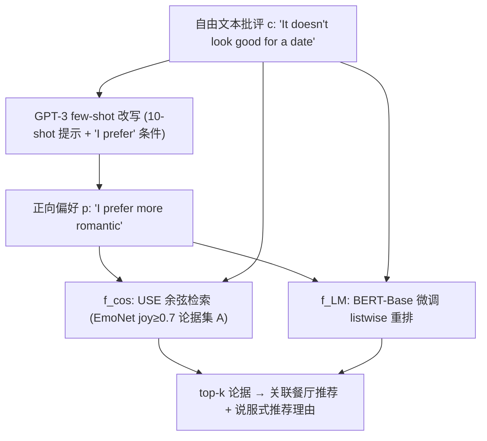

# It doesn't look good for a date: Transforming Critiques into Preferences for Conversational Recommendation Systems (把「不适合约会」翻译成「我更浪漫一点」：面向对话推荐的批评→偏好改写)

- **会议/期刊**: EMNLP 2021 (Main Conference)
- **作者与机构**: Victor S. Bursztyn (Northwestern)、Jennifer Healey / Nedim Lipka / Eunyee Koh (Adobe Research)、Doug Downey (Northwestern & AI2)、Larry Birnbaum (Northwestern)
- **推荐链路定位**: 召回（评论论据检索）+ 重排（论据级 nDCG 排序）
- **研究方向**: 对话推荐与智能体仿真 / 大语言模型推荐
- **论文原文**: [https://arxiv.org/abs/2109.07576v1](https://arxiv.org/abs/2109.07576v1)
- **开源代码**: [https://github.com/vbursztyn/critique-to-preference-emnlp2021](https://github.com/vbursztyn/critique-to-preference-emnlp2021)（含 1020 条餐厅批评–偏好数据集）

## TL;DR (1分钟核心速览)

对话推荐中的用户反馈往往是**负面、隐晦、依赖常识的批评**（“这地方不适合约会”），而评论库里的卖点句却是**正面且具体**的（“完美适合浪漫晚餐”），二者词汇空间严重错位，直接检索必然失败。本文用 GPT-3 few-shot 把批评改写成正向偏好（“我更喜欢浪漫一点的”），再走两条链路：USE 嵌入余弦检索 EmoNet 过滤后的高正向情感评论句，或微调 BERT（MS MARCO 头部方案）对论据做 listwise 重排。在自建 15 家餐厅、1020 条批评的评测集上，嵌入检索 Precision@1 从 0.256 升至 0.574（+124%），BERT 重排 nDCG@1 相对提升 19%（task1/2）至 59%（task3）。

## Background & Motivation (背景与核心矛盾)

- **主流范式**: 批评式推荐（critiquing-based CRS）多在**预定义特征槽位**内让用户“微调属性”（Sun & Zhang 2018；Christakopoulou 2016），或让用户对具体物品打分以获得偏好信号。
- **前人局限**: ① 槽位式系统把可表达的批评锁死在人工特征空间内，无法处理“It has a freaking band!”这种**无显式负面词**的间接抱怨；② 打分式系统虽不依赖特征空间，却极不自然，且与真实人类导购“多轮推荐–批评–再推荐”的对话形态脱节。
- **核心洞察 (Key Insight)**: 批评与偏好之间存在**词汇层面的系统性错位**——批评常以“极性对立”(too casual → fancier)、"常识联想"(有乐队 → 想要安静)、"同类内筛选"(不爱海鲜 → 想要牛肉/鸡肉) 三种方式隐含偏好；只要把批评显式翻译成**正向偏好陈述**，检索空间就与评论卖点句对齐了。
- **本文切入点**: 不做特征空间建模，而是把“批评理解”交给大规模 LM 的 few-shot 语义改写，将开放式批评→开放式正向偏好，再在评论句集合上做内容检索/重排。

<figure class="paper-figure" markdown="span">
  <figcaption>图1：我们的系统将一条批评转化为正面偏好，然后利用客户证言向用户推销一个新选项的示例。</figcaption>
</figure>

## Method (核心方法设计)

### 1. 整体框架 (Overall Architecture)

输入是一轮或多轮拼接的自由文本批评 $c$；先用 10 条人工示例（5 条食物、5 条氛围）作 few-shot 前缀提示 GPT-3（DaVinci，temperature 0.7，top_p 1.0，长度 20），并强制以字符串 “I prefer” 结尾以条件化生成正向偏好$p$。随后$p$（或原始$c$作对照）进入两条并行链路：轻量链路$f_{cos}$在 EmoNet joy ≥ 0.7 过滤出的 2865 条“高正向情感评论句”候选集$\mathcal{A}$中用 Universal Sentence Encoder 做余弦最近邻检索，取 top-3 论据并回溯到所属餐厅；重量链路$f_{LM}$用 MS MARCO 头部方案微调 BERT-Base（10k steps，lr$10^{-5}$，max len 512），对候选论据按与查询的相关性做 listwise 排序。训练/评测均由人工对论据打 3–1 级相关性标签（两折交叉验证）。

### 2. 关键设计拆解 (Key Designs)

1. **Few-shot 批评→偏好改写（Critique Interpretation）**：痛点是不做特征工程就无法把“隐晦负面”映射到“正向需求”。做法是纯提示式生成 $p=\mathrm{GPT3}\big([e_1,\dots,e_{10};\,c;\,\text{“I prefer”}]\big)$，示例刻意覆盖“极性对立/常识联想”两类映射（too expensive → more affordable）。有效性直觉：改写把**检索目标从“否定式排除”变为“肯定式匹配”**，直接消除了查询与评论句之间的极性鸿沟，且对“How come they only serve that much?”这类零负面词批评仍然可解。

2. **情感先验过滤的论据召回 $f_{cos}$**：定义“persuasive argument”= 正向情感明确且对偏好尽量具体的评论句。先以 EmoNet joy 阈值筛出$\mathcal{A}$，再用$\mathrm{Sim}(s_1,s_2)=\cos(\mathrm{Enc}(s_1),\mathrm{Enc}(s_2))$与$f_{cos}(q)=\arg\max_{a\in\mathcal{A}}\mathrm{Sim}(a,q)$ 检索。这样既避免把“抱怨句”当作卖点（情感先验），又保留开放词汇空间（不做特征槽位）。

3. **论据级 listwise 重排 $f_{LM}$与训练目标**：$f_{cos}$ 的向量检索对词汇错位仍敏感，故用强交互重排器补偿。以人工 3–1 相关性标签监督，softmax 损失
$\mathcal{L}=-\log\dfrac{\exp s(q,a^{+})}{\sum_{a\in\mathcal{A}_{q}}\exp s(q,a)}$，其中$s(\cdot)$为 BERT 查询–论据交互打分。为严格检验改写价值，设置三种输入：$f^{crit}_{LM}$（只用批评）、$f^{pref}_{LM}$（只用偏好）、$f^{concat}_{LM}$（二者拼接）；若$f^{crit}_{LM}\approx f^{pref}_{LM}$，则说明强 LM 可自行完成改写、改写模块冗余。推理开销上$f_{cos}$只需一次编码 + ANN 近邻，$f_{LM}$ 每次查询需对 top-15/30 论据逐条前向（单次训练 3–6 小时 GPU）。

## Experimental Setup & Evaluation Protocol (实验设置与评估协议)

- **数据集与预处理**: 领域限定为美国两大都会区 15 家餐厅，每家至多 100 条 4–5 星 Google Places 评论；批评来自早期系统用户研究（46 条）+ Circa 数据集改编（294 条），并随机拼接成 2 轮/3 轮复合批评以模拟长对话（排除自相矛盾组合）。

| 数据集 | #Restaurants | #Review Sents | #Positive Args ($\mathcal{A}$) | #Critiques | 稀疏度/说明 |
| :--- | :---: | :---: | :---: | :---: | :--- |
| Restaurant Critique (自建) | 15 | 5,744 (来自 1,455 条评论) | 2,865 (joy ≥ 0.7) | 340 单轮 + 340 双轮 + 340 三轮 = 1,020 | 改写成功率 87.6% (298/340)；每餐厅约 191 条可用论据 |

- **数据划分与防穿越 (Splitting Strategy)**: 非时序的用户/物品划分，而是**查询级两折交叉验证**（`2-fold CV`，按 query 切分训练/测试的论据相关性标签）；批评与餐厅无重叠泄漏风险，但同一餐厅的评论句可能跨折出现。
- **排名评测协议 (Ranking Protocol)**: `Sampled Ranking` —— $f_{cos}$每查询取 top-3 论据由人工标注 accurate/inaccurate，报 Precision@1/2/3；$f_{LM}$先由$f^{crit}_{cos}$与$f^{pref}_{cos}$ 各取 top-15 构成 15/15/30 条候选（task1/task2/task3），人工打 3–1 级相关性后报 nDCG@1/3/5/10。标注一致性 Cohen's Kappa = 0.71（Precision）/ 0.73（nDCG），属强一致。**未做全库 Full-Ranking，亦未做显著性检验。**
- **对比基线与超参设置**: 无传统 CF/序列推荐基线，仅在**同一框架内做输入消融**（crit vs pref vs concat）；GPT-3 为 DaVinci API，BERT-Base 10k steps / lr $10^{-5}$ / len 512。

## Key Experimental Results (实验关键数据)

### 1. 主实验对比 (Main Results)

**表 1：嵌入检索 $f_{cos}$（1020 条批评，人工标注 top-3）**

| 方法 | 输入 | P@1 | P@2 | P@3 |
| :--- | :--- | :---: | :---: | :---: |
| $f^{crit}_{cos}$ | 原始批评 | 0.256 | 0.251 | 0.250 |
| $f^{pref}_{cos}$ | 改写后偏好 | **0.574** | **0.546** | **0.525** |
| Improv. | — | **+124.2%** | **+117.5%** | **+110.0%** |

**表 2：BERT 论据重排 $f_{LM}$（nDCG，2-fold CV 均值，加粗为各任务各列最优）**

| 任务 / 输入 | nDCG@1 | nDCG@3 | nDCG@5 | nDCG@10 |
| :--- | :---: | :---: | :---: | :---: |
| task1 (15 条 crit 召回) – $f^{crit}_{LM}$ | 0.617 | 0.674 | 0.723 | 0.811 |
| task1 – $f^{pref}_{LM}$ | **0.731** | **0.753** | **0.773** | **0.858** |
| task1 – $f^{concat}_{LM}$ | 0.726 | 0.740 | **0.773** | 0.844 |
| task2 (15 条 pref 召回) – $f^{crit}_{LM}$ | 0.676 | 0.754 | 0.805 | **0.865** |
| task2 – $f^{pref}_{LM}$ | 0.729 | 0.761 | **0.808** | 0.856 |
| task2 – $f^{concat}_{LM}$ | **0.805** | **0.772** | **0.808** | 0.863 |
| task3 (30 条混合) – $f^{crit}_{LM}$ | 0.498 | 0.537 | 0.605 | 0.660 |
| task3 – $f^{pref}_{LM}$ | **0.790** | **0.754** | **0.758** | **0.791** |
| task3 – $f^{concat}_{LM}$ | 0.686 | 0.663 | 0.685 | 0.746 |
| Improv.(pref vs crit, @1) | task1 +18.5% / task2 +19.1%(concat) / task3 +58.6% | | | |

### 2. 消融实验 (Ablation Study)

对 340 条单轮批评逐条比较 $f^{pref}_{cos}$是否优于$f^{crit}_{cos}$，并将优势案例按批评模式归因：

| 消融/归因项 | 数量 | 占比 | 说明 |
| :--- | :---: | :---: | :--- |
| 改写带来正收益的案例 | 170 / 340 | 50.0% | 相对提升来源 |
| ① 极性对立推断 (too casual → fancier) | 40 | 24% | 批评与偏好共享词汇但极性相反 |
| ② 常识联想推断 (有乐队 → 想要安静) | 78 | 46% | 词汇完全不重叠，纯常识跳跃 |
| ③ 同类特征内筛选 (不爱海鲜 → 要牛肉/鸡肉) | 38 | 22% | 需在子类别内做排除 |
| 未归类 | 14 | 8% | 混合/边缘情形 |
| 改写失败（GPT-3 输出含糊） | 42 / 340 | 12.4% | 取 3 次采样最优后仍不可用 |

### 3. 关键实验发现 (Key Findings)

- **改写是主增益源，而非检索器能力**：即使 BERT 重排已很强，$f^{pref}_{LM}$仍比$f^{crit}_{LM}$ 在 task1（**与批评更近的候选池，理论上 crit 占优**）上 nDCG@1 高 18.5%，说明“语义改写”信息独立于“交互式匹配能力”，两者不可互相替代；task3 混合池上差距拉大到 +58.6%，因为原始批评在 30 条候选里根本无法区分正负极性。
- **拼接不等于改写**：$f^{concat}_{LM}$在 task2 上 nDCG@1 最高（0.805，+19.1%），但在 task3 上骤降至 0.686（甚至低于 task2 的 crit），说明把批评与偏好直接拼进输入会让模型在混合候选池中失去极性信号；显式改写（只喂正向偏好）更稳健，$f^{pref}_{LM}$ 在 task3 四项指标全胜。
- **增益随排序深度衰减但语义改写不衰减**：task1 上 pref vs crit 的 nDCG@1/+18.5% 到 nDCG@10 收敛至 +5.8%，符合“深位置有更多容错候选”的常识；而 task3 的 nDCG@10 仍有 +19.8%，且 46% 的收益案例属于“零词汇重叠的常识联想”，证明改写真正解决的是**查询–文档词汇错位**问题，而非简单的同义词扩展。

## Highlights & Limitations (亮点、对比与审稿批判)

- **与代表作对比 (vs. Prior Work)**: 相比槽位式批评系统（Chen & Pu 2012）与打分式 elicit 系统（Christakopoulou 2016），本文**不预设任何特征空间**，把批评理解显式化为生成任务，并将推荐落点从“物品”转为“可解释的评论论据”（说服式推荐理由）；相比 Penha & Hauff (2020) 用 BERT 推断 related items/genres，本文聚焦**批评→偏好的定向改写**并给出可量化增益。
- **可迁移亮点**: ① “查询改写以对齐评价文本极性”这一招可直接搬到电商/短视频的评论驱动推荐与冷启动卖点生成；② 用 EmoNet 情感阈值预筛候选论据，是廉价但有效的“候选池净化”技巧，可替代昂贵的强模型过滤。
- **审稿级局限批判**: ① **评估规模与协议薄弱**：仅 15 家餐厅、100 条查询做 BERT 训练/测试、无 Full-Ranking、无传统 CRS/CF 基线、无显著性检验，+124% 这类巨大相对增益很可能源于基线过弱（随机级 P@1=0.256）；② **GPT-3 依赖与可复现性**：DaVinci API + temperature 0.7 + 三次采样取优，改写成功率仅 87.6%，成本、延迟与结果稳定性均未报告，且未与开源小模型（如 T5/FLAN）对齐成本–收益；③ 只做“rule in”不做“rule out”，无法主动排除不合适的餐厅，多轮对话也仅以批评拼接模拟，非真实交互。

## Rating (四维评分)

- **方法创新性 (Novelty)**: ⭐⭐⭐ （把“批评理解”重构为生成式查询改写，任务视角新；但技术组件（few-shot 提示 + USE 检索 + BERT 重排）均为现成模块拼接，无新算子或理论分析）
- **评估协议与实验扎实度 (Protocol & Experiments)**: ⭐⭐ （仅 100 条查询 Sampled Ranking、无 Full-Ranking、无外部 SOTA 基线、无显著性检验，Kappa 一致性是少数亮点）
- **写作与数学规范度 (Clarity & Rigor)**: ⭐⭐⭐⭐ （问题定义、提示模板、两种检索器与三类批评模式讲得干净，公式简洁可复现；但对 GPT-3 成本/延迟与改写失败案例讨论不足）
- **工业落地与复现价值 (Industrial & Practical Value)**: ⭐⭐⭐ （代码与 1020 条批评–偏好数据集开源，论据级“说服式理由”对导购/电商非常有价值；但依赖付费大模型 API，15 家餐厅规模离线上部署仍远）

