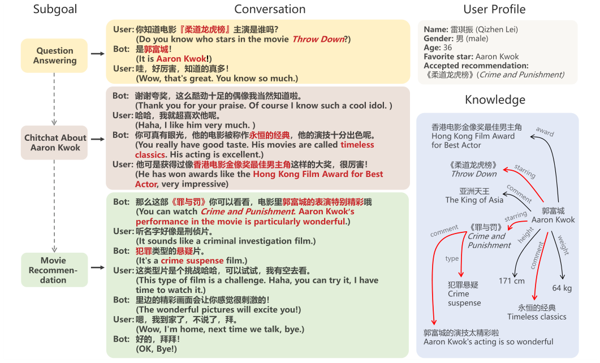
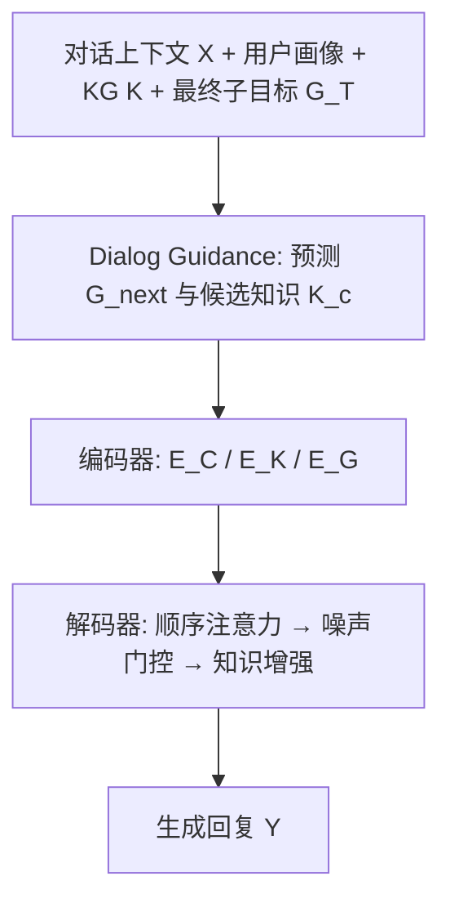
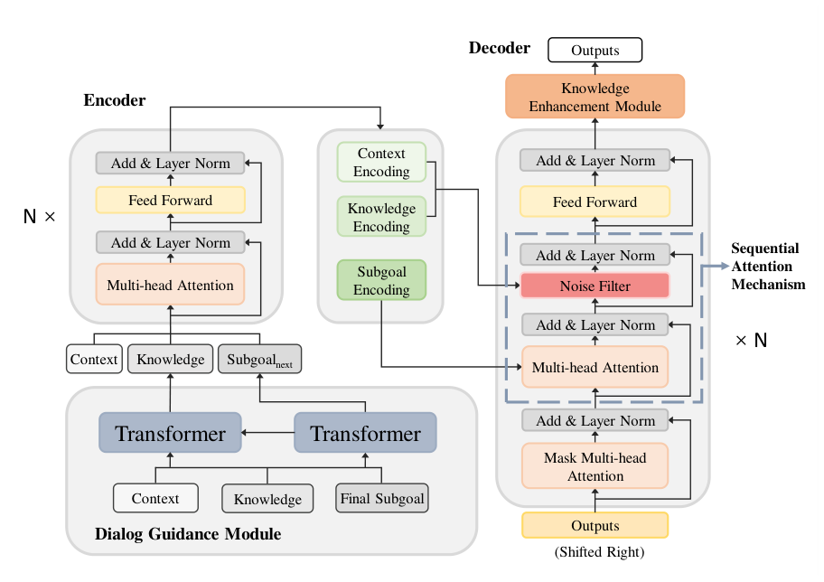

# KERS: A Knowledge-Enhanced Framework for Recommendation Dialog Systems with Multiple Subgoals (知识增强的多子目标推荐对话系统框架)

- **会议/期刊**: Findings of EMNLP 2021
- **作者与机构**: Jun Zhang, Yan Yang, Chengcai Chen, Liang He, Zhou Yu；华东师范大学、小 i 机器人、哥伦比亚大学
- **推荐链路定位**: 端到端生成式（多子目标对话推荐回复生成）
- **研究方向**: 对话推荐与智能体仿真 / 图神经网络与知识图谱推荐
- **论文原文**: [论文原文链接](https://aclanthology.org/2021.findings-emnlp.94.pdf)
- **开源代码**: [开源代码仓库链接](https://github.com/z562/KERS)

## TL;DR (1分钟核心速览)

面向 DuRecDial 多子目标对话推荐，MGCG 将整张知识图谱喂给生成器，带来知识噪声与计算浪费。KERS 先预测下一子目标，再生成头实体/关系并检索候选知识，解码端以顺序注意力、知识门控和知识词典增强抑制无关三元组。按 6.5:1:2.5 划分，在 DuRecDial 上相对 MGCG_G：F1 +14.45、知识 F1 +15.36、PPL -8.17，人工偏好率 78.3%。

## Background & Motivation (背景与核心矛盾)

- **主流范式**: DuRecDial 将推荐对话拆为 chitchat、QA、推荐等 21 类子目标；MGCG 先规划子目标序列，再从全知识图谱抽取知识生成回复。
- **前人局限**: 全 KG 输入噪声大且训练慢；子目标只用于“规划”，未细粒度约束每轮知识选择，错误三元组会直接污染推荐与问答。
- **核心洞察 (Key Insight)**: 不同子目标所需知识不同，且并非每轮都需要知识；应先“选候选知识”，再在解码时动态门控。图 1 即展示了多子目标依次推进、知识随阶段切换的典型对话。

<figure class="paper-figure" markdown="span">
  <figcaption>图1：多子目标推荐对话中丰富知识的示例。对话基于知识图谱。该任务可视为依次完成多个子目标。红色文字表示知识相关信息，红色箭头表示选中的知识三元组。</figcaption>
</figure>

- **本文切入点**: 用子目标序列与候选知识作为先验，在解码端加入顺序注意力、噪声过滤器与知识增强，兼顾信息量与准确性。

## Method (核心方法设计)

### 1. 整体框架 (Overall Architecture)

KERS 将每轮输入拆为对话上下文 $X$、用户画像与 KG$K$、最终推荐子目标$G_T$。Dialog Guidance 先预测$G_{\text{next}}$，再生成头实体/关系得到候选知识$K_c$；编码器分别编码$X,K_c,G'_{\text{next}}$；解码器按“自注意力→子目标→上下文/知识门控→FFN”生成回复。训练分两阶段：先训子目标与知识生成，再以交叉熵优化回复；推理自回归解码。

<figure class="paper-figure" markdown="span">
  <figcaption>图2：知识增强的多子目标驱动推荐系统（KERS）的架构。</figcaption>
</figure>

### 2. 关键设计拆解 (Key Designs)

1. **Dialog Guidance：先规划子目标，再生成候选知识**：MGCG 从全 KG 取知识，本文改为两段式生成。先以 $X,K',G_T$ 预测下一子目标，再用生成的头实体/关系匹配 KG 三元组；无标注知识用字符级 F1>0.35 构造伪标签训练知识生成器。核心目标为：
   $\mathcal{L}_{G,K}=\sum_i-\log P(g_i^{\text{next}}\mid X,K',G_T,g_{<i}^{\text{next}})-\log P(k_i^w\mid G_{\text{next}},X,K',G_T,k_{<i}^w)$。
   这样只生成 head/relation 即可锁定候选知识，降低搜索空间，子目标预测准确率达 96.60%。

2. **顺序注意力 + 噪声过滤器：让子目标先约束，再筛知识**：解码器先做 token 自注意力，再以子目标 $E_G$ 为条件提取信息，最后用知识门控融合上下文与知识：
   $O_C=\mathrm{MHA}(O_G,E_C,E_C),O_K=\mathrm{MHA}(O_G,E_K,E_K)$，
   $\alpha_k=\sigma(W_k[O_C;O_K]),O_{KG}=O_C+(1-\alpha_k)O_C+\alpha_kO_K$。
   $\alpha_k$ 根据知识与上下文匹配度自适应衰减；当回复不需知识或知识与场景无关时，模型退回上下文主导，避免“强行引用”。

3. **知识增强与训练目标：提高知识词曝光，但不牺牲流畅度**：用可学习权重 $\alpha_g=\sigma(W_gO_{\text{dec}})$调整知识词典$K'$ 内外的词概率：
   $P_o(y_j)=\mathrm{softmax}\left(\begin{cases}\alpha_gH(y_j), & y_j\notin K'\\ H(y_j), & y_j\in K'\end{cases}\right)$，
   再优化 $\mathcal{L}_{RG}=-\sum_j o_j\log P_o(y_j)$。$\alpha_g$ 低时知识词相对被放大，模型自动学习在合适轮次“说出来”。生成式任务无负采样；两阶段训练，推理自回归，训练约 50 min/epoch。

## Experimental Setup & Evaluation Protocol (实验设置与评估协议)

- **数据集与预处理**: DuRecDial 为中文推荐对话，含 21 类子目标与 222,198 条知识三元组；未做 5-core 过滤，按对话级 6.5:1:2.5 划分。

| 数据集 | #Dialogues | #Subgoals | #KG triples | 划分 | 场景说明 |
| :--- | :---: | :---: | :---: | :---: | :--- |
| DuRecDial | 10,190 | 21 | 222,198 | 6.5:1:2.5 | 电影/音乐/餐厅/新闻等中文推荐对话 |

- **数据划分与防穿越 (Splitting Strategy)**: 采用固定比例划分，非 Leave-One-Out，也非全局时间戳切分；训练/验证/测试对话互不重叠。
- **排名评测协议 (Ranking Protocol)**: 本文是生成式对话任务，**不采用 Full-Ranking / Sampled Ranking**；自动指标为 PPL、F1、BLEU-1/2、DIST-2、Knowledge F1，并报告子目标预测与知识预测准确率。
- **对比基线与超参设置**: 基线含 S2S+kg、Trans.、Trans.+kg、MGCG_R、MGCG_G；编码器/解码器各 6 层 Transformer、12 头、768 维、词表 30k、最大上下文 768。人工评测含 5 名标注者（200 个 turn 样本）与 10 名专业评测者（60 个对话场景）；pairwise 用 t-test，$p<0.05$；Fleiss kappa 0.60–0.81。

## Key Experimental Results (实验关键数据)

### 1. 主实验对比 (Main Results)

| 模型 | PPL↓ | F1↑ | BLEU-1↑ | BLEU-2↑ | DIST-2↑ | Knowledge F1↑ | 训练 min/epoch |
| :--- | :---: | :---: | :---: | :---: | :---: | :---: | :---: |
| S2S+kg | 24.75 | 24.52 | 0.1649 | 0.0792 | 0.0131 | 8.37 | 27 |
| Trans. | 9.78 | 41.79 | 0.3925 | 0.2883 | 0.0502 | 27.76 | 44 |
| Trans.+kg | 9.40 | 44.73 | 0.4192 | 0.3180 | 0.0554 | 31.82 | 46 |
| MGCG_R | — | 33.93 | — | 0.2320 | **0.1870** | — | — |
| MGCG_G | 16.51 | 36.02 | 0.3403 | 0.2351 | 0.0574 | 23.67 | 30 |
| **KERS** | **8.34** | **50.47** | **0.4629** | **0.3619** | 0.0790 | **39.03** | 50 |

相对 MGCG_G：F1 +14.45（+40.1%）、Knowledge F1 +15.36（+64.9%）、PPL -8.17（-49.5%）、BLEU-2 +53.9%。MGCG_R 的 DIST-2 更高，但其为检索式模型，F1/知识准确性明显落后。

### 2. 消融实验 (Ablation Study)

| 变体 | PPL↓ | F1↑ | DIST-2↑ | Knowledge F1↑ | 训练 min/epoch |
| :--- | :---: | :---: | :---: | :---: | :---: |
| KERS | **8.34** | **50.47** | **0.0790** | **39.03** | 50 |
| w/o DiaGuidance | 8.80 | 47.51 | 0.0812 | 35.10 | 37 |
| w/o Subgoal | 8.76 | 48.95 | 0.0821 | 37.98 | 46 |
| w/o CandidateKnow | 8.58 | 49.61 | 0.0751 | 37.01 | 43 |
| + Topic | 8.40 | 49.40 | 0.0761 | 37.07 | 45 |
| w/o NoiseFilter | 8.44 | 48.98 | 0.0765 | 38.27 | 54 |
| w/o KnowEnhance | 8.56 | 49.21 | 0.0682 | 37.82 | 49 |
| + AllKnowledge | 8.50 | 49.20 | 0.0782 | 36.73 | 105 |

### 3. 关键实验发现 (Key Findings)

1. **子目标规划是最大增益源**：移除 DiaGuidance 后 F1 由 50.47 跌至 47.51、Knowledge F1 由 39.03 跌至 35.10；96.60% 子目标准确率与 75.6% 知识预测准确率说明“先选后生成”提供了强先验。
2. **候选知识优于全量知识**：AllKnowledge 的 Knowledge F1 仅 36.73，且训练 105 min/epoch；KERS 用候选知识达 39.03，训练时间减半，说明全 KG 输入主要引入噪声而非信息。
3. **门控与增强互补，顺序也重要**：去掉 NoiseFilter 后 F1 降至 48.98、Knowledge F1 降至 38.27；去掉 KnowEnhance 后 DIST-2 由 0.0790 降至 0.0682。Reverse/Monolayer 的 F1 仅 49.42/49.40，低于 KERS 的 50.47。

## Highlights & Limitations (亮点、对比与审稿批判)

- **与代表作对比 (vs. Prior Work)**: 相较 MGCG_G，KERS 不再用全 KG 生成，而以子目标驱动候选知识；相较 Trans.+kg，本文多了噪声门控与知识词典增强，避免“所有知识一股脑拼接”。
- **可迁移亮点**: 标量知识门控 $\alpha_k$ 可直接迁移到外部知识增强的对话推荐/召回重排；字符 F1 伪标签策略可用于无知识标注的对话数据。
- **审稿级局限批判**: 仅在中文 DuRecDial 验证，跨语言/跨域泛化未知；知识预测仍有 24.4% 错误，噪声门控是补救而非根治；自动指标未报显著性，人工评测样本量（200 turns/60 场景）有限；训练 50 min/epoch 高于 MGCG_G 的 30 min。

## Rating (四维评分)

- **方法创新性 (Novelty)**: ⭐⭐⭐⭐ （将多子目标规划、候选知识生成与解码门控统一，机制组合新颖，但单点算子较常规）
- **评估协议与实验扎实度 (Protocol & Experiments)**: ⭐⭐⭐ （自动+人工评估完整，含消融与 pairwise，但仅单数据集且自动指标缺显著性检验）
- **写作与数学规范度 (Clarity & Rigor)**: ⭐⭐⭐⭐ （架构与公式清晰，三模块职责分明；部分符号与训练细节可更展开）
- **工业落地与复现价值 (Industrial & Practical Value)**: ⭐⭐⭐ （代码开源、门控思想易用，但 6+6 层 Transformer 训练开销较高，领域依赖中文 DuRecDial）

