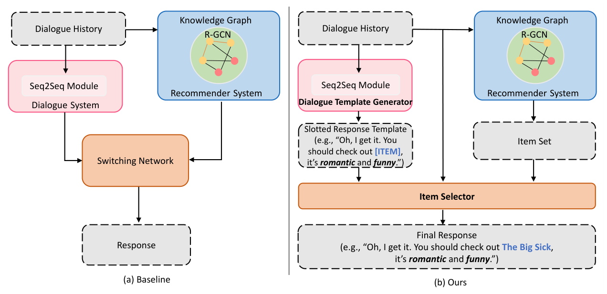
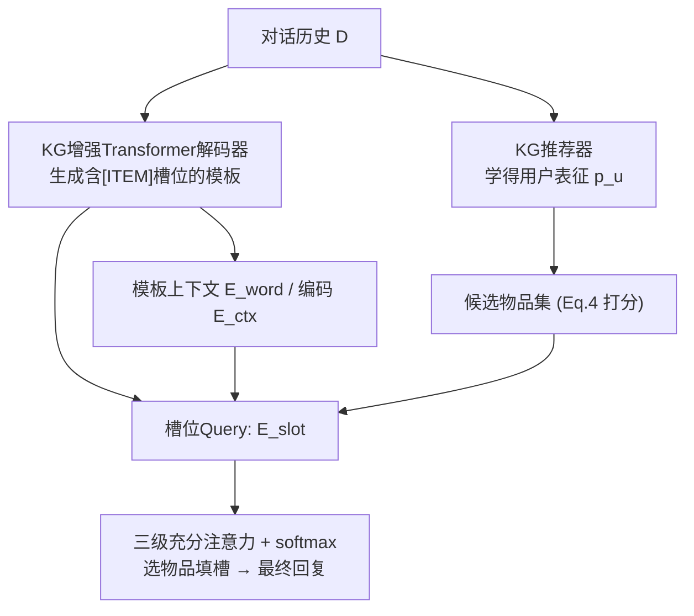
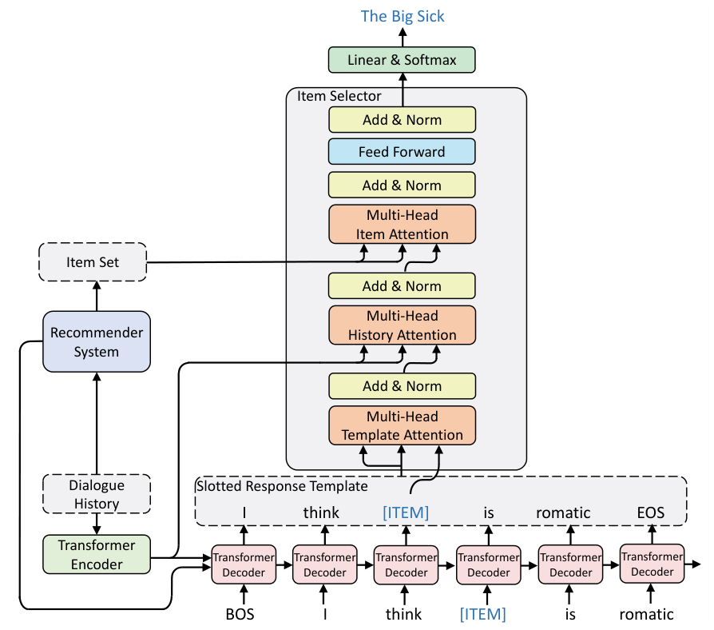

# Learning Neural Templates for Recommender Dialogue System (面向推荐对话系统的神经模板学习)

- **会议/期刊**: EMNLP 2021 (Long Paper)
- **作者与机构**: Zujie Liang, Huang Hu, Can Xu, Jian Miao 等；中山大学 & 微软 STCA
- **推荐链路定位**: 对话式端到端生成（模板生成 + 槽位物品召回填充）
- **研究方向**: 对话推荐与智能体仿真 / 生成式推荐
- **论文原文**: [arXiv:2109.12302v1](https://arxiv.org/abs/2109.12302v1)
- **开源代码**: [github.com/jokieleung/NTRD](https://github.com/jokieleung/NTRD)

## TL;DR (1分钟核心速览)

开放域对话推荐 (CRS) 长期受困于"物品插不进、新物品推不出"两大痛点：Switching/Copy 机制难以在自由文本中精确嵌入推荐物品，且模型只会推荐训练语料中出现过的物品。NTRD 将对话生成与物品推荐**解耦**为两阶段——先用 KG 增强的 Transformer 解码器生成含 `[ITEM]` 槽位的回复模板，再用渐进式充分注意力选择器从候选池填充槽位。在 ReDial（80/10/10 划分）上，ReR@1 从 0.889 → 1.806、ReR@50 从 1.733 → 31.59（提升近 18 倍），Dist-4 提升 71%，并实现 13.40% 的新物品零样本推荐率（KGSF 为 0）。

## Background & Motivation (背景与核心矛盾)

- **主流范式**: 开放域 CRS 通常由推荐模块 + 对话模块组成，靠 Switching Network 或 Copy 机制在解码时逐 token 决定"生成词"还是"拷贝物品"，整体概率为 $P(w_o)=p_s P_{dial}(w)+(1-p_s)P_{rec}(i)$。
- **前人局限**: ① 逐 token 的二选一开关无法保证物品被精确、得体地嵌入回复（KGSF 的 ReR@1 仅 0.889%）；② 目标物品必须在训练语料中出现、且在词表/物品池中有对应 embedding，否则永无推荐机会。
- **核心洞察 (Key Insight)**: 物品的插入位置（语义上"该放电影名的槽位"）与槽位里填什么物品，其实是两个可分离的子问题——前者只依赖对话语义结构，后者只依赖用户偏好与候选池。
- **本文切入点**: 用 `[ITEM]` 特殊 token 把训练语料中所有电影名 mask 掉，让解码器只学"何处开槽"，物品选择交给一个独立、可插拔的选择器，从而兼容频繁更新的推荐系统。

<figure class="paper-figure" markdown="span">
  <figcaption>图1：现有框架与本文提出的 NTRD 框架的模块对比。</figcaption>
</figure>

## Method (核心方法设计)

### 1. 整体框架 (Overall Architecture)

给定对话历史 $D=\{s_1,...,s_t\}$，KG 增强的 Transformer 编码器-解码器先生成一条把目标物品替换为 `[ITEM]` 的**回复模板**（如 "You should check out [ITEM], it's romantic and funny."）；随后物品选择器以槽位隐状态为 Query，依次与模板其余词、对话上下文编码、候选物品集合做三级注意力交互，输出候选池上的物品分布并按最高分填槽；两模块以$\mathcal{L}=\lambda\mathcal{L}_{gen}+\mathcal{L}_{slot}$ 端到端联合训练，推理时模板用贪心解码、遇到 `[ITEM]` 即调用选择器。

<figure class="paper-figure" markdown="span">
  <figcaption>图2：本文方法概览。带槽位的回复模板首先由 Transformer 解码器生成，然后由物品选择器用合适的物品填充槽位。我们的框架以渐进方式使生成的模板、对话历史和候选物品之间进行充分的信息交互，有助于选择更合适的物品填入槽位位置。</figcaption>
</figure>

### 2. 关键设计拆解 (Key Designs)

1. **响应模板生成器（把"推荐什么"从生成分布里剥离）**：传统解码器词表里没有物品语义，Switch 开关学到的是混合策略。NTRD 在词表新增 `[ITEM]` 并把语料里所有电影名统一替换，使输出分布简化为 $\hat{P}_{dial}(w)=\mathrm{softmax}(\mathbf{W}_d \mathbf{e}+\mathbf{b}_d)$。直觉：一旦槽位位置由语言模型学定，"要不要推荐"和"推荐哪个"不再耦合，且缩小了有效词表规模，反而提升了开槽概率（Item Ratio 31.5→66.77）。

2. **渐进式充分注意力物品选择器（模板上下文成为选物品的证据）**：现有方法只依据对话历史推断物品，忽略了回复中槽位后紧跟的语义线索（如 "romantic and funny"）。NTRD 以槽位嵌入 $\mathbf{E}_{slot}$ 为 Query 堆叠三层 MHA：

$$\hat{\mathbf{E}}_{slot}=\mathrm{MHA}(\mathbf{E}_{slot},\mathbf{E}_{word},\mathbf{E}_{word}),\quad \mathbf{E}'_{slot}=\mathrm{MHA}(\hat{\mathbf{E}}_{slot},\mathbf{E}_{ctx},\mathbf{E}_{ctx}),\quad \mathbf{E}''_{slot}=\mathrm{MHA}(\mathbf{E}'_{slot},\mathbf{H}_{cand},\mathbf{H}_{cand})$$

即"槽位 ← 模板词 → 对话上下文 → 候选物品"由近及远逐层融合，最终 $P_{rec}(w)=\mathrm{softmax}(\mathbf{W}_r \mathbf{e}'_{slot}+\mathbf{b}_r)$ 在候选池上打分。物理直觉：模板中的修饰语为物品筛选提供了**显式语义约束**，等价于把自然语言生成结果反哺检索。

3. **训练目标、候选构造与推理效率**：推荐器沿用 KGSF 的双 KG + MIM 预训练，用户表征 $\mathbf{p}_u$与物品嵌入按$\mathrm{sim}(m)=\mathrm{softmax}(\mathbf{p}_u^{\top}\mathbf{h}_m)$打分取候选集$\mathcal{M}_t$。损失为模板交叉熵与槽位交叉熵加权$\mathcal{L}=\lambda\mathcal{L}_{gen}+\mathcal{L}_{slot}$，$\lambda=5$ 使模板生成主导优化（避免稀疏的物品监督压垮语言建模）。全程无负采样；推理仅需一次模板贪心解码 + 一次候选池打分，开销与 KGSF 同阶。

## Experimental Setup & Evaluation Protocol (实验设置与评估协议)

- **数据集与预处理**: ReDial 电影推荐对话基准，按 80/10/10 比例随机划分：

| 数据集 | #Users | #Items | #Interactions | 稀疏度/密度 | 特征/场景说明 |
| :--- | :---: | :---: | :---: | :---: | :--- |
| ReDial | 10,006 会话 | 6,924 电影 | 182,150 句 | — | 双角色 (Seeker/Recommender) 众包电影推荐对话；含 word-KG 与 item-KG |

- **数据划分与防穿越 (Splitting Strategy)**: 标准 `比例划分`（80% train / 10% valid / 10% test），未采用会话级时间切分；新物品实验额外剔除训练集中出现的 373 个测试物品以构造零样本评测。
- **排名评测协议 (Ranking Protocol)**: 物品侧为 `Full-Ranking`（在候选物品池 $\mathcal{M}_t$ 上做全量 softmax 排序）；关键创新是**在最终回复文本上**度量 ReR@k——检查回复中槽位处 top-k 概率是否命中真值物品（ReR@1 为实际嵌入回复的命中率），并统计 Item Diversity 与 Item Ratio 反映推荐在回复中的覆盖度。
- **对比基线与超参设置**: 基线为 REDIAL（AutoEncoder+HRED）、KBRD（单 KG + 词汇 bias）、KGSF（双 KG + Switch）；物品嵌入 $d_h=128$、对话嵌入$d_e=300$，Adam lr=$10^{-3}$，batch=32，梯度裁剪$[0,0.1]$，显著性以重跑均值对比（未报告$p$ 值）。

## Key Experimental Results (实验关键数据)

### 1. 主实验对比 (Main Results)

| Model | PPL↓ | Dist-2 | Dist-3 | Dist-4 | ReR@1 | ReR@10 | ReR@50 | Item Div. | Item Ratio |
| :--- | :---: | :---: | :---: | :---: | :---: | :---: | :---: | :---: | :---: |
| REDIAL | 28.1 | 0.225 | 0.236 | 0.228 | — | — | — | — | 15.8 |
| KBRD | 17.9 | 0.263 | 0.368 | 0.423 | — | — | — | — | 29.6 |
| KGSF (SOTA) | 5.55 | 0.305 | 0.466 | 0.589 | 0.889 | 1.083 | 1.733 | 6.03 | 31.5 |
| **NTRD (ours)** | **4.41** | **0.578** | **0.820** | **1.005** | **1.806** | **12.503** | **31.592** | **11.05** | **66.77** |
| Improv. | +20.5% | +89.5% | +76.0% | +70.6% | +103.1% | +1054% | +1723% | +83.3% | +112.0% |

人工评测（1–3 分，Fleiss' κ > 0.6）：KGSF (Fluency 2.24 / Inform. 1.92) vs NTRD (2.48 / 2.16)，人类参照 (2.85 / 2.37)。新物品实验：KGSF 0.00% vs NTRD **13.40%**（373 个新物品中 50 个被成功推荐）。

### 2. 消融实验 (Ablation Study)

原文未提供组件级消融表，以下以"耦合式 Switch vs 解耦模板填槽"作对照性证据：

| 设置 | ReR@1 | ReR@50 | Item Ratio | Novel Ratio |
| :--- | :---: | :---: | :---: | :---: |
| 耦合 Switch（KGSF） | 0.889 | 1.733 | 31.5 | 0.00 |
| 仅模板不加选择器上下文（隐含） | — | — | 显著依赖候选池质量 | ≥0 |
| **解耦模板 + 充分注意力（NTRD）** | **1.806** | **31.592** | **66.77** | **13.40** |

### 3. 关键实验发现 (Key Findings)

1. **瓶颈在"嵌入位置"而非"排序能力"**：KGSF 推荐模块本身可用，但 ReR@1 仅 0.889%，说明开关机制把已召回物品"漏写"；解耦后 ReR@50 暴涨 17 倍，证明模板+填槽能把候选池排序准确落纸。
2. **`[ITEM]` token 缩表反哺开槽**：Item Ratio 从 31.5 升至 66.77，因为词表被 slot 归一化后，解码器对"该处应开槽"的先验显著增强。
3. **零样本能力源于架构而非数据**：13.40% 新物品命中率来自选择器只看候选嵌入、不依赖语料共现；这使 NTRD 可对接频繁更新的线上推荐器而无需重训对话模型。

## Highlights & Limitations (亮点、对比与审稿批判)

- **与代表作对比 (vs. Prior Work)**: 相较 KGSF，NTRD 保留其双 KG 推荐器但**彻底移除 Switch 开关**，把"生成什么"和"推荐什么"职责分离；相较 MGCG 等多目标对话生成工作，NTRD 输出的是结构化模板而非端到端自由文本，可控性更强。
- **可迁移亮点**: ① 用特殊 token mask 目标实体、将检索/生成解耦的"模板-填槽"范式可迁移至电商导购、POI 推荐等需在回复中嵌入实体名的场景；② 三级渐进 MHA 可当作轻量 reranker，把生成文本作为检索上下文。
- **审稿级局限批判**: ① 只有单一 `[ITEM]` 占位符承载全部实体提及（如比较类回复 "A is better than B" 需多个不同槽），细粒度槽位缺失；② 选择器候选池由上游推荐器给定，端到端联合优化的重排增益未被验证；③ 仅 ReDial 一个数据集、80/10/10 随机划分带来的信息泄漏风险未讨论；④ 缺少逐组件消融与显著性检验，$p<0.05$ 仅为"bold 表示显著"的声明性说法。

## Rating (四维评分)

- **方法创新性 (Novelty)**: ⭐⭐⭐⭐ （以 `[ITEM]` 解耦生成与推荐的思路简洁有效，充分注意力选择器设计合理，但机制层面偏工程组合）
- **评估协议与实验扎实度 (Protocol & Experiments)**: ⭐⭐⭐ （提出 ReR@k 这一贴近真实体感的新指标与零样本评测是亮点，但仅单数据集、缺消融和显著性检验）
- **写作与数学规范度 (Clarity & Rigor)**: ⭐⭐⭐⭐ （公式简洁、Eq.5 三级注意力表述清楚，但符号排版有小笔误且缺复杂度分析）
- **工业落地与复现价值 (Industrial & Practical Value)**: ⭐⭐⭐⭐⭐ （代码开源，模板可插拔对接任意推荐器、支持新物品免重训，工程迁移成本低）

