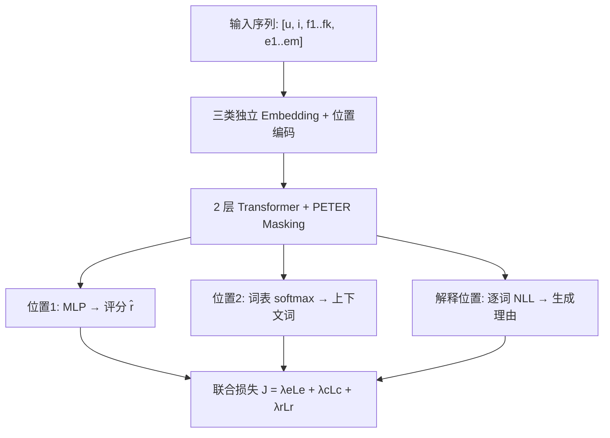

# Personalized Transformer for Explainable Recommendation (面向可解释推荐的个性化 Transformer)

- **会议/期刊**: ACL-IJCNLP 2021 (main conference)
- **作者与机构**: Lei Li, Li Chen (Hong Kong Baptist University); Yongfeng Zhang (Rutgers University)
- **推荐链路定位**: 解释生成（推荐理由端到端生成）+ 评分预测，可挂载于对话推荐系统的“解释回应”环节
- **研究方向**: 对话推荐与智能体仿真 / 生成式推荐
- **论文原文**: [https://arxiv.org/abs/2105.11601v2](https://arxiv.org/abs/2105.11601v2)
- **开源代码**: [https://github.com/lileipisces/PETER](https://github.com/lileipisces/PETER)

## TL;DR (1分钟核心速览)

可解释推荐需要“给定用户-物品 ID 生成个性化理由”，但 Transformer 无法消化与词不在同一语义空间的 ID，纯生成任务下会退化为对 `<bos>` 的复制，产出千篇一律的句子。PETER 以“上下文预测”为辅助任务，强制第 2 个位置的表示去预测解释中的词，从而给 ID 赋予语言学含义，并用改进的 PETER Masking 把解释生成、上下文预测、评分预测塞进同一个 2 层小模型。在 TripAdvisor/Yelp/Amazon 三个数据集随机 8:1:1 划分、5 次取平均的协议下，PETER+ 的 BLEU-4 相对 NETE 提升约 24%–28%，训练速度约为微调 BERT(ACMLM) 的 14 倍/epoch。

## Background & Motivation (背景与核心矛盾)

- **主流范式**: 带文本的可解释推荐多用 RNN（GRU/LSTM）编码用户-物品 ID 为 context vector，再逐词解码出理由句；或用“预训练+微调”的 BERT 以掩码预测方式生成。
- **前人局限**: (1) ID 在语料中出现频率远低于词（一条长评论仅对应一对 ID），直接与词拼接会被当作 OOV token，模型对其不敏感；(2) Transformer 的自注意力没有为“异质输入（ID vs. 词）”设计接口，标准左到右掩码也让 item 信息无法参与打分。
- **核心洞察 (Key Insight)**: 论文的注意力可视化（图 1）显示，标准 Transformer 在生成每一步几乎只看 `<bos>`，用户与物品列几乎全暗；这正是 USR（唯一句比）≈0 的直接原因——不是容量不够，而是 ID 没有被“用起来”。
- **本文切入点**: 不扩模型、不做预训练，而是**设计一个任务**：让 ID 位置的隐状态去预测目标解释里的词（drafting），再由解释生成任务润色（polishing），以任务设计替代规模扩张。

## Method (核心方法设计)

### 1. 整体框架 (Overall Architecture)

输入是一条异构序列 $S=[u,i,f_1,\dots,f_{|F|},e_1,\dots,e_{|E|}]$：用户 ID、物品 ID、（可选）物品特征词、解释词。三类 token 各自使用独立 embedding 表$\mathbf{U},\mathbf{I},\mathbf{V}$，ID **不进入词表**$V$（否则 softmax 要在百万级 ID 上归一化），再叠加位置编码送入$L=2$层 Transformer。序列最终表示按位置分工：第 1 位接 MLP 出评分$\hat r_{u,i}$，第 2 位接词表线性层做上下文预测，解释词位置做逐词生成；三个任务以加权损失端到端联合训练，推理时贪心解码至 `<eos>`。

### 2. 关键设计拆解 (Key Designs)

1. **PETER Masking（改造注意力掩码，让 ID 互通且不泄漏未来词）**：标准左到右掩码使 $i$无法被解释词位置看到，评分也拿不到物品信息。本文将掩码矩阵前两行（$u,i$）设为互相可见、且可被后续所有位置看见，解释部分仍保持因果掩码：
$M_{jk}=0\ \text{if allowed},\quad M_{jk}=-\infty\ \text{otherwise}$有效注意力为$A^{l,h}=\mathrm{softmax}\!\left(\frac{Q^{l,h}K^{l,h\top}}{\sqrt d}+M\right)V^{l,h}$。直觉是：ID 成为“始终可见的前缀条件”，既服务打分又服务生成，同时不破坏自回归性。

2. **Context Prediction（上下文预测，把 ID 拉到词空间）**：仅做生成任务时，ID 的梯度信号被句子的高频虚词淹没。该辅助任务用第 2 位（物品位，因 $u,i$ 互相注意故已融合双方信息）的表示直接回归解释中的全部词：
$\mathcal{L}_c=\frac{1}{|\mathcal{T}|}\sum_{(u,i)\in\mathcal{T}}\frac{1}{|E_{u,i}|}\sum_{t=1}^{|E_{u,i}|}-\log c^{e_t}_{2}$
它相当于“先打草稿”：把与这对 ID 相关的特征词（如 pool、bathroom）先激活，生成任务再把这些词组织成句，于是 ID 被迫携带语言学语义。

3. **训练目标、负采样与推理效率**：三任务联合目标为
$\mathcal{J}=\min_{\Theta}\left(\lambda_e\mathcal{L}_e+\lambda_c\mathcal{L}_c+\lambda_r\mathcal{L}_r\right)$其中$\mathcal{L}_e$为解释词 NLL（位置偏移$2+|F_{u,i}|$），$\mathcal{L}_r$为 MSE；$\lambda_e=\lambda_c=1.0,\ \lambda_r=0.1$。文本生成任务无负采样环节，评分任务用全量观测评分回归（非排序）。推理为贪心解码、最大长度 15，模型仅 2 层、$d=512$、$H=2$，单 epoch 2.3 分钟（Tesla P40）。

## Experimental Setup & Evaluation Protocol (实验设置与评估协议)

- **数据集与预处理**: 解释句均含至少一个物品特征词，词表截断为最高频 20,000 词（ACMLM 用子词不截断）：

| 数据集 | #Users | #Items | #Interactions | #Features | 场景说明 |
| :--- | :---: | :---: | :---: | :---: | :--- |
| TripAdvisor | 27,147 | 20,266 | 1,293,247 | 7,340 | 酒店，平均解释长 12.32 词 |
| Yelp | 7,506 | 7,360 | 441,783 | 5,399 | 餐厅，平均 47.6 条/用户 |
| Amazon | 9,765 | 6,280 | 320,023 | 5,069 | 电影&TV，平均 32.8 条/用户 |

- **数据划分与防穿越 (Splitting Strategy)**: 采用 `比例划分`——随机 8:1:1 切分训练/验证/测试，重复 5 次取均值，并保证训练集中每个用户与每个物品至少有一条记录（非冷启动划分，属转导式设定）。
- **排名评测协议 (Ranking Protocol)**: **本文不做排序评测**。推荐侧用回归指标 RMSE / MAE（全量评分，无负采样）；解释侧用文本质量 BLEU-1/4、ROUGE-1/2 的 P/R/F，加上面向可解释性的 FMR（是否命中 ground-truth 特征）、FCR（特征覆盖率）、DIV（解释间特征差异，越低越好）、USR（唯一句比）。
- **对比基线与超参设置**: 无特征组：Transformer、NRT、Att2Seq、PETER；有特征组：ACMLM（微调 BERT）、NETE（GRU+特征模板）、PETER+；推荐侧另比 PMF、SVD++。$d=512$、FFN 维 2048、$L=H=2$、batch 128、SGD + 梯度裁剪 1.0；显著性用 Student's t-test（\*\*$p<0.01$，\*$p<0.05$）。

## Key Experimental Results (实验关键数据)

### 1. 主实验对比 (Main Results)

| 数据集 | 模型 | FMR↑ | FCR↑ | USR↑ | BLEU-1↑ | BLEU-4↑ | ROUGE-1-F↑ | ROUGE-2-F↑ |
| :--- | :--- | :---: | :---: | :---: | :---: | :---: | :---: | :---: |
| Yelp | Transformer | 0.06 | 0.06 | 0.01 | 7.39 | 0.42 | 12.56 | 1.09 |
| Yelp | NRT | 0.07 | 0.11 | 0.12 | 11.66 | 0.65 | 13.55 | 1.33 |
| Yelp | Att2Seq | 0.07 | 0.12 | 0.13 | 10.29 | 0.58 | 13.29 | 1.31 |
| Yelp | PETER | 0.08 | 0.19 | 0.13 | 10.77 | 0.73 | 13.77 | 1.49 |
| Yelp | ACMLM (BERT) | 0.05 | 0.31 | **0.95** | 7.01 | 0.24 | 6.82 | 0.39 |
| Yelp | NETE | 0.80 | 0.27 | 0.52 | 19.31 | 2.69 | 25.56 | 6.33 |
| Yelp | **PETER+** | **0.86** | **0.38** | 0.34 | **20.80** | **3.43** (+27.5%) | **27.95** | **7.94** |
| Amazon | PETER | 0.12 | 0.21 | 0.29 | 12.77 | 1.17 | 15.23 | 2.20 |
| Amazon | NETE | 0.71 | 0.19 | 0.57 | 18.76 | 2.46 | 24.81 | 5.46 |
| Amazon | **PETER+** | **0.77** | **0.31** | 0.46 | **19.75** | **3.06** (+24.4%) | **26.35** | **6.71** |
| Trip | NRT | 0.06 | 0.09 | 0.08 | 15.05 | 0.99 | 15.40 | 2.01 |
| Trip | ACMLM | 0.07 | **0.41** | **0.94** | 3.45 | 0.02 | 3.72 | 0.16 |
| Trip | NETE | 0.78 | 0.27 | 0.57 | 22.39 | 3.66 | 27.71 | 7.66 |
| Trip | **PETER+** | **0.89** | 0.35 | 0.25 | **24.32** | **4.55** (+24.3%) | **30.49** | **9.24** |

推荐侧（RMSE/MAE）：PETER 在 Yelp 为 1.01/0.78，与 SVD++(1.01/0.78)、NRT(1.01/0.78)、NETE(1.01/0.79) 完全持平，显著优于 PMF(1.09/0.88)；TripAdvisor 上 0.81/0.63 略逊于 SVD++ 的 0.80/0.61。

### 2. 消融实验 (Ablation Study)

| 变体 (TripAdvisor) | FMR↑ | FCR↑ | USR↑ | BLEU-1↑ | BLEU-4↑ | RMSE↓ | MAE↓ |
| :--- | :---: | :---: | :---: | :---: | :---: | :---: | :---: |
| w/o $\mathcal{L}_c$（$\lambda_c=0$） | 0.06 | 0.03 | 0.01 | 15.37 | 0.86 | 0.80 | 0.61 |
| w/o $\mathcal{L}_r$（$\lambda_r=0$） | 0.07 | 0.14 | 0.10 | 16.16 | 1.15 | 3.23 | 3.10 |
| 左到右掩码替换 PETER Masking | 0.07 | 0.15 | 0.12 | 15.73 | 1.11 | 0.87 | 0.68 |
| PETER（完整） | 0.07 | 0.13 | 0.08 | 15.96 | 1.11 | 0.81 | 0.63 |

### 3. 关键实验发现 (Key Findings)

1. **上下文预测是去同质化的唯一开关**：关掉 $\mathcal{L}_c$ 后 USR 从 0.08 塌到 0.01（等于标准 Transformer 水平），BLEU-4 从 1.11 降到 0.86，FCR 从 0.13 跌至 0.03——说明 ID 的“语言学含义”确实是由该辅助任务而非架构本身赋予的。
2. **掩码设计直接决定推荐能力**：换成左到右掩码后 RMSE 由 0.81 恶化到 0.87、MAE 0.63→0.68，原因是物品位不再能被评分位置看见；而 $\mathcal{L}_c$与$\mathcal{L}_r$共享$u,i$表示，故去掉$\mathcal{L}_c$ 反而使 RMSE 微降至 0.80，形成解释/推荐的显式权衡。
3. **小模型 > 大预训练模型（在效率上碾压）**：PETER+ 每 epoch 仅 2.3 分钟 vs. ACMLM 32.3 分钟；ACMLM 总训练 97 分钟 / 3 epoch，PETER+ 仅 57.7 分钟 / 25 epoch，同时 BLEU-4 高出 1–2 个数量级，证明“设计任务”比“堆预训练”更划算。

## Highlights & Limitations (亮点、对比与审稿批判)

- **与代表作对比 (vs. Prior Work)**: 相较 NRT / Att2Seq（MLP 编码 ID + RNN 解码），PETER 用自注意力统一建模并新增 ID→词监督；相较 NETE（GRU + 特征槽位模板，生成偏模板化），PETER+ 生成更自然的句子且 FMR 更高（0.86 vs 0.80 / 0.89 vs 0.78）；相较 ACMLM（微调 BERT 掩码预测），PETER+ 的文本质量优势巨大且训练成本低一个量级，但 USR 与 FCR 不及 ACMLM——后者在训练时同时见到用户与物品两侧特征，比较并不完全对等。
- **可迁移亮点**: (1) “ID 位置隐状态回归目标文本词”这一辅助任务可无痛迁移到对话推荐的理由生成、评论摘要、个性化 QA；(2) PETER Masking 提供了一种把异质 token（ID / 图像 / 特征）作为“始终可见前缀”注入自回归 Transformer 的通用接口。
- **审稿级局限批判**: (1) 评估协议偏弱——随机 8:1:1 划分而非时间切分，存在未来信息泄漏风险；解释侧核心指标 BLEU/ROUGE 与人类感知相关性有限，且无人工评测，USR 与文本质量指标之间还存在明显不一致（PETER+ USR 0.25 却 BLEU 最优）。(2) 模型容量与任务均衡是硬伤：小数据集（Amazon/TripAdvisor）上明显欠拟合、推荐指标不及 SVD++，且三个 $\lambda$ 与 15 词长度截断均为人工设定，缺少敏感性分析；生成采用贪心解码，多样性与长句能力受限。

## Rating (四维评分)

- **方法创新性 (Novelty)**: ⭐⭐⭐⭐ （用辅助任务而非模型扩容解决 ID-词异质空间问题，思路简洁优雅；但本质是“多任务正则 + 掩码改造”，理论支撑以注意力可视化为主，缺形式化分析）
- **评估协议与实验扎实度 (Protocol & Experiments)**: ⭐⭐⭐ （三数据集 + 5 次划分 + 显著性检验、解释与推荐双侧评测较完整，但随机划分不防穿越、纯自动指标缺人工评测、无排序协议与超参敏感性分析）
- **写作与数学规范度 (Clarity & Rigor)**: ⭐⭐⭐⭐ （掩码、三任务损失与位置偏移定义清晰，公式与图示对应良好；复杂度与参数量分析略简，评测指标定义稍散）
- **工业落地与复现价值 (Industrial & Practical Value)**: ⭐⭐⭐⭐ （代码开源、2 层小模型单卡训练即可，适合作为对话推荐系统中的解释生成旁路；但依赖万级 ID 表与逐词解码，线上时延与冷启动 ID 泛化仍需工程处理）

