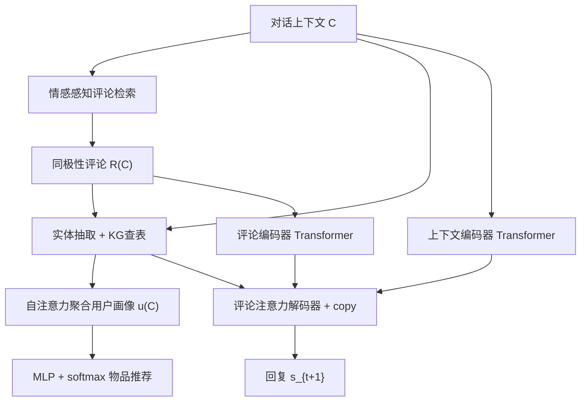
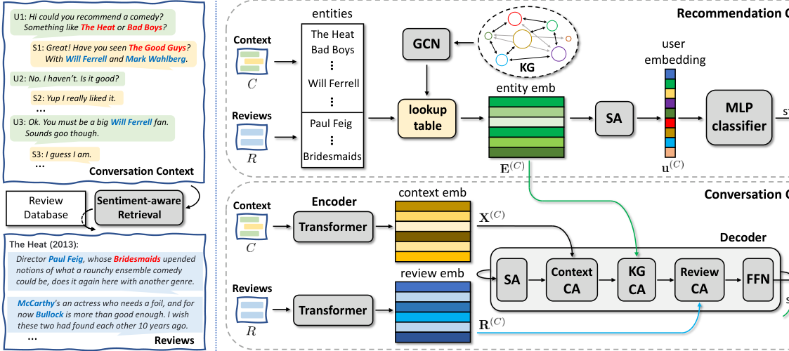

# RevCore: Review-augmented Conversational Recommendation (评论增强的对话推荐)

- **会议/期刊**: ACL Findings 2021
- **作者与机构**: Yu Lu, Junwei Bao, Yan Song, Zichen Ma, Shuguang Cui, Youzheng Wu, Xiaodong He；CUHK-Shenzhen & JD AI Research
- **推荐链路定位**: 端到端生成式（对话推荐 + 回复生成）
- **研究方向**: 对话推荐与智能体仿真
- **论文原文**: [论文原文链接](https://arxiv.org/abs/2106.00957v1)
- **开源代码**: 暂未开源（论文承诺将发布）

## TL;DR (1分钟核心速览)

针对短对话与陌生物品导致CR物品信息不足、KG构建昂贵且生成回复空洞的问题，RevCore用情感一致评论检索补充实体画像，并以评论注意力解码器生成可解释回复。在REDIAL 8:1:1上，R@1 6.1（较KGSF 3.9提升56.4%），Dist-3 0.558，人工信息量0.718。

## Background & Motivation (背景与核心矛盾)

- **主流范式**: 对话推荐多用KG增强物品/实体表示，代表作为KBRD、KGSF，将推荐与回复生成耦合到统一对话系统。
- **前人局限**: 短对话实体稀疏，陌生电影难以画像；KG构建成本高、跨域迁移差，且知识与回复生成融合不足。
- **核心洞察 (Key Insight)**: 用户评论天然包含演员、导演、剧情等细粒度体验，且可提供“为什么推荐”的解释性文本。
- **本文切入点**: 只注入与当前对话情感极性一致的评论，兼顾推荐画像增强与回复信息量，不强制依赖KG。

## Method (核心方法设计)

### 1. 整体框架 (Overall Architecture)

输入对话 $C$与IMDb评论库；先按情感$v^*$检索同极性句子$R(C)$，抽取上下文与评论实体拼成$\mathbf{E}(C)$，经自注意力得用户向量$\mathbf{u}(C)$ 做多类物品打分；同时上下文与评论分别编码，解码器依次对上下文、KG实体、评论做交叉注意力，并用拷贝机制输出回复；训练分情感预训练、推荐交叉熵、生成交叉熵三步。

<figure class="paper-figure" markdown="span">
  <figcaption>图2：所提方法在电影推荐场景中的概览，其中“emb”“SA”“CA”和“sf”分别表示嵌入、自注意力、交叉注意力和softmax操作。</figcaption>
</figure>
图 2：RevCore 整体框架：情感感知评论检索同时增强推荐画像与回复生成。

### 2. 关键设计拆解 (Key Designs)

1. **情感一致性评论检索**：直接拼接评论会引入态度冲突噪声。先预测评论情感 $v=\operatorname{Sentiment}(r)$，再按当前上下文情感$v^*$检索$r(C)=\operatorname{Retrieve}(\mathcal{R}_{db},\{v\},v^*)$；只保留同极性句子，避免“好评电影中的差评句”污染画像与生成。
2. **评论增强实体画像**：REDIAL对话实体稀疏。将上下文实体与评论实体合并 $\mathbf{E}(C)=\{\operatorname{Extract}(C),\operatorname{Extract}(R(C))\}$，再自注意力聚合$\mathbf{u}(C)=\mathbf{E}(C)\boldsymbol{\alpha}$，$\boldsymbol{\alpha}=\operatorname{softmax}(\mathbf{b}^{\top}\tanh(\mathbf{W}_{\alpha}\mathbf{E}(C)))$；$p=\operatorname{softmax}(\operatorname{MLP}(\mathbf{u}(C)))$。评论补足导演/演员等实体，使冷门电影也可画像。
3. **评论注意力解码与复制**：生成时按“上下文→KG实体→评论”逐层交叉注意力，$A_i^3=\operatorname{MHA}(A_i^2,\mathbf{R}(C),\mathbf{R}(C))$，$Y_i=\operatorname{FFN}(A_i^3)$；输出概率叠加词表生成与KG/评论复制$P(y_i|\{y_{i-1}\})=P_1+P_2+P_3$。训练为三步：情感预训练、推荐$\mathcal{L}_{rec}$、生成$\mathcal{L}_{gen}$；无负采样，在线需额外跑评论检索与编码器，推理开销高于KGSF。

## Experimental Setup & Evaluation Protocol (实验设置与评估协议)

- **数据集与预处理**: REDIAL电影对话推荐，评论从IMDb每片爬取30条高helpful评论；按星级5阈值判定情感。

| 数据集 | #Users | #Items | #Interactions | 稀疏度/密度 | 特征/场景说明 |
| :--- | :---: | :---: | :---: | :---: | :--- |
| REDIAL | 未报告（对话对） | 64,362 | 10,021段对话 | 极稀疏 | 电影推荐，8:1:1；IMDb评论库增强 |

- **数据划分与防穿越 (Splitting Strategy)**: 按REDIAL原始训练/验证/测试 8:1:1 比例划分，未采用5-core过滤。
- **排名评测协议 (Ranking Protocol)**: 候选电影集上的多类softmax排序，报告 $R@1/R@10/R@50$；原文未说明负采样，非采样二分类，可视为候选集全排序。
- **对比基线与超参设置**: Trans、Redial、KBRD、KGSF；上下文/回复最大长度256/30，评论句20词，其余超参对齐KGSF；$d$未在正文明确；未报告显著性检验，仅给均值。

## Key Experimental Results (实验关键数据)

### 1. 主实验对比 (Main Results)

表 1：推荐任务（Recall@k，越高越好）

| 模型 | R@1 | R@10 | R@50 |
| :--- | :---: | :---: | :---: |
| Redial | 2.4 | 14.0 | 32.0 |
| KBRD | 3.1 | 15.0 | 33.6 |
| KGSF | 3.9 | 18.3 | 37.8 |
| RevCore (−KG) | 4.2 | 22.7 | 43.3 |
| **RevCore (+KG)** | **6.1** | **23.6** | **45.4** |

RevCore(+KG) 较KGSF：R@1 +56.4%，R@10 +29.0%，R@50 +20.1%。

表 2：对话任务（Dist-n越高越好，PPL越低越好）

| 模型 | Dist-2 | Dist-3 | Dist-4 | PPL |
| :--- | :---: | :---: | :---: | :---: |
| Trans | 0.148 | 0.151 | 0.137 | 17.0 |
| Redial | 0.225 | 0.236 | 0.228 | 28.1 |
| KBRD | 0.263 | 0.368 | 0.423 | 17.9 |
| KGSF | 0.289 | 0.434 | 0.519 | **9.8** |
| RevCore (−KG) | 0.373 | 0.527 | **0.615** | 10.7 |
| **RevCore (+KG)** | **0.424** | **0.558** | 0.612 | 10.2 |

### 2. 消融实验 (Ablation Study)

表 3：对话任务消融（RevCore +KG 为完整模型）

| 变体 | Dist-2 | Dist-3 | Dist-4 | PPL |
| :--- | :---: | :---: | :---: | :---: |
| RevCore (+KG) | 0.424 | 0.558 | 0.612 | 10.2 |
| w/o revCP（去评论copy） | 0.353 | 0.443 | 0.503 | 10.0 |
| w/o revRA（去评论注意力） | 0.328 | 0.428 | 0.516 | 13.2 |
| w/o revEN（评论/上下文共享编码器） | 0.394 | 0.534 | 0.586 | 10.8 |

### 3. 关键实验发现 (Key Findings)

- **评论可直接补足推荐画像**：RevCore(+KG) R@1 6.1 vs KGSF 3.9；即使去掉KG，RevCore(−KG) R@1 4.2仍超KGSF，说明评论实体补全可部分替代KG。
- **信息量与多样性显著提升**：Dist-3 0.558 vs KGSF 0.434（+0.124）；人工评测informativeness 0.718 vs 0.332、coherence 0.601 vs 0.324，而PPL仅10.2 vs 9.8。
- **评论注意力与情感检索最关键**：去revRA使Dist-3降至0.428、PPL升至13.2；情感排序C-S-S的R@1 6.1优于helpful排序C-H-S的4.2；评论长度20最佳，增至30+时PPL升至13.1。

## Highlights & Limitations (亮点、对比与审稿批判)

- **与代表作对比 (vs. Prior Work)**: KGSF依赖双KG对齐，KBRD用KG词偏置生成，Redial仅层级RNN；RevCore以“情感过滤评论”作为更廉价的外部信号，并将评论同时用于画像与解码。
- **可迁移亮点**: 情感一致性过滤可用于任何外部文本注入；独立评论编码器+copy机制可在不破坏对话连贯性的前提下提升解释性。
- **审稿级局限批判**: 依赖每物品评论库与情感标签，冷启动/无评论域难直接落地；仅在REDIAL单数据集验证，无显著性检验与线上A/B，且额外评论检索/编码带来推理延迟。

## Rating (四维评分)

- **方法创新性 (Novelty)**: ⭐⭐⭐⭐ （较早系统化引入情感一致评论增强CR，机制清晰但理论深度有限）
- **评估协议与实验扎实度 (Protocol & Experiments)**: ⭐⭐⭐ （单数据集8:1:1，含自动+人工评测和消融，但无显著性检验与多域验证）
- **写作与数学规范度 (Clarity & Rigor)**: ⭐⭐⭐⭐ （检索、推荐、生成三模块公式完整，符号一致，复杂度分析略少）
- **工业落地与复现价值 (Industrial & Practical Value)**: ⭐⭐⭐ （评论库维护与额外编码开销需评估，代码承诺发布但当前未核验）

