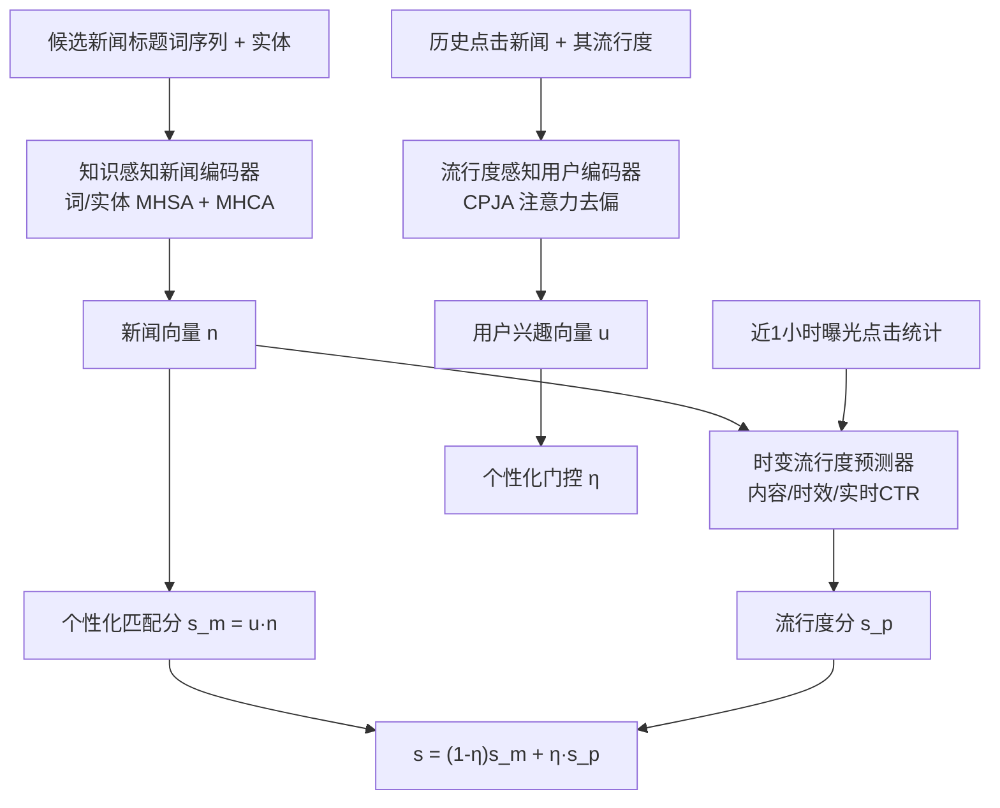
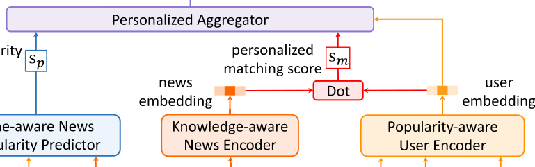

# PP-Rec: News Recommendation with Personalized User Interest and Time-aware News Popularity (个性化兴趣与时变新闻流行度融合的新闻推荐)

- **会议/期刊**: ACL 2021
- **作者与机构**: Tao Qi, Fangzhao Wu, Chuhan Wu, Yongfeng Huang（清华大学电子工程系 & BNRist；微软亚洲研究院）
- **推荐链路定位**: 精排（Impression 级候选新闻打分）
- **研究方向**: 冷启动与长尾推荐 / 去偏与可信推荐
- **论文原文**: [https://arxiv.org/abs/2106.01300v2](https://arxiv.org/abs/2106.01300v2)
- **开源代码**: [https://github.com/JulySinceAndrew/PP-Rec](https://github.com/JulySinceAndrew/PP-Rec)

## TL;DR (1分钟核心速览)

针对个性化新闻推荐在**冷启动用户**上兴趣表征失准、且倾向重复推荐同类新闻导致**信息茧房**两大痛点，PP-Rec 提出最终排序分 $s=(1-\eta)s_m+\eta s_p$的双分数融合框架：$s_m$为知识感知的个性化匹配分，$s_p$为融合新闻内容、时效与近实时 CTR 的时变流行度分，并由用户表征生成个性化门控$\eta$自适应调节二者权重；同时用内容-流行度联合注意力（CPJA）消除点击行为中的流行度偏置。在 MSN / Feeds 两套工业日志数据上，AUC 由 66.69→71.05（MSN）、MRR 相对提升 22.5%，冷启动用户（历史点击数$K=0$）与列表多样性指标同步显著提升。

## Background & Motivation (背景与核心矛盾)

- **主流范式**: NRMS/LSTUR/KRED 等以新闻标题-实体内容与历史点击序列做注意力建模，用 $\mathbf{u}^\top\mathbf{n}$ 的匹配度排序候选新闻。
- **前人局限**: ① 冷启动用户行为极稀疏，兴趣向量几近噪声，匹配分不可靠；② 纯内容匹配使推荐结果与已读新闻高度同质，降低新鲜感与留存；③ 纯流行度方法（ViewNum/SCENE）对所有用户推同一批热门新闻，损失个性化。
- **核心洞察 (Key Insight)**: 热门新闻往往承载灾难、选举等"跨兴趣普适重要信息"，且主题分布天然分散——因此**流行度既可作为冷启动用户的兴趣替代信号，又可作为多样性的注入源**；但直接用浏览量衡量流行度会被曝光次数（impression bias）污染，应改用 CTR。
- **本文切入点**: 将"个性化匹配"与"时变流行度"作为两个独立打分通道，用用户级门控自适应融合，并对用户行为本身的流行度偏置做反向加权。

## Method (核心方法设计)

### 1. 整体框架 (Overall Architecture)

输入为候选新闻标题的**词序列 + 链接实体**、目标用户的历史点击序列、以及候选新闻的近 1 小时曝光/点击统计。知识感知新闻编码器先用词/实体两路 MHSA 建模内部关联、再用词-实体交叉注意力（MHCA）消解实体歧义（如"MAC"在 Lancome 语境下指化妆品），注意力聚合得新闻向量 $\mathbf{n}$。时变流行度预测器以$\mathbf{n}$、时效$r$与实时 CTR$c_t$输出$s_p$。流行度感知用户编码器对历史新闻做 MHSA 取上下文表示$\mathbf{m}_i$，并把（量化后的）历史流行度嵌入$\mathbf{p}_i$ 拼入注意力打分以抑制"因热门而点"的行为。最终门控融合打分，BPR 成对训练。

<figure class="paper-figure" markdown="span">
  <figcaption>图2：PP-Rec的整体框架。</figcaption>
</figure>

### 2. 关键设计拆解 (Key Designs)

1. **时变流行度预测器（解决"冷启动新闻无 CTR"与"流行度随时间衰减"）**：新发布新闻来不及累积曝光，故以内容为兜底先验；同时新闻寿命周期不同，需按内容自适应决定"信内容"还是"信时效"。核心算子为内容特定门控：
$\hat{p}=\theta\cdot\hat{p}_c+(1-\theta)\cdot\hat{p}_r,\quad \theta=\sigma(\mathbf{W}_p[\mathbf{n},\mathbf{r}]+\mathbf{b}_p)$其中$\hat{p}_c$仅由内容预测、$\hat{p}_r$由内容+时效嵌入联合预测；再与实时 CTR 线性加权$s_p=w_c c_t+w_p\hat{p}$。直觉：$\theta$大表示该新闻"内容即决定热度"（如突发地震），$\theta$ 小则"越新越热"占主导，避免了对所有新闻用同一衰减曲线。

2. **流行度感知用户编码器 CPJA（消除行为流行度偏置）**：用户点"特朗普被弹劾"可能只因它热，点"某歌手新歌"才是真兴趣；若不加区分，兴趣向量被热门新闻主导。本文在注意力打分中显式拼入被点新闻的流行度嵌入：
$\alpha_i=\frac{\exp(\mathbf{q}^\top\tanh(\mathbf{W}_u[\mathbf{m}_i,\mathbf{p}_i]))}{\sum_{j}\exp(\mathbf{q}^\top\tanh(\mathbf{W}_u[\mathbf{m}_j,\mathbf{p}_j]))},\quad \mathbf{u}=\sum_i\alpha_i\mathbf{m}_i$
让模型自行学到"高流行度新闻的注意力权重应下调"，等价于一种软性的逆倾向加权（IPS）。

3. **训练目标、负采样与推理效率**：采用 BPR 成对损失，负样本从**同一 impression 的未点击候选**中采样（天然难负例，规避跨曝光分布偏移）：
$\mathcal{L}=-\frac{1}{|D|}\sum_{i=1}^{|D|}\log\sigma(s_i^{p}-s_i^{n})$无额外对比/正则项。推理时$s_p$ 依赖的实时 CTR 需在线聚合近 1 小时统计，用户侧与新闻侧编码均为轻量注意力（20 头 × 20 维），可离线预计算新闻向量，线上仅做内积 + 门控，开销可控。

## Experimental Setup & Evaluation Protocol (实验设置与评估协议)

- **数据集与预处理**: 自建两套微软工业日志（无公开带流行度标注的新闻数据集，故需自采）：

| 数据集 | #Users | #Items(News) | #Interactions(Impressions) | 稀疏度/密度 | 特征/场景说明 |
| :--- | :---: | :---: | :---: | :---: | :--- |
| MSN | 490,522 | 161,013 | 1,100,000 | 1,675,084 clicks，单曝光均 1.52 点击 | 微软新闻网站，2019-10-19 ~ 11-15 |
| Feeds | 98,866 | 4,117,562 | 1,100,000 | 2,384,976 clicks，单曝光均 2.17 点击 | 微软商业新闻 Feed，2020-01-23 ~ 04-23 |

  两数据集均固定采样 500k 训练 / 100k 验证 / 500k 测试 impression，**未做 5-core 过滤**。

- **数据划分与防穿越 (Splitting Strategy)**: **全局时间戳切分**——MSN 用最后 1 周日志作测试、Feeds 用最后 3 周作测试，其余用于训练/验证，严格避免未来曝光泄漏进训练。
- **排名评测协议 (Ranking Protocol)**: **Impression 级 Sampled Ranking**——每次曝光内对 1 个正例与若干未点击候选打分，报 AUC / MRR / nDCG@5 / nDCG@10；非全库 Full-Ranking，故绝对数值偏高。
- **对比基线与超参设置**: ① 流行度类 ViewNum / RecentPop / SCENE / CTR；② 个性化类 EBNR / DKN / NAML / NPA / NRMS / LSTUR / KRED。词嵌入 300 维（GloVe）、实体嵌入 100 维（WikiData TransE）、时效与流行度嵌入 100 维；注意力 20 头 × 20 维；Dropout 0.2，Adam lr=$10^{-4}$；各实验重复 5 次报均值±方差，$t$-test 显著性$p<0.001$。

## Key Experimental Results (实验关键数据)

### 1. 主实验对比 (Main Results)

| 方法 | MSN AUC | MSN MRR | MSN nDCG@5 | MSN nDCG@10 | Feeds AUC | Feeds MRR | Feeds nDCG@5 | Feeds nDCG@10 |
| :--- | :---: | :---: | :---: | :---: | :---: | :---: | :---: | :---: |
| CTR (纯流行度) | 65.72 | 30.50 | 32.79 | 38.68 | 66.40 | 30.29 | 35.53 | 40.72 |
| DKN | 64.16 | 30.63 | 32.98 | 38.66 | 66.30 | 30.25 | 35.01 | 40.55 |
| NAML | 66.06 | 32.10 | 34.73 | 40.43 | 67.50 | 31.07 | 36.08 | 41.61 |
| NPA | 65.83 | 31.70 | 34.24 | 39.96 | 67.25 | 30.80 | 35.72 | 41.25 |
| NRMS | 66.34 | 32.00 | 34.68 | 40.39 | 68.10 | 31.47 | 36.61 | 42.12 |
| LSTUR | 66.69 | 32.12 | 34.76 | 40.51 | 67.43 | 30.95 | 35.92 | 41.45 |
| KRED | 66.54 | 31.97 | 34.65 | 40.38 | 67.67 | 31.16 | 36.19 | 41.72 |
| **PP-Rec** | **71.05** | **39.34** | **44.01** | **50.46** | **72.11** | **32.42** | **38.13** | **43.50** |
| **Improv.%** | +6.54% | +22.48% | +26.61% | +24.56% | +5.89% | +3.02% | +4.15% | +3.28% |

### 2. 消融实验 (Ablation Study)

原文消融以图 9 / 图 10 的曲线形式给出（未披露具体数值），下表为据其趋势整理的方向性结论：

| 变体 | 移除内容 | 性能变化 | 主要受损场景 |
| :--- | :--- | :--- | :--- |
| w/o popularity score $s_p$ | 去掉流行度通道，退化为纯个性化 | 显著下降 | 冷启动用户、多样性 |
| w/o matching score $s_m$ | 去掉个性化匹配通道 | 明显下降 | 兴趣明确的活跃用户 |
| w/o recency $r$ | 流行度预测不看时效 | 下降 | 旧闻误判为热点 |
| w/o news content $\mathbf{n}$ | 流行度仅靠 CTR+时效 | 下降 | 刚发布、曝光不足的新新闻 |
| w/o near real-time CTR $c_t$ | 流行度仅靠内容+时效 | 下降 | 已累积充分曝光的新闻 |

### 3. 关键实验发现 (Key Findings)

1. **流行度信号被现有模型系统性忽视**：纯 CTR 流行度基线在 MSN 上 AUC 已达 65.72，与最强个性化模型 NAML（66.06）几乎持平，说明"不看用户也能打平"，反过来证明个性化模型丢失了一大块可用信息；PP-Rec 融合后 AUC 提升至 71.05，验证两通道互补而非冗余。
2. **增益集中在排序头部而非全局区分度**：MSN 上 AUC 仅 +6.54%，但 MRR +22.48%、nDCG@5 +26.61%，说明流行度主要把"必读热点"顶到 Top 位置；Feeds 增益明显更小（AUC +5.89%、MRR +3.02%），因其新闻库达 411 万条、长尾更极端，流行度分布更嘈杂，时变预测难度更大。
3. **冷启动与多样性同向改善而非此消彼长**：历史点击数 $K\in\{0,1,3,5\}$的对比中$K=0$增益最大，因门控$\eta$由用户表征生成、稀疏时自动偏向$s_p$；同时图 7 的列表内平均距离与图 8 的新话题比例随$K_{top}$ 全程优于 LSTUR/NRMS，证明热门新闻的天然主题分散性确实打破了内容相似性的闭环。

## Highlights & Limitations (亮点、对比与审稿批判)

- **与代表作对比 (vs. Prior Work)**: 与 NRMS/LSTUR 的本质差异是**排序分不再是单一内积**，而引入与用户解耦的"全局价值"通道并用可学习门控调和；与 SCENE/ViewNum 等流行度方法相比，本文用 CTR 替代浏览量消除曝光偏置、并叠加内容与时效先验，故能对**零曝光新新闻**给出流行度估计。
- **可迁移亮点**: ① "内容 + 时效 + 实时行为"三源门控预测流行度的结构，可直接迁移到短视频/电商新品冷启动的价值预估；② 在注意力打分中拼接物品流行度嵌入作为软去偏手段，比显式 IPS 加权更易实现且无需倾向分估计。
- **审稿级局限批判**: ① 消融仅以曲线呈现、缺具体数值与方差，冷启动实验也只展示 MSN（Feeds 称"结果相似"未给证），复现与显著性核查不便；② 流行度嵌入需对预测值做**不可微量化**（作者自述因此剔除时效与内容两项），造成训练/推理输入不一致；③ 依赖近 1 小时实时 CTR 聚合，存在线上统计延迟与冷启动窗口错配，且两数据集均为微软内部私有日志、未开源，横向可比性受限。

## Rating (四维评分)

- **方法创新性 (Novelty)**: ⭐⭐⭐⭐ （双通道门控融合 + 时变流行度三方门控思路清晰，虽各组件多为已有注意力拼接，但"流行度作为冷启动与多样性的统一解"这一视角颇具启发性）
- **评估协议与实验扎实度 (Protocol & Experiments)**: ⭐⭐⭐⭐ （两套真实工业日志、严格时间切分、11 个基线、5 次重复 + $p<0.001$ 检验到位，但采样排序协议偏乐观、消融缺数值）
- **写作与数学规范度 (Clarity & Rigor)**: ⭐⭐⭐ （框架图与模块图清晰、公式简洁，但 BPR 损失写法与标准形式有出入、门控权重 $w_c,w_p$ 未约束归一化，细节交代略粗）
- **工业落地与复现价值 (Industrial & Practical Value)**: ⭐⭐⭐⭐ （代码已开源、结构轻量可离线预计算，流行度通道工程上也易于增量上线；主要短板是私有数据不可得与实时 CTR 依赖）

