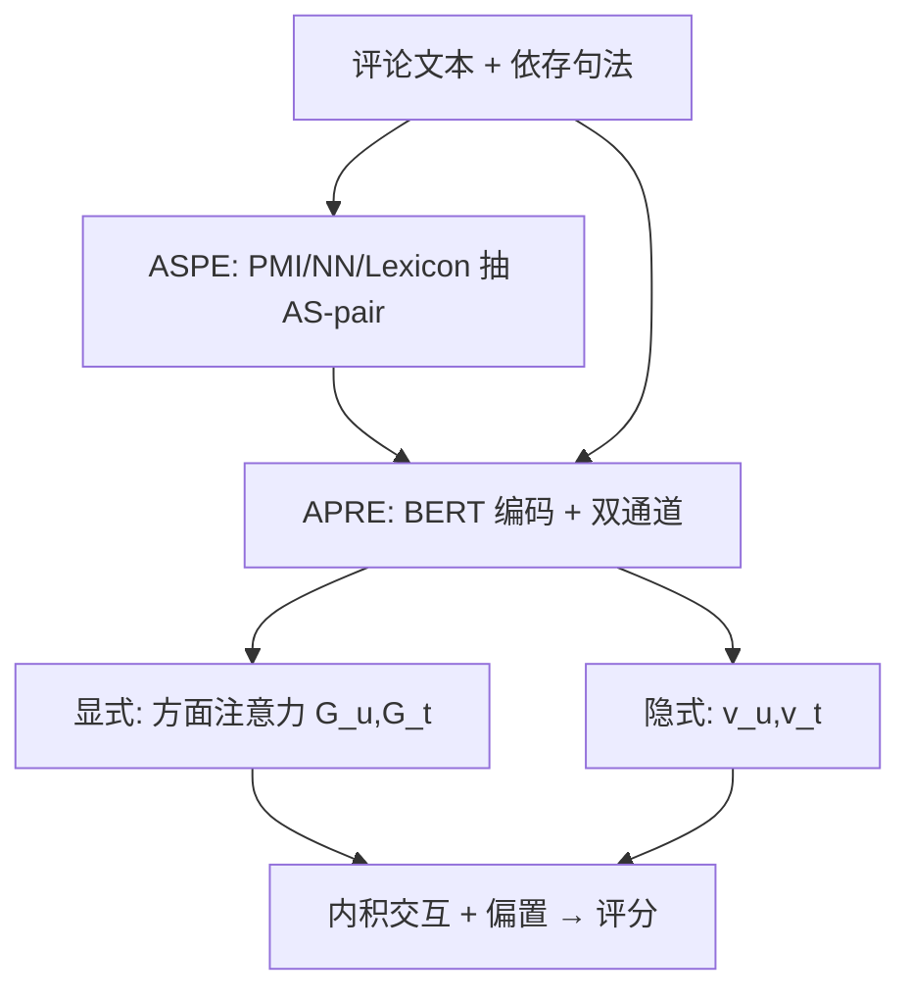

# Recommend for a Reason: Unlocking the Power of Unsupervised Aspect-Sentiment Co-Extraction (为“理由”而推荐：解锁无监督方面-情感联合抽取)

- **会议/期刊**: Findings of EMNLP 2021
- **作者与机构**: Zeyu Li, Wei Cheng, Reema Kshetramade, John Houser, Haifeng Chen, Wei Wang（UCLA 与 NEC Labs America）
- **推荐链路定位**: 精排（评分预测）
- **研究方向**: 协同过滤 / CTR 特征交叉
- **论文原文**: [https://arxiv.org/abs/2109.03821v1](https://arxiv.org/abs/2109.03821v1)
- **开源代码**: [https://github.com/zyli93/ASPE-APRE](https://github.com/zyli93/ASPE-APRE)

## TL;DR (1分钟核心速览)

现有基于评论的推荐器倾向于用大型语言编码器得到隐式、不可解释的文本表征，忽略了用户对不同商品属性的差异化关注。本文提出紧耦合两阶段框架：无监督**方面-情感对抽取器 ASPE**（PMI+神经网络+词典三源融合、依存句法候选过滤）与**注意力-属性感知评分估计器 APRE**（显式方面通道 + 隐式文本通道双路回归）。在 7 个 Amazon Review 数据集上，评分预测 MSE 相对最优基线下降 $1.337\%\sim 4.061\%$（$p<0.01$），并首次提供方面级可解释的预测分解。

## Background & Motivation (背景与核心矛盾)

- **主流范式**: 基于评论的推荐（NARRE/MPCN/DAML/AHN）普遍用 CNN/Attention/BERT 编码整句，再与用户-商品 ID 表征融合回归评分。
- **前人局限**: (1) 忽略"用户对不同属性关注度不同"，导致相同商品不同用户给出差异极大的评分（如麦克风争议使 R1=5★、R2=3★）；(2) 方面多为 LDA 类隐变量，语义重叠、不可解释，且情感被压缩成标量，缺乏细粒度。
- **核心洞察 (Key Insight)**: 用户态度是"用户注意力 × 商品属性"的乘积，例如 R3 因舒适度满意而忽略麦克风不足仍打 5★；显式 AS-pair 比粗粒度 like/dislike 偏好更能解释评分分歧。
- **本文切入点**: 用无监督 AS-pair 作为"可解释的方面级证据"，喂入双通道估计器，使预测既准又可分解到方面粒度。

## Method (核心方法设计)

### 1. 整体框架 (Overall Architecture)

ASPE 从评论中无监督抽取 (aspect, sentiment) 对，作为用户注意力与商品属性的显式载体；APRE 用固定 BERT + 可训练线性层得到 token 表征，一路走隐式通道（全局 `[CLS]`+CNN+池化）刻画整体语义，一路走显式通道（按方面聚合情感词表征并经 review-wise 注意力汇聚），最后由双通道拼接并经内积交互回归评分。训练用 MSE 反向传播。

### 2. 关键设计拆解 (Key Designs)

1. **三源融合的无监督 AS-pair 抽取（ASPE）**：标注语料昂贵且领域受限 → 用 PMI 极性打分 $\text{Pol}(w)=\sum_{s^+}\text{PMI}(w,s^+)-\sum_{s^-}\text{PMI}(w,s^-)$，融合预训练 SDRN（NN）与情感词典（Lexicon）取并集，再用依存关系 `amod` 与 `nsubj+acomp` 抽 (名词,形容词) 候选并按情感集过滤。三源互补弥补种子偏差与跨域退化，实现免标注、跨域通用。

2. **双通道注意力-属性回归（APRE）**：隐式通道丢失方面分辨力、纯显式又漏隐喻情感 → 方面 $a$的情感表征按提及情感词求和$h_{u,r}^{(a)}=\sum h_j^1$，经 review-wise 注意力$\alpha_{u,r}^{(a)}=\frac{\exp(\tanh(\mathbf{w}_{ex}^\top[h_{u,r}^{(a)};a^{(u)}]))}{\sum_{r'}\exp(\cdot)}$加权得$G_u$（商品侧对称得$G_t$）；隐式通道用$[\mathbf{h}_{[CLS]}^1;\mathbf{h}_{cnn};\text{MaxPool};\text{AvgPool}]$得$\mathbf{v}_u,\mathbf{v}_t$。

3. **训练目标与推理效率**：评分经 $\hat{s}_{u,t}=b_u+b_t+F_{im}([\mathbf{v}_u;\mathbf{v}_t])+\langle\gamma,F_{ex}([G_u;G_t])\rangle$融合，内积项$\langle\gamma,\cdot\rangle$即方面级交互贡献；损失$J(\Theta)=\sum_{r_{u,t}}(s_{u,t}-\hat{s}_{u,t})^2+\lambda\|\Theta\|_2^2$。BERT 冻结、无需负采样；单 epoch 耗时 AM 127s、SO 90min，ASPE 每数据集仅跑一次。

## Experimental Setup & Evaluation Protocol (实验设置与评估协议)

- **数据集与预处理**: 7 个 Amazon Review 子类，过滤用户/商品交互 <5 条、评论 <5 词的样本（近似 5-core）：

| 数据集 | #Users | #Items | #Reviews | 密度 | 场景说明 |
| :--- | :---: | :---: | :---: | :---: | :--- |
| AM | 2,928 | 1,835 | 20,413 | 3.42e-3 | 汽车配件 |
| DM | 14,138 | 11,707 | 111,323 | 6.05e-4 | 数字音乐 |
| MI | 1,429 | 900 | 10,226 | 7.16e-3 | 乐器 |
| PS | 19,854 | 8,510 | 157,376 | 8.38e-4 | 宠物用品 |
| SO | 35,590 | 18,357 | 295,434 | 4.07e-4 | 运动户外 |
| TG | 19,409 | 11,924 | 167,155 | 6.50e-4 | 玩具游戏 |
| TH | 16,633 | 10,217 | 134,129 | 7.10e-4 | 工具家装 |

- **数据划分与防穿越**: `比例划分` 8:1:1（train/val/test），无时间戳切分，属随机划分。
- **排名评测协议**: 非排名任务，采用**评分回归**，指标为 $\text{MSE}=\frac{1}{|R_{test}|}\sum(\hat{s}_{u,r}-s_{u,r})^2$；提升 >1% 视为显著（$p<0.01$ 统计检验）。
- **对比基线与超参**: 13 个基线含传统（MF/WRMF/FM）与深度（ConvMF/NeuMF/D-CNN/NARRE/ANR/MPCN/DAML/AHN/AHN-B）；BERT 固定、dropout=0.2、LR=0.001，维度经 AM 上网格搜索调优。

## Key Experimental Results (实验关键数据)

### 1. 主实验对比 (Main Results)

MSE（越低越好），最优加粗，$\Delta$ 为对最优基线的相对降幅：

| 模型 | AM | DM | MI | PS | SO | TG | TH |
| :--- | :---: | :---: | :---: | :---: | :---: | :---: | :---: |
| MF | 1.986 | 1.715 | 2.085 | 2.048 | 2.084 | 1.471 | 1.631 |
| FM | 1.082 | 0.436 | 1.146 | 1.458 | 1.212 | 0.922 | 1.050 |
| NeuMF | 0.901 | 0.396 | 0.903 | 1.294 | 0.893 | 0.841 | 1.072 |
| D-CNN | 0.809 | 0.390 | 0.861 | 1.250 | 0.894 | 0.835 | 0.975 |
| NARRE | 0.826 | 0.374 | 0.837 | 1.425 | 0.990 | 0.908 | 0.958 |
| DAML | 0.829 | 0.372 | 0.837 | 1.247 | 0.893 | 0.820 | 0.962 |
| AHN-B | 0.810 | 0.385 | 0.840 | 1.270 | 0.896 | 0.829 | 0.976 |
| AHN | 0.802 | 0.376 | 0.834 | 1.252 | 0.887 | 0.822 | 0.967 |
| **Ours** | **0.791** | **0.359** | **0.823** | **1.218** | **0.863** | **0.788** | **0.936** |
| $\Delta(\%)$ | 1.390 | 3.621 | 1.337 | 2.381 | 2.784 | 4.061 | 2.350 |

### 2. 消融实验 (Ablation Study)

| 变体 | AM | DM | MI | PS | SO | TG | TH |
| :--- | :---: | :---: | :---: | :---: | :---: | :---: | :---: |
| w/o EX（去显式通道） | 0.814 | 0.379 | 0.833 | 1.244 | 0.882 | 0.796 | 0.965 |
| w/o IM（去隐式通道） | 0.798 | 0.374 | 0.863 | 1.226 | 0.873 | 0.798 | 0.956 |
| **Full APRE** | **0.791** | **0.359** | **0.823** | **1.218** | **0.863** | **0.788** | **0.936** |

### 3. 关键实验发现 (Key Findings)

1. **性能提升并非来自 BERT**：AHN-B（接入 BERT）在多数数据集反而弱于原始 word2vec 版 AHN（如 AM 0.810 vs 0.802），因 BERT 冻结降低参数容量；而 Ours 在全部 7 个数据集稳定优于 AHN-B 至少 1.337%，证明增益来自 AS-pair 显式建模而非编码器。
2. **显式通道贡献大于隐式通道**：w/o IM 在 AM/DM/PS/SO/TG 上 MSE 低于 w/o EX（如 AM 0.798 vs 0.814），说明昂贵的隐式整句编码性价比低于方面级剖析——一个反直觉但实用的结论。
3. **可解释性可定量分解**：案例中 $\gamma_i F_{ex}(\cdot)_i$ 将同一预测拆为方面级贡献，如 battery 劣势贡献 −0.008、install/look 优势贡献 +0.019/+0.015，与"受关注方面影响更大"的假设一致，是基线模型不具备的能力。

## Highlights & Limitations (亮点、对比与审稿批判)

- **与代表作对比 (vs. Prior Work)**: 相较 NARRE/DAML 等隐式评论推荐，本文首次给出可分解的方面-情感显式证据；相较 SDRN/RINANTE 等有监督联合抽取，ASPE 免标注且跨 7 域通用；相较 ANR 的隐式方面，本文方面语义可读、情感为向量而非标量。
- **可迁移亮点**: (1) "PMI+NN+词典"三源并集融合策略可迁移到任意缺乏标注的文本特征抽取任务；(2) 双通道"显式证据 + 隐式语义"融合与内积分解 $\langle\gamma,F_{ex}\rangle$，可直接移植为可解释 CTR 精排头。
- **审稿级局限批判**: (1) 依赖冻结 BERT 与依存句法，抽取对隐式/隐喻情感（如 "like a pillow"）漏检，ASPE 与 APRE 未端到端联合优化，存在抽取误差级联；(2) 随机 8:1:1 划分非时间切分，存在信息泄漏风险；且未与近年图/序列评论模型对比，评测范围偏窄。

## Rating (四维评分)

- **方法创新性 (Novelty)**: ⭐⭐⭐⭐ （首次将无监督 AS-pair 作为可解释方面证据嵌入评分回归，双通道内积分解独具匠心）
- **评估协议与实验扎实度 (Protocol & Experiments)**: ⭐⭐⭐ （7 域覆盖广、有显著性检验与消融，但随机划分、缺时间切分与最新基线）
- **写作与数学规范度 (Clarity & Rigor)**: ⭐⭐⭐⭐ （公式与两阶段流程清晰，注意力与聚合符号定义完整，复杂度分析略简）
- **工业落地与复现价值 (Industrial & Practical Value)**: ⭐⭐⭐⭐ （代码开源、BERT 冻结推理可控、提供方面级解释，利于电商评论场景落地）

