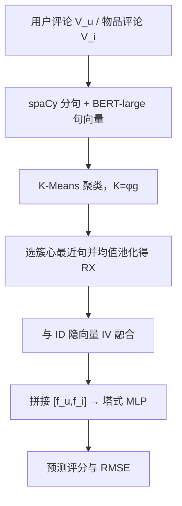
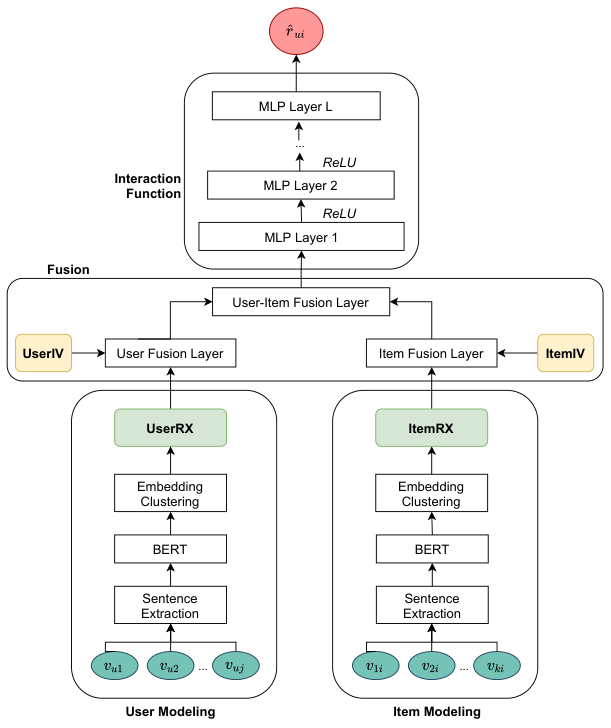

# Unsupervised Extractive Summarization-Based Representations for Accurate and Explainable Collaborative Filtering (基于无监督抽取式摘要的准确可解释协同过滤)

- **会议/期刊**: ACL 2021
- **作者与机构**: Reinald Adrian Pugoy, Hung-Yu Kao；台湾成功大学、菲律宾开放大学
- **推荐链路定位**: 精排（评分预测）
- **研究方向**: 协同过滤与双塔召回 / 大语言模型推荐（BERT 语义表征增强）
- **论文原文**: [论文原文链接](https://aclanthology.org/2021.acl-long.232.pdf)
- **开源代码**: [ESCOFILT](https://github.com/reinaldncku/ESCOFILT)

## TL;DR (1分钟核心速览)

针对评论型协同过滤中 review-level 解释只取单条最高权重评论、word-level 解释碎片化、表征与解释分离的痛点，ESCOFILT 用 BERT 句向量 + K-Means 为每个用户/物品抽取跨评论代表句摘要，并直接把摘要均值池化作为表征与解释，再与 ID 隐向量融合后经 MLP 预测评分。在 4 个 Amazon 5-core 子集的 80/10/10 划分上，RMSE 平均 0.9210，较最佳基线降 0.52%；人工列表式评估中摘要解释 83% 首选。

## Background & Motivation (背景与核心矛盾)

- **主流范式**: 评论型 CF 多用 CNN/注意力从评论文本学习用户、物品表征；NARRE 用 review-level attention 同时产出解释，BENEFICT 用 BERT 自注意力+MSP 产出 token-level 解释。
- **前人局限**: review-level 解释只保留一条最高权重评论，丢弃其他评论中的有用句；word/token-level 解释常为碎片，不符合人偏好完整句子的阅读习惯。
- **核心洞察 (Key Insight)**: 真实解释往往是跨多条评论的完整句子集合；若把抽取式摘要同时当作表征与解释，可避免“先预测、后解释”的割裂。
- **本文切入点**: 无监督抽取式摘要替代注意力解释：句向量聚类选代表句，摘要向量直接参与评分预测。

## Method (核心方法设计)

### 1. 整体框架 (Overall Architecture)

ESCOFILT 由用户侧与物品侧两条平行支路构成。输入用户 $u$写过的评论集合$V_u$与物品$i$收到的$V_i$；每侧先拼接评论并用 spaCy Sentencizer 分句，再将句子送入 BERT-large，取倒数第二层词向量平均得句向量。随后对句向量做 K-Means，$K=\phi g$，选每簇距质心最近的句子并平均，得到 UserRX/ItemRX，它同时是表征与解释。该摘要向量经线性投影后与评分 ID 隐向量 UserIV/ItemIV 相加，拼接成$[\mathbf{f}_u,\mathbf{f}_i]$，送入塔式 MLP 回归评分。训练用 MSE，Adam 优化，无负采样。

<figure class="paper-figure" markdown="span">
  <figcaption>图1：所提出的 ESCOFILT 架构。</figcaption>
</figure>

图1：ESCOFILT 整体架构（原论文图1）。

### 2. 关键设计拆解 (Key Designs)

1. **摘要即表征-解释（Extractive Representation-Explanation）**：review-level 只选单条评论、word-level 碎片化。做法是分句后 BERT 编码，K-Means 将语义相近句归簇，每簇取距质心最近句并平均：$K=\phi_i g$，$\mathrm{ItemRX}_i=\frac{1}{K}\sum_{x=1}^{K}\mathbf{s}'_{i,e(C_x)}$。直觉是聚类把冗余评论压成若干语义中心，代表句既去冗余又覆盖多评论，且句子完整可读。

2. **ID 隐向量与摘要融合**：纯文本摘要丢失评分矩阵中的数值偏好，传统 ID 隐向量又不可解释。保留 UserIV/ItemIV，经 $\mathbf{W}$投影后与摘要向量相加：$\mathbf{f}_u=(\mathrm{UserRX}_u\mathbf{W}_u+\mathbf{b}_u)+\mathrm{UserIV}_u$，$\mathbf{f}_{ui}=[\mathbf{f}_u,\mathbf{f}_i]$。ID 向量补协同信号，摘要补语义与解释，二者互补后送入 MLP。

3. **训练目标、负采样与推理效率**：评分回归损失为 $\mathcal{L}=\frac{1}{|\tau|}\sum_{(u,i)\in\tau}(r_{ui}-\hat{r}_{ui})^2$，无负采样。用户/物品摘要可离线缓存；新实体需即时 BERT+KMeans，成本随句数$g$线性增长，KMeans 迭代约$O(gK)$。

## Experimental Setup & Evaluation Protocol (实验设置与评估协议)

- **数据集与预处理**: Amazon 5-core，保证每个用户/物品至少 5 条评论；#Reviews 即评分-评论交互数。

| 数据集 | #Users | #Items | #Reviews/交互 | 密度 | 特征/场景说明 |
| :--- | :---: | :---: | :---: | :---: | :--- |
| Automotive | 2,928 | 1,835 | 20,473 | 0.381% | 汽车用品评论+评分 |
| Digital Music | 5,541 | 3,568 | 64,706 | 0.327% | 数字音乐 |
| Instant Video | 5,130 | 1,685 | 37,126 | 0.430% | 即时视频 |
| Patio, Lawn & Garden | 1,686 | 962 | 13,272 | 0.818% | 庭院园艺 |

- **数据划分与防穿越**: 每个数据集按 80%/10%/10% 随机比例划分训练/验证/测试，**非全局时间戳切分**，存在评论时间穿越风险。
- **排名评测协议**: 本文是评分预测任务，**不是 Top-N 排序**；无 Full-Ranking/采样排序，也无训练负采样，统一用测试集 RMSE 评估。
- **对比基线与超参**: 基线为 BENEFICT、DeepCoNN、MPCN、NARRE；BERT-large 句向量 1024 维，隐向量 $m\in\{32,128,220\}$网格搜索，摘要比例$\phi_u=\phi_i=0.4$，MLP 4 层，lr=0.006，batch=128，dropout=0.5，Adam。**未报告显著性检验**。
- **人工解释评估**: 90 条物品解释（每类 30 条），2 名评委，7 项真实可解释性标准、5 点 Likert；列表式排序用 Cohen's $\kappa$ 衡量一致性。

## Key Experimental Results (实验关键数据)

### 1. 主实验对比 (Main Results)

| 模型 | Automotive | Digital Music | Instant Video | Patio | 平均 RMSE |
| :--- | :---: | :---: | :---: | :---: | :---: |
| BENEFICT | 0.9023 | 0.8910 | 0.9746 | 0.9352 | 0.9258 |
| DeepCoNN | 0.9076 | 0.8904 | 0.9778 | 0.9316 | 0.9269 |
| MPCN | 0.9107 | 0.9298 | 0.9976 | 0.9362 | 0.9436 |
| NARRE | 0.9144 | 0.8915 | 0.9758 | 0.9539 | 0.9339 |
| **ESCOFILT** | **0.8968** | **0.8831** | **0.9742** | **0.9298** | **0.9210** |

表注：RMSE 越低越好。相对各数据集最佳基线，ESCOFILT 的 RMSE 降幅分别为 0.61%、0.82%、0.04%、0.19%，平均 **0.52%**。

### 2. 消融实验 (Ablation Study)

| 变体 | 用户摘要 | 物品摘要 | 验证 RMSE（图2趋势） | 结论 |
| :--- | :---: | :---: | :---: | :--- |
| ESCOFILT | ✓ | ✓ | 最低 | 完整模型最佳 |
| ESCOFILT-I | ✗ | ✓ | 次优 | 物品评论更多，收益更大 |
| ESCOFILT-U | ✓ | ✗ | 第三 | 仅用户摘要不足 |
| ESCOFILT-N | ✗ | ✗ | 最差 | 随机 ID 表征不足 |

表注：原文图2仅给趋势、未报告具体数值，故不列数值；默认 ESCOFILT 在四个数据集验证 RMSE 均最低。

### 3. 关键实验发现 (Key Findings)

1. **全数据集一致最优，但增益幅度依赖评论丰富度**：ESCOFILT 平均 RMSE 0.9210，较最佳基线 BENEFICT 的 0.9258 降 0.0048（0.52%）；Digital Music 降幅最大（0.8904→0.8831，0.82%），Instant Video 仅降 0.04%，说明评论越多、语义聚类去冗余收益越明显。
2. **BERT 全局上下文优于 CNN 局部特征**：BERT 系两模型平均 RMSE 为 0.9210/0.9258，低于 DeepCoNN 0.9269、NARRE 0.9339、MPCN 0.9436；ESCOFILT 又比同作者 BENEFICT 再降 0.0048，表明句子级摘要比 token 子数组更稳。
3. **摘要解释更受偏好，但可视化不占优**：摘要级在 coherence、completeness、novelty、perceived truth、quality 共 5/7 项最优，perceived truth 达 3.92；列表式评估 83% 物品首选摘要解释，$\kappa=0.45$；但 visualization 3.78 低于 NARRE 的 3.92，说明摘要可读但不直观。消融还显示物品聚类贡献大于用户聚类（I 接近完整、N 最差），因物品平均评论数更多。

## Highlights & Limitations (亮点、对比与审稿批判)

- **与代表作对比 (vs. Prior Work)**: NARRE 的 review-level 解释只选单条最高注意力评论，ESCOFILT 跨评论选句、覆盖更全；BENEFICT 的 token-level 子数组易碎片化，ESCOFILT 输出完整句；DeepCoNN/MPCN 依赖 CNN 局部特征，ESCOFILT 用 BERT 全局上下文+KMeans 去冗余。
- **可迁移亮点**: ①用无监督句向量聚类选代表句，可作为可解释表征注入任意文本推荐模型；②表示与解释统一，省去后置解释器，摘要可直接展示给用户。
- **审稿级局限批判**: ①每个用户/物品单独跑 BERT+KMeans，离线成本高；$\phi=0.4$意味着摘要保留约四成句子，压缩率有限，长评论实体更贵。②评估仅 4 个 Amazon 子集、随机 80/10/10 划分，未做时间切分与显著性检验；仅评分 RMSE，未验证 Top-N 排序或线上效果；人工评估仅 2 名评委、90 条样本，$\kappa$ 仅 0.28–0.45，统计效力有限。

## Rating (四维评分)

- **方法创新性 (Novelty)**: ⭐⭐⭐ （首次把抽取式摘要用于 CF 并统一表示与解释，思路清晰；但本质是 BERT+KMeans+MLP 的组合创新，理论深度有限）
- **评估协议与实验扎实度 (Protocol & Experiments)**: ⭐⭐⭐ （4 个 5-core 数据集+人工评估较完整，但仅评分预测、随机划分、无显著性检验，消融只有图无数值）
- **写作与数学规范度 (Clarity & Rigor)**: ⭐⭐⭐⭐ （流程与公式简洁清楚，符号定义明确；KMeans 目标与摘要压缩率讨论略欠严谨）
- **工业落地与复现价值 (Industrial & Practical Value)**: ⭐⭐⭐ （代码开源、结构易复现；但 BERT-large 逐句编码与逐实体聚类带来较高离线成本，线上需缓存摘要）

