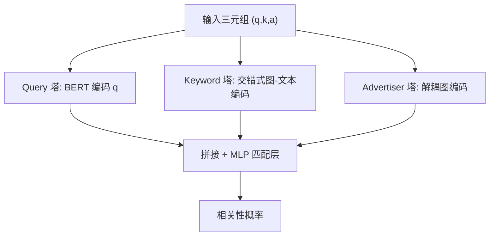
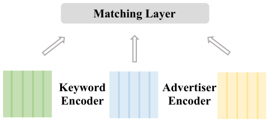
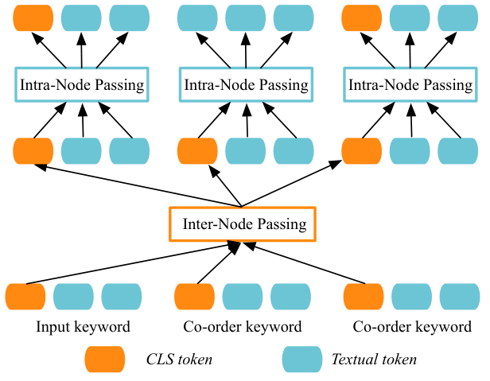

# Leveraging Bidding Graphs for Advertiser-Aware Relevance Modeling in Sponsored Search（利用竞价图进行赞助搜索中的广告主感知相关性建模）

- **会议/期刊**: Findings of EMNLP 2021
- **作者与机构**: Shuxian Bi, Chaozhuo Li, Xiao Han, Zheng Liu, Xing Xie, Haizhen Huang, Zengxuan Wen；中国科学技术大学、Microsoft
- **推荐链路定位**: 召回/粗排（赞助搜索广告相关性匹配）
- **研究方向**: CTR/CVR 预估与特征交叉 / 图神经网络与知识图谱推荐
- **论文原文**: [论文原文链接](https://aclanthology.org/2021.findings-emnlp.191.pdf)
- **开源代码**: 暂未开源（论文仅依赖 HuggingFace Transformers）

## TL;DR (1分钟核心速览)

针对赞助搜索中关键词语义稀缺、同一 query-keyword 在不同广告主下意图漂移的问题，BGTR 将广告主共订单图与广告主-关键词二部图引入三塔相关性模型，用交错式图-文本编码和解耦图编码融合语义与竞价行为；在 16.6 万工业三元组上以 ROC-AUC 评估，较 TextGNN 提升 0.4 个点（相对 0.50%）。

## Background & Motivation (背景与核心矛盾)

- **主流范式**: 赞助搜索相关性主要用 one-tower/two-tower BERT 编码 query-keyword 文本，以语义相似度判断广告是否匹配。
- **前人局限**: 关键词通常很短，单句语义不足以表达广告意图；同一 query-keyword 对不同广告主含义不同，例如“apple pie”对食谱站与食品电商并不等价。
- **核心洞察**: 广告主的共订单关键词可消歧——同订单关键词共享广告意图；广告主-关键词二部图中相似广告主倾向竞价相似关键词，存在同质性。
- **本文切入点**: 将相关性从 query-keyword 二元组扩展为 query-keyword-advertiser 三元组，用两类竞价图作为无监督补充信息。

## Method (核心方法设计)

### 1. 整体框架 (Overall Architecture)

BGTR 将三元组 $(q_i,k_i,a_i)$ 拆成三塔：查询塔用 BERT 编码搜索意图；关键词塔以该广告主的共订单图为邻域，交错执行节点间 [CLS] 消息传递与节点内 token 注意力，得到广告主感知的关键词表示；广告主塔在广告主-关键词二部图上做解耦图编码，并以链接预测预训练。三塔向量拼接后经 MLP 输出相关性概率，交叉熵端到端训练；在线仅算 query 塔，关键词/广告主向量可预缓存。

<figure class="paper-figure" markdown="span">
  <figcaption>图 2：BGTR 模型的框架。</figcaption>
</figure>
图 2：BGTR 三塔框架示意。

### 2. 关键设计拆解 (Key Designs)

1. **广告主感知关键词编码器（交错式图-文本融合）**：传统做法先 BERT 编码节点文本、再 GNN 聚合邻居，文本编码时看不到邻域。BGTR 让每层先做节点间 [CLS] 图注意力 $\hat{\mathbf{M}}_c^{(l-1)}=\mathrm{softmax}(Q_c^{(l-1)}K_c^{(l-1)\top}/\sqrt{d_h})V_c^{(l-1)}$，再把拓扑增强的 [CLS] 发回各节点做节点内注意力；[CLS] 成为跨节点消息总线，避免长文本拼接。复杂度从全拼接的$O(t(s+1))$降到约$O(t+s)$。

<figure class="paper-figure" markdown="span">
  <figcaption>图 3：广告主感知关键词编码器中单层的示意图。</figcaption>
</figure>
图 3：广告主感知关键词编码器单层示意。

2. **解耦广告主编码器（意图因子解耦）**：URL/主页/Freebase 噪声大或覆盖率低。BGTR 在 ad-keyword 图上将广告主/关键词拆成 $T$个意图子空间，用$p_{a,k,t}=\frac{\exp(s_{a,t}^\top s_{k,t})}{\sum_{i=1}^{T}\exp(s_{a,i}^\top s_{k,i})}$加权聚合关键词，并以链接预测目标$\mathcal{L}_{ae}=-\log\sigma(h_a^\top h_k)-\log\sigma(-h_a^\top h_{\hat{k}})$ 预训练，使广告主表示可迁移到相关性任务。

3. **训练目标、负采样与推理效率**：相关性任务用交叉熵 $\mathcal{L}=\sum_{x\in\mathcal{D}}\mathrm{cross}(y,y')$；不使用 BPR/InfoNCE 式 batch 负采样，ad-keyword 图采用拓扑远离的负样本，相关性标签由人工标注提供。在线三塔解耦，query 实时编码，keyword/advertiser 表示离线缓存，适合大规模候选匹配。

## Experimental Setup & Evaluation Protocol (实验设置与评估协议)

- **数据集与预处理**: 工业级 query-keyword-advertiser 三元组，共 165,963 条；两阶段人工标注（10 名初级标注，歧义样本再由 5 名资深标注复核）。原文未提供用户/物品统计，以下为样本级划分：

| 数据划分 | 正例 | 负例 | 总样本 | 说明 |
| :--- | ---: | ---: | ---: | :--- |
| Training | 90,536 | 43,405 | 133,941 | 类别不平衡 |
| Validation | 11,162 | 5,566 | 16,728 | 选最佳 checkpoint |
| Test | 10,366 | 4,928 | 15,294 | 最终报告 |

- **数据划分与防穿越**: 固定训练/验证/测试样本划分；论文未披露时间戳切分或冷启动划分细节，无法确认严格防穿越。
- **排名评测协议**: 非 Full-Ranking/Sampled Ranking，而是三元组相关性二分类；因数据不平衡采用 ROC-AUC。
- **对比基线与超参**: 语义模型 C-DSSM、TwinBERT、TwinBERT+URL；GNN 模型 GAT、GraphSAGE-Mean/LSTM；混合模型 TextGNN。BERT-base-uncased，batch 64，lr $1e-5$，10 epochs，L2 0.001，V100；未报告显著性检验。

## Key Experimental Results (实验关键数据)

### 1. 主实验对比 (Main Results)

| 模型 | 类型 | ROC-AUC | 相对 TextGNN |
| :--- | :--- | ---: | ---: |
| GAT | 朴素 GNN | 0.722 | - |
| GraphSAGE-Mean | 朴素 GNN | 0.721 | - |
| GraphSAGE-LSTM | 朴素 GNN | 0.727 | - |
| C-DSSM | 语义双塔 | 0.773 | - |
| TwinBERT | 语义双塔 | 0.796 | - |
| TwinBERT + URL | 显式广告主特征 | 0.795 | - |
| TextGNN | 松散图-文本混合 | 0.797 | 基线 |
| **BGTR** | **三塔深融合** | **0.801** | **+0.4pp / +0.50%** |

### 2. 消融实验 (Ablation Study)

| 聚合策略 | 含 AE | 去掉 AE | AE 增益 |
| :--- | ---: | ---: | ---: |
| LSTM | 0.801 | 0.799 | +0.002 |
| Mean-pooling | 0.801 | 0.799 | +0.002 |
| Self-attention | 0.802 | 0.800 | +0.002 |

注：主表 BGTR 为 0.801，消融中 self-attention+AE 为 0.802，原文存在 0.001 差异，按原文列示。

### 3. 关键实验发现 (Key Findings)

1. **图信号并非万能**：朴素 GAT/GraphSAGE 仅 0.721–0.727，低于 TwinBERT 0.796；TextGNN 0.797 仅比 TwinBERT 高 0.001，说明松散拼接收益有限；BGTR 0.801 比 TextGNN 高 0.004（0.50%）。
2. **显式广告主信息有噪**：TwinBERT+URL 0.795 反低于 TwinBERT 0.796，支持用竞价行为替代 URL；解耦 AE 在三种聚合下均稳定 +0.002，自注意力最高 0.802。
3. **邻域越多越好且需语义近邻**：邻居数从 2 增到 10 时 AUC 约从 0.797 升至 0.801，ANN 采样始终优于随机采样，说明共订单近邻提供有效消歧上下文。

## Highlights & Limitations (亮点、对比与审稿批判)

- **与代表作对比 (vs. Prior Work)**: TwinBERT 只建模 query-keyword 语义，关键词表示与广告主无关；TextGNN 先文本后图、属松散耦合；BGTR 用三元组和三塔深融合，并用 ad-keyword 图解耦广告主意图，本质区别在于把“谁在竞价”纳入相关性。
- **可迁移亮点**: 用 [CLS] 作为图-文本跨节点消息总线，可迁移到短文本+邻居图场景；广告主/关键词图先做无监督链接预测，再作为下游可训练 embedding，适合大图预训练。
- **审稿级局限批判**: 仅单一工业数据集，无公开基准、无开源模型代码、无显著性检验，ROC-AUC 二分类也不等价于线上全库排序收益；共订单图与广告主图规模大，邻居采样和预计算开销、线上延迟、隐私合规均未充分分析。

## Rating (四维评分)

- **方法创新性 (Novelty)**: ⭐⭐⭐⭐ （三元组相关性建模与交错式图-文本融合较新颖，解耦广告主编码器有明确意图因子直觉）
- **评估协议与实验扎实度 (Protocol & Experiments)**: ⭐⭐⭐ （单一工业数据集、固定划分、AUC 分类评估，缺少公开基准与显著性检验）
- **写作与数学规范度 (Clarity & Rigor)**: ⭐⭐⭐⭐ （公式与三塔流程清晰，复杂度直觉到位；部分符号与切分细节略简）
- **工业落地与复现价值 (Industrial & Practical Value)**: ⭐⭐⭐⭐ （三塔可预计算、契合赞助搜索召回/粗排，但代码未开源且大图工程开销需实测）

