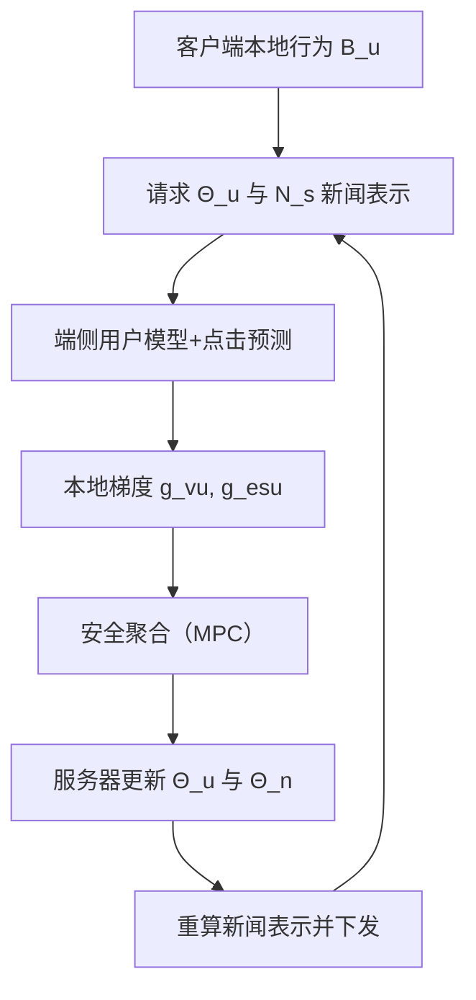
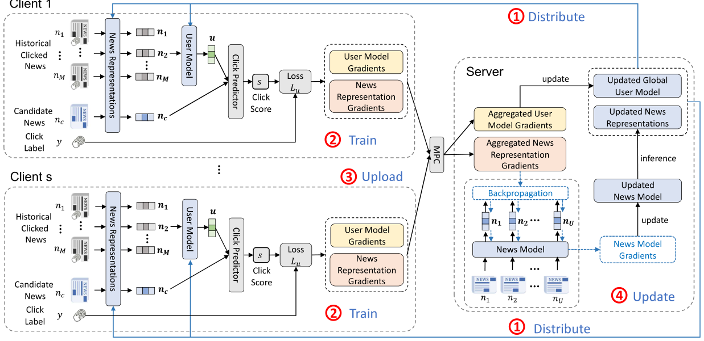

# Efficient-FedRec: Efficient Federated Learning Framework for Privacy-Preserving News Recommendation (高效联邦新闻推荐框架)

- **会议/期刊**: EMNLP 2021
- **作者与机构**: Jingwei Yi, Fangzhao Wu, Chuhan Wu, Ruixuan Liu, Guangzhong Sun, Xing Xie；USTC / MSRA / Tsinghua / RUC
- **推荐链路定位**: 精排（点击预估，联邦训练）
- **研究方向**: 去偏公平、可信隐私与工业架构
- **论文原文**: [论文原文链接](https://arxiv.org/abs/2109.05446v3)
- **开源代码**: [开源代码仓库链接](https://github.com/yjw1029/Efficient-FedRec)

## TL;DR (1分钟核心速览)

针对联邦新闻推荐中客户端无法承担大新闻模型算力/通信的痛点，Efficient-FedRec 将模型拆为服务器端大新闻模型与端侧轻量用户模型，只传用户模型、联合新闻集表示及安全聚合梯度。在 MIND/Adressa 采样式排序协议下，性能接近 FedRec(BERT)，Adressa AUC 79.08、nDCG@5 47.13，客户端通信降至 2.18M、CPU 计算 0.02s/轮。

## Background & Motivation (背景与核心矛盾)

- **主流范式**: 新闻推荐通常由重新闻模型（BERT 编码新闻内容）与轻用户模型（历史点击建模）组成；联邦学习 FedRec 则让客户端训练并上传整个模型梯度。
- **前人局限**: PLM-NR 总参数 110.7M，其中新闻模型约 110M，端侧直接训练/通信不可承受；FCF 依赖新闻 ID 嵌入，面对每日新新闻的冷启动明显失效。
- **核心洞察 (Key Insight)**: 新闻模型虽重但可由服务器集中维护，客户端只需新闻表示即可完成点击打分；单用户点击史可通过组内联合新闻集与 MPC 聚合隐藏。
- **本文切入点**: 做“非对称模型拆分”：服务器持有 $\Theta_n$，客户端只算$\Theta_u$ 与新闻表示梯度，并用安全聚合保护梯度与新闻集合。

## Method (核心方法设计)

### 1. 整体框架 (Overall Architecture)

Efficient-FedRec 把新闻推荐模型按开销拆开：服务器维护大新闻模型 $\Theta_n$并预计算新闻表示，客户端只持有轻量用户模型$\Theta_u$。每轮客户端先取$\Theta_u$与联合新闻集$\mathcal{N}_s$的表示，在本地历史点击上做用户编码与点积点击预测，反传得到用户模型梯度及新闻表示梯度；服务器用安全聚合求加权和，FedAdam 更新$\Theta_u$，再用链式法则把表示梯度回传到新闻模型并重算表示下发。全过程不共享原始行为，客户端不跑 BERT。

<figure class="paper-figure" markdown="span">
  <figcaption>图2：Efficient-FedRec的框架。</figcaption>
</figure>

### 2. 关键设计拆解 (Key Designs)

1. **非对称模型拆分（端侧只算轻量用户模型）**：痛点：FedRec 整模型下发/回传，PLM-NR 110.7M 参数且 110M 在新闻模型。做法：服务器保有 $\Theta_n$，客户端仅取$\Theta_u$和新闻表示；本地反传只产生$\boldsymbol{g}_{v_u}^t,\boldsymbol{g}_{e_u}^t$。服务器按样本数加权聚合$\boldsymbol{g}_v^t=\frac{1}{\sum_{u\in U_s}|\mathcal{B}_u|}\sum_{u\in U_s}|\mathcal{B}_u|\boldsymbol{g}_{v_u}^t$，再用$\boldsymbol{g}_n^t=\sum_{n_i\in\mathcal{N}_s}\boldsymbol{g}_{e_i}^t\frac{\partial \boldsymbol{n}_i}{\partial\Theta_n^t}$ 更新新闻模型。直觉：把重 BERT 算力放到 GPU 服务器，端侧只剩小模型。

2. **联合新闻集 + MPC 安全聚合（隐藏单用户点击史）**：若直接请求用户新闻表示会泄露 $\mathcal{N}_u$。把本地新闻集编码为高维向量$h_i$，命中位置填随机数否则 0：$h_i^j=\text{random}$若$n_j\in\mathcal{N}_i$，否则为 0；安全聚合得$h=\sum_{u\in U_s}h_i$，只恢复组内并集$\mathcal{N}_s$。梯度同样用加权向量安全聚合。直觉：服务器只见组并集，组越大单用户可辨识性越低；MPC 避免服务器看单客户端梯度。

3. **训练目标、负采样与推理效率**：同曝光采 $K=4$未点击新闻，损失$\mathcal{L}_u=-\frac{1}{|\mathcal{B}_u|}\sum_j\sum_{i=1}^{K+1}y_i\log\frac{\exp(s_i)}{\sum_{k=1}^{K+1}\exp(s_k)}$；用户模型用 FedAdam，新闻模型用 Adam。推理只需用户模型与新闻表示点积，端侧每轮通信 2.18M、CPU 计算 0.02s（Base BERT），50 人安全聚合约 0.71s。

## Experimental Setup & Evaluation Protocol (实验设置与评估协议)

- **数据集与预处理**:

| 数据集 | #Users | #Items | #Interactions | 稀疏度/密度 | 特征/场景说明 |
| :--- | :---: | :---: | :---: | :---: | :--- |
| MIND (small) | 94,057 | 65,238 | 230,117 曝光 / 347,727 正例 | 未报告 | 英文微软新闻，含 8,236,715 负例 |
| Adressa | 640,503 | 20,428 | — / 3,101,991 点击 | 未报告 | 挪威语新闻，无原生负例 |

- **数据划分与防穿越**: MIND 用第 6 天点击训练、前 5 天构历史，最后一天 20% 验证、其余测试；Adressa 同构，缺负例时每点击采 20 负例测试。
- **排名评测协议**: MIND 用曝光内候选，Adressa 采样 20 负例；均属 `Sampled Ranking`，非全库 `Full-Ranking`。训练负采样为同曝光 $K=4$ 未点击新闻。
- **对比基线与超参**: 基线含集中式 DKN/LSTUR/NAML/NRMS/PLM-NR，隐私式 FCF/FedRec(BERT)；$d=400$、dropout=0.2、lr=$5\times10^{-5}$、用户组=50；5 次重复报告均值±方差，未报告显著性检验。

## Key Experimental Results (实验关键数据)

### 1. 主实验对比 (Main Results)

| 方法 | MIND AUC | MIND nDCG@5 | Adressa AUC | Adressa nDCG@5 |
| :--- | :---: | :---: | :---: | :---: |
| DKN | 64.72 | 33.01 | 73.73 | 40.98 |
| LSTUR | 66.90 | 35.11 | 68.37 | 38.11 |
| NAML | 66.10 | 34.52 | 73.09 | 43.51 |
| NRMS | 66.67 | 34.88 | 75.31 | 44.66 |
| PLM-NR | **67.79** | **36.08** | 78.20 | **48.41** |
| FCF | 50.02 | 22.77 | 51.39 | 15.42 |
| FedRec(BERT) | 67.45 | 35.44 | 78.60 | 45.76 |
| Efficient-FedRec | 67.44 | 35.62 | **79.08** | 47.13 |

相对 FedRec(BERT)：MIND nDCG@5 +0.18（+0.51%），Adressa AUC +0.48（+0.61%）、nDCG@5 +1.37（+2.99%）；MIND AUC 仅 -0.01。加粗为列最优。

### 2. 消融/规模与效率分析 (Ablation & Efficiency)

原文未做逐组件消融，下表为新闻模型规模与拆分效应的替代分析（客户端 CPU、服务器 GPU）：

| 新闻模型 | AUC | Eff 客通 | Eff 客算 | Eff 服算 | FedRec 客通 | FedRec 客算 |
| :--- | :---: | :---: | :---: | :---: | :---: | :---: |
| Tiny | 64.21 | 2.18M | 0.02s | 2.05s | 10.01M | 0.69s |
| Mini | 65.55 | 2.18M | 0.02s | 3.20s | 23.74M | 2.44s |
| Base | 67.44 | 2.18M | 0.02s | 6.74s | 221.29M | 51.92s |
| Large | 67.50 | 2.18M | 0.02s | 8.81s | 673.28M | 117.04s |

### 3. 关键实验发现 (Key Findings)

- **隐私式性能接近集中式**：Efficient-FedRec MIND AUC 67.44/nDCG@5 35.62，仅比 PLM-NR 低 0.35/0.46；Adressa AUC 79.08 反超 PLM-NR 0.88，说明拆分训练未显著损伤效果。
- **端侧开销数量级下降**：Base BERT 下客户端通信 2.18M vs FedRec(BERT) 221.29M（约 0.99%），计算 0.02s vs 51.92s；代价是服务器计算 6.74s，整体算力向中心迁移。
- **大模型收益与端侧解耦**：Tiny→Base AUC +3.23，Base→Large 仅 +0.06；Efficient 客户端开销恒为 2.18M/0.02s，FedRec 通信从 10.01M 增至 673.28M、计算 0.69s→117.04s。

## Highlights & Limitations (亮点、对比与审稿批判)

- **与代表作对比**: 相比 FedRec 整模型联邦训练，本文把重新闻模型留在服务器，端侧通信/计算降一个数量级以上；相比 FedRec(BERT)，在相同 BERT 新闻模型下性能几乎持平但端侧开销极低；相比 PLM-NR，牺牲少量 MIND 指标换取不共享用户行为。
- **可迁移亮点**: “按开销拆分模型 + 只传表示/梯度”可迁移到短视频、电商等重内容编码场景；联合新闻集安全聚合可用于隐藏单用户历史集合。
- **审稿级局限批判**: 非 i.i.d. 用户行为使 MIND 仍低于集中式 PLM-NR；服务器计算随 BERT 增大而上升（Base 6.74s、Large 8.81s），且 50 人安全聚合约 0.71s/用户；评估为采样排序且未报告显著性检验，隐私保护依赖 MPC 而非形式化 DP 保证。

## Rating (四维评分)

- **方法创新性 (Novelty)**: ⭐⭐⭐⭐ （非对称拆分+联合新闻集安全聚合，系统设计新颖，理论分析偏工程）
- **评估协议与实验扎实度 (Protocol & Experiments)**: ⭐⭐⭐⭐ （两真实数据集、5 次重复、效率分析充分，但采样排序且无显著性检验）
- **写作与数学规范度 (Clarity & Rigor)**: ⭐⭐⭐⭐ （框架与公式清晰，复杂度与安全聚合流程交代完整）
- **工业落地与复现价值 (Industrial & Practical Value)**: ⭐⭐⭐⭐⭐ （代码开源，端侧 2.18M/0.02s 极具部署价值，服务器成本需权衡）

