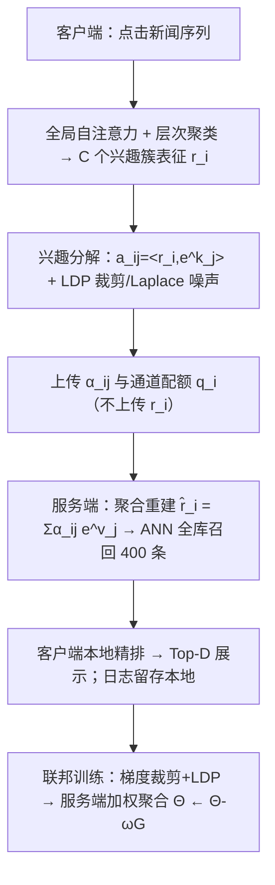
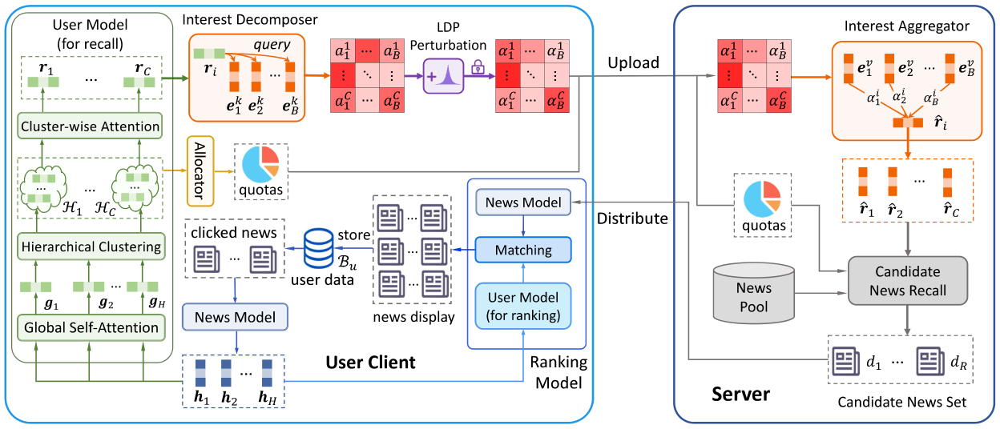
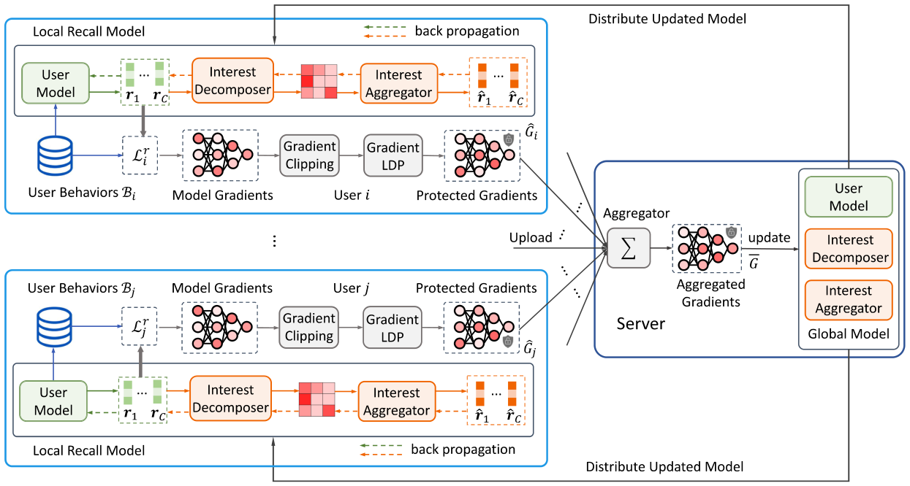

# Uni-FedRec: A Unified Privacy-Preserving News Recommendation Framework for Model Training and Online Serving (面向模型训练与在线服务的统一隐私保护新闻推荐框架)

- **会议/期刊**: EMNLP 2021 (Findings)
- **作者与机构**: Tao Qi, Chuhan Wu, Yongfeng Huang (清华大学电子系/BNRist)；Fangzhao Wu, Xing Xie (微软亚洲研究院)
- **推荐链路定位**: 召回（客户端多兴趣生成 + 服务端 ANN 检索）→ 精排（客户端本地排序）
- **研究方向**: 去偏公平、可信隐私与工业架构 / 多任务学习与列表级重排
- **论文原文**: [https://arxiv.org/abs/2109.05236v1](https://arxiv.org/abs/2109.05236v1)
- **开源代码**: [https://github.com/taoqi98/UniFedRec](https://github.com/taoqi98/UniFedRec)

## TL;DR (1分钟核心速览)

现有联邦新闻推荐（如 FedRec）只解决了"排序模型"的去中心化训练，却在**候选生成（召回）与在线服务**环节仍要么依赖中心化存储、要么把可反推点击历史的用户表征明文上传。Uni-FedRec 把召回也搬进客户端：本地用层次聚类学多兴趣簇表征，经"共享基础兴趣嵌入分解-聚合 + LDP 拉普拉斯噪声"合成为 $\hat r_i$，客户端只上传受保护的分解权重与通道配额，服务端聚合后 ANN 全库召回，候选再回传客户端本地精排。MIND 全库召回 R@100 相对最强基线 +27.7%，同时历史点击泄漏率由 17.04% 降至 0.55%。

## Background & Motivation (背景与核心矛盾)

- **主流范式**: 以 NRMS/LSTUR/NAML 为代表的新闻推荐模型把用户行为日志集中存储，用注意力/GRU 聚合点击新闻成单向量兴趣，再以内积匹配候选新闻；FedRec 则用联邦学习把**排序**模型训练去中心化。
- **前人局限**: ① 隐私只覆盖训练阶段，**在线服务仍需中心化用户表征**，兴趣向量本身可被反演推断点击历史；② 单向量用户兴趣无法覆盖多领域阅读偏好，而 PinnerSage/Octopus 这类多兴趣模型的多通道分数无法直接套用 InfoNCE 的单分数排序形式。
- **核心洞察 (Key Insight)**: 用户兴趣表征若由**跨用户共享的低维基础兴趣嵌入**重新合成，则其携带的个体私有信息远少于由真实点击聚合出的原始表征；同时，客户端本地执行精排天然无隐私泄露，隐私压力应集中在"召回所需的上传通道"。
- **本文切入点**: 用"分解→扰动→聚合"把上传内容从高维兴趣向量替换为低维受保护分解权重，并让多兴趣召回保持可排序的单一打分。

## Method (核心方法设计)

### 1. 整体框架 (Overall Architecture)

用户行为日志与新闻池彻底分离：日志留在客户端，池子在服务端。请求到来时，客户端本地运行用户模型（全局自注意力）→ 层次聚类多兴趣 → 兴趣分解器 → LDP 扰动，仅上传受保护的分解权重 $\alpha_{ij}$与各兴趣通道配额$q_i$；服务端执行兴趣聚合器重建$\hat r_i$，从全库 ANN 召回$R=400$条候选并下发；客户端用本地精排模型（可插拔 FedRec/NRMS/LSTUR/NAML 骨干）打分，展示 Top-$D$，会话结束日志落回本地。训练侧则是标准联邦流程：客户端本地算召回/精排损失梯度，裁剪加噪后上传，服务端按样本量加权聚合并广播参数。

<figure class="paper-figure" markdown="span">
  <figcaption>图 1：Uni-FedRec 的隐私保护在线服务框架。</figcaption>
</figure>

### 2. 关键设计拆解 (Key Designs)

1. **层次聚类多兴趣 + 配额加权统一打分**：痛点是一方面单向量兴趣丢失多领域偏好，另一方面多兴趣的多通道分数与 InfoNCE 的单标量排序不兼容。做法：对点击新闻表征 $\{g_j\}$做层次聚类（簇间平均距离超过阈值$d_c$即停止），簇内注意力得$r_i=\sum_j \gamma_{ij}g_{ij}$；召回时按簇规模分配配额$R_i=q_iR,\ q_i=|H_i|/\sum_j|H_j|$，并把各通道分数按配额组合成统一分$z=\sum_{i=1}^{C}q_i\hat z_i,\ \hat z_i=d\cdot\hat r_i$。直觉：配额把"兴趣通道"直接绑定到候选预算，避免大簇垄断召回位，同时恢复单分数可比性。
2. **兴趣分解-聚合 + LDP 合成表征**：痛点在于 $r_i$由真实点击聚合，明文上传可反推点击历史。做法：维护$B=30$个跨用户共享的基础兴趣嵌入$\{(e^k_j,e^v_j)\}$，将$r_i$在键空间分解为$a_{ij}=\langle r_i,e^k_j\rangle$，经裁剪与拉普拉斯噪声扰动$\hat a_{ij}=f_\delta(a_{ij})+n_I,\ n_I\sim\mathrm{La}(0,\lambda_I)$，再以$\alpha_{ij}=\mathrm{softmax}_j(\hat a_{ij})$对值嵌入加权合成$\hat r_i=\sum_j\alpha_{ij}e^v_j$。有效性来自两点：$d=256\to B=30$的降维投影天然压缩私有信息，且$\hat r_i$由共享嵌入而非个体点击构成；按 LDP 理论其隐私预算上界为$2\delta/\lambda_I$。工程上只传$\alpha$（$B$维）而非$\hat r_i$（$d$ 维），直接降低上行带宽。
3. **训练目标、负采样与推理开销**：召回用统一分构造 InfoNCE，$K_r=4$个负样本取自"曝光未点击"：$\mathcal{L}^r_u=\sum_{i=1}^{|B_u|}\frac{\exp(z_i)}{\exp(z_i)+\sum_{j=1}^{K_r}\exp(z^j_i)}$；精排损失$\mathcal{L}^g_u$同构，负样本取自同一 impression 内未点击新闻。联邦侧上传$\hat G_u=f_\theta(\partial\mathcal{L}_u/\partial\Theta)+n_g$，服务端$G=\sum_{u\in U}\beta_u\hat G_u,\ \beta_u=|B_u|/\sum_{v\in U}|B_v|$，$\Theta\leftarrow\Theta-\omega G$，每轮采样 2% 客户端。推理时客户端仅一次用户模型前向 + 30 维打分，服务端一次 ANN 检索，细排完全本地，延迟主要由上行与下发候选数决定。

<figure class="paper-figure" markdown="span">
  <figcaption>图 3：Uni-FedRec 的隐私保护模型训练框架。</figcaption>
</figure>

## Experimental Setup & Evaluation Protocol (实验设置与评估协议)

- **数据集与预处理**: 无 5-core 过滤，直接使用官方日志划分。

| 数据集 | #Users | #Items(News) | #Interactions | 特征/场景说明 |
| :--- | :---: | :---: | :---: | :--- |
| MIND | 1,000,000 | 161,013 | 24,155,470 clicks / 15,777,377 impressions | 微软新闻 6 周日志，大规模公开基准 |
| NewsFeeds | 20,000 | 120,219 | 112,927 clicks / 48,923 impressions | 商业新闻流 2 周日誌，稀疏度极高（约 1.2e-6 密度） |

- **数据划分与防穿越 (Splitting Strategy)**: MIND 沿用官方按时间切分；NewsFeeds 用**首周日誌构建历史行为**、**最后两天做评测**、其余日誌训练，属严格时间戳切分。
- **排名评测协议 (Ranking Protocol)**: 召回侧为**无偏 Full-Corpus 召回**——从全库新闻池中取 Top-$K$（$K$=100/200/300/400），统计**未来真实点击**被命中比例 R@K；隐私侧另设指标：统计**用户历史已点击新闻**出现在 Top-$K$ 候选中的比例（越低越好，反映表征可反演程度）；精排侧报告 impression 级 AUC（负样本取自同一 impression 的全部未点击项）。
- **对比基线与超参设置**: 召回基线 YoutubeNet、HUITA、EBNR、SASRec、PinnerSage、Octopus；精排骨干 FedRec/NRMS/LSTUR/NAML。Embedding $d=256$，自注意力 16 头 ×16 维，$B=30$，$d_c=1$，$\delta=0.2$，$\lambda_I=1.2$，$\theta=0.1$，$\lambda_g=0.01$，学习率 0.05，$K_r=K_g=4$；每方法独立重复 5 次，$t$-test 显著性$p\le 0.001$。

## Key Experimental Results (实验关键数据)

### 1. 主实验对比 (Main Results)

召回性能（R@K，%），加粗为最优：

| 方法 | MIND R@100 | R@200 | R@400 | NewsFeeds R@100 | R@200 | R@400 |
| :--- | :---: | :---: | :---: | :---: | :---: | :---: |
| YoutubeNet | 1.50 | 2.43 | 3.96 | 0.60 | 0.92 | 1.45 |
| HUITA | 1.69 | 2.67 | 3.97 | 0.60 | 0.91 | 1.45 |
| EBNR | 2.31 | 3.72 | 5.61 | 0.64 | 0.96 | 1.55 |
| SASRec | 2.22 | 3.51 | 5.38 | 0.62 | 0.96 | 1.49 |
| PinnerSage | 1.22 | 1.85 | 3.53 | 0.59 | 0.93 | 1.45 |
| Octopus | 1.26 | 1.93 | 3.55 | 0.60 | 0.92 | 1.44 |
| **Uni-FedRec** | **2.95** | **4.13** | **5.99** | **0.80** | **1.14** | **2.03** |
| Improv.% (vs 最强基线) | +27.7% | +11.0% | +6.8% | +25.0% | +18.8% | +31.0% |

精排总体性能（MIND AUC，召回×精排组合矩阵）：

| 召回方法 \ 精排骨干 | FedRec | LSTUR | NRMS | NAML |
| :--- | :---: | :---: | :---: | :---: |
| EBNR（最强基线） | 75.56 | 73.82 | 75.01 | 70.89 |
| PinnerSage | 69.26 | 68.96 | 67.28 | 66.09 |
| **Uni-FedRec** | **79.26** | **77.31** | **78.91** | **75.40** |
| Improv.% | +4.9% | +4.7% | +5.2% | +6.4% |

隐私保护（历史点击被回召率，越低越好）：

| 方法 | MIND R@100 | MIND R@400 | NewsFeeds R@100 |
| :--- | :---: | :---: | :---: |
| PinnerSage / Octopus | 16.91 / 17.04 | 27.18 / 27.31 | 29.43 / 29.45 |
| EBNR / SASRec | 5.49 / 6.00 | 12.05 / 12.52 | 11.35 / 7.78 |
| **Uni-FedRec** | **0.55** | **2.22** | **0.23** |

### 2. 消融实验 (Ablation Study)

| 变体 | 召回 R@K | 隐私泄漏率 | 结论 |
| :--- | :---: | :---: | :--- |
| w/o LDP 噪声 $n_I$ | ↑ | ↑↑ | 精度回升但隐私保护基本失效，印证噪声是权衡旋钮 |
| w/o 层次聚类多兴趣（退化为单兴趣） | ↓ | ≈ | 多领域覆盖丢失，召回精度下降 |
| w/o BIE 分解-聚合（直接上传 $r_i$） | ≈ | ↑↑ | 隐私泄漏率回到基线量级，证明合成机制才是隐私来源 |

（原文图 4 仅给出趋势方向，未报告具体数值；$\lambda_I$与$d_c$ 的敏感性分别在原文图 5、图 6。）

### 3. 关键实验发现 (Key Findings)

1. **增益随 $K$ 递减暴露了增益来源**：MIND 上 R@100 相对强基线 +27.7%，R@400 仅 +6.8%；说明多兴趣+配额的主要贡献是**把不同兴趣簇的头部候选挤进小候选集**，一旦候选池放大，各方法都能"捞回"长尾点击，增益被摊薄。
2. **隐私与精度的权衡极为陡峭**：最强多兴趣基线 PinnerSage/Octopus 的泄漏率高达 16.9%/17.0%，Uni-FedRec 仅 0.55%（约 30×降幅），而其召回仍全面优于这些基线——即隐私收益并非以精度为代价换取。

## Highlights & Limitations (亮点、对比与审稿批判)

- **与代表作对比 (vs. Prior Work)**: 相比 FedRec（只联邦训练精排、服务端仍需用户表征）、PinnerSage/Octopus（多兴趣但明文上传且多通道分数不可排）、以及基于同态加密的 FedRec-HE 类方案（通信/算力开销大），本文的差异是把"隐私保护"从训练阶段延伸到**在线召回服务**，并用低维分解权重替代加密，兼顾带宽与可排序性。
- **可迁移亮点**: ① "共享码本分解-聚合 + 噪声"可视为一种轻量级**隐私化表征量化**，可迁移到跨域/多场景上传用户向量的场景；② 用通道配额 $q_i$ 把多兴趣分数压成单标量，是复用 InfoNCE 类单分数损失的通用技巧。
- **审稿级局限批判**: ① 隐私论证偏"直觉+单轮 LDP"，缺少**多轮组合隐私预算（composition）核算**与实际攻击（成员推断/属性推断）验证；评测指标"历史点击回召率"是自造代理指标，说服力弱于攻击成功率。② 系统层面未报告上行/下发字节、端侧算力与端到端延迟，而 $B=30$ 的低维瓶颈与客户端每次请求都需前向用户模型+聚类，落地成本未被量化；同时基线均为集中式训练，缺少"联邦 + 多兴趣"的对照，增益归因混杂了联邦与多兴趣两种因素。

## Rating (四维评分)

- **方法创新性 (Novelty)**: ⭐⭐⭐⭐ （把隐私保护首次贯通召回与在线服务，"分解-聚合+LDP"思路清晰，但组件本身均为已有技术组合）
- **评估协议与实验扎实度 (Protocol & Experiments)**: ⭐⭐⭐ （全库召回 + 5 次重复 + $p\le0.001$ 显著性值得肯定，但隐私指标自造、消融仅给趋势无具体数值、缺联邦多兴趣基线）
- **写作与数学规范度 (Clarity & Rigor)**: ⭐⭐⭐⭐ （公式与符号简洁自洽、配额与统一分推导清楚，隐私预算仅给上界未展开证明）
- **工业落地与复现价值 (Industrial & Practical Value)**: ⭐⭐⭐⭐ （代码已开源，两阶段架构与真实新闻流业务对齐，但端侧聚类与上行延迟的工程账未算清）

