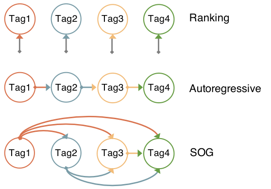
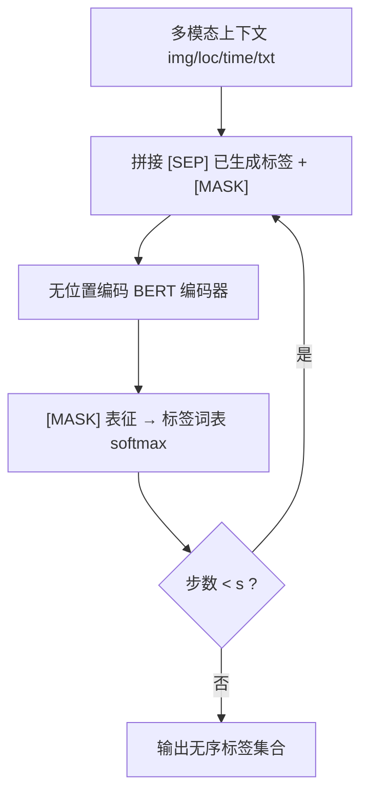

# Leveraging Order-Free Tag Relations for Context-Aware Recommendation（利用无序标签关系做上下文感知推荐）

- **会议/期刊**: EMNLP 2021
- **作者与机构**: Junmo Kang, Jeonghwan Kim, Suwon Shin, Sung-Hyon Myaeng（韩国科学技术院 KAIST）
- **推荐链路定位**: 端到端生成式（标签/话题推荐，一次性生成 top-5 标签集合）
- **研究方向**: 生成式推荐与离散语义ID / 多模态推荐
- **论文原文**: [https://arxiv.org/abs/2012.02957v2](https://arxiv.org/abs/2012.02957v2)
- **开源代码**: 暂未开源

## TL;DR (1分钟核心速览)

标签推荐长期被当作 top-k 排序问题（忽略标签间语义依赖）或自回归序列生成问题（强行引入并不存在的顺序）。本文提出 SOG：用去掉位置编码的 BERT 编码器配合 [MASK] 表征做"序列无关"生成，把已生成标签回填到输入 query 迭代扩展（类比伪相关反馈 PRF），并以 1-to-M KL 损失对剩余全部真值标签建模。在全标签库无采样排序协议下，Instagram P@1 达 51.85（较最强排序基线 +24.1%），Stack Overflow P@1 达 67.87（较最强 AR 基线 +8.9%）。

## Background & Motivation (背景与核心矛盾)

- **主流范式**: 一是 Joint Space / BERT-Ranking 类的排序范式，把上下文与标签映射到同一空间，用 pairwise 排序损失或 [CLS] 表征上的交叉熵取 top-k；二是 Seq2Seq / Seq2Set / Transformer-decoder 的自回归（AR）生成范式。
- **前人局限**: 排序范式对每个标签独立打分，无法利用标签间依赖——定性案例中 BR-EF 能推出 `#disney` 却推不出同属《头脑特工队》的 `#fear`/`#anger`；AR 范式把标签集当句子，next token 高度依赖紧邻的前一个 token，首步错误会沿链传播，且 1-to-1 序列似然把"可任意置换"的集合硬编码成唯一目标序列。
- **核心洞察 (Key Insight)**: 标签是"无句法、无序、却语义互相依赖"的集合型语言。作者的注意力统计佐证了这一点：tag→tag 的平均交互强度高达 63.31%，而 [MASK] 对最后生成的标签并无特别偏好（对 tag 的注意力 54.01%）。
- **本文切入点**: 用双向编码器 + [MASK] 替代 decoder，使所有已生成标签对下一步贡献等权；把"顺序"这一约束从架构（去位置编码）与目标函数（1-to-M）两个层面同时解除。

<figure class="paper-figure" markdown="span">
  <figcaption>图1：三种不同标签推荐框架的图示。</figcaption>
</figure>

## Method (核心方法设计)

### 1. 整体框架 (Overall Architecture)

一条 post 的多模态上下文（图像 caption、地点符号名、时间词化、正文文本）经 `[IMG]/[LOC]/[TIME]/[SEP]` 分隔符拼接后一次性送入 BERT，取末尾 `[MASK]` 位置的隐表征投影到标签词表做 softmax，argmax 得到第 $i$个标签；随后把该标签追加到 `[MASK]` 之前形成新一轮输入，重复$s$步（实验取$s=5$）得到最终无序标签集合。训练时每个 post 展开为$N$ 个前缀实例，损失为预测分布与"剩余真值标签均匀分布"之间的 KL 散度；推理为纯贪心解码，已生成标签概率置 0 防重复。

<figure class="paper-figure" markdown="span">
  ![图2：所提模型的整体架构。其利用 BERT 的自注意力和 \[MASK\] 标记迭代生成最可能的标签，使生成的标签之间具有相同流程。](../../../../assets/papers/2012.02957v2/figure_2.png)<figcaption>图2：所提模型的整体架构。其利用 BERT 的自注意力和 [MASK] 标记迭代生成最可能的标签，使生成的标签之间具有相同流程。</figcaption>
</figure>

### 2. 关键设计拆解 (Key Designs)

1. **序列无关编码生成（Sequence-Oblivious Generation）**：AR 的痛点在于 $t$步只池化$t-1$步 token，信息流被顺序截断。SOG 直接删除 position embedding，让 self-attention 对所有位置等权，第$i$步输入与打分为$X_i=[x,[\text{SEP}],\hat{y}_1,\dots,\hat{y}_{i-1},[\text{MASK}]]$、$p=\mathrm{softmax}(h_i^{[\text{MASK}]}W_{H_T}^{\top}+b)$。因$[\text{MASK}]$ 聚合的是全部已生成标签而非仅末位标签，错误不会沿链单向传播，这也是"已生成标签回填 query"这一 PRF 式操作的物理直觉来源。

2. **1-to-M 训练目标**：1-to-1 监督 $L_i=\{ht_i\}$把可置换集合压成唯一序列；本文令第$i$步的正样本为剩余全部真值$L_i=\{ht_i,\dots,ht_N\}$，并用 KL 损失对齐均匀分布$q$：
$$D_{\mathrm{KL}}(q\|p)=\sum_{ht\in H_T}q(ht)\log\frac{q(ht)}{p(ht)}$$
关键在于：每个 post 展开的实例数（$0,1,\dots,N-1$ 个已知标签）在 1-to-1 与 1-to-M 下完全相同，因此增益并非数据增广，而是顺序约束的松弛；打乱训练集标签顺序后性能不变，验证了无序假设。

3. **贪心解码与早融合**：束搜索（$B=3/5/10$）在标签任务上全面掉点，因为推荐只关心"每步最相关"而非"整体最可能的句子"，故采用$B=1$贪心。多模态侧，图像经 Azure captioning 转文本、时间规则化为 {季节, 星期, 时段} 三类词，与其余特征在同一 BERT 输入中靠 self-attention 交互（早融合），而非 BR-LF 的"分塔编码后平均"。推理成本为$s$ 次完整 BERT 前向（110M 参数，无跨步缓存复用）。

## Experimental Setup & Evaluation Protocol (实验设置与评估协议)

- **数据集与预处理**:

| 数据集 | #Posts | #Tags | Tags/Post | 稀疏度/过滤规则 | 特征/场景说明 |
| :--- | :---: | :---: | :---: | :---: | :--- |
| Instagram | 87,872 | 907 | 9.59 | 剔除 >20 标签帖（疑广告）+ 标签频次 <400 过滤 | Image(caption)+Location+Time+Text 四模态 |
| Stack Overflow | 81,320 | 3,897 | 3.05 | question score ≥5 + 标签频次 ≥10 | 仅 title+body 文本单模态 |

- **数据划分与防穿越**: 采用 9:1 **随机比例划分**（非全局时间戳切分，存在时序泄漏风险）。
- **排名评测协议**: **全标签词表排序**（softmax 覆盖全部 $|H_T|$个标签，无负采样、无候选截断），指标 P@K / R@K（$K=1,3,5$）；注意 Instagram 平均 9.59 标签/帖，R@5 理论上限仅约 52%。
- **对比基线与超参**: Frequency、Joint Space（pairwise + 随机负采样）、BR-LF / BR-EF（BERT 排序）、Seq2Seq(MLE)、Seq2Set(MLE+RL)、AR(1-to-1 / 1-to-M)；backbone 为 bert-base-uncased，$d=768$，lr 5e-5，batch 64，max len 384，每组设置 3 次试验取最优，未报告显著性检验与方差。

## Key Experimental Results (实验关键数据)

### 1. 主实验对比 (Main Results)

| 模型 | IG P@1 | IG P@5 | IG R@5 | SO P@1 | SO P@5 | SO R@5 |
| :--- | :---: | :---: | :---: | :---: | :---: | :---: |
| Frequency-Based | 6.99 | 4.65 | 5.76 | 7.49 | 7.57 | 16.73 |
| Joint Space (Ranking) | 15.21 | 9.58 | 17.40 | 9.70 | 6.06 | 13.26 |
| BR-LF | 28.84 | 14.88 | 26.77 | - | - | - |
| BR-EF | 41.78 | 20.51 | 34.50 | 58.72 | 20.56 | 44.01 |
| Seq2Seq (MLE) | 34.05 | 13.24 | 22.30 | 53.38 | 16.44 | 35.83 |
| Seq2Set (MLE+RL) | 39.96 | 14.66 | 26.94 | 57.30 | 16.95 | 37.53 |
| AR (1-to-1) | 30.06 | 14.66 | 25.88 | 61.66 | 21.06 | 45.98 |
| AR (1-to-M) | 37.34 | 17.46 | 29.47 | 62.30 | 22.15 | 47.49 |
| SOG (1-to-1) | 46.15 | 20.58 | 34.65 | 59.80 | 24.23 | **52.84** |
| **SOG (1-to-M)** | **51.85** | **22.03** | **36.62** | **67.87** | **24.09** | 51.82 |
| Improv. | +24.1% | +7.4% | +6.1% | +8.9% | +8.8% | +11.2% |

### 2. 消融实验 (Ablation Study)

| 设置 | P@1 | P@5 | R@5 |
| :--- | :---: | :---: | :---: |
| All Contexts (SOG 1-to-M) | **51.85** | **22.03** | **36.62** |
| w/o Image | 40.57 | 15.72 | 26.29 |
| w/o Location | 49.79 | 20.85 | 34.64 |
| w/o Time | 43.23 | 19.27 | 31.64 |
| w/o Text | 37.24 | 14.74 | 24.35 |

### 3. 关键实验发现 (Key Findings)

1. **早融合远胜晚融合**：BR-EF 与 BR-LF 同为 BERT 排序，仅融合方式不同，P@1 却从 28.84 跃升至 41.78（+44.9%），说明图像 caption 与时间的互补性（"太阳 + morning → #sunrise"）只有在同一注意力场中才能被捕捉，分塔编码后平均会把模态间的条件约束抹平。
2. **1-to-M 的增益确为"去顺序"而非"增数据"**：AR 从 1-to-1 到 1-to-M 在 Instagram 提升 +7.28 P@1（30.06→37.34），SOG 提升 +5.70（46.15→51.85），两者训练实例数一致；而打乱训练标签顺序后性能无显著差异，构成对顺序无关假设的直接证据。
3. **上下文特征贡献高度不均**：移除 Text 掉点最狠（P@1 −14.61），移除 Image 次之（−11.28），Location 几乎无损（−2.06），与注意力矩阵中 tag 对 text 的 10.41%、对 location 6.72% 的依赖强度排序一致——衍生特征（符号地点名）噪声大、泛化弱。

## Highlights & Limitations (亮点、对比与审稿批判)

- **与代表作对比 (vs. Prior Work)**: 相比 Joint Space / BR-EF 的"独立打分"，SOG 通过迭代回填 query 显式建模标签共现（`#joy`→`#fear`→`#anger` 链条）；相比 AR 的"仅依赖前一 token"，SOG 让全部已生成标签等权；相比 Seq2Set 的 RL 微调仍受 AR 骨架与巨大动作空间拖累（样本效率低、需 MLE 预训练），SOG 从架构与损失两端同时切断顺序假设。
- **可迁移亮点**: (1) 1-to-M + KL 的"对剩余标签集合均匀分布建模"可直接搬到会话多物品推荐、语义 ID 多码字生成等集合型输出任务；(2) 生成结果回填 query 的 PRF 式迭代，与生成式检索（TIGER 式自回归 ID 检索）的单向解码形成互补改进点。
- **审稿级局限批判**: (1) 推理需 $s=5$ 次完整 110M BERT 前向且无法复用中间 KV，延迟约为单次编码的 5 倍、训练耗时 25 小时，在线部署代价偏高；(2) 评估采用随机 9:1 划分而非时间切分，未做新标签冷启动与长尾分桶，且 R@5 受平均 9.59 标签的物理上限压制，主表未报方差与显著性；(3) SOG(1-to-1) 在 Stack Overflow 的 P@1 反低于 AR(1-to-1)（59.80 vs 61.66），说明纯单模态文本场景下架构本身优势不稳，收益高度依赖 1-to-M 训练配方。

## Rating (四维评分)

- **方法创新性 (Novelty)**: ⭐⭐⭐⭐ （将"无序+互依赖"重新定义为集合型语言问题，去位置编码 + 1-to-M KL 的组合有清晰的问题驱动逻辑，但单向贪心生成本身并非全新范式）
- **评估协议与实验扎实度 (Protocol & Experiments)**: ⭐⭐⭐ （全标签库无采样排序是加分项，双域+多基线+特征消融较完整；但随机划分、无时间切分、仅 3 次试验且未报显著性检验与方差）
- **写作与数学规范度 (Clarity & Rigor)**: ⭐⭐⭐⭐ （$[\text{MASK}]$表征、1-to-M 目标与贪心解码的定义前后一致、公式简洁，注意力统计表为设计提供了实证支撑；训练实例展开的边界与$q$ 的构造细节略简）
- **工业落地与复现价值 (Industrial & Practical Value)**: ⭐⭐⭐ （思路易复现但无开源代码、图像 caption 依赖商业 API，$s$ 次前向的推理开销与 25h 训练成本限制了大规模在线部署）

