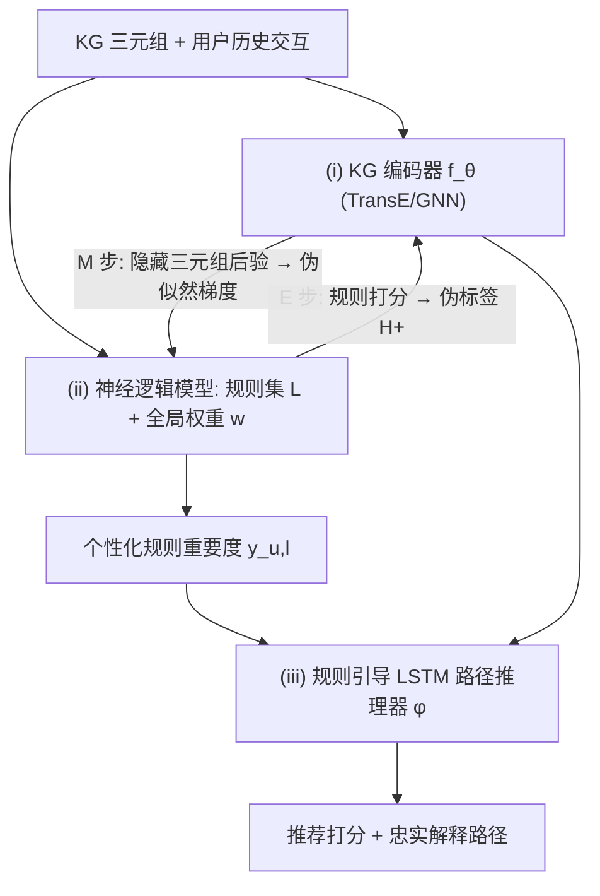
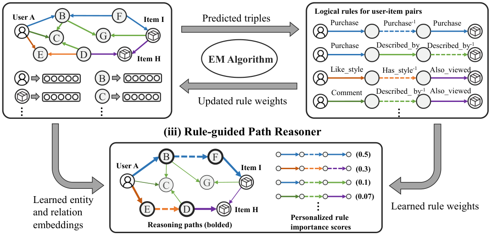

# Faithfully Explainable Recommendation via Neural Logic Reasoning (基于神经逻辑推理的忠实可解释推荐)

- **会议/期刊**: NAACL 2021
- **作者与机构**: Yaxin Zhu, Yikun Xian, Zuohui Fu, Gerard de Melo, Yongfeng Zhang (Rutgers University)
- **推荐链路定位**: 召回（KG 路径候选生成 + 可解释理由输出）
- **研究方向**: 图神经网络与知识图谱推荐 / 对话推荐与可解释性生成
- **论文原文**: [https://arxiv.org/abs/2104.07869v1](https://arxiv.org/abs/2104.07869v1)
- **开源代码**: [https://github.com/orcax/LOGER](https://github.com/orcax/LOGER)

## TL;DR (1分钟核心速览)

KG 路径推荐（PGPR、CAFE 等）能给出"看起来合理"的解释路径，但几乎无人验证解释是否**忠实**反映模型真实决策、是否与用户历史行为一致。本文提出 LOGER：以可解释的逻辑合成规则为桥梁，用 EM 算法让 KG 编码器 $f_\theta$与规则权重$\mathbf{w}$ 互相蒸馏，导出**用户级个性化规则重要度**并约束 LSTM 路径推理器只在高分规则空间内搜索。在三个 Amazon 电商数据集 top-10 评测中 NDCG 相对最优基线最高提升 22.9%，同时 JS 忠实度散度与人工排序均取得最优。

## Background & Motivation (背景与核心矛盾)

- **主流范式**: 以 PGPR/CAFE 为代表，把用户-物品推荐转化为 KG 上的强化学习/模块化路径搜索，路径本身即解释。
- **前人局限**: (1) PGPR 的路径由"知识驱动奖励"引导，与**具体用户历史行为解耦**，同一用户与不同用户可能得到同质解释；(2) CAFE 的神经模块网络只隐式抽象推理过程，无法保证生成的解释路径就是模型打分真正依赖的证据（Subramanian et al. 指出此类解释缺乏忠实性）。
- **核心洞察 (Key Insight)**: 忠实性可操作化为"**训练集上用户历史行为的规则分布** 与 **测试期生成路径的规则分布** 之间的接近程度"，若解释路径来自模型真实使用的规则，两个分布应当高度重合。
- **本文切入点**: 用可解释的逻辑规则（而非黑箱注意力）作为"编码器语义"与"路径生成"之间的共享中间语言，规则权重天然可读、可验证、可施加路径约束。

## Method (核心方法设计)

### 1. 整体框架 (Overall Architecture)

LOGER 由三部分组成：KG 编码器 $f_\theta$学习实体/关系语义；神经逻辑模型（Markov Logic Network）在规则集$L$上维护全局权重$\mathbf{w}$；两者通过 **EM 迭代** 互训——E 步用规则权重筛选"可信隐藏三元组"并注入编码器训练，M 步用编码器给出的隐藏三元组后验更新规则权重。收敛后按$y_{u,l}=w_l n_l(u)/\sum_{l'}n_{l'}(u)$计算**每个用户各自的规则重要度**，据此限制 LSTM 路径推理器$\phi$ 只在 top 规则对应的关系序列上生成用户→物品的解释路径。

<figure class="paper-figure" markdown="span">
  <figcaption>图1：所提可解释推荐方法示意图，包括(i) KG编码器，(ii) 神经逻辑模型，以及(iii) 规则引导的路径推理器。</figcaption>
</figure>

### 2. 关键设计拆解 (Key Designs)

1. **规则-编码器互蒸馏的 E 步（规则先验注入表征）**：痛点是不完整 KG 里大量缺失 user-item 交互无监督信号。做法是用上轮规则权重估计隐藏三元组为真的概率，再用固定点条件把它当作编码器的软标签：

$$p(X_{hrt}=1\mid X_{G_{hrt}},\mathbf{w})=\sigma\!\left(\frac{\sum_{l\in L_{hrt}} w_l}{|L_{hrt}|}\right),\qquad \ell(\theta)=\sum_{(e_h,r,e_t)\in G\cup H^{+}}\log q(X_{hrt}=1\mid\theta)$$

   其中 $H^{+}=\{(e_h,r,e_t)\mid p\ge\tau\}$ 即"高置信隐藏三元组"。直觉：规则判为真的缺失交互被补进正样本，等价于**逻辑驱动的语义增广**，缓解稀疏与假阴性。

2. **个性化规则重要度 + 规则引导路径推理（解释的忠实性来源）**：全局权重 $w_l$只能表达"哪些规则普遍有效"，无法表达"对该用户有效"。作者用用户自身的规则 grounding 计数$n_l(u)$做归一化加权，得到$y_{u,l}$，再把路径推理器的搜索空间限制在$y_u$ 中高分规则所覆盖的关系序列上。这从机制上排除了"事后编造一条看似通顺但与决策无关的路径"的可能——路径必须在模型真正依赖的规则空间内。

3. **训练目标、负采样与推理效率**：M 步无法直接最大化配分函数 $Z$，改用伪似然梯度上升：

$$\nabla_{w_l}\ell_{PL}=\sum_{(e_h,r,e_t)\in G}\frac{1-p_{hrt}}{|L_{hrt}|}+\sum_{(e_h,r,e_t)\in H}\frac{q(X_{hrt}=1\mid\theta)-p_{hrt}}{|L_{hrt}|}$$

   最终排序分为编码器似然与规则似然的加权和 $s(u,v)=q(X_{urv}\mid\theta)+\alpha\,p(X_{urv}=1\mid X_{G_{urv}},\mathbf{w})$（$\alpha$ 为超参），无需负采样，训练开销主要来自规则 grounding 计数，路径推理为单用户一次前向的 LSTM 序列生成。

## Experimental Setup & Evaluation Protocol (实验设置与评估协议)

- **数据集与预处理**: 三个 Amazon 电商子集（Fu et al. 2020b 的大规模子集，KG 同时含用户侧行为实体与物品侧属性实体）；原文未在正文给出过滤阈值与统计表（置于附录）。

| 数据集 | 领域 | KG 特点 | 场景说明 |
| :--- | :---: | :---: | :--- |
| Cellphones | 手机 | 用户侧+物品侧关系 | 主实验与消融数据集 |
| Grocery | 生鲜杂货 | 用户偏好/风格关系丰富 | 验证跨品类泛化 |
| Automotive | 汽车用品 | 同上 | RippleNet 无结果（未跑通/不可扩展） |

- **数据划分与防穿越 (Splitting Strategy)**: 正文仅说明"训练集采样历史路径、测试集生成解释路径"，**未明确标注是 Leave-One-Out 还是比例划分**，沿用 HeteroEmbed(Ai et al. 2018) 的评测设定。
- **排名评测协议 (Ranking Protocol)**: 沿用 HeteroEmbed 的 **top-10 推荐** 计算 Precision / Recall / NDCG / HR；原文**未披露采样负例比例或是否为 Full-Ranking**，此为可复现性缺口。
- **对比基线与超参设置**: 基线含 CKE（TransR+MF）、RippleNet（记忆网络+路径正则）、PGPR（策略引导图搜索）、KGAT（注意力高阶邻居传播）、HeteroEmbed（异构图表征，与本文同为 TransE 底座的关键对照）。$\tau$与$\alpha$为超参，$H^{+}$ 规模做敏感性分析；未见显著性检验报告。

## Key Experimental Results (实验关键数据)

### 1. 主实验对比 (Main Results)

| 模型 | Cellphones NDCG@10 | Cellphones HR@10 | Grocery NDCG@10 | Grocery HR@10 | Automotive NDCG@10 | Automotive HR@10 |
| :--- | :---: | :---: | :---: | :---: | :---: | :---: |
| CKE | 0.1847 | 0.3067 | 0.3070 | 0.4511 | 0.2257 | 0.3621 |
| RippleNet | 0.2177 | 0.3715 | 0.2858 | 0.4800 | — | — |
| PGPR | 0.2366 | 0.3801 | 0.3174 | 0.4926 | 0.2804 | 0.4409 |
| KGAT | 0.2365 | 0.3835 | 0.3381 | 0.5020 | 0.2859 | 0.4514 |
| HeteroEmbed | 0.2626 | 0.4226 | 0.3701 | 0.5572 | 0.3314 | 0.5082 |
| **LOGER** | **0.3227** | **0.4808** | **0.4370** | **0.6121** | **0.3653** | **0.5346** |
| Improv.% (vs 最优基线) | **+22.9%** | **+13.8%** | **+18.1%** | **+9.9%** | **+10.2%** | **+5.2%** |

Recall/Precision 同向：Cellphones 0.2977 / 0.0622（HeteroEmbed 0.2543 / 0.0527，Recall +17.1%）；Grocery 0.3754 / 0.0906；Automotive 0.3091 / 0.0743。

### 2. 消融与忠实度实验 (Ablation & Faithfulness)

| 配置 | Cellphones JS$_f$↓ | Cellphones JS$_w$ ↓ | Cellphones Avg.Rank ↓ | Grocery Avg.Rank ↓ |
| :--- | :---: | :---: | :---: | :---: |
| PGPR | 0.56 | 0.49 | 2.52 | 2.27 |
| KGAT | 0.53 | 0.45 | 2.14 | 2.08 |
| **LOGER** | **0.47** | **0.32** | **1.52** | **1.75** |
| w/o 逻辑规则（= HeteroEmbed 同底座 TransE） | 0.2626 NDCG（推荐侧代理消融） | — | — | — |

| 隐藏三元组数 $|H^{+}|$ (Cellphones) | 10 → 50 趋势 |
| :--- | :--- |
| P / R / NDCG / HR | 随 $|H^{+}|$ 增大**单调上升**，全区间高于 HeteroEmbed（图 2） |

### 3. 关键实验发现 (Key Findings)

1. **同底座消融证明增益来自逻辑推理而非表征**：LOGER 与 HeteroEmbed 都用 TransE 学习 KG 表征，但 NDCG 从 0.2626 提升到 0.3227（+22.9%），说明增益来自 EM 互蒸馏引入的规则先验与隐藏三元组增广，而非更复杂的编码器。
2. **规则增广对稀疏更有价值**：随 $|H^{+}|$ 从 10 增至 50，四项指标持续上升且始终压制 HeteroEmbed——规则挖掘出的高置信缺失交互越多，模型辨别"好规则"的能力越强，形成正反馈。
3. **忠实性与精度同向而非权衡**：LOGER 在 JS$_w$ 上从 KGAT 的 0.45 降至 0.32（−29%），人工排序 1.52 明显优于 2.14/2.52，说明用规则约束解释路径不会牺牲推荐质量，反而因路径空间收窄而降低噪声。

## Highlights & Limitations (亮点、对比与审稿批判)

- **与代表作对比 (vs. Prior Work)**: 相比 PGPR 的"全局奖励 + RL 搜索"，LOGER 的路径由**用户级规则重要度**约束，解释可归因到具体规则而非策略网络黑箱；相比 KGAT 的注意力权重式解释（无法验证是否真被使用），LOGER 用训练/测试规则分布的 JS 散度给出**可量化忠实性定义**；相比 CKE/RippleNet 只把 KG 当正则项，本文将规则直接用于打分。
- **可迁移亮点**: (1) "规则分布一致性"作为忠实性度量，可平移到任何生成式解释（LLM 推荐理由、对话推荐解释）的自动评估；(2) EM 式"规则先验 → 伪标签 → 表征学习"的互蒸馏框架，可用于冷启动场景下的伪交互增广。
- **审稿级局限批判**: (1) **评估协议披露不足**——未说明划分方式、负例采样比与是否 Full-Ranking，且缺显著性检验，与 KGAT 等基线差距在部分指标上仅 0.002 量级（如 Cellphones NDCG 0.2366 vs 0.2365），说服力依赖单一数据集上的大幅领先；(2) 规则 grounding 计数随 KG 规模与规则长度组合增长，路径推理还需 LSTM 自回归生成，线上时延与规则集人工/自动挖掘的可扩展性未做复杂度分析，也缺少对 $\tau$、$\alpha$ 的敏感性曲线。

## Rating (四维评分)

- **方法创新性 (Novelty)**: ⭐⭐⭐⭐ （首次在 KG 可解释推荐中形式化并度量"忠实性"，EM 互蒸馏连接符号规则与分布式表征的思路清晰，但各模块本身（MLN、TransE、LSTM 路径生成）均为已有技术组合）
- **评估协议与实验扎实度 (Protocol & Experiments)**: ⭐⭐⭐ （三数据集 + JS 量化 + 20 人用户调研的组合值得肯定，但划分/采样协议缺失、无显著性检验、消融仅覆盖 $|H^{+}|$ 一维）
- **写作与数学规范度 (Clarity & Rigor)**: ⭐⭐⭐⭐ （E/M 两步公式与梯度推导完整、符号一致，路径推理器细节与数据集统计下放附录略显关键信息外置）
- **工业落地与复现价值 (Industrial & Practical Value)**: ⭐⭐⭐ （代码已开源、可作为可解释召回模块嵌入，但规则挖掘与 grounding 计数的规模化开销与线上时延缺乏论证）

