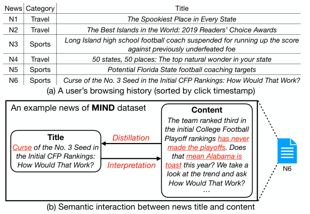
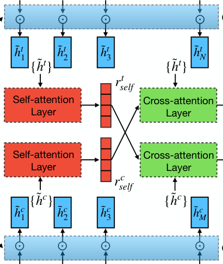
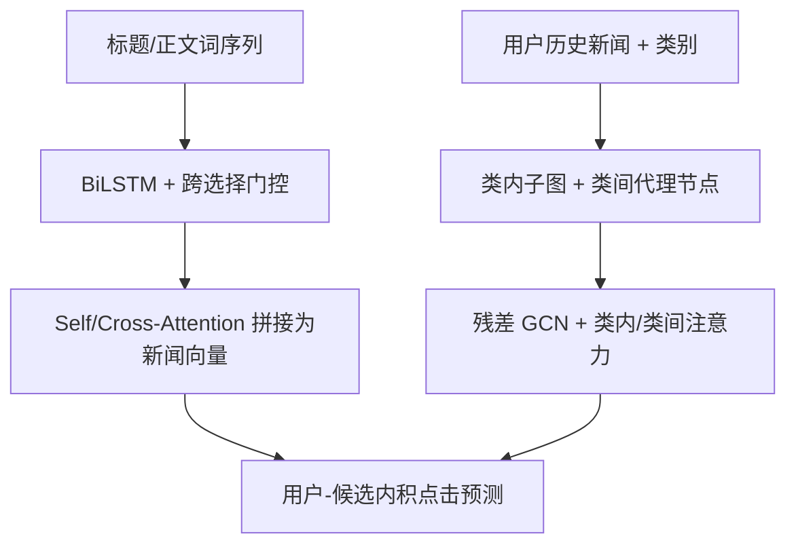

# Neural News Recommendation with Collaborative News Encoding and Structural User Encoding (基于协同新闻编码与结构化用户编码的神经新闻推荐)

- **会议/期刊**: EMNLP 2021 Findings
- **作者与机构**: Zhiming Mao, Xingshan Zeng, Kam-Fai Wong；香港中文大学、华为诺亚方舟实验室
- **推荐链路定位**: 召回/粗排（候选新闻点击预测）
- **研究方向**: 图神经网络与知识图谱推荐 / 序列与会话推荐
- **论文原文**: [论文原文链接](https://arxiv.org/abs/2109.00750v2)
- **开源代码**: [开源代码仓库链接](https://github.com/Veason-silverbullet/NNR)

## TL;DR (1分钟核心速览)

本文针对新闻推荐中“标题-内容分开编码、用户历史按线性序列编码”的两大痛点，提出协同新闻编码 CNE 与结构化用户编码 SUE：前者用跨选择门控和交叉注意力让标题与正文互相解释，后者把用户浏览历史构造成“类内新闻子图 + 类间代理节点”的层次聚类图，并用 GCN 与两级注意力学习用户兴趣。在 200K-MIND 的曝光候选排序协议上，AUC 达 69.55，较最佳基线提升 +0.92，nDCG@10 提升 +0.49。

## Background & Motivation (背景与核心矛盾)

- **主流范式**: 新闻推荐通常分别用 CNN/RNN/自注意力编码标题与正文，再将用户历史视为有序新闻序列，用 RNN 或注意力聚合用户表示，最后以用户-候选新闻向量内积做点击预测。
- **前人局限**: 其一，标题与正文分开编码后再拼接/注意力融合，忽略词级语义交互；标题常含隐喻、修辞与稀疏术语，仅靠标题无法消歧。其二，用户历史被压成线性序列，无法显式刻画同一主题新闻形成的“兴趣簇”，也难以区分类内细化与类间聚合。
- **核心洞察 (Key Insight)**: 标题是正文的“蒸馏”，正文是标题的“解释”；用户对同一主题的多次浏览天然构成虚拟兴趣簇，簇内新闻相关、簇间兴趣互补，层次结构比平坦序列更贴近真实兴趣分布。
- **本文切入点**: 用门控跨选择 + 两阶段注意力实现标题-正文协同编码；用类内/类间层次图与 GCN 显式建模用户兴趣簇。

<figure class="paper-figure" markdown="span">
  <figcaption>图1：(a) 用户浏览历史示例。(b) 新闻标题-内容语义交互示例。</figcaption>
</figure>

## Method (核心方法设计)

### 1. 整体框架 (Overall Architecture)

模型由 CNE 与 SUE 两路组成。CNE 对标题、正文分别过 BiLSTM，取正/反向末层 cell state 拼接为语义记忆向量；再用对方记忆向量门控选择本方序列特征，随后经 self-attention 与 cross-attention 相加得到标题/正文表示并拼接为新闻向量 $\mathbf{r}_n$。SUE 以用户历史新闻为节点，按类别建类内子图，并为每个类别加代理节点、代理节点全连接形成类间子图；GCN 带残差传播后，以候选新闻为 query 做类内注意力与类间注意力，得到用户表示$\mathbf{r}_u$。最后以$\hat{y}_{n,u}=\langle\mathbf{r}_n,\mathbf{r}_u\rangle$ 排序候选新闻。

<figure class="paper-figure" markdown="span">
  <figcaption>图2：我们模型的整体架构。图构建基于图1(a)中的用户历史。</figcaption>
</figure>

### 2. 关键设计拆解 (Key Designs)

1. **跨选择门控（Cross-selection）**：解决标题/正文语义割裂。用对方 LSTM 记忆向量 $\mathbf{m}^c$重标定本方第$i$个序列特征：$g_i^t=\sigma(\mathbf{W}_h\mathbf{h}_i^t+\mathbf{W}_m\mathbf{m}^c+\mathbf{b}_g)$，$\tilde{\mathbf{h}}_i^t=g_i^t\odot\mathbf{h}_i^t$。直觉是让正文上下文筛掉标题中的歧义词，同时保留标题的核心信息。
2. **两阶段交叉注意力（Cross-attention）**：在跨选择特征上先做 self-attention 得 $\mathbf{r}_{self}^t$，再以对方 self 表示作 query、本方特征作 key/value 得$\mathbf{r}_{cross}^t$，最终$\mathbf{r}_t=\mathbf{r}_{self}^t\oplus\mathbf{r}_{cross}^t$，$\mathbf{r}_n=[\mathbf{r}_t;\mathbf{r}_c]$。这样标题可被正文解释，正文也可被标题蒸馏。
3. **层次聚类图与两级注意力**：类内子图连接同类别新闻，类间子图通过代理节点汇聚不同兴趣簇。GCN 采用残差传播 $\mathbf{H}^{l+1}=\mathrm{ReLU}(\tilde{\mathbf{D}}^{-1/2}\tilde{\mathbf{A}}\tilde{\mathbf{D}}^{-1/2}\mathbf{H}^l\mathbf{W}^l)+\mathbf{H}^l$缓解过平滑；类内注意力以候选新闻为 query 聚合簇内新闻，类间注意力再聚合簇级表示，$\mathbf{r}_u=\mathbf{r}_{cl}^{inter}$。

**训练目标、负采样与推理效率**：对每个点击样本随机采 $K=4$个未点击新闻，做$(K+1)$类 softmax：$\mathcal{L}=-\sum_i\log\frac{\exp(\hat{y}_i^+)}{\exp(\hat{y}_i^+)+\sum_{j=1}^{K}\exp(\hat{y}_{i,j}^-)}$。推理时对候选新闻逐条编码并与用户向量内积；用户侧需为其历史构图并跑 GCN，开销主要来自每用户图传播。

## Experimental Setup & Evaluation Protocol (实验设置与评估协议)

- **数据集与预处理**: 从 MIND 采样 200K 用户，正文用摘要文本；标题/正文截断至 32/128，历史长度上限 50，GloVe 300 维。

| 数据集 | #Users | #Items | #Interactions | 稀疏度/密度 | 特征/场景说明 |
| :--- | :---: | :---: | :---: | :---: | :--- |
| 200K-MIND | 200,000（训练 189,532） | 78,520（训练 75,858） | 正样本 902,330；曝光日志 594,433 | 正样本/用户-新闻对≈0.0057% | 英文新闻标题+摘要正文+类别；MSN 点击日志 |

- **数据划分与防穿越 (Splitting Strategy)**: 使用 MIND 官方训练/验证；因测试集无标签，将原验证集对半切分为验证集与测试集；训练仅用训练集，按验证 AUC 早停。
- **排名评测协议 (Ranking Protocol)**: 评测在 MIND 每次曝光给出的候选新闻集上排序，报告 AUC、MRR、nDCG@5、nDCG@10；训练采用 1:4 负采样，并非全库 Full-Ranking。所有实验独立重复 10 次取均值，显著性用 Student’s t-test，$p<0.01$。
- **对比基线与超参设置**: 对比 LibFM/DSSM/Wide&Deep 等通用模型，以及 DAE-GRU、DKN、LSTUR、NAML、NPA、NRMS、FIM 等新闻推荐 SOTA；Adam，lr=1e-4，dropout=0.2，batch=64，GCN 层数 $L=4$。

## Key Experimental Results (实验关键数据)

### 1. 主实验对比 (Main Results)

| 方法 | AUC | MRR | nDCG@5 | nDCG@10 |
| :--- | ---: | ---: | ---: | ---: |
| DSSM | 64.74 | 30.12 | 33.22 | 39.50 |
| DAE-GRU | 65.98 | 31.48 | 34.93 | 41.12 |
| DKN | 66.20 | 31.25 | 34.23 | 40.92 |
| LSTUR | 68.10 | 32.87 | 36.46 | 42.69 |
| NAML | 68.63† | 33.16 | 36.79 | 43.07 |
| NPA | 67.34 | 32.59 | 35.98 | 42.28 |
| NRMS | 68.61 | 33.46† | 37.02† | 43.30† |
| FIM | 68.44 | 32.95 | 36.58 | 42.97 |
| **CNE-SUE** | **69.55** | **33.70** | **37.54** | **43.79** |
| Δ vs 最佳基线 | +0.92 | +0.24 | +0.52 | +0.49 |

### 2. 消融实验 (Ablation Study)

| 变体 | AUC | MRR | nDCG@5 | nDCG@10 |
| :--- | ---: | ---: | ---: | ---: |
| Full CNE-SUE | **69.55** | **33.70** | **37.54** | **43.79** |
| w/o Cross-selection | 69.39 | 33.52 | 37.30 | 43.62 |
| w/o Cross-attention | 69.48 | 33.61 | 37.39 | 43.68 |
| w/o GCN | 69.31 | 33.48 | 37.25 | 43.53 |
| w/o Hierarchical cluster attention | 69.40 | 33.52 | 37.37 | 43.65 |

### 3. 关键实验发现 (Key Findings)

1. 完整模型全面超过最佳基线：AUC +0.92、nDCG@10 +0.49；新闻编码消融中 CNE 的 AUC 69.21 高于 NAML 68.63，且标题单编码 68.25 明显高于正文单编码 67.96，说明“标题-正文交互”比简单拼接更有效。
2. 消融中移除 GCN 掉点最大（AUC −0.24、nDCG@10 −0.26），移除 cross-attention 掉点最小（AUC −0.07），表明用户历史的结构化建模是主要增益，交叉注意力更多是互补增强。
3. 图深度 $L=4$最优，继续加深因过平滑而下降；兴趣簇数$|C|>1$时模型稳定优于基线，但$|C|>8$ 后所有模型下降，说明层次聚类能平衡兴趣多样性与噪声。

## Highlights & Limitations (亮点、对比与审稿批判)

- **与代表作对比 (vs. Prior Work)**: NAML 对标题/正文分别 CNN 编码后多视图融合，NRMS 用多头自注意力编码新闻与用户序列，FIM 做候选-历史 3D 卷积匹配；本文首次把“标题-正文词级跨选择/交叉注意”与“用户兴趣层次聚类图”组合，显式建模文本互补与兴趣结构。
- **可迁移亮点**: 跨选择门控可迁移到图文电商、短视频标题-封面-正文等多字段内容编码；类内新闻子图 + 类间代理节点的构图方式可迁移到长历史用户建模。
- **审稿级局限批判**: 构图依赖新闻类别标签，类别噪声或缺失时图质量会退化；仅在 200K-MIND 上验证，评测为曝光候选排序而非全库排序，且每用户构图 + GCN 推理带来额外延迟，线上大规模收益仍需 A/B 验证。

## Rating (四维评分)

- **方法创新性 (Novelty)**: ⭐⭐⭐⭐ （跨选择门控与层次聚类图组合有针对性，但整体仍是 BiLSTM/注意力/GCN 的有机集成）
- **评估协议与实验扎实度 (Protocol & Experiments)**: ⭐⭐⭐ （单数据集 200K-MIND、10 次重复与 t-test 较规范，但缺全库排序和多领域验证）
- **写作与数学规范度 (Clarity & Rigor)**: ⭐⭐⭐⭐ （公式与模块关系清楚，图注和部分符号可更统一）
- **工业落地与复现价值 (Industrial & Practical Value)**: ⭐⭐⭐⭐ （代码开源、结构可部署，但用户图构图与 GCN 推理成本需工程优化）

