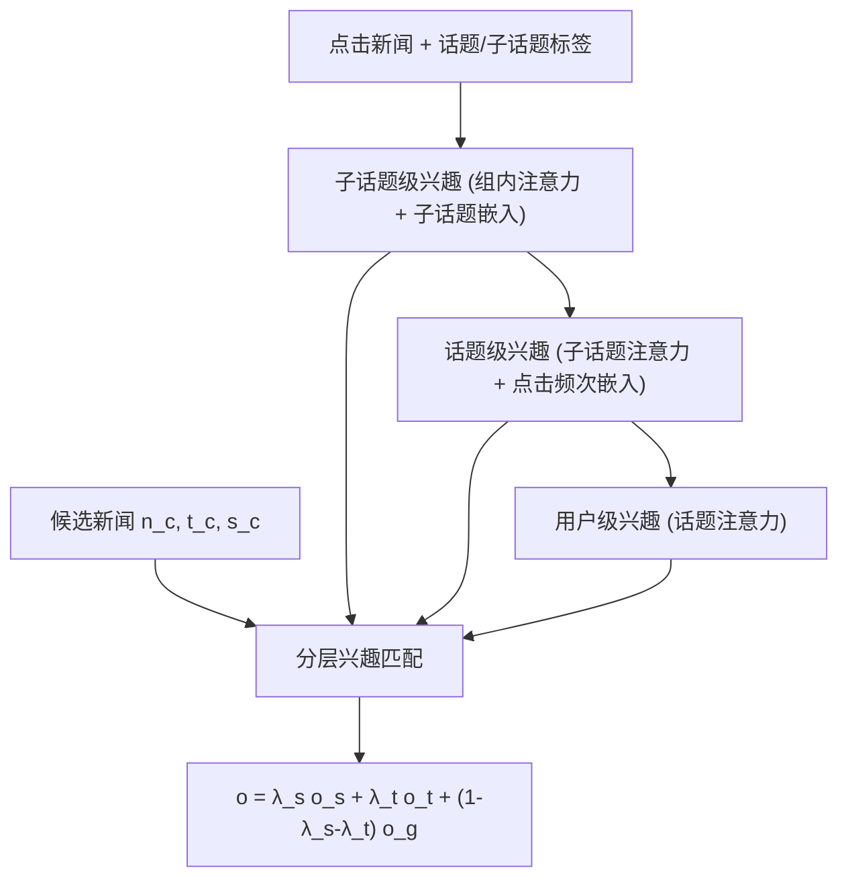
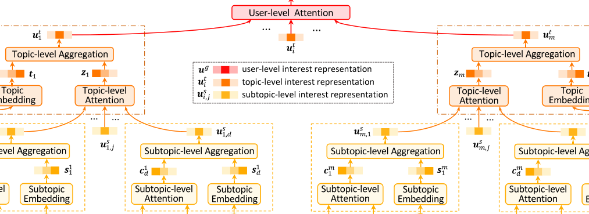
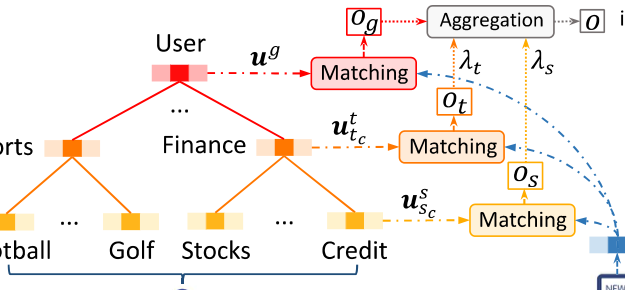

# HieRec: Hierarchical User Interest Modeling for Personalized News Recommendation (面向个性化新闻推荐的层级用户兴趣建模)

- **会议/期刊**: ACL 2021
- **作者与机构**: Tao Qi, Chuhan Wu, Peiru Yang, Yongfeng Huang (清华大学电子工程系/BNRist)；Fangzhao Wu, Yang Yu, Xing Xie (微软亚洲研究院)
- **推荐链路定位**: 召回（多通道子话题召回）+ 精排（impression 级排序）
- **研究方向**: 序列与会话推荐（新闻推荐中的用户兴趣建模）
- **论文原文**: [https://arxiv.org/abs/2106.04408v1](https://arxiv.org/abs/2106.04408v1)
- **开源代码**: [https://github.com/JulySinceAndrew/HieRec](https://github.com/JulySinceAndrew/HieRec)

## TL;DR (1分钟核心速览)

新闻推荐的主流做法是把用户历史点击聚合成**单一用户向量**，但用户兴趣天然多样且多粒度（既爱体育，又只爱足球而非高尔夫），单向量必然发生兴趣"平均化坍缩"。HieRec 改用一个三层兴趣树（子话题级 / 话题级 / 用户级）表示用户，并提出分层兴趣匹配：候选新闻分别与其所属子话题、所属话题及全局兴趣打分，再按层级权重融合。在 MIND 与工业 Feeds 两个真实数据集、impression 内负采样排序协议下，MIND 上 AUC 由 65.91 升至 67.95（+3.10%），nDCG@5 由 33.78 升至 36.36（+7.64%）。

## Background & Motivation (背景与核心矛盾)

- **主流范式**: 以 NRMS/NAML/NPA 为代表，用自注意力/注意力池化把点击序列压成一个用户向量，再与候选新闻向量做内积；LSTUR/GNewsRec 额外引入用户 ID 或点击图结构增强长期兴趣。
- **前人局限**: ①单向量表征容量有限，无法同时保留"体育—足球—英超"这类嵌套粒度信息，细粒度偏好被粗粒度偏好淹没；②FIM 类方法虽做候选感知匹配，但只用同一语义空间做整体相关性，缺少"候选新闻匹配不上任何细粒度兴趣时回退到粗粒度"的机制。
- **核心洞察 (Key Insight)**: 作者从日志观察到，同一用户面对同属"体育"的三条新闻（足球/篮球/高尔夫）只点足球，说明**在哪个粒度上匹配成功**才是区分点击的关键信号，而非兴趣的整体相似度。
- **本文切入点**: 用显式层级结构（话题/子话题标签是新闻平台现成元数据）组织用户兴趣，并让候选新闻沿层级逐级"对号入座"打分。

## Method (核心方法设计)

### 1. 整体框架 (Overall Architecture)

输入为用户 $M$条点击新闻及其话题/子话题标签，以及候选新闻$n_c$（含$t_c,s_c$）。新闻编码器先用词自注意力 + 词注意力得到文本向量$n_t$，再用实体自注意力 + 实体注意力得到实体向量$n_e$，拼接为$n=W_t n_t+W_e n_e$。用户侧按标签把点击切成"话题—子话题"点击组，自底向上做三层注意力聚合得到兴趣树，再在匹配阶段沿层级对候选新闻打分，加权融合为最终兴趣分$o$，用 NCE 损失训练。

<figure class="paper-figure" markdown="span">
  <figcaption>图 2：HieRec 中分层用户兴趣建模的框架。</figcaption>
</figure>

### 2. 关键设计拆解 (Key Designs)

1. **三级兴趣树聚合（把"平均化"改成"分桶后聚合"）**：先对每个点击组 $\mathcal{N}_{ij}$做组内注意力得到$c_{ij}$，并与子话题嵌入相加得$u^s_{ij}=c_{ij}+s_{ij}$；话题级再用注意力聚合其下属子话题兴趣$v^s_{ij}=[u^s_{ij};r_{ij}]$（$r_{ij}$是该子话题点击数的嵌入，显式注入"投入强度"），得$u^t_i=z_i+t_i$；用户级聚合$u_g=\sum_i \alpha_i u^t_i$。直觉：兴趣在桶内先"提纯"，跨桶时不互相稀释，且话题标签天然提供了先验分桶，无需聚类。

2. **分层兴趣匹配（层级门控 + 频次加权）**：候选新闻不再只与 $u_g$比一次，而是三级各比一次——$o_g=n_c\cdot u_g$；$o_t=(n_c\cdot u^{t}_{t_c})\cdot w_{t_c}$；$o_s=(n_c\cdot u^{s}_{s_c})\cdot w_{s_c}$，其中$w$为该话题/子话题在历史点击中的占比；若候选话题未被点击过则$o_t=0$ 直接剪枝。融合为：

$$o=\lambda_s o_s+\lambda_t o_t+(1-\lambda_s-\lambda_t)o_g$$

   直觉：细粒度命中给高置信度信号，粗粒度提供回退兜底（篮球新闻虽无子话题兴趣，仍可由"体育"话题兴趣承接），频次权重校正"偶发点击"的噪声。

<figure class="paper-figure" markdown="span">
  <figcaption>图 3：HieRec 中分层用户兴趣匹配的框架。</figcaption>
</figure>

3. **训练目标与推理效率**：采用同一 impression 内负采样的 NCE 损失 $\mathcal{L}=-\sum_{i}\log\frac{\exp(o_i^+)}{\exp(o_i^+)+\sum_{j=1}^{K}\exp(o_i^j)}$（$K$条曝光未点击新闻作负样本，天然难负例、免全局采样）；推理时只用子话题级兴趣向量做**多通道召回**，各兴趣通道分别取 top-$K$ 后等权合并，成本与单向量内积检索同阶。

## Experimental Setup & Evaluation Protocol (实验设置与评估协议)

- **数据集与预处理**: MIND（small 版，官方话题/子话题标签齐全）；Feeds 为微软新闻信息流真实日志采样，仅有话题标签，故只启用 user+topic 两级。

| 数据集 | #Users | #Items | #Interactions(点击) | 稀疏度说明 | 特征/场景说明 |
| :--- | :---: | :---: | :---: | :---: | :--- |
| MIND (small) | 94,057 | 65,238 | 347,727 | 18 话题 / 270 子话题 | 公开新闻推荐基准，标题+实体 |
| Feeds | 50,605 | 1,126,508 | 473,697 | 28 话题 / 无子话题 | 工业信息流，用户已哈希脱敏 |

- **数据划分与防穿越 (Splitting Strategy)**: MIND 采用**全局时间戳切分**——前 4 周构造用户阅读历史，倒数第 2 周训练，最后 1 周测试；Feeds 从**前 10 周**采样 10 万/1 万 impression 作训练/验证，**最后 3 周**采样 10 万 impression 作测试，严格时间外推。
- **排名评测协议 (Ranking Protocol)**: `Sampled Ranking`——在每个 impression 内部对候选新闻排序（MIND 每个 impression 含 1 条点击 + 4 条未点击，正负比约 1:4），指标 AUC / MRR / nDCG@5 / nDCG@10，5 次重复取均值±标准差，最优提升经 t-test 检验 $p<0.01$。
- **对比基线与超参设置**: 9 个基线覆盖 GRU 序列 (EBNR)、知识图谱 (DKN)、注意力聚合 (NAML/NPA)、长短期建模 (LSTUR)、自注意力 (NRMS)、图结构 (GNewsRec)、候选感知 (FIM)；新闻向量 400 维，词/实体自注意力输出 400/100 维，标题截断 30 词 / 5 实体，历史取近 50 次点击，$\lambda_s=0.7,\lambda_t=0.15$，Adam + dropout，5 epoch。

## Key Experimental Results (实验关键数据)

### 1. 主实验对比 (Main Results)

| 方法 | MIND AUC | MIND MRR | MIND nDCG@5 | MIND nDCG@10 | Feeds AUC | Feeds MRR | Feeds nDCG@5 | Feeds nDCG@10 |
| :--- | :---: | :---: | :---: | :---: | :---: | :---: | :---: | :---: |
| EBNR | 61.62 | 28.07 | 30.55 | 37.07 | 63.48 | 28.01 | 32.05 | 37.64 |
| DKN | 63.99 | 28.95 | 31.73 | 38.38 | 62.94 | 28.05 | 32.15 | 37.68 |
| NAML | 64.30 | 29.81 | 32.64 | 39.11 | 64.48 | 28.99 | 33.37 | 38.90 |
| LSTUR | 65.68 | 30.44 | 33.49 | 39.95 | 65.01 | 29.28 | 33.74 | 39.16 |
| NRMS | 65.43 | 30.74 | 33.13 | 39.66 | 65.27 | 29.40 | 33.89 | 39.34 |
| KRED | 65.89 | 30.80 | 33.78 | 40.23 | 65.51 | 29.57 | 34.04 | 39.60 |
| GNewsRec | 65.91 | 30.50 | 33.56 | 40.13 | 65.23 | 29.36 | 33.87 | 39.44 |
| FIM | 64.65 | 29.70 | 32.51 | 39.30 | 65.41 | 29.57 | 34.08 | 39.56 |
| **HieRec** | **67.95** | **32.87** | **36.36** | **42.53** | **66.23** | **29.82** | **34.42** | **39.94** |
| **Improv.%** | **+3.10%** | **+6.72%** | **+7.64%** | **+5.72%** | **+1.10%** | **+0.85%** | **+1.00%** | **+0.86%** |

### 2. 消融实验 (Ablation Study)

为公平比较"用户兴趣建模"本身的增益，表 3 固定**同一新闻编码器**后重跑各方法（MIND）：

| 变体（统一新闻编码器） | AUC | MRR | nDCG@5 | nDCG@10 |
| :--- | :---: | :---: | :---: | :---: |
| NRMS（单用户向量 + 自注意力） | 66.04 | 31.20 | 34.53 | 40.89 |
| LSTUR（GRU + 用户 ID） | 66.02 | 31.16 | 34.37 | 40.83 |
| GNewsRec（GRU + 点击图） | 66.16 | 31.19 | 34.40 | 40.82 |
| HieRec 仅 user-level 匹配 | 图 5 折线，无表内数值（明显低于以下两行） | | | |
| HieRec user + topic/subtopic 两级 | 图 5 折线，居中 | | | |
| **HieRec 三级全用** | **67.95** | **32.87** | **36.36** | **42.53** |

层级匹配消融在原文以图 5 折线给出，结论单调：仅 user 级 < 两级 < 三级；$\lambda_s$在 0.65–0.7、$\lambda_t$在 0.12–0.15 最优，$\lambda_s$ 过大或过小均掉点。

### 3. 关键实验发现 (Key Findings)

1. **增益主要来自兴趣建模而非新闻编码**：固定编码器后 HieRec 仍比 NRMS 高 1.91 AUC / 1.83 nDCG@5，说明约三分之二的总增益来自层级兴趣结构本身，而非实体/注意力编码器差异。
2. **粒度回退机制是关键**：FIM 同样做候选—历史交互建模却只有 64.65 AUC（低于 NRMS），证明"仅靠整体语义相关性"无法区分同话题下的细粒度偏好；HieRec 的 $o_t/o_s$ 频次加权使 MIND nDCG@5 相对 KRED 提升 7.64%，是全部指标中最大涨幅。
3. **分层带来多样性红利**：多通道召回下 HieRec 在 top-$K$ 召回率与 ILAD（组内平均距离）上同时优于单向量方法（图 6/图 7），即精度与多样性非零和；工业 Feeds 上增益收窄至 ~1%，因缺少子话题标签退化为两级，说明**层级深度收益依赖元数据粒度**。

## Highlights & Limitations (亮点、对比与审稿批判)

- **与代表作对比 (vs. Prior Work)**: 与 NRMS/NAML 的本质差别是把"一个用户向量"换成"一棵带标签的兴趣树"，兴趣不再被注意力池化抹平；与 GNewsRec 相比不依赖用户-新闻二部图（工业冷启动更友好）；与 FIM 相比把"候选感知"从单空间相关性升级为层级化多粒度匹配 + 回退。
- **可迁移亮点**: ①用平台现成类目标签做兴趣分桶、以子树注意力替代 K-means 兴趣聚类，几乎零额外训练成本；②"层级分数 + 频次权重 + 缺失层级置零剪枝"的融合范式可直接搬到时序推荐的多行为（曝光/点击/加购）分层建模。
- **审稿级局限批判**: ①层级完全依赖人工话题体系，Feeds 上因缺子话题退化即掉点一半以上，缺乏对无标签场景的自监督兴趣树构建（如层次聚类/语义 ID 量化）；②评估为 impression 内 1:4 采样排序，未做全库 Full-Ranking，AUC 类指标可能高估粗粒度兴趣的实际召回价值，且推理延迟、多通道召回的通道数-时延权衡未量化。

## Rating (四维评分)

- **方法创新性 (Novelty)**: ⭐⭐⭐⭐ （层级兴趣树 + 层级匹配思路清晰、先验合理，但本质是标签引导的分组注意力，理论深度有限）
- **评估协议与实验扎实度 (Protocol & Experiments)**: ⭐⭐⭐⭐ （两个真实数据集、时间切分防穿越、5 次重复 + $p<0.01$ 检验、含召回/多样性/超参/案例多维分析；缺 Full-Ranking 与消融数值表）
- **写作与数学规范度 (Clarity & Rigor)**: ⭐⭐⭐⭐ （公式简洁、符号统一、逐层推导可复现；未给出复杂度与参数敏感性方差分析）
- **工业落地与复现价值 (Industrial & Practical Value)**: ⭐⭐⭐⭐⭐ （代码开源，仅需类目元数据，多通道召回与单塔检索同阶开销，工业信息流已验证）

