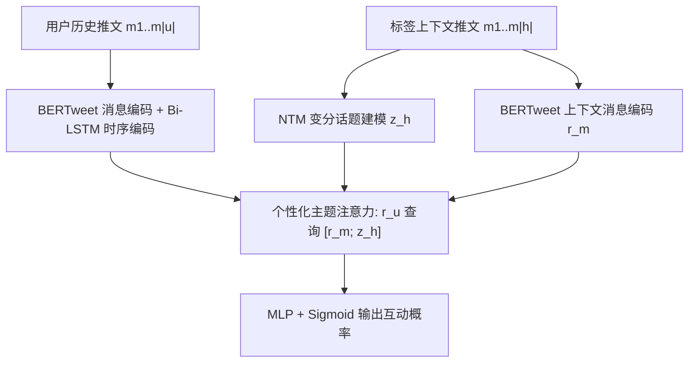
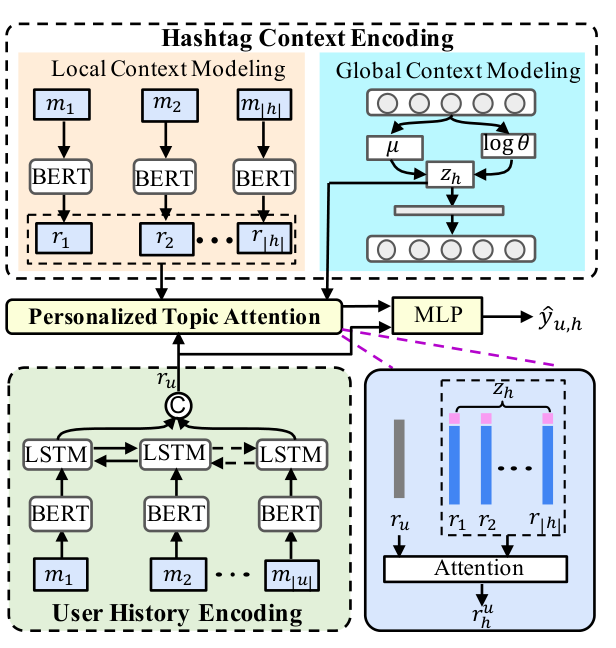

# #HowYouTagTweets: Learning User Hashtagging Preferences via Personalized Topic Attention (通过个性化主题注意力学习用户的话题标签使用偏好)

- **会议/期刊**: EMNLP 2021 (Main Conference)
- **作者与机构**: Yuji Zhang, Yubo Zhang, Chunpu Xu, Jing Li (香港理工大学), Ziyan Jiang (Amazon Alexa AI), Baolin Peng (Microsoft Research)
- **推荐链路定位**: 召回（用户-话题标签互动候选打分与排序）
- **研究方向**: 序列与会话推荐 / 冷启动与长尾推荐
- **论文原文**: [https://aclanthology.org/2021.emnlp-main.616.pdf](https://aclanthology.org/2021.emnlp-main.616.pdf)
- **开源代码**: [https://github.com/polyusmart/Personalized-Hashtag-Preferences](https://github.com/polyusmart/Personalized-Hashtag-Preferences)

## TL;DR (1分钟核心速览)

社交平台的标签语义随时间漂移，且标签上下文稀疏、噪声极大，现有的用户-内容互动建模（CF 或纯监督文本匹配）无法把历史学到的兴趣迁移到**未来才出现的标签**上。本文提出“用户历史编码 + 标签上下文编码 + 个性化主题注意力”的框架：用 BERTweet 建模局部语义、VAE 式神经话题模型（NTM）抽取标签全局主题，再以用户向量为 query 对上下文推文做主题感知注意力，最后 MLP 打分。在 900M 条推文过滤出的 3.4 万互动数据上采用**全局时间戳切分 + 全库排序（Full-Ranking）**，MAP 0.3114 vs. SOTA 0.2765，相对提升 **12.6%**，其中 55% 测试标签训练期从未出现（冷启标签）。

## Background & Motivation (背景与核心矛盾)

- **主流范式**: 标签个性化早期工作依赖浅层词统计（LDA 主题、TF-IDF 内容因子）或手工特征刻画用户画像；另一支“标签推荐 (hashtag recommendation)”是**帖子导向**的（给定一条推文挑标签），而非用户导向地预测“某人未来会不会用这个标签”。
- **前人局限**: ① 既有方法默认标签语义不变（Zeng et al. 2020 式会话推荐直接套用），但真实场景中**新标签不断涌现、旧标签语义迁移**，训练期学到的用户兴趣无法与未来标签的语义空间对齐；② 标签上下文极度碎片化、噪声主导——如图 1 所示 `#book` 的四条上下文中仅 M1 含 `thriller/mystery` 与用户兴趣真正匹配，其余三条基本是噪声，LSTM+Attention 在上下文变长时反而被噪声拖累。
- **核心洞察 (Key Insight)**: 用户的历史推文是**稠密**的（平均 13 条/人），而标签上下文是**幂律稀疏**的（平均 3 条/标签）；因此正确做法不是“把两者塞进同一编码器对齐”，而是先用**无监督话题建模**把稀疏标签侧补全为全局分布表征，再用用户侧的稠密兴趣对其进行**查询式筛选**。
- **本文切入点**: BERT 局部语义 + NTM 全局主题联合训练，把“未来标签”与“历史兴趣”统一到同一深度语义空间，并引入个性化主题注意力只在上下文中挑出与用户匹配的少数关键推文。

## Method (核心方法设计)

### 1. 整体框架 (Overall Architecture)

输入是一个用户 $u$与其历史推文序列$\langle m_1,\dots,m_{|u|}\rangle$，以及目标标签$h$的上下文消息集$\{m_1,\dots,m_{|h|}\}$（均隐去标签文本本身以防平凡特征）。用户侧经 BERTweet 得到消息向量后用双向 LSTM 编码时间漂移，取末态拼接为用户表征$\mathbf{r}_u$；标签侧并行两路：一路用 VAE 式 NTM 从上下文词袋$\mathbf{v}_h$推断隐主题$\mathbf{z}_h$（话题-词分布），一路用 BERTweet 得到上下文消息向量$\mathbf{r}_m$。二者在个性化主题注意力处汇合，以$\mathbf{r}_u$为 query、以$[\mathbf{r}_m;\mathbf{z}_h]$为 key 计算注意力并加权池化得个性化标签表征$\mathbf{r}_h^u$，再与$\mathbf{r}_u$ 拼接经 MLP+Sigmoid 输出互动概率。训练上先预训练 NTM 20 epoch，再联合优化互动损失与 NTM 损失。

<figure class="paper-figure" markdown="span">
  <figcaption>图2：我们的模型将话题标签上下文编码（上）和用户历史编码（左下）与个性化主题注意力（右下）耦合，以预测用户-话题标签互动。</figcaption>
</figure>

### 2. 关键设计拆解 (Key Designs)

1. **VAE 神经话题模型补全稀疏标签上下文（Global Context Modeling）**：痛点是把标签压成 BERT 均值向量后，噪声词与主题词被等权平均，标签表征退化。本文改为对标签级词袋 $\mathbf{v}_h$做高斯采样得到隐主题：$\boldsymbol{\mu}=f_\mu(f_e(\mathbf{v}_h)),\ \log\boldsymbol{\sigma}=f_\sigma(f_e(\mathbf{v}_h)),\ \mathbf{z}_h\sim\mathcal{N}(\boldsymbol{\mu},\boldsymbol{\sigma})$，解码端$\hat{\mathbf{v}}_h=\mathrm{softmax}(f_\phi(\boldsymbol{\theta}_h))$重建词袋，其中$\boldsymbol{\theta}_h=\mathrm{softmax}(\mathbf{z}_h)$即话题-词分布。直觉是：跨消息的词共现统计迫使模型把 `thriller/mystery` 这类判别性词聚成同一主题维，$K=100$ 维的话题向量天然是“去噪后的标签指纹”，可跨用户共享、对新标签也能靠上下文词袋推断。
2. **个性化主题注意力（Personalized Topic Attention）**：痛点是上下文里只有极少数推文对当前用户有用，普通 attention 仅凭标签自身信息无法判断“对谁有用”。本文把消息向量与标签主题拼接成主题感知表示，再让用户向量当 query：

$$f_{att}(\mathbf{r}_u, [\mathbf{r}_m;\mathbf{z}_h])=\mathbf{w}^{\top}\tanh\!\left(\mathbf{W}_u\mathbf{r}_u+\mathbf{W}_m[\mathbf{r}_m;\mathbf{z}_h]\right),\quad \alpha_{u,m}=\frac{\exp(f_{att})}{\sum_{n\in h_{set}}\exp(f_{att})}$$

加权池化得 $\mathbf{r}_h^u=\sum_m \alpha_{u,m}\mathbf{r}_m$。本质上这是**双端个性化匹配**：同一标签对不同用户产生不同的注意力分布与不同表征，因此语义漂移的新标签仍可被“用户兴趣视角”重新解读。
3. **训练目标、负采样与推理效率**：总损失 $\mathcal{L}=\mathcal{L}_{eng}+\mu\mathcal{L}_{ntm}$（$\mu=10^{-4}$），互动损失为带权二分类交叉熵$\mathcal{L}_{eng}=-\sum_{(u,h)\in\tau}\left(\lambda y\log\hat{y}+(1-y)\log(1-\hat{y})\right)$，$\lambda=100$强调正样本可靠性（负样本可能因“用户没空发帖”而假阴性）；$\mathcal{L}_{ntm}$为 KL 散度 + 词袋重建项。训练用$1{:}5$ 负采样，推理时对测试用户全库标签排序，单次打分 = 一次 Bi-LSTM + 一次注意力，BERT 特征可离线缓存，在线开销近似双塔内积。

## Experimental Setup & Evaluation Protocol (实验设置与评估协议)

- **数据集与预处理**: 由 Twitter 流式 API 抓取 2013 年 9 亿条推文，过滤无标签推文、历史截断 50 条、隐藏标签文本、剔除中间位置推文与“只发原创标签”的用户；标签上下文仅保留出现 ≥5 条推文的标签；词表 10K（NLTK 分词/词干化后去链接与标点）。

| 数据集 | #Users | #Items(标签) | #Interactions(推文) | 稀疏度/密度 | 特征/场景说明 |
| :--- | :---: | :---: | :---: | :---: | :--- |
| Twitter | 2,571 | 22,320 | 33,881 | 平均 13 推/用户、3 推/标签（幂律） | 英文推文；**55% 测试标签训练期未出现（冷启）**；用户平均使用 12 个标签 |

- **数据划分与防穿越 (Splitting Strategy)**: **全局时间戳切分** —— 按时间排序取最早 80% 训练、最近 10% 测试、中间 10% 验证，严格保证“用过去预测未来”；测试中出现的新用户因无历史被剔除。
- **排名评测协议 (Ranking Protocol)**: **Full-Ranking（全库排序）**，测试时对所有测试标签打分排序，无采样近似；训练阶段采用 $1{:}5$负采样。指标为 P@5、MAP、nDCG@5（$N=5$报告，其他$N$ 趋势一致）。
- **对比基线与超参设置**: 基线覆盖随机/热度（RANDOM、POPULAR）、内容浅层（LDA+GBDT、TF-IDF+GBDT、BERT-SIM 余弦）、协同过滤（CF）、神经（MLP、LSTM、LSTM-ATT / Zeng et al. 2020 SOTA）。消息编码器为 BERTweet，Bi-LSTM 双向隐藏 768、2 层，Adam，lr=1e-3，batch=128，$K=100$，$\lambda=100$，$\mu=10^{-4}$；显著性用配对 t 检验（$p<0.01$）。

## Key Experimental Results (实验关键数据)

### 1. 主实验对比 (Main Results)

| 模型 | MAP | P@5 | nDCG@5 | 类型 |
| :--- | :---: | :---: | :---: | :--- |
| RANDOM | 0.0741 | 0.0200 | 0.0467 | 非神经 |
| POPULAR | 0.0814 | 0.0233 | 0.0564 | 非神经 |
| BERT-SIM | 0.2264 | 0.0800 | 0.2251 | 内容相似 |
| TF-IDF + GBDT | 0.1555 | 0.0560 | 0.1424 | 浅层特征 |
| LDA + GBDT | 0.1107 | 0.0360 | 0.0882 | 浅层特征 |
| CF | 0.1085 | 0.0424 | 0.1009 | 协同过滤 |
| MLP | 0.2624 | 0.0994 | 0.2677 | 神经 |
| LSTM | 0.2659 | 0.1004 | 0.2763 | 神经 |
| LSTM-ATT (SOTA) | 0.2765 | 0.1043 | 0.2873 | 神经 |
| **OUR MODEL** | **0.3114** | **0.1148** | **0.3257** | 本文 |
| **Improv.% (vs. SOTA)** | **+12.6%** | **+10.1%** | **+13.4%** | — |

### 2. 消融实验 (Ablation Study)

| 变体 | MAP | P@5 | nDCG@5 | 说明 |
| :--- | :---: | :---: | :---: | :--- |
| LSTM-ATT | 0.2765 | 0.1043 | 0.2873 | 无话题建模 |
| ⊕ TOPICS | 0.2912 | 0.1063 | 0.2993 | 主题向量简单拼接，无个性化注意力 |
| w/o JOINT | 0.2947 | 0.1092 | 0.3067 | 有个性化注意力，但 NTM 仅预训练不联合 |
| **FULL MODEL** | **0.3114** | **0.1148** | **0.3257** | 完整模型 |

### 3. 关键实验发现 (Key Findings)

1. **“话题建模”本身即贡献 +5.3% MAP（0.2765→0.2912），而“个性化注意力 + 联合训练”再贡献 +7.0%（0.2912→0.3114）**：前者说明稀疏标签上下文必须靠跨消息词共现补全，后者说明同一标签必须被用户重新加权；两者缺一不可，`w/o JOINT` 掉 1.7 个点 MAP 证明预训练主题在语义漂移下会与未来标签错位。
2. **CF 显著弱于 BERT-SIM（0.1085 vs. 0.2264 MAP）**：在 55% 测试标签训练期从未出现的冷启设定下，用户-标签共现历史几乎是空的，内容语义信号远优于交互共现信号——这直接否定了“把交互历史当主力特征”的常规召回范式。
3. **长度分桶显示模型优势与上下文长度正相关（图 5）**：标签上下文 ≤5 条时 LSTM-ATT 略优，而上下文越丰富本文增益越大；反观用户历史过长时两模型均下降（长历史用户样本少），但本文在**历史稀疏用户（1–7 条）上提升最明显**——未标注的标签上下文数据被无监督话题建模有效复用。

## Highlights & Limitations (亮点、对比与审稿批判)

- **与代表作对比 (vs. Prior Work)**: 相较 Zeng et al. (2020) 的 LSTM-ATT（把未来内容当作静态文本直接编码，无话题先验、无个性化加权），本文多了“全局主题 + 用户 query 注意力”两级筛选；相较 Wu et al. (2017)/Zhao et al. (2016) 的浅层统计用户画像，本文在深度语义空间完成跨时间对齐；相较帖子导向的标签推荐（Li et al. 2016；Gong & Zhang 2016），本文任务定义本身从“给帖子配标签”转为“给用户预测标签”。
- **可迁移亮点**: ① 用 VAE 话题向量作为**冷启物品的内容指纹**，并在注意力里与该物品的若干文本片段拼接作 key，可直接迁移到新闻/短视频冷启召回；② 正样本加权 $\lambda\gg1$（此处 100）应对“用户未行动 ≠ 不喜欢”的假阴性，是所有隐式反馈场景的实用 trick。
- **审稿级局限批判**: ① 评估仅覆盖 2,571 名用户、3.4 万条推文，且为 2013 年单年英文数据，标签数量 22,320 但平均每标签仅 3 条推文，**长尾标签的排序结果方差极大**，未报告置信区间或多次采样；② 训练 $1{:}5$ 负采样与测试全库排序存在**样本分布不一致**，且负样本构造方式（随机 vs. 热度加权）未做消融；③ 每个候选标签都要跑一遍 BERTweet + 注意力，**全库排序的在线成本随标签数线性增长**，论文未给出延迟测量与工程优化（如两阶段召回）。

## Rating (四维评分)

- **方法创新性 (Novelty)**: ⭐⭐⭐⭐ （“用户 query + 话题 key”的个性化主题注意力与 NTM 联合训练组合新颖，把标签语义漂移问题转化为跨时间表征对齐，但各组件单独看均为成熟模块的拼接）
- **评估协议与实验扎实度 (Protocol & Experiments)**: ⭐⭐⭐⭐ （全局时间切分 + 全库排序 + 冷启标签设定非常贴近真实，$p<0.01$ 显著性检验与三档消融完整，但数据规模偏小、缺少负采样策略与延迟分析）
- **写作与数学规范度 (Clarity & Rigor)**: ⭐⭐⭐⭐ （注意力与损失公式定义清晰、超参与训练流程交代充分，NTM 推导因篇幅省略、部分符号如 $f_{att}$ 的维度约定未明确）
- **工业落地与复现价值 (Industrial & Practical Value)**: ⭐⭐⭐⭐ （代码与数据均已开源，BERT 特征可离线缓存、在线仅需注意力+MLP；但全库打分需两阶段召回改造方能上线）

