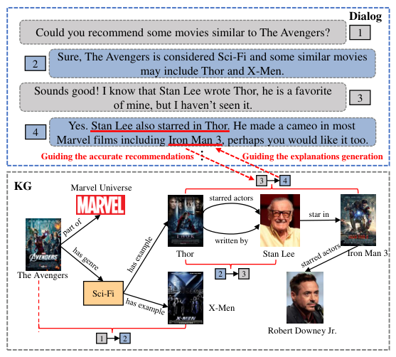
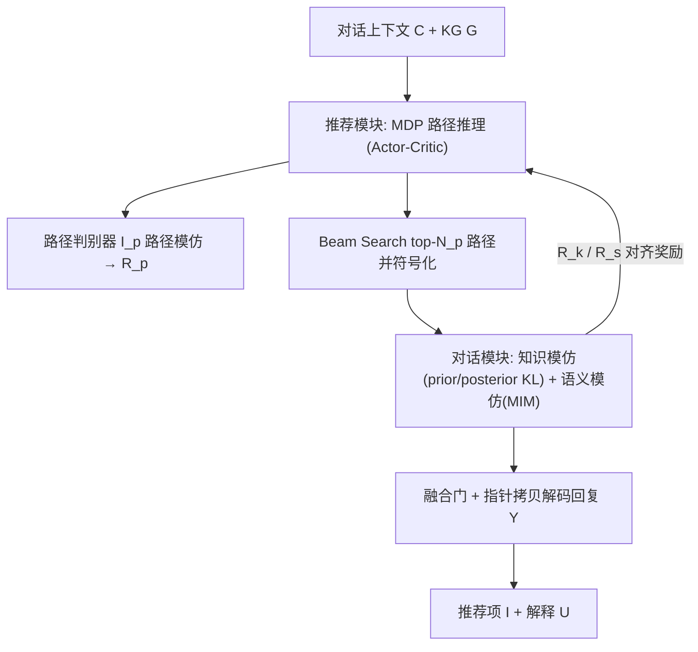
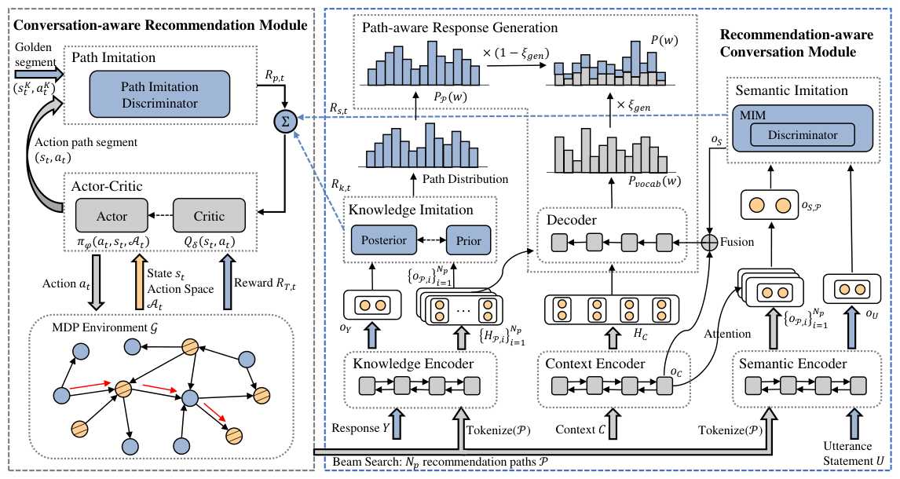

# Aligning Recommendation and Conversation via Dual Imitation (基于双向模仿的推荐与对话对齐)

- **会议/期刊**: EMNLP 2022
- **作者与机构**: Jinfeng Zhou, Bo Wang, Minlie Huang, Dongming Zhao, Kun Huang, Ruifang He, Yuexian Hou（天津大学、清华大学 CoAI、中国移动天津 AI Lab）
- **推荐链路定位**: 端到端生成式（含 KG 多跳召回式推理 + 回复生成）
- **研究方向**: 对话推荐与智能体仿真 / 图神经网络与知识图谱推荐
- **论文原文**: [https://arxiv.org/abs/2211.02848v1](https://arxiv.org/abs/2211.02848v1)
- **开源代码**: 暂未开源

## TL;DR (1分钟核心速览)

现有 KG 增强对话推荐（CRS）把"推荐"与"对话"做成黑盒隐向量松耦合：推荐用了与兴趣迁移无关的实体，回复也给不出可解释理由。DICR 用「推荐路径（KG 显式多跳链）」与「兴趣迁移路径（对话隐式实体链）」作为同一用户兴趣漂移的两种具体显现，设计双向模仿：推荐侧用对抗模仿学习（Actor-Critic + 路径判别器）逼近兴趣迁移路径，对话侧用知识模仿（prior/posterior 路径分布对齐）与语义模仿（互信息最大化）反哺路径推理奖励。OpenDialKG 下一轮推荐 Recall@1 达 0.211（+62.3% vs. CRFR / +14.1% vs. ACRG），解释链接 P-Inter 0.689（+30.7%）。

## Background & Motivation (背景与核心矛盾)

- **主流范式**: 生成式 CRS 依赖稀疏对话上下文，故主流引入 KG 增强（KBRD/KGSF/CRFR/C²-CRS），以实体嵌入或片段推理表征用户偏好，再解码含推荐项与解释的回复。
- **前人局限**: ①推荐侧以隐向量在整张 KG 上做偏好聚合，推理链里常混入**与用户兴趣迁移无关的实体**，导致推荐命中不准；②对话侧解释是"黑盒表征 → 文本"的映射，丢失了**兴趣迁移中的显式偏好逻辑**，回复缺解释。
- **核心洞察 (Key Insight)**: 对话中的兴趣迁移路径（The Avengers→Sci-Fi→Thor→Stan Lee→Iron Man 3）与 KG 中的推荐路径共享同一串兴趣实体序列，二者是同一现象的两种模态投影；一旦对齐，推荐路径天然可充当解释，解释也反过来约束推荐。
- **本文切入点**: 用模仿学习把"路径行为"而非"隐向量"作为两模块的通信信号，双向交换对齐奖励。

<figure class="paper-figure" markdown="span">
  <figcaption>图 1：会话中表达的兴趣迁移过程可指导可解释推荐路径的生成。可解释推荐路径反过来可指导生成包含准确推荐的可解释回复。推荐与会话在双向引导中最大化互利。</figcaption>
</figure>

## Method (核心方法设计)

### 1. 整体框架 (Overall Architecture)

输入为对话上下文 $C$与知识图谱$\mathcal{G}$。**对话感知推荐模块**把路径推理形式化为 MDP：从上下文中出现的实体$e_0$出发，状态$s_t=\{u,e_{t-H},\dots,r_t,e_t\}$（$u$为上下文中实体嵌入均值），动作空间$\mathcal{A}_t$为$e_t$的出边（剔除历史实体），Actor-Critic 在与路径判别器$I_{p,\tau}$的对抗中学习策略；预训练后用 beam search 取 top-$N_p$条路径并**符号化**（实体-关系词串$\mathcal{P}$）送入对话模块。**推荐感知对话模块**用 Bi-GRU 分别编码$C$、回复$Y$、金标陈述$U$、各条路径$\mathcal{P}$，经知识模仿学到路径权重$\mu_{P,i}$、经语义模仿学到路径语义$o_{S,P}$，再由融合门与指针拷贝解码回复。训练完成后再做双向联合训练：对话侧输出的$R_{k,t},R_{s,t}$ 回灌为推荐智能体的额外奖励，推荐侧更新的路径分布又作为对话侧的软对齐信号，形成正循环。

<figure class="paper-figure" markdown="span">
  <figcaption>图 2：所提出的 DICR 模型的双模仿架构。</figcaption>
</figure>

### 2. 关键设计拆解 (Key Designs)

1. **路径模仿 (Path Imitation, 推荐↔对话)**：痛点是 RL 的终端奖励 $R_{T,t}$极稀疏（只有终点命中才给 1）。作者引入判别器逐**步**判定当前$(s_t,a_t)$ 是否像金标兴趣迁移片段，并转为密集奖励：

$$I_{p,\tau}(s_t,a_t)=\sigma\!\left(\mathbf{b}_{p,\tau}^{\top}\tanh(\mathbf{W}_{p,\tau}[s_t\oplus a_{p,t}])\right),\quad R_{p,t}=\log I_{p,\tau}(s_t,a_t)-\log\!\left(1-I_{p,\tau}(s_t,a_t)\right)$$

该式即 GAIL 式奖励：把"像人"的概率直接当 intrinsic reward，使智能体在中间跳就获得梯度，避免盲目扩张路径。

2. **知识模仿 + 语义模仿 (对话↔推荐)**：痛点是路径与回复的权重、语义两层都未对齐。**知识模仿**以上下文为先验、以人类回复为后验，构造两条路径分布并用 KL 拉近，辅以 BOW loss 保证路径分布与回复词袋相关：

$$P(p_i\mid C)=\frac{\exp\!\left(o_{P,i}\cdot\tanh(W_{K,C}o_C)\right)}{\sum_{j}\exp\!\left(o_{P,j}\cdot\tanh(W_{K,C}o_C)\right)},\quad \mathcal{L}_{KL}=D_{KL}\!\left(P(p_i\mid Y)\,\|\,P(p_i\mid C)\right)$$

**语义模仿**让上下文聚合的路径表征 $o_{S,P}$与金标陈述语义$o_U$互信息最大（双线性判别器 + BCE），推理阶段$U$缺失时以$o_{S,P}$替代$o_S$ 作为解码器初始状态。直觉：把"哪条路径该被讲"与"该讲成什么语义"两件事分别监督，避免单一损失互相干扰。

3. **训练目标、奖励聚合与推理开销**：总奖励 $R_t=\alpha R_{p,t}+\beta R_{k,t}+\gamma R_{s,t}+(1-\alpha-\beta-\gamma)R_{T,t}$（$\alpha=\gamma=0.006,\beta=0.001$）；推荐损失$\mathcal{L}_{REC}=\mathcal{L}_{\phi,\delta}+\mathcal{L}_{\tau}$，对话损失$\mathcal{L}_{GEN}=\mathcal{L}_{KL}+\mathcal{L}_{BOW}+\mathcal{L}_{BCE}+\mathcal{L}_{NLL}$。**免负采样**（KG 全候选出边排序），分四阶段训练（REC → BOW/BCE 预训练 → GEN → 双向联合）。解码时融合门$g_t=\sigma(W_g[d^C_t;v^P_t])$、$v_t=g_t d^C_t+(1-g_t)v^P_t$抑制错误路径，拷贝概率$P(w_t)=\xi^{gen}_t P_{vocab}(w_t)+(1-\xi^{gen}_t)P_{\mathcal{P}}(w_t)$ 保证解释词可被原样复制。

## Experimental Setup & Evaluation Protocol (实验设置与评估协议)

- **数据集与预处理**: 仅 OpenDialKG（对话↔KG 平行语料，实体与事实连接被人工标注；兴趣迁移路径由"上下文实体为起点、回复实体为终点"自动抽取，并符号化为陈述句）。详细规模见原文附录 A，正文未披露过滤阈值。

| 数据集 | #Users | #Items | #Interactions | 稀疏度/密度 | 特征/场景说明 |
| :--- | :---: | :---: | :---: | :---: | :--- |
| OpenDialKG | — | — (KG 实体) | 对话级标注（附录 A） | — | 电影/体育等多域，含 KG 三元组与实体链接标注 |

- **数据划分与防穿越 (Splitting Strategy)**: 面向**下一轮（next-turn）**推荐与回复生成，按官方对话级切分（附录 B）；未做冷启动划分。
- **排名评测协议 (Ranking Protocol)**: 推荐采用 `Recall@{1,10,25}`，在 KG 候选物品集合上排序；正文未声明负采样比例，可视为近全库排序。**无采样负例训练**（RL 采样路径）。
- **对比基线与超参设置**: 基线 8 个 —— TextCNN、Trans、KBRD、KGSF、RevCore、CRFR、C²-CRS、以及作者构造的消融变体 ACRG（去掉全部模仿与双向交互）。KG 嵌入 $d=128$，历史长度$H=1$，最大路径长 3，动作空间上限 250，$N_p=10$，编解码各 2 层 / 800 隐单元，词向量 word2vec 300 维，Adam lr=$10^{-4}$，batch=32。显著性：推荐/对话主表$p<0.001$（t-test），人评$p<0.05$。

## Key Experimental Results (实验关键数据)

### 1. 主实验对比 (Main Results)

| 模型 | Recall@1 | Recall@10 | Recall@25 | BLEU-1 | BLEU-2 | F1 |
| :--- | :---: | :---: | :---: | :---: | :---: | :---: |
| TextCNN | 0.059 | 0.177 | 0.235 | — | — | — |
| KBRD | 0.104 | 0.407 | 0.490 | 0.408 | 0.324 | 0.108 |
| KGSF | 0.119 | 0.436 | 0.523 | 0.416 | 0.330 | 0.123 |
| RevCore | 0.124 | 0.432 | 0.516 | 0.409 | 0.323 | 0.112 |
| CRFR | 0.130 | 0.458 | 0.543 | 0.421 | 0.334 | 0.135 |
| C²-CRS | 0.112 | 0.465 | 0.541 | 0.417 | 0.331 | 0.145 |
| ACRG | 0.185 | 0.490 | 0.629 | 0.422 | 0.326 | 0.270 |
| **DICR** | **0.211** | **0.511** | **0.643** | **0.478** | **0.366** | **0.319** |
| Improv. (vs. 最强基线) | +14.1% / +62.3% | +4.3% / +11.6% | +2.2% / +18.4% | +13.3% | +9.6% | +120% |

**解释性主表**（Hit = 生成回复是否含金标推荐项；G/P × Inter/Inner 分别统计跨上下文与回复内、可匹配 KG 与可匹配推荐路径的实体链接数）：

| 模型 | Hit | G-Inter | G-Inner | P-Inter | P-Inner |
| :--- | :---: | :---: | :---: | :---: | :---: |
| KGSF | 0.261 | 0.662 | 0.201 | — | — |
| CRFR | 0.293 | 0.691 | 0.247 | 0.485 | 0.134 |
| C²-CRS | 0.310 | 0.695 | 0.319 | — | — |
| ACRG | 0.318 | 0.548 | 0.288 | 0.527 | 0.279 |
| **DICR** | **0.426** | **0.720** | **0.348** | **0.689** | **0.330** |

人评（200 上下文 / 6 名标注者 / 0–2 分，Fleiss' $\kappa\approx0.49\text{–}0.57$）：DICR 流畅 1.815、连贯 1.633、信息量 1.300、可解释 1.058，全面领先（次优 ACRG 为 1.790/1.608/1.045/0.950）。

### 2. 消融实验 (Ablation Study)

| 变体 | Recall@1 | Recall@25 | BLEU-1 | Hit | P-Inter |
| :--- | :---: | :---: | :---: | :---: | :---: |
| **DICR (完整)** | **0.211** | **0.643** | **0.478** | **0.426** | **0.689** |
| w/o PI (路径模仿) | 0.203 | 0.635 | 0.467 | 0.405 | 0.657 |
| w/o KI (知识模仿) | 0.201 | 0.632 | 0.464 | 0.386 | 0.651 |
| w/o SI (语义模仿) | 0.200 | 0.631 | 0.466 | 0.403 | 0.663 |
| w/o FG (融合门) | — | — | 0.458 | 0.385 | 0.641 |
| w/o BI (双向联合训练) | — | — | 0.439 | 0.354 | 0.570 |

### 3. 关键实验发现 (Key Findings)

1. **路径模仿贡献的是"解释内部连贯"，而非解释广度**：去掉 PI 后 Recall@1 仅降 0.008，但 P-Inner（回复内实体链接）掉 0.021、G-Inner 掉 0.028 —— 说明逐步奖励主要是把推理链收敛到与兴趣迁移同构的短链，从而让回复内的解释天然自洽。
2. **知识模仿是推荐命中的主要来源**：w/o KI 使 Hit 从 0.426 跌至 0.386（−9.4%），同时 Dist-1/2 下降最多，验证 prior/posterior 分布对齐既修正了"路径选哪条"（命中），也提升了回复用词多样性。
3. **双向联合训练（BI）是最大单点增益**：去掉 BI 后 BLEU-1 从 0.478 掉到 0.439（−8.2%）、Hit 从 0.426 掉到 0.354（−16.9%）、P-Inter 从 0.689 掉到 0.570，明显大于任一单侧模仿模块的损失，证明"路径作为跨模块通信信道"的紧耦合优于松耦合拼接。此外，ACRG（有路径、无模仿）G-Inter 仅 0.548 却 P-Inter 0.527，说明无对齐约束的路径会带来与 KG 全局知识不一致的解释。

## Highlights & Limitations (亮点、对比与审稿批判)

- **与代表作对比 (vs. Prior Work)**: 相比 KBRD/KGSF（隐向量拼接传递知识）与 C²-CRS（对比学习拉近两空间），DICR 的通信信号是**离散可符号化的路径**，天然可作解释；相比 CRFR 的片段推理（无对话侧反向约束），DICR 引入对话侧奖励回灌，形成闭环；相比 ACRG（同一 RL 框架但无模仿），增益几乎全部来自对齐损失。
- **可迁移亮点**: ①把"可解释中间产物"（路径/推理链）当作模块间通信总线，替代隐向量传递，可直接迁移到多任务精排与可解释推荐；②用 KL(prior‖posterior) 让推理阶段能做"无金标解释"的推断（$\mu_{P,i}=P(p_i|C)$），是解决训练/推理输入不一致的通用技巧。
- **审稿级局限批判**: ①只在 OpenDialKG 单数据集、单域（电影为主）验证，且用户规模与稀疏度未在正文报告，泛化性证据不足；②强依赖 KG 显式三元组，缺失隐式多维相似度知识时路径会断裂；③推理需 beam search 生成 10 条路径 + 双模块联合前向，延迟与在线成本未做任何分析；④Dist-1/2 上不及 C²-CRS（0.059/0.183 vs 0.065/0.209），说明对齐解释性可能牺牲了表面多样性。

## Rating (四维评分)

- **方法创新性 (Novelty)**: ⭐⭐⭐⭐ （首次把模仿学习引入 CRS，用"路径 ↔ 兴趣迁移路径"的显式行为对齐替代黑盒表征，思路清晰有新意，但 GAIL + MIM 组件本身较为标准）
- **评估协议与实验扎实度 (Protocol & Experiments)**: ⭐⭐⭐⭐ （自动 + 人评 + 自建 5 项可解释性指标的三角验证很扎实，但仅单一数据集、未声明全库/采样排序细节，削弱结论强度）
- **写作与数学规范度 (Clarity & Rigor)**: ⭐⭐⭐⭐ （四阶段训练流程、奖励聚合与各模仿损失的符号链条清楚，图中先验/后验标注明确；奖励权重与路径长度的耦合说明略简）
- **工业落地与复现价值 (Industrial & Practical Value)**: ⭐⭐⭐ （无开源代码、beam search + 双模块联合前向的线上延迟高，但"路径作为可解释通信总线"与 prior/posterior 对齐范式对工业可解释推荐极具参考价值）

