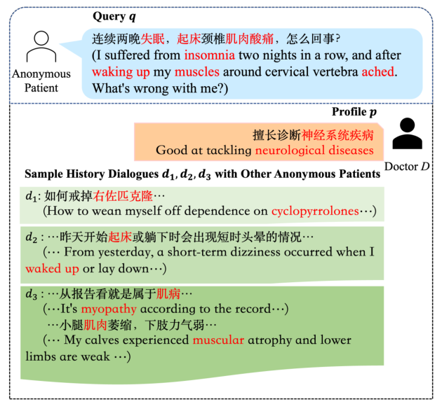
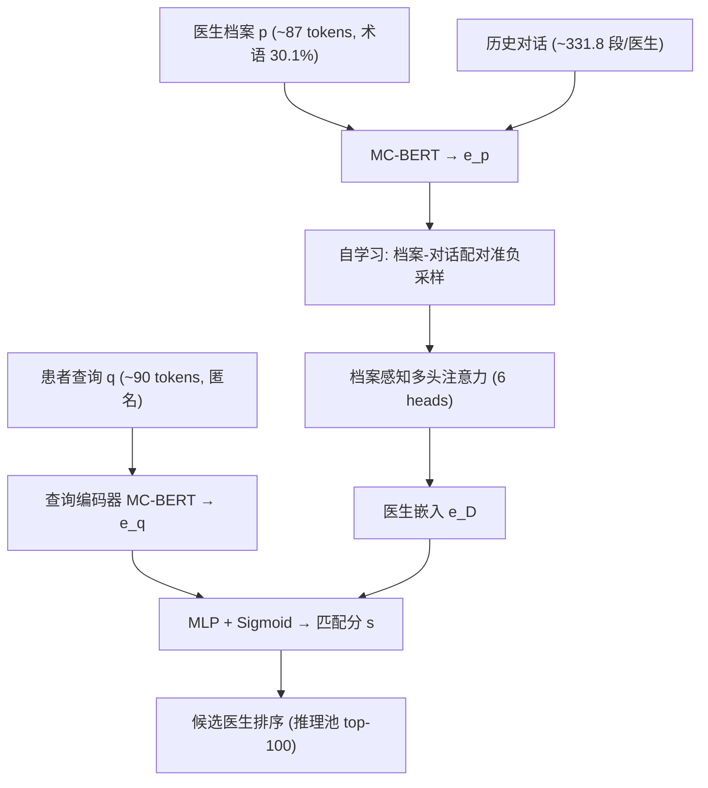

# Doctor Recommendation in Online Health Forums via Expertise Learning (基于专家能力学习的在线健康论坛医生推荐)

- **会议/期刊**: ACL 2022 (Main Conference)
- **作者与机构**: Xiaoxin Lu, Yubo Zhang, Jing Li (香港理工大学计算机系), Shi Zong (南京大学计算机系)
- **推荐链路定位**: 召回（双塔语义匹配召回 + 候选池排序）
- **研究方向**: 协同过滤与双塔召回 / 冷启动与长尾推荐
- **论文原文**: [https://arxiv.org/abs/2203.02932v4](https://arxiv.org/abs/2203.02932v4)
- **开源代码**: [https://github.com/polyusmart/Doctor-Recommendation](https://github.com/polyusmart/Doctor-Recommendation)

## TL;DR (1分钟核心速览)

本文提出「在线问诊医生推荐」新任务：患者因隐私完全匿名，只有一句约 90 token 的主诉；医生档案又由专业术语写成（术语占比 30.13%），与口语化查询存在严重词汇鸿沟。作者用 MC-BERT 双塔编码查询与医生（档案 + 历史对话），先以「档案-对话是否同一医生」的自监督任务把专业/口语语义拉进同一空间，再以档案向量作 Query、历史对话作 Key/Value 做多头注意力抽取多侧面专家能力。在春雨医生 119,128 段对话、359 名医生数据上，P@1 由最强基线 0.219 提升至 0.616（+181%），MAP 由 0.380 提升至 0.620。

## Background & Motivation (背景与核心矛盾)

- **主流范式**: 工业推荐依赖目标用户的历史行为（购买/点击/序列）做兴趣建模；专家推荐（CQA）则多用引用网络、社交关系或 TF-IDF 相似度做匹配。
- **前人局限 1（用户侧）**: 医疗隐私要求患者匿名，系统既无 user ID 也无历史交互，仅剩一段短查询——这是典型 **Strict Zero-shot 用户冷启动**，协同过滤与序列模型直接失效。
- **前人局限 2（物品侧）**: 医生档案仅约 87 token 且高度专业化，而患者查询的医学术语占比仅 5.52%，余弦相似度几乎不可用（COS-SIM(D+Q) P@1 只有 0.056）。
- **核心洞察 (Key Insight)**: 医生历史对话平均 331.83 段、534 token，其术语占比 7.83%，恰好介于专业档案与口语查询之间——对话中的"头晕/肌肉萎缩/右佐匹克隆"等词正是连接"神经系统疾病"档案与"失眠+肌肉酸痛"主诉的桥接语料。
- **本文切入点**: 用自监督任务把档案语言迁入对话的口语语义空间，再用注意力从数百段冗余对话中挑出与当前查询相关的片段。

<figure class="paper-figure" markdown="span">
  <figcaption>图1：顶部为示例患者查询 q，随后是示例医生 D 的档案以及 D 之前参与的三段对话。表示患者需求和医生专长的显著词以红色标出。2</figcaption>
</figure>

## Method (核心方法设计)

### 1. 整体框架 (Overall Architecture)

模型为双塔结构。左塔（医生编码器）：医生档案 $p$与历史对话$\{d_1,\dots,d_n\}$分别经 MC-BERT 得到$e_p$与$[e_{d_1},\dots,e_{d_n}]$；先以「档案—对话配对」自学习微调 BERT 嵌入层对齐语言风格，再以$e_p$为 Query 对对话矩阵做多头注意力聚合成医生嵌入$e_D$。右塔（查询编码器）用同源 MC-BERT 编码患者主诉得$e_q$。预测层拼接$[e_D;e_q]$经一层 MLP + Sigmoid 输出匹配分$s$，对候选医生排序。医生侧嵌入可离线预计算，在线仅需一次查询编码与$m$ 次轻量打分，符合双塔召回范式。

### 2. 关键设计拆解 (Key Designs)

1. **档案-对话自监督对齐（Self-Learning）**：痛点是档案用书面专业语、对话用口语，直接拼接/平均会互相污染（MLP(P+D+Q) P@1 0.153 反而低于单源）。做法是以"同一医生的档案+对话对标正、随机搭配为负"构造二分类任务微调 BERT 嵌入层，隐式目标为 $s_{p,d}=\sigma(\mathbf{W}[e_p;e_d])$ 最大化同源配对。这样档案向量被"翻译"进与查询同分布的口语空间，长档案噪声也随之被钝化。

2. **档案感知多头注意力（Profile-aware Multi-head Attention）**：痛点是单医生数百段对话主题混杂，平均池化会被无关内容淹没。做法是以档案为 Query、对话矩阵为 Key/Value：
$h_j=\mathrm{softmax}\!\left(\frac{(e_p W_j^{Q})(E_D W_j^{K})^{\top}}{\sqrt{d}}\right)(E_D W_j^{V}),\quad e_D=\mathrm{Concat}(h_1,\dots,h_l)W^{O}$
注意力的物理直觉是"用医生的擅长方向去检索他历史上真正聊过什么"，多头则对应专家能力的多侧面（如同时覆盖"失眠"与"肌病"）。

3. **训练目标、负采样与推理效率**：采用加权二元交叉熵，对正样本（该医生确实接诊过该查询）加权 $\lambda=5$，因负样本受"医生忙碌"等不可控因素污染：
$\mathcal{L}=-\sum_{(D,q)\in\tau}\big[\lambda\hat{s}\log s+(1-\hat{s})\log(1-s)\big]$
训练阶段以 1:10 负采样加速；推理只在处理查询最多的 top-100 医生池内排序，医生嵌入离线缓存，在线开销主要是 1 次 BERT 前向 + 100 次 MLP。

## Experimental Setup & Evaluation Protocol (实验设置与评估协议)

- **数据集与预处理**: 爬取春雨医生平台，去停用词；非神经基线用 jieba 分词，神经模型用 MC-BERT 分词（最大长度 512，嵌入 768 维）。

| 数据集 | #Users | #Items | #Interactions | 稀疏度/密度 | 特征/场景说明 |
| :--- | :---: | :---: | :---: | :---: | :--- |
| Chunyu Yisheng | 匿名（无持久 ID） | 359 医生 / 14 科室 | 119,128 段对话 | 每医生均 331.83 段；查询均 90 token | 词汇 8,715；档案均 87.53 token；对话均 534.28 token；档案术语率 30.13% vs 患者话语 5.52% |

- **数据划分与防穿越**: 每名医生随机 80% 对话作训练集；剩余 20% 只取其**首轮患者查询**作为评测查询，再随机对半分为验证/测试。查询本身不参与训练，构成严格的"新查询—旧医生"划分（无用户侧泄漏）。
- **排名评测协议**: 非全库排序——推理仅在 **top-100 高频接诊医生候选池**内排序（Sampled/Candidate Ranking），需注意该协议对热门医生存在天然偏置。指标为 P@1、MAP、ERR@5；三随机种子重复取平均，配对 t 检验 $p<0.02$。
- **对比基线与超参**: 启发式（RANDOM/FREQUENCY/KNN/COS-SIM）、GBDT+TF-IDF、MLP 三变体、BERT 版 DSSM、点积/拼接注意力变体，以及三项消融。MC-BERT 微调，头数 6，$\lambda=5$，MLP 隐层 256，Adam lr=0.008，batch 256，50 epoch + early stop。

## Key Experimental Results (实验关键数据)

### 1. 主实验对比 (Main Results)

| 模型 | P@1 | MAP | ERR@5 | 相对 FULL 差距 |
| :--- | :---: | :---: | :---: | :---: |
| RANDOM | 0.010 | 0.052 | 0.001 | −98.4% |
| FREQUENCY | 0.005 | 0.032 | 0.001 | −99.2% |
| KNN (K=20) | 0.082 | 0.151 | 0.008 | −86.7% |
| COS-SIM (D+Q) | 0.056 | 0.136 | 0.006 | −90.9% |
| GBDT (TF-IDF) | 0.018 | 0.052 | 0.002 | −97.1% |
| MLP (P+Q) | 0.164 | 0.331 | 0.018 | −73.4% |
| MLP (D+Q) | 0.174 | 0.341 | 0.019 | −71.8% |
| MLP (P+D+Q) | 0.153 | 0.312 | 0.017 | −75.2% |
| DSSM (BERT w/ P) | 0.151 | 0.231 | 0.012 | −75.5% |
| DOT-ATT | 0.219 | 0.380 | 0.021 | −64.4% |
| CAT-ATT | 0.167 | 0.332 | 0.018 | −72.9% |
| **MUL-ATT (FULL)** | **0.616** | **0.620** | **0.039** | — |

### 2. 消融实验 (Ablation Study)

| 变体 | P@1 | MAP | ERR@5 | 说明 |
| :--- | :---: | :---: | :---: | :--- |
| w/o Self-Learning | 0.309 | 0.319 | 0.019 | 去掉档案-对话对齐 |
| w/o Profile (仅对话) | 0.521 | 0.526 | 0.033 | 移除档案 Query |
| w/o Dialogue (仅档案) | 0.198 | 0.217 | 0.013 | 移除历史对话 |
| **FULL (6 heads)** | **0.616** | **0.620** | **0.039** | 完整模型 |
| heads=2 / 4 / 8 | 0.601 / 0.609 / 0.564 | 0.605 / 0.613 / 0.568 | 0.038 / 0.038 / 0.035 | 头数敏感性 |

### 3. 关键实验发现 (Key Findings)

1. **自监督对齐是主导增益来源而非注意力结构本身**：去掉自学习后 P@1 从 0.616 掉到 0.309（−49.8%），而换成点积注意力的 DOT-ATT 仍只有 0.219——说明跨语言风格对齐比聚合方式更关键，注意力只是在已对齐空间上的增益项。
2. **对话比档案更能代表医生能力**：仅用对话 (0.521) 远高于仅用档案 (0.198)，与术语率 30.13% vs 7.83% 的分布完全吻合；档案一旦单独使用就退化为与患者口语不可匹配的"专业词典"。
3. **专家能力本质多侧面，头数需适中**：6 头最优 (0.616)，8 头反降至 0.564；注意力可视化显示 6 个头分别聚焦肌萎缩/头晕/肌肉酸痛/失眠/颈椎等不同证据，且仅 4 个头集中于同一段对话 $d_3$，印证"多头=多能力维度"的解释而非单纯容量增益。

## Highlights & Limitations (亮点、对比与审稿批判)

- **与代表作对比**: 相比 MedDialog/Zeng 等对话理解工作，本文首次把"医生"作为被推荐对象建模其专家能力；相比 CQA 专家推荐（依赖引用图/社交特征），本文纯靠语言语义解决匿名患者匹配；相比常规 CF/双塔，其独特点是把物品侧（医生）的"静态档案 + 动态行为史"做双源融合，而非只做用户侧序列。
- **可迁移亮点**: (1) 用"静态属性—历史行为"配对构造自监督任务，专治两类文本风格不一致（如商品标题 vs 用户评论、岗位 JD vs 简历）；(2) 以属性向量作 Query 去 attend 行为序列，比把属性拼进序列更抗长文本噪声。
- **审稿级局限批判**: (1) **评估协议受限**——推理只在 top-100 高频接诊医生内排序，天然放大了流行度偏置，作者自陈模型倾向推荐"万金油"医生（百余条"眼睛"对话者）而非仅 30 段对话的睑腺炎专家，却未给出重排或无偏全库排序实验；(2) 数据仅单平台中文、359 名医生，泛化性存疑，且档案质量未建模（年资型自述档案会拖累效果），亦无线上 A/B 或延迟数据。

## Rating (四维评分)

- **方法创新性 (Novelty)**: ⭐⭐⭐⭐ （任务定义新，"静态属性↔行为历史"自监督对齐 + 属性感知多头注意力的组合思路清晰，但组件本身均为现有模块的重组）
- **评估协议与实验扎实度 (Protocol & Experiments)**: ⭐⭐⭐ （基线覆盖启发式/神经/注意力三类共 11 个，消融与分桶分析完整、三 seed + t 检验，但候选池仅 top-100 非全库排序，存在明显流行度偏置）
- **写作与数学规范度 (Clarity & Rigor)**: ⭐⭐⭐⭐ （任务动机与数据统计（术语率、对话长度分布）论证充分、公式简洁，注意力可视化与错误分析到位；缺损失中 $\lambda$ 的敏感性分析）
- **工业落地与复现价值 (Industrial & Practical Value)**: ⭐⭐⭐⭐ （双塔 + 离线医生嵌入缓存的架构极易上线，代码与数据已开源，可直接迁移到在线问诊分诊、律师/心理咨询师匹配类平台）

