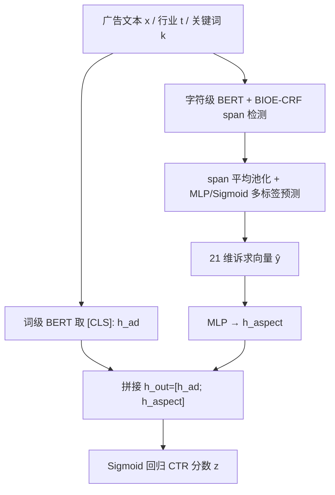
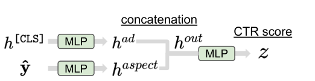

# Aspect-based Analysis of Advertising Appeals for Search Engine Advertising (搜索引擎广告中广告诉求的方面级分析)

- **会议/期刊**: NAACL-HLT 2022 Industry Track
- **作者与机构**: Soichiro Murakami, Peinan Zhang, Sho Hoshino 等（CyberAgent, Inc. / 东京工业大学）
- **推荐链路定位**: 精排（CTR 预估）+ 广告创意辅助生成
- **研究方向**: CTR/CVR 预估与特征交叉 / 大语言模型语义表征增强
- **论文原文**: [https://arxiv.org/abs/2204.11445v1](https://arxiv.org/abs/2204.11445v1)
- **开源代码**: 暂未开源

## TL;DR (1分钟核心速览)

针对"不同行业应当用哪类广告诉求（价格、功能、品质等）才最吸引点击"这一创意难题，本文首次定义 5 粗/16 细共 21 类广告诉求 (A³) 的层级标注体系，人工标注 2,738 条日文广告文本（多标签 span 标注，$\kappa=0.612$），并对比 span-based（BERT+BIOE+CRF）与 doc-based（BERT+MLP）两种诉求检测器；随后把预测出的诉求标签作为辅助特征拼入 BERT-MLP 回归器做 CTR 预估。在 168,412 条真实 Google Ads 样本上，诉求特征使 AUC 由 0.683 升至 **0.713（相对 +4.4%）**、MAE 由 0.142 降至 **0.136（相对 −4.2%）**；相关性分析显示不同行业确有效力各异的诉求（如金融行业"积分返还"$r=0.443$）。

## Background & Motivation (背景与核心矛盾)

- **主流范式**: SEA 创意支持主要走两条路——自动生成广告文案/关键词（Ravi et al., 2010; Kamigaito et al., 2021）与直接预估 CTR（Richardson et al., 2007; Mishra et al., 2021 的 TSI），二者都把"为什么这条文案有效"当作黑盒处理。
- **前人局限**: ① 方面级文本分析（ABSA）长期局限于酒店、餐饮、家电等单一品类，其方面定义极细（如冰箱的"能效""噪音"），无法覆盖跨行业通用广告创意；② 广告实践中诉求表达是多标签、重叠的（"会员额外 20% off" 同时属于「折扣价」与「限定人群优惠」），而常规句子级 ABSA 只做单标签句分类。
- **核心洞察 (Key Insight)**: 电商行业"限时特惠"有效、汽车行业"品质"更重要——诉求的**效力是行业条件的函数**；若能把诉求显式识别出来并与行业交叉分析，既能给创意人员可操作的写作建议，也能作为结构化先验提升 CTR 预估精度。
- **本文切入点**: 先建"跨行业通用诉求体系 + span 级多标签数据集"，再用检测器输出诉求向量作为 CTR 模型的额外特征，一举打通"分析—建模"闭环。

## Method (核心方法设计)

### 1. 整体框架 (Overall Architecture)

模型分两级串联：第一级是**诉求检测器**，输入广告文本 $x$（标题/描述/LP meta-description），由字符级 BERT 编码后经 BIOE-CRF 定位 span，再对每个 span 做多标签分类；第二级是**CTR 回归器**，把广告文本$x$、行业类型$t$、匹配关键词$k$一并送入词级 BERT，取 `[CLS]` 向量$h_{ad}$与第一级输出的 21 维诉求二值向量经 MLP 编码后的$h_{aspect}$ 拼接，回归点击率。训练与推理完全解耦，检测器离线可缓存，线上仅需一次 BERT 前向 + 两个轻量 MLP。检测器两条技术路线（span-based 与 doc-based）被并列比较，最终以 doc-based 的预测标签入库。

<figure class="paper-figure" markdown="span">
  <figcaption>图3：CTR预测模型概览。</figcaption>
</figure>

### 2. 关键设计拆解 (Key Designs)

1. **层级化 A³ 标签体系（先定"什么值得说"）**：痛点起因 $\to$ABSA 既有方面无法跨行业复用。做法是先用规则/人工初筛出 8 个粗粒度诉求，再让资深广告优化师介入，把「特惠」细分为折扣价、积分、免费、赠品（因"免费"与"赠品"的说服力强弱显著不同），并补入「行业第一/最大」。最终形成 5 粗类 + 16 细类、共 21 个多标签（$K=21$）、平均每条广告 1.54 个 span 的体系，间隔一致性$\kappa=0.612$、span 级$F_1=0.451$——这是全文最具迁移价值的基础设施贡献。
2. **span-based 检测：边界感知 + 多标签解耦**：痛点起因 $\to$一个诉求表达是短片段而非整句，且边界错误会污染标签。做法是字符级 BIOE 序列标注 + 线性链 CRF 建模标签转移约束：$v_i=\mathrm{MLP}(h_i)$，经 Viterbi 解码得边界$l$；再对 span$S_{(i,j)}$ 做平均池化并多标签分类：

$$h^{avg}_{(i,j)}=\frac{1}{j-i+1}\sum_{t=i}^{j}h_t,\qquad m_k=\sigma\big(\mathrm{MLP}(h^{avg}_{(i,j)})_k\big)$$

   直觉上 CRF 保证 "E 必在 B/I 之后"，平均池化把片段语义压缩为单一诉求表征。训练用 CRF loss + BCE。但实验发现 span 检测本身的 $F_1$仅 0.69，级联误差使 Pred 模型 Macro-$F_1$ 只有 0.32，反而拖累下游。
3. **doc-based 检测与训练/推理开销**：改用整句 `[CLS]` 一次多标签分类 $m_k=\sigma(\mathrm{MLP}(h_{[CLS]}))_k$，仅 BCE 损失。它放弃定位能力但把任务从"定位+分类"降为"句级分类"，粒度更粗更易学，Macro-$F_1$达 **0.46**，甚至在多数标签上超过使用 Oracle span 的 0.56 中的若干项。CTR 侧总损失为 MSE：$\mathcal{L}=\frac{1}{N}\sum(z_i-\hat{z}_i)^2$，诉求向量作为离散特征拼接，**无需负采样**（回归任务），线上推理增量仅为 21 维向量拼接。

## Experimental Setup & Evaluation Protocol (实验设置与评估协议)

- **数据集与预处理**: 全部为日文真实广告，来自 Google Ads（2020-03-01 至 2021-02-28），按广告主采样每户最多 5,000 条以缓解长尾偏置，剔除长度 <15 或 >200 字符，并用归一化 Levenshtein 距离去重（广告多由模板批量生成）。

| 数据集 | 规模 | Train / Dev / Test | 标签/特征 | 场景说明 |
| :--- | :---: | :---: | :---: | :--- |
| A³ 标注集 | 2,738 条广告文本 | 1,857 / 465 / 410 | 21 类多标签 span | 666 标题 + 1,532 描述 + 440 LP，13 个行业 |
| CTR 数据集 | 168,412 条 (文本, 关键词, 行业) | 136,352 / 16,084 / 15,976 | 连续 CTR ∈ [0,1] | 56 小时标注，1.10 s/条 |

- **数据划分与防穿越 (Splitting Strategy)**: CTR 任务**按 campaign ID 划分**（非随机按条），避免同一投放计划内的样本跨集泄漏；标注集为随机划分（剔除 6 条标注异常样本）。全文**无时间戳切分与冷启动划分**。
- **排名评测协议 (Ranking Protocol)**: 本文**并非排序任务**，未采用 Full-Ranking 或 Sampled Ranking，而是回归/分类指标：诉求检测用多标签 Macro-$F_1$（span 与标签同时正确才算 TP）；CTR 用 **AUC / RMSE / MAE**。这构成其与外推式推荐评测的关键差异。
- **对比基线与超参设置**: 检测器对比 span-based（Pred 与 Oracle-span 两档）与 doc-based；CTR 对比无诉求特征的 BERT 基线及 +$l_{span}$/ +$l_{doc}$两档。均用 `cl-tohoku` 日文 BERT-base（12 层/768 维/12 头），dropout 0.1，Adam/Adamax，学习率$8.6\times10^{-5}$、$5.5\times10^{-5}$、$2.0\times10^{-5}$，早停 patience=3，Optuna 调参 30 trials，**单次运行、无显著性检验**。

## Key Experimental Results (实验关键数据)

### 1. 主实验对比 (Main Results)

**诉求检测（表 2，span 级 $F_1$）**：

| 模型 | Free | Features | Reward points | Largest/No.1 | Story | Problem solving | **Macro-F1** |
| :--- | :---: | :---: | :---: | :---: | :---: | :---: | :---: |
| Span-based (Pred) | 0.68 | 0.50 | 0.62 | 0.67 | 0.32 | 0.00 | 0.32 |
| Span-based (Oracle span) | 0.94 | 0.72 | 0.75 | 0.82 | 0.53 | 0.00 | 0.56 |
| Doc-based | **0.88** | 0.70 | 0.74 | 0.80 | **0.83** | 0.00 | 0.46 |

**CTR 预估（表 4）**：

| 模型 | AUC ↑ | RMSE ↓ | MAE ↓ |
| :--- | :---: | :---: | :---: |
| BERT（无 A³） | 0.683 | 0.220 | 0.142 |
| + $l_{span}$ | 0.709 | 0.218 | 0.137 |
| + $l_{doc}$ | **0.713** | **0.217** | **0.136** |
| Improv. | **+4.4%** | −1.4% | −4.2% |

### 2. 消融实验 (Ablation Study)

以待检诉求来源为消融变量（同时反映检测器质量对下游的敏感度）：

| 配置 | AUC | ΔAUC | Macro-F1（检测） |
| :--- | :---: | :---: | :---: |
| w/o A³（纯 BERT） | 0.683 | — | — |
| w/ span-Pred 标签 | 0.709 | +0.026 | 0.32 |
| w/ Oracle span 标签 | （未报） | — | 0.56 |
| w/ doc-based 标签 | **0.713** | **+0.030** | 0.46 |
| w/ 去掉 span 定位（即 doc-based 检测） | +0.004 vs Pred | — | +0.14 |

### 3. 关键实验发现 (Key Findings)

1. **诉求特征的增益与检测精度强正相关**：doc-based 检测的 Macro-$F_1$比 span-Pred 高 0.14，对应下游 AUC 再涨 0.004（0.709→0.713）。这说明级联式"先抽特征再预估"的瓶颈在抽取端——span 检测$F_1$ 仅 0.69，级联误差吃掉了一半以上潜在收益。
2. **行业 × 诉求的点二列相关系数证实"行业特异效力"**：金融行业「积分返还」$r=0.443$、人力资源「赠品」$r=0.339$、VOD&eBook「行业第一」$r=0.283$、人力资源「履约记录」$r=0.237$、eBook「特惠」$r=0.229$均落入弱正相关区间 ($0.25<|r|<0.5$)；而「功能」类在几乎所有行业都接近 0 且偏负（EC 为$-0.121$），说明它是"通用但无区分度"的诉求，不应作为创意重点。相反「折扣价」在五个行业全为负（$-0.128\sim-0.176$），提示单纯打折反而削弱点击意愿。
3. **数据稀缺标签直接归零**：抽样数仅 17/25/52 的「解决问题」「首单优惠」「限量供应」在 span 与 doc 模型上 $F_1$均为 0.00；而表达高度模板化的「免费」（430 span）$F_1=0.88、「包邮/速度」0.66，说明该任务的难度几乎完全由标签的表达多样性与频次决定，而非模型容量。

## Highlights & Limitations (亮点、对比与审稿批判)

- **与代表作对比 (vs. Prior Work)**: 相比 Mishra et al. (2021) 的 TSI——直接把整句文本映射为 CTR 打分黑盒——本文把"文案→CTR"拆成"文案→显式诉求→CTR"的可解释链路，诉求成为人类可读、可干预的中间变量；相比 Kamigaito et al. (2021) 的文案生成，本文不生成文本而是给出**行业条件的诉求优先级清单**，工程风险更低。相比传统 ABSA（SemEval-2016），其方面体系首次做到"跨 13 个行业通用"而非单品类极细粒度。
- **可迁移亮点**: ① "先做小样本人工标注体系 + 检测器产出结构化离散特征，再拼入精排 MLP" 的范式，可直接迁移到电商标题卖点抽取、短视频标签增强召回；② "用点二列相关系数做行业 × 特征效力画像"是低成本、可解释的业务洞察工具，无需上线 A/B 即可给出创意建议。
- **审稿级局限批判**: ① 实验规模薄弱——检测测试集仅 410 条、单次运行、无显著性检验与置信区间，0.709→0.713 的差距很可能落在噪声内，AUC 提升的结论稳健性不足；② 标签体系由 6 名标注者与广告代理人工经验定义，存在主观性与行业覆盖偏置（Beauty&Health 仅 10 条），而 CTR 数据集却含 168,412 条且行业分布极不均衡（VOD&eBook 30,536 vs Real estate 313），相关性分析的小样本行业结论不可靠；③ 21 维二值向量完全丢弃了诉求表达的强度与位置信息（如"20% off" vs "5% off"），也未与关键词 $k$ 做交叉，特征表达力偏浅，与 DCN/FiBiNET 类显式交叉结构相比仍有明显提升空间。

## Rating (四维评分)

- **方法创新性 (Novelty)**: ⭐⭐⭐ （标签体系与"诉求作中间变量"的思路有价值，但 span/doc 两路模型均为 BERT+CRF/MLP 的直接套用，建模层无新算子）
- **评估协议与实验扎实度 (Protocol & Experiments)**: ⭐⭐ （仅 410 条测试样本、单次运行无显著性检验、无时间切分与采样/全库排序协议，AUC 增益 0.004 的组间差异难以服众）
- **写作与数学规范度 (Clarity & Rigor)**: ⭐⭐⭐⭐ （标签定义、标注流程、实例与超参表齐全，公式简洁无冗余；但缺少复杂度与推理延迟分析）
- **工业落地与复现价值 (Industrial & Practical Value)**: ⭐⭐⭐⭐ （诉求特征零负采样、离线缓存、线上只增 21 维拼接，落地成本极低；可惜数据集与代码均未开源，复现需自建日文标注集）

