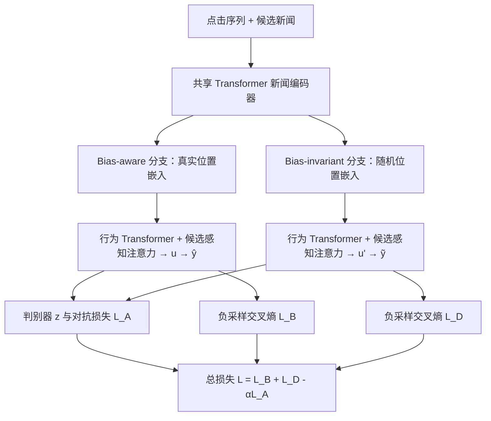
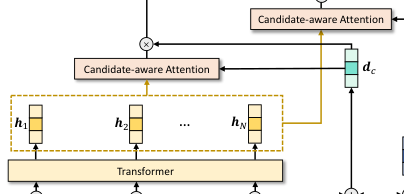

# DebiasGAN: Eliminating Position Bias in News Recommendation with Adversarial Learning (DebiasGAN：基于对抗学习的新闻推荐位置偏差消除)

- **会议/期刊**: ACL/EMNLP 2022
- **作者与机构**: Chuhan Wu, Fangzhao Wu, Yongfeng Huang；清华大学电子工程系 & BNRist、微软亚洲研究院
- **推荐链路定位**: 精排（候选新闻点击率预估）
- **研究方向**: 去偏公平、可信隐私与工业架构 / 序列与会话推荐
- **论文原文**: [https://arxiv.org/abs/2106.06258v1](https://arxiv.org/abs/2106.06258v1)
- **开源代码**: 暂未开源

## TL;DR (1分钟核心速览)

新闻点击受展示位置强影响，直接拟合有偏日志会高估顶部位置并扭曲用户兴趣。DebiasGAN 构建共享新闻编码器的双分支：bias-aware 分支注入真实位置嵌入，bias-invariant 分支注入随机位置嵌入，再用判别器对二者用户兴趣表示做对抗对齐，迫使后者学得位置无关兴趣。在 News/Uniform 两套真实日志、采样排序协议下，AUC 较最强去偏基线 PAL 分别提升 1.14%/1.70%，MRR 提升 3.34%/3.77%。

## Background & Motivation (背景与核心矛盾)

- **主流范式**: 新闻推荐以 Transformer 新闻编码器 + 用户点击序列建模兴趣（NRMS、FIM 等），直接以点击日志做负采样交叉熵训练。
- **前人局限**: ① 顶部新闻天然获得更多曝光与点击，模型会把“位置高”误学成“内容相关”；② IPW、Reg-EM、PAL 等去偏方法多把位置偏差建模为用户无关的全局倾向，忽略同一位置对不同用户、不同候选新闻的影响差异。
- **核心洞察 (Key Insight)**: 图 1 显示两个用户对高/低位置的点击分布截然不同——位置偏差是用户条件化的；若给候选新闻随机位置，模型被迫只依赖内容与历史，可逼近理想无偏点击分数。
- **本文切入点**: 用“真实位置分支 + 随机位置分支”的对抗表示对齐，把位置信息从兴趣表示中剥离。

<figure class="paper-figure" markdown="span">
  <figcaption>图1：两个用户点击的新闻以及向他们展示的一条候选新闻。</figcaption>
</figure>

## Method (核心方法设计)

### 1. 整体框架 (Overall Architecture)

输入用户点击序列 $[D_1,\dots,D_N]$与候选$D_c$，共享 Transformer 新闻编码器得到$\boldsymbol{r}_i,\boldsymbol{r}_c$。Bias-aware 分支给点击新闻加真实位置嵌入$\boldsymbol{e}_i$、候选加真实位置$\boldsymbol{e}_c$，经行为 Transformer 与候选感知注意力得$\boldsymbol{u}$，打分$\hat{y}=\boldsymbol{w}^\top\boldsymbol{u}$；bias-invariant 分支共享编码器与行为 Transformer，仅将候选位置替换为随机嵌入$\boldsymbol{e}'_c$，得$\boldsymbol{u}'$与$\tilde{y}=\boldsymbol{w}^\top\boldsymbol{u}'$。判别器区分$\boldsymbol{u}$与$\boldsymbol{u}'$，对抗梯度使二者分布对齐。训练用负采样交叉熵，推理仅走 bias-invariant 分支并加固定默认位置。

<figure class="paper-figure" markdown="span">
  <figcaption>图2：DebiasGAN 的模型架构。</figcaption>
</figure>

### 2. 关键设计拆解 (Key Designs)

1. **位置量化 + 候选感知注意力（用户条件化位置偏差）**：原始位置多达 1173/667 个，长尾稀疏；先做 $\hat{p}_i=\lceil\sqrt{p_i-1}\rceil$分桶，再与新闻语义相加。用户兴趣表示为$\boldsymbol{u}=\boldsymbol{d}_c\odot[\mathrm{softmax}(\boldsymbol{d}_c^\top\tanh(\mathbf{W}_c\mathbf{H}+\boldsymbol{w}_c))\times\mathbf{H}]$，其中$\boldsymbol{d}_c$ 含候选位置。这样同一位置对不同候选/用户产生不同偏置权重，符合“位置效应是条件化的”直觉，而非全局常数。

2. **随机位置 + 对抗去偏**：bias-invariant 分支把候选位置随机化，切断位置与点击的直接关联；判别器 $z=\sigma(\boldsymbol{w}_p^\top\boldsymbol{u}-\boldsymbol{w}_n^\top\boldsymbol{u}')$，对抗损失$\mathcal{L}_A=-\log z$。通过负梯度使$\boldsymbol{u}$与$\boldsymbol{u}'$ 难以区分——若仍可区分，说明兴趣表示残留位置线索；对抗逼迫其只保留内容兴趣，从而实现表示层去偏。

3. **训练目标、负采样与推理效率**：总损失 $\mathcal{L}=\mathcal{L}_B+\mathcal{L}_D-\alpha\mathcal{L}_A$，$\mathcal{L}_B,\mathcal{L}_D$为两分支负采样交叉熵，$\alpha=0.5$。训练时每条正样本配负样本（原文未报告负采样比例），非全库训练；在线推理只保留 bias-invariant 分支，计算量与 NRMS 同阶，但训练需多一个前向分支与判别器。

## Experimental Setup & Evaluation Protocol (实验设置与评估协议)

- **数据集与预处理**:

| 数据集 | #News | #Users | #Impressions | #Clicks | #Positions | 场景说明 |
| :--- | ---: | ---: | ---: | ---: | ---: | :--- |
| News | 97,646 | 310,469 | 580,000 | 917,839 | 1,173 | 商业新闻平台有偏点击日志 |
| Uniform | 1,277,315 | 479,281 | 529,482 | 808,365 | 667 | 测试集为均匀随机排序新闻列表 |

- **数据划分与防穿越 (Splitting Strategy)**: News 按全局时间戳切分——最后一周测试、最后 3 天验证、其余训练；Uniform 训练/验证来自有偏日志，测试集为最后一个月均匀随机排序列表，用于检验无偏排序能力。
- **排名评测协议 (Ranking Protocol)**: 采样排序（Sampled Ranking）——训练与评估均以负采样构造候选，原文未报告 Full-Ranking 全库协议；指标为 AUC、MRR、nDCG@5、nDCG@10，5 次重复取均值±标准差，t-test 显著性 $p<0.05$。
- **对比基线与超参设置**: 基线含 NAML、NPA、NRMS、FIM 等新闻推荐模型，以及 IPW、Reg-EM、PAL 等去偏方法；GloVe 词向量、Adam 优化器、$\alpha=0.5$，超参在验证集上调。

## Key Experimental Results (实验关键数据)

### 1. 主实验对比 (Main Results)

| 方法 | News AUC | News MRR | News nDCG@5 | News nDCG@10 | Uniform AUC | Uniform MRR | Uniform nDCG@5 | Uniform nDCG@10 |
| :--- | ---: | ---: | ---: | ---: | ---: | ---: | ---: | ---: |
| NAML | 62.59 | 21.40 | 21.61 | 26.56 | 61.27 | 28.36 | 37.71 | 43.26 |
| NPA | 62.67 | 21.48 | 21.69 | 26.63 | 61.30 | 28.38 | 37.75 | 43.27 |
| NRMS | 62.87 | 21.64 | 21.85 | 26.79 | 61.52 | 28.65 | 37.92 | 43.46 |
| FIM | 63.02 | 21.73 | 21.93 | 26.90 | 61.67 | 28.74 | 38.03 | 43.58 |
| IPW | 63.04 | 21.74 | 21.96 | 26.98 | 61.96 | 29.11 | 38.34 | 43.80 |
| Reg-EM | 63.16 | 21.81 | 22.15 | 27.20 | 62.29 | 29.34 | 38.59 | 44.03 |
| PAL | 63.22 | 21.85 | 22.21 | 27.25 | 62.34 | 29.41 | 38.66 | 44.10 |
| **DebiasGAN** | **63.94** | **22.58** | **22.97** | **28.02** | **63.40** | **30.52** | **39.80** | **45.19** |
| **Improv. vs PAL** | **+1.14%** | **+3.34%** | **+3.42%** | **+2.83%** | **+1.70%** | **+3.77%** | **+2.95%** | **+2.47%** |

### 2. 消融实验 (Ablation Study)

原文图 3 仅以柱状图呈现，未报告具体数值；下表以箭头表示相对完整模型的性能变化。

| 变体 | News AUC | Uniform AUC | 观察 |
| :--- | :---: | :---: | :--- |
| DebiasGAN | 63.94 | 63.40 | 完整模型 |
| w/o Position Quantization | ↓ | ↓ | 相邻位置效应被割裂，位置嵌入更稀疏 |
| w/o Candidate-aware Attention | ↓↓ | ↓↓ | 无法建模用户/候选相关的位置敏感度 |
| w/o Adversarial Learning | ↓↓ | ↓↓↓ | 位置信息残留于兴趣表示，Uniform 降幅最大 |

### 3. 关键实验发现 (Key Findings)

1. **去偏方法整体优于纯监督模型**：PAL 较 NRMS 在 News/Uniform 上 AUC 提升 +0.35/+0.82，说明位置偏差确实损害泛化；DebiasGAN 又较 PAL 提升 +0.72/+1.06 AUC，验证双分支对抗的增量价值。
2. **无偏测试集收益更大**：DebiasGAN 在 Uniform 上 AUC 相对提升 1.70%、MRR 提升 3.77%，均高于 News 的 1.14%/3.34%，说明随机位置测试更直接检验“位置无关兴趣”的学习效果。
3. **对抗强度需平衡**：$\alpha$ 从 0 增至 0.5 时 AUC 上升，超过 0.5 后下降——过小去偏不足，过大则主任务监督被对抗梯度稀释；消融中对抗学习与候选感知注意力贡献最大，位置量化增益较小但稳定。

## Highlights & Limitations (亮点、对比与审稿批判)

- **与代表作对比 (vs. Prior Work)**: IPW 用全局逆倾向加权，Reg-EM 用 EM 回归估计倾向，二者均把位置偏差视为用户无关；PAL 将点击分解为相关性与曝光概率，但位置偏置仍进入 CTR 模型。DebiasGAN 的区别在于：用随机位置分支 + 表示层对抗对齐，把“用户条件化位置偏差”端到端剥离，且测试时不需要位置特征。
- **可迁移亮点**: ① $\lceil\sqrt{p-1}\rceil$ 位置分桶可缓解位置长尾稀疏，适用于电商/广告曝光位建模；② 随机位置 + 对抗表示对齐可直接迁移到广告位偏差、推荐曝光偏差等场景；③ 候选感知注意力可建模“上下文相关的偏差”。
- **审稿级局限批判**: ① 两套数据均来自私有商业新闻平台，无公开基准与开源代码，复现性弱；② 评估为采样排序，未报告 Full-Ranking 全库排序，AUC 对负样本组成敏感；③ 训练需双分支与判别器，推理虽只走单分支，但随机位置分布在测试时换成固定默认位置，存在分布偏移风险，线上延迟与 A/B 未验证。

## Rating (四维评分)

- **方法创新性 (Novelty)**: ⭐⭐⭐⭐ （双分支随机位置 + 对抗表示对齐思路清晰，但对抗去偏并非全新范式，胜在用户条件化建模与结构简洁）
- **评估协议与实验扎实度 (Protocol & Experiments)**: ⭐⭐⭐☆ （两套真实日志、5 次重复与 t-test 较规范，但私有数据、采样排序、消融仅给柱状图无具体数值）
- **写作与数学规范度 (Clarity & Rigor)**: ⭐⭐⭐⭐ （公式与架构图简洁，位置量化、候选感知注意力、对抗损失定义明确，复杂度分析略缺）
- **工业落地与复现价值 (Industrial & Practical Value)**: ⭐⭐⭐☆ （推理不加位置、可与现有新闻推荐模型结合，但需双分支训练、无开源代码、线上收益未量化）

