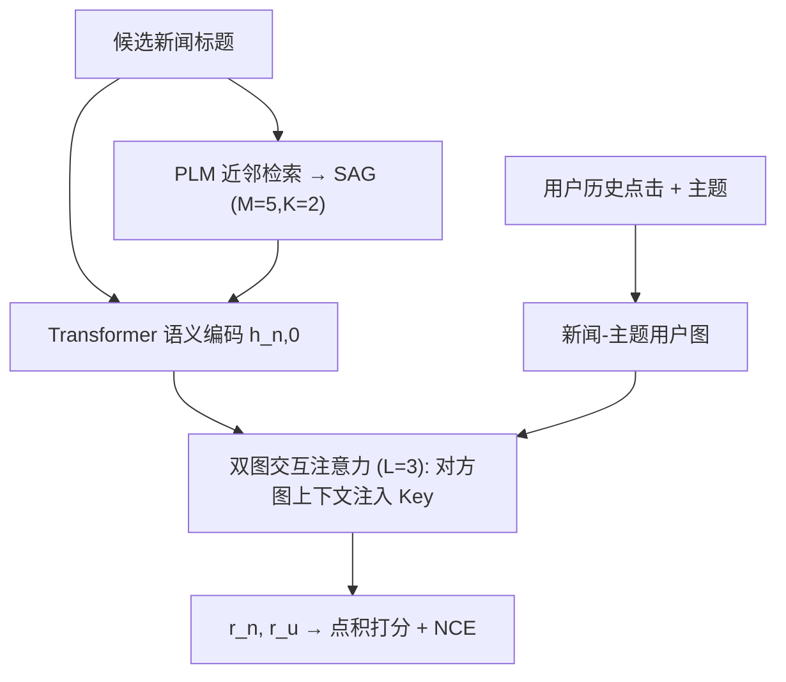
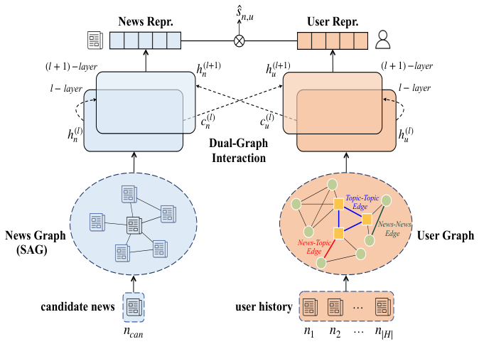

# DIGAT: Modeling News Recommendation with Dual-Graph Interaction (双图交互注意力网络用于新闻推荐)

- **会议/期刊**: Findings of EMNLP 2022
- **作者与机构**: Zhiming Mao, Hongru Wang, Kam-Fai Wong (香港中文大学) / Jian Li (腾讯) / Xingshan Zeng
- **推荐链路定位**: 精排（印象内候选新闻排序）
- **研究方向**: 图神经网络与知识图谱推荐 / 冷启动与长尾推荐
- **论文原文**: [https://arxiv.org/abs/2210.05196v2](https://arxiv.org/abs/2210.05196v2)
- **开源代码**: [https://github.com/Veason-silverbullet/DIGAT](https://github.com/Veason-silverbullet/DIGAT)

## TL;DR (1分钟核心速览)

新闻推荐的通用范式是新闻-用户双表征匹配，但**单条候选新闻多为最新冷新闻、仅几十词，语义不足以表征其主题**；已有图方法又只在用户侧构图或把候选新闻塞进二部图，测试期冷新闻成为孤立节点、且新闻与用户之间缺乏特征交互。DIGAT 用预训练 PLM 检索语义近邻，把候选新闻扩成"根节点+多跳近邻"的语义增强图（SAG），再让新闻图与用户（新闻-主题）图以交互注意力逐层互灌上下文。在 MIND-small/large 的印象内全候选排序协议下，AUC 68.77/70.08，nDCG@5 较最强基线提升 2.3%/3.4%（$p<0.01$）。

## Background & Motivation (背景与核心矛盾)

- **主流范式**: 新闻编码器（CNN/Transformer + 注意力池化）产出新闻向量，用户编码器（GRU/多头自注意力/异构图）聚合历史点击，末端点积打分，NCE 训练。
- **前人局限一**: 候选新闻是"短文本 + 冷启动"双约束——测试期大量候选新闻在用户历史中从未出现，无法用点击记录补信息；单条标题的句法/语义量级不足以刻画用户真正感兴趣的主题（如 Sports），与信息丰富的用户历史匹配时存在严重信息不对称。
- **前人局限二**: GERL 把新闻与用户放进二部图联合传播，测试期的新候选新闻是孤立节点，图传播直接退化；GNewsRec / User-as-Graph 只做用户侧异构图的细粒度池化，候选新闻始终单条编码，**新闻-用户图之间没有特征交互**（只在最后一步点积）。
- **核心洞察 (Key Insight)**: 候选新闻虽无点击，但可从训练语料中检索语义近邻，把它变成一个小图，用图的局部+全局上下文替代"一句话"表征；同时两张图不应各自为政，而应在每一层互相作为消息传递的条件。
- **本文切入点**: 新闻图通道（SAG）+ 用户图通道（news-topic graph）+ 逐层双图交互注意力，一套端到端框架同时解两个矛盾。

## Method (核心方法设计)

### 1. 整体框架 (Overall Architecture)

候选新闻标题经 Transformer（MSA + 注意力聚合）得语义向量 $h_{n,0}$，并以它为根节点，用 mpnet-base-v2 计算余弦相似度、逐跳检索$M$个近邻、扩展$K$跳，构成语义增强图 SAG（规模约$O(M^{K})$）；用户侧用同一新闻编码器编码历史点击，并构建含新闻节点与主题节点的新闻-主题图（同主题新闻全连、新闻连其所属主题、主题全连）。两条通道先各读取出图上下文（新闻侧 = 根节点局部表征 + 近邻注意力的全局表征，经门控融合；用户侧 = 以新闻上下文为 query 逐层聚合主题再聚合到用户），随后进入$L=3$层双图交互：更新新闻节点时把用户图上下文$c_u$注入注意力打分，更新用户节点时对称地注入$c_n$，每层重新读取上下文。末端取$r_n=c_n^{L}$、$r_u=c_u^{L}$，点积打分并以 NCE 训练，SAG 离线预构建（MIND-large 约 20 分钟）。

<figure class="paper-figure" markdown="span">
  <figcaption>图 2：DIGAT 框架的整体架构。</figcaption>
</figure>

### 2. 关键设计拆解 (Key Designs)

1. **语义增强图 SAG（用图上下文替代单文本表征）**：为缓解冷新闻语义稀疏，对语料内任意新闻对计算 $s_{i,j}=\cos(\phi(T_i),\phi(T_j))$并逐跳连边；图上下文由局部$h_n^{L}=h_{n,0}$与全局$h_n^{G}=\sum_{i}\alpha_i h_{n,i}$门控融合：$\alpha_i=\mathrm{softmax}\big((h_{n,0}W_n^{Q})(h_{n,i}W_n^{K})^{\top}/\sqrt{d}\big)$，$c_n=\mathrm{FFN}_g([h_n^{L};h_n^{G}])$。直觉上它把候选新闻从"一句话向量"变成"一个主题簇的加权中心"，等价于用检索到的同主题样本做免监督的主题级表征平滑。
2. **双图交互注意力（条件化消息传递）**：标准 GAT 的注意力与用户在新闻侧完全无关，故本文将 key 向量改为三元融合 $K_{i,j}=\mathrm{FFN}_n^{(l)}([c_u^{(l)};h_{n,i}^{(l)};h_{n,j}^{(l)}])$，$\alpha_{i,j}=\mathrm{softmax}\big(\mathrm{LeakyReLU}(a_n^{\top}K_{i,j})\big)$，$h_{n,i}^{(l+1)}=\mathrm{ReLU}\big(\sum_{j\in\mathcal{N}_i}\alpha_{i,j}\hat{h}_{n,j}\big)+h_{n,i}^{(l)}$，用户侧对称。物理直觉：以对方兴趣上下文为条件做消息裁剪，自动压低与当前用户无关的近邻（噪声新闻）权重——这也解释了层数加深后性能反降（注意力条件化误差累积，$L\ge 6$ 必须梯度裁剪）。
3. **训练目标、负采样与推理开销**：$\hat{s}_{n,u}=r_n^{\top}r_u$，$\mathcal{L}=-\sum_{i=1}^{|\mathcal{D}|}\log\frac{\exp(\hat{s}_i^{+})}{\exp(\hat{s}_i^{+})+\sum_{j=1}^{S}\exp(\hat{s}_{i,j}^{-})}$，$S=4$均匀随机负采样（无 in-batch / hard negative）。新闻文本表征可预计算缓存，双图迭代更新（公式 11–12）是主要推理开销，$L=3$时单卡 3090 推理 598.5 s，约为 NRMS（89.5 s）的 6.7 倍，但可通过降$L$ 换取效率。

## Experimental Setup & Evaluation Protocol (实验设置与评估协议)

- **数据集与预处理**:

| 数据集 | #Users | #News | 用户历史 | 特征/场景说明 |
| :--- | :---: | :---: | :---: | :--- |
| MIND-small | 50,000 | ≈6.5 万（官方统计） | 最近 50 条点击 | 英文标题截断 32 词，Glove 300d，$d=400$ |
| MIND-large | 1,000,000 | ≈270 万（官方统计） | 最近 50 条点击 | 6 周微软新闻匿名曝光日志，small 为其用户采样 |

- **数据划分与防穿越 (Splitting Strategy)**: `全局时间戳切分`——前 5 周日志作训练/验证，第 6 周日志作测试，测试期候选新闻大量为训练中未见的新新闻（天然冷新闻设定）。
- **排名评测协议 (Ranking Protocol)**: `Full-Ranking`——对每个 impression 的全部曝光候选新闻统一打分排序（未点击即负例），非采样排序；指标 AUC / MRR / nDCG@5 / nDCG@10。
- **对比基线与超参设置**: 序列/注意力类 GRU、DKN、NPA、NAML、LSTUR、NRMS、FIM、HieRec，图类 GERL、GNewsRec、User-as-Graph；$d=400$、$M=5$、$K=2$、$L=3$、lr$1\times10^{-4}$（Adam）、负样本$S=4$；MIND-small 重复 10 次 / large 重复 5 次取均值，Student's t-test$p<0.01$。

## Key Experimental Results (实验关键数据)

### 1. 主实验对比 (Main Results)

| 方法 | small AUC | small MRR | small nDCG@5 | small nDCG@10 | large AUC | large MRR | large nDCG@5 | large nDCG@10 |
| :--- | :---: | :---: | :---: | :---: | :---: | :---: | :---: | :---: |
| NAML | 66.12 | 31.53 | 34.88 | 41.09 | 66.46 | 32.75 | 35.66 | 41.40 |
| LSTUR | 65.87 | 30.78 | 33.95 | 40.15 | 67.08 | 32.36 | 35.15 | 40.93 |
| NRMS | 65.63 | 30.96 | 34.13 | 40.52 | 67.66 | 33.25 | 36.28 | 41.98 |
| FIM | 65.34 | 30.64 | 33.61 | 40.16 | 67.87 | 33.46 | 36.53 | 42.21 |
| HieRec | 67.83 | 32.78 | 36.31 | 42.49 | 69.03 | 33.89 | 37.08 | 43.01 |
| GERL (二部图) | 65.27 | 30.10 | 32.93 | 39.48 | 68.10 | 33.41 | 36.34 | 42.03 |
| GNewsRec | 65.54 | 30.27 | 33.29 | 39.80 | 68.15 | 33.45 | 36.43 | 42.10 |
| User-as-Graph | – | – | – | – | 69.23 | 34.14 | 37.21 | 43.04 |
| **DIGAT** | **68.77** | **33.46** | **37.14** | **43.39** | **70.08** | **35.20** | **38.46** | **44.15** |
| Improv.% (vs 最强基线) | +1.39% | +2.08% | +2.29% | +2.12% | +1.23% | +3.11% | +3.36% | +2.58% |

### 2. 消融实验 (Ablation Study)

| 变体 | AUC | MRR | nDCG@5 | nDCG@10 | Δ AUC |
| :--- | :---: | :---: | :---: | :---: | :---: |
| w/o SA（去 SAG，单条新闻编码） | 67.44 | 32.44 | 35.79 | 42.13 | −1.33 |
| TF-IDF SA（语法相似度检索） | 67.82 | 32.65 | 36.25 | 42.49 | −0.95 |
| Seq SA（近邻排成序列做注意力） | 68.29 | 33.01 | 36.60 | 42.91 | −0.48 |
| w/o Interaction（两侧均退化为 vanilla GAT） | 低于上述全部含交互变体（图 3） | – | – | – | – |
| **DIGAT（PLM 检索 + 图结构 + 双图交互）** | **68.77** | **33.46** | **37.14** | **43.39** | – |

### 3. 关键实验发现 (Key Findings)

1. **SAG 是最大单一增益源，且增益主要来自语义检索质量而非"更多文本"**：去掉 SAG 掉 1.33 AUC；换成 TF-IDF 只回收 0.38，说明语法级相似度检索会引入近义但主题错位的近邻；把同一批近邻排成序列只用注意力池化（Seq SA）也只有 68.29，比图结构低 0.48，证明多跳多邻居拓扑本身有额外价值。
2. **交互是"条件化"而非"拼接"**：去掉全部交互、或仅保留单侧交互均低于 DIGAT，且去掉用户图交互的跌幅大于去掉新闻图交互——说明用户上下文对新闻侧近邻的裁剪更关键（用户历史信息量更大，能有效抑制 SAG 噪声）；双侧同时交互优于任一单侧，验证逐层迭代的必要性。
3. **图方法在冷新闻上的分野被量化**：同为图方法，GERL 在 MIND-small 仅 65.27 AUC，低于非图的 NAML（66.12），正是二部图中冷新闻孤立节点导致的退化；而 DIGAT 双侧分图 + SAG 使其在 cold-news 测试集上仍领先最强基线 0.94 AUC。效率侧：$M$从 1→5 单调升、$M>5$转降（噪声近邻 + 全局聚合变难），$K=2$最优；$L=1$即 68.23 AUC 已超所有基线（30.5 MB / 250.7 s），$L=3$ 为 40.3 MB / 598.5 s，构成清晰的精度-延迟可调曲线。

## Highlights & Limitations (亮点、对比与审稿批判)

- **与代表作对比 (vs. Prior Work)**: 与 GERL 的本质差异是放弃"新闻-用户二部图"改为两条独立图通道，规避测试期冷新闻孤立节点；与 GNewsRec/User-as-Graph 的差异是把候选新闻也建成图并与其交互，而非仅做用户侧图池化后末端点积；与 HieRec 的差异是新闻侧不再单条编码，而用检索近邻扩充语义，二者在 MIND-small 上相差 0.94 AUC。
- **可迁移亮点**: ①"PLM 近邻检索 + 多跳扩展"构造成本极低（20 分钟离线预处理），可直接迁移到任何冷物品/冷内容场景做表征增强；②把对侧图上下文注入注意力 key 的条件化消息传递算子，可套用到双塔交互、跨域双图等结构。
- **审稿级局限批判**: ①推理成本高（598.5 s，6.7× NRMS），且每条候选新闻都要构建 SAG 子图，工业上印象内数百候选时开销不可忽略；②SAG 依赖静态离线语料检索，无法吸收实时事件流（作者也承认应改用事件驱动聚类）；③只在 MIND 离线日志上验证，无在线 A/B，且 $M$、$K$、$L$ 三者耦合敏感、深层训练依赖梯度裁剪，复现调参成本偏高。

## Rating (四维评分)

- **方法创新性 (Novelty)**: ⭐⭐⭐⭐ （SAG 检索增强 + 双图条件化交互两个算子都指向具体痛点，非堆叠模块，但理论上仍是 GAT 的条件化变体，缺少谱域或理论保证）
- **评估协议与实验扎实度 (Protocol & Experiments)**: ⭐⭐⭐⭐ （MIND 双规模、Full-Ranking、10/5 次重复 + t-test，消融覆盖 SAG 三种替代与三种交互变体；扣分在于交互消融只给曲线未给数值、无在线验证）
- **写作与数学规范度 (Clarity & Rigor)**: ⭐⭐⭐⭐ （框架图与公式链条清晰、算法 1 完整；但 SAG 构图细节与复杂度推到附录，$O(M^{K})$ 的规模表述与实际节点数略有出入）
- **工业落地与复现价值 (Industrial & Practical Value)**: ⭐⭐⭐⭐ （代码开源、SAG 可离线批处理、$L$ 可调出精度-延迟折中；但双图迭代推理延迟与构图存储成本使其更适合作为冷启动召回补强而非全量精排）

