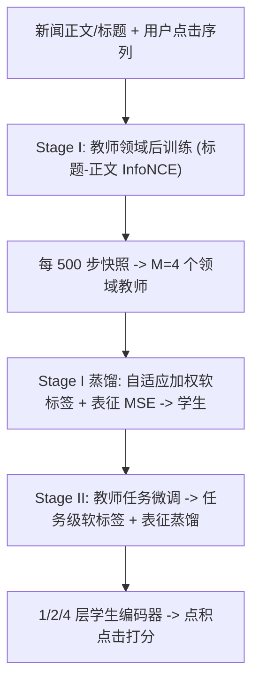
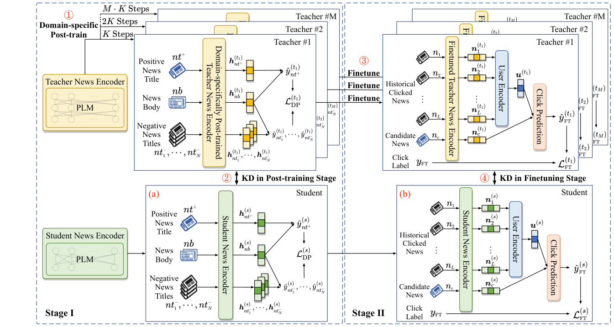
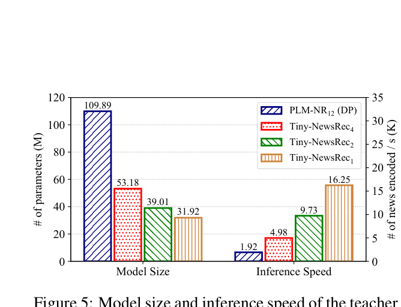

# Tiny-NewsRec: Effective and Efficient PLM-based News Recommendation (高效轻量的 PLM 新闻推荐)

- **会议/期刊**: EMNLP 2022
- **作者与机构**: Yang Yu, Fangzhao Wu, Chuhan Wu, Jingyi Yi, Qi Liu (中国科学技术大学 / 微软亚洲研究院 / 清华大学)
- **推荐链路定位**: 精排（新闻编码 + 用户兴趣匹配打分）
- **研究方向**: 大语言模型推荐 / 自监督对比与去噪
- **论文原文**: [https://arxiv.org/abs/2112.00944v2](https://arxiv.org/abs/2112.00944v2)
- **开源代码**: [https://github.com/yflyl613/Tiny-NewsRec](https://github.com/yflyl613/Tiny-NewsRec)

## TL;DR (1分钟核心速览)

针对 PLM 新闻推荐的两大痛点——通用语料与新闻文本的 domain shift、以及 12 层 PLM 逐条编码新闻带来的在线延迟——Tiny-NewsRec 先用「新闻标题↔正文」自监督对比匹配做领域后训练 (DP)，再以「后训练阶段传领域知识 + 微调阶段传任务知识」的两阶段多教师蒸馏压缩模型。在 MIND/Feeds 的 impression 级候选排序协议下，4 层学生 AUC 达 71.19/69.58，反超 12 层教师 (71.02/69.37)；参数量 109.89M→53.18M，单卡编码吞吐 1.92K→4.98K news/s。

## Background & Motivation (背景与核心矛盾)

- **主流范式**: 用 UniLMv2/BERT 等 PLM 替换 CNN/注意力作为新闻编码器 (PLM-NR、UNBERT)，再以「用户历史点击新闻 + 候选新闻」点积打分，端到端用点击标签微调。
- **前人局限**: ① 预训练语料 (BookCorpus/Wikipedia) 与新闻文本存在领域偏移，仅靠 0/1 点击标签的稀疏监督难以弥合；DAPT/TAPT 的继续预训练需海量无标注语料且目标 (MLM) 与「语义匹配」不直接对齐。② 110M 参数编码每条新闻，低延迟在线服务不可承受；直接砍层 (PLM-NR1/2/4) 掉点明显，而 TinyBERT/NewsBERT 的蒸馏**完全忽略领域差距**，只在下游任务阶段搬运知识。
- **核心洞察 (Key Insight)**: 新闻的标题与正文天然是同一语义的两种表述，可零标注构造强对比正样本；且领域后训练轨迹上不同 step 的 checkpoint 各自侧重不同语义侧面，互为补充，比单一教师或「多 PLM 联合微调」的教师更具信息多样性。
- **本文切入点**: 把「领域适配」与「模型压缩」耦合进同一条流水线：先 DP 再两阶段蒸馏，让轻量学生在**后训练阶段就学会新闻域语义**，而非只在任务阶段被动模仿。

## Method (核心方法设计)

### 1. 整体框架 (Overall Architecture)

输入为新闻标题/正文与用户最近 $L$条点击新闻。Stage I 先用「正文为锚、标题为正例、随机标题为负例」的 InfoNCE 让 12 层教师做领域后训练，并在收敛后每$K=500$步快照一个 checkpoint，共$M=4$ 个教师；学生同步做同样的 DP 任务，同时接受这 4 个教师的软标签与表征蒸馏。Stage II 把这 4 个教师各自用点击任务微调，再对学生做一次任务级蒸馏（对齐新闻表征与用户表征）。推理时只剩学生编码器 + 注意力用户编码器 + 点积打分，无任何教师开销。

<figure class="paper-figure" markdown="span">
  <figcaption>图 1：Tiny-NewsRec 的框架</figcaption>
</figure>

### 2. 关键设计拆解 (Key Designs)

1. **标题-正文对比式领域后训练 (DP)**：痛点是不透明的 MLM 目标并未显式建模「语义可匹配性」。本文令 $\hat{y}_{n_t^+}=\boldsymbol{h}_{n_b}^{\top}\boldsymbol{h}_{n_t^+}$、$\hat{y}_{n_t^-}=\boldsymbol{h}_{n_b}^{\top}\boldsymbol{h}_{n_t^-}$，最小化

$$\mathcal{L}_{DP}=-\log\frac{\exp(\hat{y}_{n_t^+})}{\exp(\hat{y}_{n_t^+})+\sum_{i=1}^{N}\exp(\hat{y}_{n_t^-_i})}$$

   即最大化正文与自身标题互信息下界；直觉上它把新闻句子表征从 PLM 固有的各向异性锥体中「推开」，产出更具判别力的新闻向量，直接利好后续的候选-历史兴趣匹配。

2. **自适应加权的多教师两阶段蒸馏**：单教师指导有限甚至带偏，集成教师又对所有样本等权。本文按每个样本上的 CE 损失给教师打分 $\alpha^{(t_i)}=\frac{\exp(-\mathrm{CE}(\hat{\boldsymbol{y}}^{(t_i)}_{DP},\boldsymbol{y}_{DP}))}{\sum_{j=1}^{M}\exp(-\mathrm{CE}(\hat{\boldsymbol{y}}^{(t_j)}_{DP},\boldsymbol{y}_{DP}))}$，再以$\mathcal{L}_{distill}=T^2\mathrm{CE}(\sum_i\alpha^{(t_i)}\hat{\boldsymbol{y}}^{(t_i)}/T,\hat{\boldsymbol{y}}^{(s)}/T)$与投影对齐损失$\mathcal{L}_{emb}=\sum_i\alpha^{(t_i)}\mathrm{MSE}(W^{(t_i)}\boldsymbol{h}^{(t_i)}+\boldsymbol{b}^{(t_i)},\boldsymbol{h}^{(s)})$ 双路监督。效果上「每个样本都向当天最好的老师学」，既避免弱教师污染，又比固定集成更贴合样本难度。

3. **训练目标与推理效率**：Stage I 为 $\mathcal{L}_1=\mathcal{L}_{distill}^{DP}+\mathcal{L}_{emb}^{DP}+\mathcal{L}_{DP}^{(s)}$；Stage II 为$\mathcal{L}_2=\mathcal{L}_{distill}^{FT}+\mathcal{L}_{emb}^{FT}+\mathcal{L}_{FT}^{(s)}$，任务损失用点击交叉熵。负采样免学习参数：DP 阶段从新闻池随机抽$N$ 个标题作负例，任务阶段沿用 impression 内真实曝光负例。推理仅 1/2/4 层学生前向，吞吐 1.92K→4.98K/9.73K/16.25K news/s（约 2.6–8.5 倍）。

## Experimental Setup & Evaluation Protocol (实验设置与评估协议)

| 数据集 | #News | #Users | #Impressions | 说明 |
| :--- | :---: | :---: | :---: | :--- |
| MIND | 161,013 | 1,000,000 | 15,777,377 | 微软新闻 6 周点击日志，官方 train/valid/test；受训练速度限制仅取 1/2 训练样本 |
| Feeds | 377,296 | 10,000 | 320,925 | 微软新闻 App 2020-08~09，最后一周为测试，训练集随机 20% 作验证 |
| News | 1,975,767 | — | — | 仅有新闻文章（均标题 11.84 词、正文 511.43 词），专供领域后训练，无用户信息 |

- **数据划分与防穿越**: MIND 用官方划分；Feeds 用**时间切分**（最后一周测试），符合线上真实分布；
- **排名评测协议**: **Sampled / impression 级候选排序**（每个曝光组含 1 条点击 + 少量未点击候选），AUC 在全体曝光上计算，MRR 与 nDCG@10 在单次曝光候选列表内计算；**未做 Full-Ranking 全库排序**，故指标不可与全库检索类工作直接横比；
- **对比基线与超参**: PLM-NR(FT) 12 层及 1/2/4 层砍层版、PLM-NR(DAPT)、PLM-NR(TAPT)、TinyBERT、NewsBERT，另含集成教师 (Ensemble-Teacher12)、TinyBERT-MT、NewsBERT-MT、MT-BERT。UniLMv2 初始化，新闻/用户表征维度 $d=256$，温度$T_{DP}=T_{FT}=1$，$M=4$，$K=500$；Adam 优化，每个实验独立重复 5 次，同层数对比的$t$-test 显著性$p<0.01$。

## Key Experimental Results (实验关键数据)

### 1. 主实验对比 (Main Results)

| 模型 (参数量) | MIND AUC | MIND MRR | MIND nDCG@10 | Feeds AUC | Feeds MRR | Feeds nDCG@10 |
| :--- | :---: | :---: | :---: | :---: | :---: | :---: |
| PLM-NR12 (FT) | 69.72 | 34.74 | 43.71 | 67.93 | 34.42 | 45.09 |
| PLM-NR12 (DAPT) | 69.97 | 35.07 | 43.98 | 68.24 | 34.63 | 45.30 |
| PLM-NR12 (TAPT) | 69.82 | 34.90 | 43.83 | 68.11 | 34.49 | 45.11 |
| PLM-NR12 (DP, 教师) | 71.02 | 36.05 | 45.03 | 69.37 | 35.74 | 46.45 |
| PLM-NR4 (FT, 53.18M) | 69.49 | 34.40 | 43.40 | 67.46 | 33.71 | 44.36 |
| TinyBERT4 (53.18M) | 70.55 | 35.60 | 44.47 | 68.40 | 34.64 | 45.21 |
| NewsBERT4 (53.18M) | 70.62 | 35.72 | 44.65 | 68.69 | 34.90 | 45.64 |
| **Tiny-NewsRec4 (53.18M)** | **71.19** | **36.21** | **45.20** | **69.58** | **35.90** | **46.57** |
| Tiny-NewsRec2 (39.01M) | 70.95 | 36.05 | 44.93 | 69.25 | 35.45 | 46.25 |
| Tiny-NewsRec1 (31.92M) | 70.04 | 35.16 | 44.10 | 68.31 | 34.65 | 45.32 |
| **Improv. (vs. NewsBERT4)** | **+0.81%** | **+1.37%** | **+1.23%** | **+1.30%** | **+2.87%** | **+2.04%** |

### 2. 消融实验 (Ablation Study)

| 变体（Feeds, 4 层学生） | AUC | nDCG@10 |
| :--- | :---: | :---: |
| Tiny-NewsRec4 (完整) | **69.58** | **46.57** |
| w/o Stage I（仅任务蒸馏） | 69.01 | 46.06 |
| w/o Stage II（仅领域蒸馏） | 68.20 | 45.11 |
| PLM-NR4 (FT，无任何蒸馏) | 67.46 | 44.36 |
| w/o 蒸馏损失（仅目标 + 对齐） | 68.32 | — |
| w/o 嵌入对齐损失 | 68.69 | — |
| w/o 目标损失（仅蒸馏 + 对齐） | 69.13 | — |

### 3. 关键实验发现 (Key Findings)

1. **领域后训练的增益与压缩增益正交**：同为 12 层，DP 相比 FT 提升 AUC +1.30 (69.72→71.02)，远大于 DAPT/TAPT 的 +0.25/+0.10，说明「标题-正文语义匹配」比继续 MLM 预训练更贴近推荐所需表征；而该收益可被蒸馏完整继承——学生 Tiny-NewsRec4 (71.19) 反而超过教师 (71.02)。
2. **两阶段缺一不可，Stage II 权重更大但 Stage I 不可替代**：去掉 Stage II 掉至 68.20 (AUC −1.38)，去掉 Stage I 掉至 69.01 (−0.57)，但两者合起来比单阶段 FT 的 67.46 高出 2.12，证明「先领域对齐再任务对齐」的顺序结构本身贡献了增量；损失层面蒸馏损失最关键 (去掉 −1.26)，说明软标签是主要监督源，而真值目标损失仍必需 (+0.45)，因为教师本身有错。
3. **多教师只在「按样本自适应加权」时才有效，且 $M=4$即饱和**：等权集成的 Ensemble-Teacher12 AUC 仅 69.43，低于 12 层单教师 DP 的 69.37 附近水平，而 Tiny-NewsRec4 达 69.58；将$M$从 1 增至 6 时 AUC 先陡升后在$M>4$趋于平坦，故 4 是性能/训练成本的拐点（需$M$ 倍教师微调开销）。

<figure class="paper-figure" markdown="span">
  <figcaption>图 5：教师模型与学生模型的模型大小和推理速度。</figcaption>
</figure>

## Highlights & Limitations (亮点、对比与审稿批判)

- **与代表作对比 (vs. Prior Work)**: ① 与 DAPT/TAPT 相比，本文的自监督任务直接用新闻内部结构构造监督信号，无需额外大规模语料且目标与下游「语义匹配」同构；② 与 TinyBERT/NewsBERT 相比，本文首次把蒸馏搬到**领域适配阶段**，并让教师来自后训练轨迹的不同 step 而非不同 PLM，教师间互补性更强、成本更低；③ 与 MT-BERT（多 PLM 联合微调）相比，多快照教师在 Feeds 上高出 +1.07 AUC。
- **可迁移亮点**: 「用同一样本的不同字段/视角构造对比正例做领域后训练」可平移到商品标题-详情、视频封面-文案、query-doc 等场景；「按样本 CE 自适应加权多教师软标签」是廉价且即插即用的蒸馏增强，可直接套到任意 teacher-student 框架。
- **审稿级局限批判**: ① 评测只用 impression 内候选集（Sampled Ranking），未做全库 Full-Ranking，AUC/MRR 绝对值无法与真实检索场景对齐，也未报告冷启动/长尾新闻分桶；② 训练成本隐藏：需 $M=4$ 个 12 层教师的独立微调与快照存储，总体 GPU 开销约为单教师方案的 4 倍，论文仅以「未来工作」带过，缺乏端到端训练时长与显存对比。

## Rating (四维评分)

- **方法创新性 (Novelty)**: ⭐⭐⭐⭐ （把领域自监督与多教师两阶段蒸馏耦合进一条流水线，思路清晰但组件本身均为已有技术的巧妙重组）
- **评估协议与实验扎实度 (Protocol & Experiments)**: ⭐⭐⭐⭐ （两个真实工业数据集、5 次重复 ±std、$p<0.01$ 显著性，并补齐多教师与效率对比；扣分在仅有采样排序、无全库排序与分桶分析）
- **写作与数学规范度 (Clarity & Rigor)**: ⭐⭐⭐⭐ （InfoNCE、自适应权重与两级损失公式定义完整、符号统一，缺少对学生表征对齐必要性的理论解释）
- **工业落地与复现价值 (Industrial & Practical Value)**: ⭐⭐⭐⭐⭐ （开源代码与数据，参数量减 50%–70%、吞吐提升 2–8 倍且精度不降，正对新闻推荐的在线延迟痛点）

