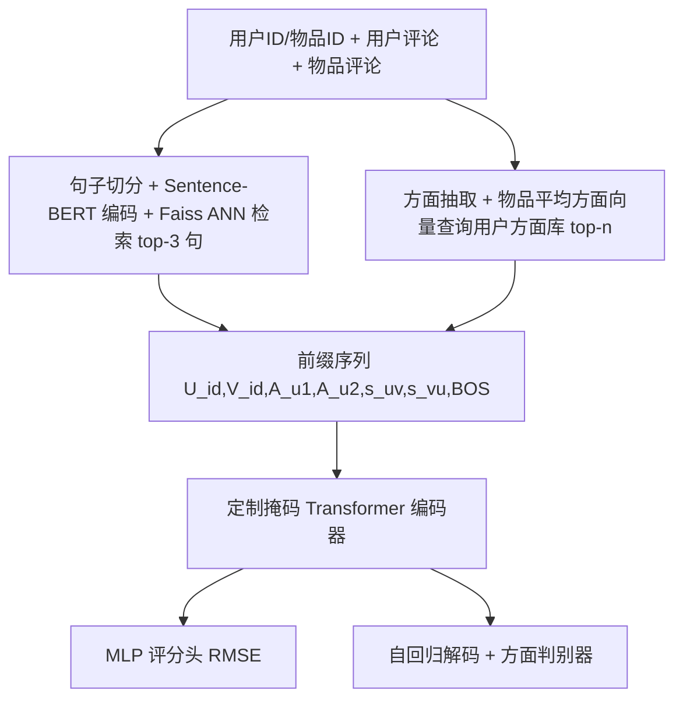
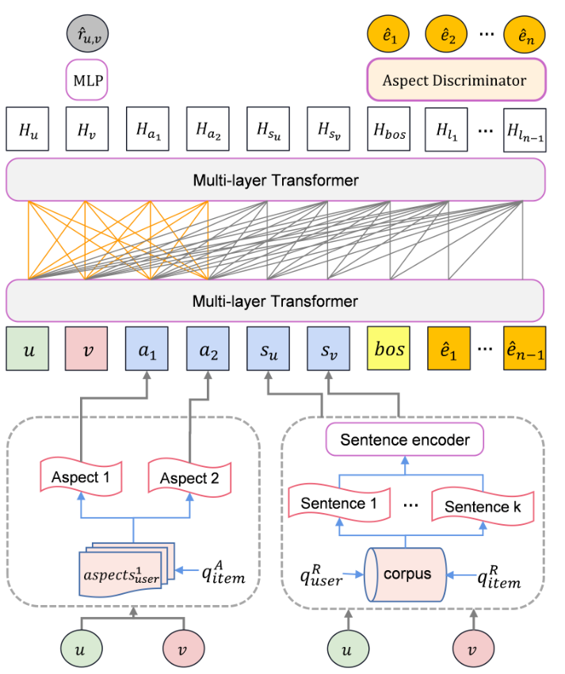

# Explainable Recommendation with Personalized Review Retrieval and Aspect Learning (基于个性化评论检索与方面学习的可解释推荐)

- **会议/期刊**: ACL 2023 (Long Papers)
- **作者与机构**: Hao Cheng, Shuo Wang, Wensheng Lu, Wei Zhang, Mingyang Zhou, Kezhong Lu, Hao Liao（深圳大学）
- **推荐链路定位**: 端到端生成式（评分预测 + 解释文本生成的多任务输出层）
- **研究方向**: 对话推荐与智能体仿真（可解释推荐理由生成） / 大语言模型推荐（语义检索增强）
- **论文原文**: [论文原文链接](https://arxiv.org/abs/2306.12657v1)
- **开源代码**: [开源代码仓库链接](https://github.com/Complex-data/ERRA)

## TL;DR (1分钟核心速览)

可解释推荐既要打分又要生成理由，但用户/物品的历史评论常常极度稀疏，纯参数化的 Transformer（如 PETER）在生成端易退化为"环境很好""服务不错"这类通用套话。ERRA 把**每个数据集的训练集本身当作检索语料**（按句切分、Sentence-BERT 编码、Faiss ANN 检索 top-3 相似句），并把用户-物品交互场景下的 **top-n 方面（aspect）** 以掩码方式注入 Transformer 前四位，联合优化评分（RMSE）、上下文预测、文本负对数似然与方面判别器四项损失。在 Yelp/Amazon/TripAdvisor 的随机 8:1:1 划分下，TripAdvisor 上 RMSE 相对 PETER 降低 3.3%、BLEU-4 提升 15.8%，人工流畅度 3.45 vs 3.11。

## Background & Motivation (背景与核心矛盾)

- **主流范式**: 多任务可解释推荐（NRT/CAML/PETER）共享用户-物品隐表征，用 Transformer 解码器在打分的同时生成自然语言理由；解释形式分为 post-hoc、embedded 与 multi-task 三类，本文立足第三类。
- **前人局限**: ① 生成任务需要大量文本监督，但真实平台里单个用户/物品的评论严重不足，生成端精度崩塌；② 现有 Transformer 框架把异构文本（ID、评论、方面）无差别拼接，缺少个性化信号，同一用户对不同物品的注意力差异被抹平。
- **核心洞察 (Key Insight)**: 模型中"缺失的知识"其实就藏在**训练集的其他评论**里——跨用户、跨物品的相似句能提供具体细节（如"隔音效果好""电池不耐用"），而用户对不同物品关注的方面并不相同（住酒店看环境、买手机看价格），因此方面必须**条件于物品**来选择。
- **本文切入点**: 用"检索增强 + 物品条件的方面选择"两个模块替换 PETER 式纯参数记忆，把外部具体细节与个性化注意力一并塞进 BOS 之前的隐向量。

<figure class="paper-figure" markdown="span">
  ![图 1：用户对不同物品的评论以及不同模型选出的评论。具体而言，(a) 一种基于 CNN 的方法，其选出的评论过于笼统；(b) 一种基于用户 ID 注意力的查询方法 \[11\]，其选出的评论不够具体；(c) 一种基于协同注意力的方法 \[5\]，其选出的评论包含一些细节；(d) 我们的模型：基于检索的方法生成与该酒店相关、信息丰富且个性化的评论。](../../../../assets/papers/2306.12657v1/figure_1.png)<figcaption>图 1：用户对不同物品的评论以及不同模型选出的评论。具体而言，(a) 一种基于 CNN 的方法，其选出的评论过于笼统；(b) 一种基于用户 ID 注意力的查询方法 [11]，其选出的评论不够具体；(c) 一种基于协同注意力的方法 [5]，其选出的评论包含一些细节；(d) 我们的模型：基于检索的方法生成与该酒店相关、信息丰富且个性化的评论。</figcaption>
</figure>

## Method (核心方法设计)

### 1. 整体框架 (Overall Architecture)

输入由五元组构成：用户 ID、物品 ID、为该用户在该物品上检索出的 2 个方面、双向检索句（用户视角 $s_{uv}$与物品视角$s_{vu}$）以及目标评论词序列。检索模块离线构建句子级向量库并用 ANN 取相似句；方面模块在用户自身的方面小语料里用物品平均方面向量做查询，取 top-n 作为"此用户面对此物品最在意的特征"；二者与 ID 一起拼成前缀序列送入改造后的 Transformer，通过定制注意力掩码让前四个位置（$U_{id},V_{id},A_{u1},A_{u2}$）互相可见，最后由 BOS 位置隐向量并行驱动 MLP 打分头与自回归词表 softmax 生成头。训练为四项损失的加权和。

<figure class="paper-figure" markdown="span">
  <figcaption>图 2：ERRA 框架概览。4.4 联合增强 Transformer</figcaption>
</figure>

### 2. 关键设计拆解 (Key Designs)

1. **训练集即语料的句子级检索增强**：痛点是评论稀缺且长评论语义混杂。做法是把长评论切成单句作为检索单元，用户查询向量取其为所有评论嵌入的均值 $q_u=\frac{1}{|\mathcal{R}_u|}\sum_{r\in\mathcal{R}_u}\mathrm{SBERT}(r)$，按余弦相似度取 top-3（$n=3$）拼成整句后再编码得$s_{uv}$；对称地为物品检索$s_{vu}$。索引交给 Faiss 的 ANN，检索在向量文件上直接完成，不引入额外可训练参数。句子粒度让生成端能"抄"到具体名词短语（"隔音""电池"），而不是句级粗语义。
2. **物品条件的方面选择 + 定制注意力掩码**：痛点是用同一套用户向量对待所有物品。本文用物品全部评论的方面均值 $A_{v_i,avg}$去查询该用户的方面局部语料，取 top-n 组成$(A_{u1},A_{u2})$，并修改自注意力可见性，使$[U_{id},V_{id},A_{u1},A_{u2}]$ 四个位置互相 attend，其余 token 只能单向看到前缀。这样 ID 唯一性与"本次交互专属注意力"被同时保留，生成句因而随物品切换（手机谈屏幕电池、餐厅谈服务营业时间）。
3. **训练目标、负采样与推理开销**：总损失 $\mathcal{L}=p_l\mathcal{L}_r+\lambda_c\mathcal{L}_c+g_l\mathcal{L}_g+a_l\mathcal{L}_a+\lambda_l\|\Theta\|_2^2$，其中$\mathcal{L}_r$为 RMSE 打分回归、$\mathcal{L}_g$为词级负对数似然、$\mathcal{L}_a=-\tau_a\log e_{t,a}$为方面判别器（生成词属于选中方面则$\tau_a=1$）。特别地$\mathcal{L}_c$只允许用位置$H_v$ 单独生成文本，防止 ID 嵌入矩阵与词嵌入矩阵塌缩同化、导致生成句高重复。无负采样环节（回归 + 全词表 softmax）；解码为贪心策略，长度 15–20，短补 PAD 长截断。推理主开销是检索一次（用户评论平均嵌入 + ANN）与一次前向，远小于逐样本微调成本。

## Experimental Setup & Evaluation Protocol (实验设置与评估协议)

- **数据集与预处理**: 过滤评论数少于 5 的用户（5-core），方面由工具抽取并与评论对齐。

| 数据集 | #Users | #Items | #Interactions | 稀疏度/密度 | 特征/场景说明 |
| :--- | :---: | :---: | :---: | :---: | :--- |
| Yelp | 27,147 | 20,266 | 1,293,247 | ~0.235% | 餐厅，人均 47.6 条、物品均 63.8 条，文本量大 |
| Amazon | 157,212 | 48,186 | 1,128,437 | ~0.015% | 手机，人均仅 7.18 条，最稀疏 |
| TripAdvisor | 9,765 | 6,280 | 320,023 | ~0.52% | 酒店，评论较短，规模最小 |

- **数据划分与防穿越 (Splitting Strategy)**: 随机按 8:1:1 切分为训练/验证/测试，**非时间戳切分**，也未做冷启动划分；检索语料直接由训练集构造，理论上不触碰测试集，但随机划分本身仍存在未来信息混入的可能。
- **排名评测协议 (Ranking Protocol)**: 本文不做 Top-N 排序，评测为**评分回归**（RMSE、MAE，越小越好）与**文本生成**（BLEU-1/4、ROUGE-2/L 的 P/R/F、BERTScore），因此不存在 Full-Ranking 与 Sampled 负采样排序之别；生成端使用贪心解码，未报告采样多样性指标。
- **对比基线与超参设置**: 预测侧 PMF、SVD++、NARRE、DAML、NRT、CAML、PETER；解释侧 NRT、CAML、ReXPlug（GPT-2 生成）、PETER。嵌入维度 $d=384$（在 [128…1024] 中网格搜索），Adam，学习率$10^{-1}$，L2$10^{-4}$，$p_l=0.2$、$g_l=1.0$、$\lambda_c\in\{0.8\}$、$a_l=0.05$，连续 3 轮不降则停；未报告显著性检验。

## Key Experimental Results (实验关键数据)

### 1. 主实验对比 (Main Results)

评分预测（RMSE / MAE，$\downarrow$ 越低越好）：

| Model | Yelp R↓ | Yelp M↓ | Amazon R↓ | Amazon M↓ | TripAdvisor R↓ | TripAdvisor M↓ |
| :--- | :---: | :---: | :---: | :---: | :---: | :---: |
| PMF | 1.097 | 0.883 | 1.235 | 0.913 | 0.870 | 0.704 |
| SVD++ | 1.022 | 0.793 | 1.196 | 0.871 | 0.811 | 0.623 |
| NARRE | 1.028 | 0.791 | 1.176 | 0.865 | 0.796 | 0.612 |
| DAML | 1.014 | 0.784 | 1.173 | 0.858 | 0.793 | 0.617 |
| NRT | 1.016 | 0.796 | 1.188 | 0.853 | 0.797 | 0.611 |
| CAML | 1.026 | 0.798 | 1.191 | 0.878 | 0.818 | 0.622 |
| PETER | 1.017 | 0.793 | 1.181 | 0.863 | 0.814 | 0.635 |
| **ERRA** | **1.008** | **0.781** | **1.158** | **0.832** | **0.787** | **0.603** |
| Improv. (vs PETER) | 0.9% | 1.5% | 1.9% | 3.6% | **3.3%** | **5.0%** |

解释生成（BLEU-4 / ROUGE-2-F / BERTScore，$\uparrow$）：

| Model | Amazon BLEU-4 | Amazon R2-F | Amazon BERT-S | Yelp BLEU-4 | TripAdvisor BLEU-4 | TripAdvisor R2-F | TripAdvisor BERT-S |
| :--- | :---: | :---: | :---: | :---: | :---: | :---: | :---: |
| NRT | 1.44 | 1.97 | 75.4 | 0.67 | 0.85 | 1.90 | 82.7 |
| CAML | 1.12 | 1.24 | 74.9 | 0.56 | 0.86 | 1.92 | 84.8 |
| ReXPlug | 1.29 | 1.22 | 75.3 | 0.57 | 0.71 | 1.61 | 83.2 |
| PETER | 1.68 | 1.97 | 76.2 | 0.69 | 0.89 | 1.94 | 86.4 |
| ERRA-A | 1.76 | 2.34 | 78.1 | 0.71 | 1.02 | 2.02 | 87.6 |
| ERRA-R | 1.64 | 2.18 | 77.3 | 0.71 | 0.95 | 1.99 | 86.9 |
| **ERRA** | **1.88** | **2.57** | **79.8** | **0.73** | **1.06** | **2.05** | **88.1** |
| Improv. | 10.6% | 21.2% | 4.5% | 5.4% | **15.8%** | 5.3% | 2.0% |

### 2. 消融实验 (Ablation Study)

| 变体 | Amazon RMSE↓ | Amazon BLEU-4↑ | Amazon R2-F↑ | TripAdvisor RMSE↓ | TripAdvisor BLEU-4↑ | TripAdvisor RL-F↑ |
| :--- | :---: | :---: | :---: | :---: | :---: | :---: |
| ERRA (full) | **1.158** | **1.88** | **2.57** | **0.787** | **1.06** | **13.87** |
| w/o Retrieval (ERRA-R) | 1.16+ | 1.64 (-12.8%) | 2.18 (-15.2%) | 0.79+ | 0.95 (-10.4%) | 12.79 (-7.8%) |
| w/o Aspect (ERRA-A) | 1.17+ | 1.76 (-6.4%) | 2.34 (-8.9%) | 0.80+ | 1.02 (-3.8%) | 12.49 (-10.0%) |

### 3. 关键实验发现 (Key Findings)

1. **检索增强主要服务于生成而非打分**：去掉检索后 Amazon BLEU-4 掉 12.8%、ROUGE-2-F 掉 15.2%，而 RMSE 几乎不动；说明"外部具体细节"改变的是文本信息量，评分精度仍靠 ID-方面交互支撑，二者增益来源解耦。
2. **方面模块是"双任务共用"的增益源**：去掉方面后 Amazon 与 TripAdvisor 的 RL-F 分别下降约 7–10%，同时两个数据集的评分误差同步变大；其机制是物品条件的方面选择把用户向量从"全局偏好"细化为"本次交互偏好"，因此预测与个性化措辞同时受益。
3. **数据稀缺度决定收益幅度**：TripAdvisor 规模最小、评论最短，BLEU-4 相对提升最大（+15.8%），Yelp 有 129 万条评论仅 +5.4%；即检索增强是"稀疏红利型"组件，语料越充足收益越被稀释——这与引言对 GPT 类大语料场景的判断一致。

## Highlights & Limitations (亮点、对比与审稿批判)

- **与代表作对比 (vs. Prior Work)**: 与 PETER 的本质差异在于 PETER 把知识压缩在参数与 ID 起点向量里，ERRA 增加了一条**可更新、可解释的外部句子通道**；与 CAML 相比，CAML 用 co-attention 从用户历史评论中挑句（只能挑自己写过的、且偏笼统），ERRA 跨用户检索并支持句级粒度；与 ReXPlug 相比，ERRA 不依赖 GPT-2 大参数，靠 3 旬检索即可获得更优 BLEU/ROUGE。
- **可迁移亮点**: ①"检索语料 = 训练集 + 句级切分 + ANN 索引"是几乎零额外参数的通用增强套路，可直接移植到评论摘要、会话理由生成；② 用物品平均方面向量去查用户方面库的"交叉条件查询"思路，可迁移到跨域偏好对齐。
- **审稿级局限批判**: ① 检索语料来自训练集，随机 8:1:1 划分下同一用户的近似重复评论可能被检回，存在"隐式标签泄漏/复制"风险，且无时间切分实验佐证泛化；② 评测止于 BLEU/ROUGE/BERTScore 与仅在 1000 样本上的流畅度人工评分（Kappa 0.79），缺少说服力/个性化维度的用户研究，生成用贪心解码也未报告延迟与多样性；③ 方面抽取完全依赖外部工具，错误会级联进掩码与判别器损失，且 $n=3$ 等超参敏感性未做分析。

## Rating (四维评分)

- **方法创新性 (Novelty)**: ⭐⭐⭐⭐ （首次把检索增强生成引入评论级可解释推荐，并用物品条件的方面掩码实现个性化，但两模块本身均为已有技术的组合式改造）
- **评估协议与实验扎实度 (Protocol & Experiments)**: ⭐⭐⭐ （三数据集、七条预测基线 + 四条生成基线齐全并有消融与人工评测，但随机划分、无显著性检验、无时间/冷启动切分，评测面偏窄）
- **写作与数学规范度 (Clarity & Rigor)**: ⭐⭐⭐ （框架图与公式清晰，损失权重与超参交代完整；但自注意力公式张量下标前后不一致、部分改进缺少复杂度分析）
- **工业落地与复现价值 (Industrial & Practical Value)**: ⭐⭐⭐⭐ （代码开源、检索侧仅需 Sentence-BERT+Faiss 与一次前向，改造成本低，适合作为可解释推荐召回/理由生成插件）

