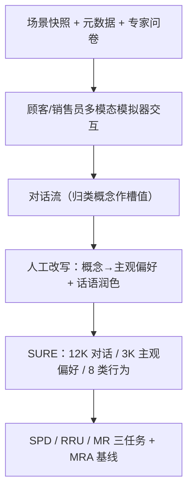
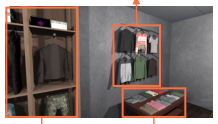

# Multimodal Recommendation Dialog with Subjective Preference: A New Challenge and Benchmark (带主观偏好的多模态推荐对话：新挑战与基准)

- **会议/期刊**: ACL 2023
- **作者与机构**: Yuxing Long, Binyuan Hui, Caixia Yuan, Fei Huang, Yongbin Li, Xiaojie Wang（北京邮电大学、独立研究者）
- **推荐链路定位**: 端到端生成式（多模态对话式推荐）
- **研究方向**: 对话推荐与智能体仿真 / 多模态推荐与内容理解
- **论文原文**: [论文原文链接](https://arxiv.org/abs/2305.18212v1)
- **开源代码**: [开源代码仓库链接](https://github.com/LYX0501/SURE)

## TL;DR (1分钟核心速览)

SIMMC 1.0/2.0 把商品需求压缩成可映射到**唯一槽值**的指代表达，无法刻画“颜色让我觉得安静”这类**主观偏好**。本文发布 SURE：12,180 条复杂店铺场景的销售-顾客多模态推荐对话，采用“模拟器生成对话流 + 人工改写主观偏好”两阶段流水线，标注 3,043 条主观偏好与 8 类专家推荐行为，并提出 SPD（偏好消歧）、RRU（指称区域理解）、MR（多模态推荐）三项基准。最强基线 MRA（OFA-base）在 SPD 上仅 36.78 F1、推荐 F1 仅 23.49，证明该任务远未解决。

## Background & Motivation (背景与核心矛盾)

- **主流范式**: 多模态 TOD 沿 SIMMC 1.0/2.0（DSTC9/10）路线，将用户话术建模为场景内可唯一对应的 referring expression，任务聚焦对话状态追踪与 API 预测。
- **前人局限一**: 真实顾客不是领域专家，常用“适合年轻女性的衣服”“让人冷静的颜色”表达需求，这类表达与属性值是**多对多映射**（对应一组槽值而非唯一槽值），SIMMC 系列完全缺失。
- **前人局限二**: 现有数据的推荐行为单一（inform/confirm/prompt），缺乏专家级的“追问/排除/提示/列举/猜值/修正/指区域/推荐”策略链条，策略学习无从评估。
- **核心洞察 (Key Insight)**: 主观偏好与属性值之间可插入“**归类概念**”作为中间符号——先做“多对一”的子偏好→概念映射，再做“一对一/一对多”的概念→属性值过滤，从而把不可控的多对多关系拆解为可标注、可模拟的两步。
- **本文切入点**: 用归类概念驱动顾客模拟器以保证对话流策略合理，再用人工改写把概念翻成多样化主观表达，同时兼顾逻辑正确性与语言多样性。

## Method (核心方法设计)

### 1. 整体框架 (Overall Architecture)

SURE 基于 SIMMC 2.0 的 1,566 张场景快照（140 家服装店 + 20 家家具店，Unity 3D 渲染），构建分两阶段。**阶段一（模拟）**：AMT 标注员标注背景物（衣柜/展台/展墙）边界框并给出“绝对位置 + 名称”标签（如 back leftmost closet）；238 名 3 年以上经验销售专家填写问卷，产出属性归类概念与 8 类行为；目标生成器随机选中不可见目标物，销售员模拟器按行为概率分布发问，顾客模拟器只能用归类概念或 yes/no 回答，直至推荐成功。**阶段二（改写）**：AMT 将归类概念改写为多种主观偏好表述，并把对话流改写为自然话语（保留槽值、补视觉/空间描述、共指替换、加礼貌语）。最终对话平均 18.35 轮、每场景 27.6 个候选物、每对话 4.48 条主观偏好。

<figure class="paper-figure" markdown="span">
  <figcaption>图2：SURE数据集的标注流程。(1) 多模态对话流模拟：我们首先聘请标注员标注场景中的背景物品，并就属性分类和行为对销售专家进行调查。然后基于调查结果通过模拟器交互生成对话流。(2) 人工改写：标注员基于属性分类概念编写主观偏好，并改写对话流。</figcaption>
</figure>

### 2. 关键设计拆解 (Key Designs)

1. **主观偏好消歧的形式化（SPD）**：顾客话语 $u_t$中的主观表达需先归到概念$c$，再由$c$ 过滤场景属性值集合，模型输出为集合而非单点：
   $\hat{\mathcal{V}}_t = \{\, v \in \mathcal{V}_{\text{scene}} \mid \text{Concept}(u_t) \Rightarrow v \,\}$
   关键约束是“场景中不存在的属性值必须被排除”，因此该任务同时考核语言概念化与视觉感知，而不是纯槽填充。

2. **候选集收缩式策略建模（RRU + 行为序列）**：指称区域被建模为候选物品集合的交运算，$\mathcal{C}_{t+1} = \mathcal{C}_t \cap \mathcal{R}_t$，其中$\mathcal{R}_t$ 是区域指代表达覆盖的物体 ID 集合。作者统计前 8 轮行为转移发现：专家极少在第 1 轮直接猜值或列举，而是先 Ask Preference 至少一次后，才 Display/Guess/Refer Region，并在候选降至 1–5 件时才 Recommend——这为策略学习提供了可量化的“节奏先验”。

3. **MRA 基线与训练目标**：单流 encoder-decoder（OFA-base 初始化，12 层、768 隐维、12 头），文本侧拼接展平对话历史与元数据（价格/品牌/尺码等），视觉侧将快照切 patch 投影到同维后与文本嵌入拼接，统一用自回归生成完成三项任务：
   $\mathcal{L} = -\sum_{t} \log p_\theta(y_t \mid y_{<t}; \mathbf{X}_{\text{txt}}, \mathbf{X}_{\text{vis}})$
   若最近一轮属于引出偏好则解码候选属性值，若属于指区域则解码物体 ID。免负采样、无检索索引，推理为单次前向自回归解码，训练共约 36 V100 小时。

## Experimental Setup & Evaluation Protocol (实验设置与评估协议)

- **数据集与预处理**: 原始数据不做 k-core 过滤（对话任务），统计如下：

| 统计项 | 数值 | 统计项 | 数值 |
| :--- | :---: | :--- | :---: |
| 对话总数 | 12,180 | 话语总数 | 223,492 |
| 场景快照 | 1,566 | 主观偏好数 | 3,043 |
| 每对话平均轮数 | 18.35 | 每对话主观偏好 | 4.48 |
| 每对话销售员行为 | 8.17 | 每场景候选物体 | 27.6 |
| 顾客平均词数 | 7.75 | 销售员平均词数 | 10.49 |

- **数据划分与防穿越**: 随机比例划分 train 65% / dev 5% / dev-test 15% / test-std 15%，其中 test-std 为不公开的隐藏集，用于后续榜单公平比较；非时间戳切分，存在同场景快照跨划分的潜在泄漏风险。
- **排名/评测协议**: 非检索式 Full-Ranking，而是**集合预测 F1**：SPD 在“引出偏好轮”上评估属性值集合 F1/Precision/Recall；RRU 在“指区域轮”上评估物体 ID 集合 F1；MR 拆为 Act F1（累计行为预测）、BLEU-4（回复生成，NLTK 计算）与 Recommendation F1（末轮目标物品 ID 正则抽取）。
- **对比基线与超参**: 论文未引入任何外部已发表基线，仅报告自建 MRA 及其两行消融；Adam，学习率 4e-4，dropout 0.2，batch 18，训练 20 epoch，按 dev 选最佳，未报告显著性检验。

## Key Experimental Results (实验关键数据)

### 1. 主实验对比 (Main Results)

| 模型 | SPD F1↑ | RRU F1↑ | Act F1↑ | BLEU-4↑ | Recom. F1↑ |
| :--- | :---: | :---: | :---: | :---: | :---: |
| **MRA (dev-test / test-std)** | **36.78 / 37.49** | **13.77 / 14.77** | **10.80 / 10.90** | **18.28 / 18.45** | **23.49 / 23.14** |
| MRA − Meta Data | 32.34 / 31.98 | 9.57 / 10.15 | 10.01 / 10.21 | 16.42 / 16.83 | 19.78 / 19.23 |
| MRA − Scene Snapshot | 31.44 / 31.83 | 7.36 / 7.09 | 9.45 / 9.77 | 17.72 / 17.63 | 21.54 / 21.26 |
| Improv. (去元数据) | −12.1% | −30.5% | −7.3% | −10.2% | −15.8% |
| Improv. (去图像) | −14.5% | −46.5% | −12.5% | −3.1% | −8.3% |

### 2. 消融实验 (Ablation Study)

| 配置 | SPD F1 | RRU F1 | Act F1 | BLEU-4 | Recom. F1 |
| :--- | :---: | :---: | :---: | :---: | :---: |
| Full MRA | 36.78 | 13.77 | 10.80 | 18.28 | 23.49 |
| w/o metadata（价格/品牌/尺码等） | 32.34 | 9.57 | 10.01 | 16.42 | 19.78 |
| w/o scene snapshot（仅文本） | 31.44 | 7.36 | 9.45 | 17.72 | 21.54 |

### 3. 关键实验发现 (Key Findings)

1. **视觉快照是空间指代的命脉**：去掉图像后 RRU 从 13.77 暴跌至 7.36（−46.5%），SPD 掉 5.34（−14.5%），说明“back leftmost closet”这类表达无法从文本元数据恢复，必须靠 patch 级视觉-空间对齐。
2. **元数据是决策而非理解的瓶颈**：去元数据使推荐 F1 降 15.8%、BLEU-4 降 10.2%，但 RRU 仅掉 30.5% 仍高于去图像；价格/品牌/材质等属性读不出图，直接掐断最终 item 判别。
3. **三任务间存在“抄近路”现象**：RRU 仅 13.77 F1，推荐 F1 却达 23.49、BLEU-4 18.28——模型更多依赖对话历史中的槽值线索而非真正完成区域闭环消歧，生成流畅 ≠ 推荐正确，这也解释了作者为何强调需要新的多模态预训练目标。

## Highlights & Limitations (亮点、对比与审稿批判)

- **与代表作对比 (vs. Prior Work)**: 相比 SIMMC 1.0/2.0 的“唯一槽值 + 简单 act”，SURE 引入多值主观偏好、8 类专家行为与行为转移分布；相比 ReDial/TG-ReDial/GoRecDial 等纯文本 CRS，SURE 强制智能体在可共视复杂店铺中完成定位、指区域与推荐。
- **可迁移亮点**: ①“归类概念”作为中间监督，把多对多映射拆为两阶段，可直接迁移到口语化 query 理解与标签体系对齐；②模拟器 + 人工改写两阶段造数，是低成本兼顾策略合理性与语言多样性的通用配方。
- **审稿级局限批判**: ①**无外部基线**（仅自建 MRA 与两行消融、无显著性检验），36.78 F1 究竟源于数据难度还是模型容量无法判定，基准说服力被削弱；②评测以 BLEU-4 与集合 F1 为主，缺少人工评价与策略效率指标（如推荐所需轮数）；③仅英文、主观偏好标注依赖标注员主观认知（作者亦承认），且同场景快照随机划分可能造成场景级泄漏，跨场景泛化未验证。

## Rating (四维评分)

- **方法创新性 (Novelty)**: ⭐⭐⭐⭐ （“主观偏好—归类概念—属性值”两阶段映射与专家行为分布驱动的模拟器造数是本领域缺失的一环，但模型侧 MRA 本身为现成 VLM 直接套用，方法增量有限）
- **评估协议与实验扎实度 (Protocol & Experiments)**: ⭐⭐⭐ （三任务设计贴合真实购物闭环，但无任何外部基线、无显著性检验、隐藏集不公开分数，评测强度明显不足）
- **写作与数学规范度 (Clarity & Rigor)**: ⭐⭐⭐⭐ （数据构建流程、任务输入输出与指标定义清晰可复现，附录问卷与标注界面完整；但缺少形式化的问题定义与复杂度分析）
- **工业落地与复现价值 (Industrial & Practical Value)**: ⭐⭐⭐⭐ （数据与代码全开源、许可清晰，可直接用于电商导购智能体的多模态策略训练与评测；但 12 层 VLM 自回归解码的在线时延与 36 V100 小时训练成本偏高）

