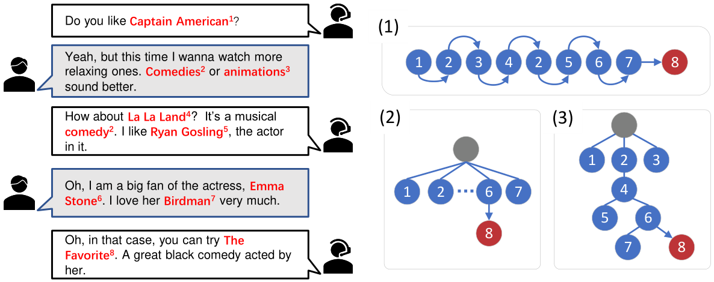
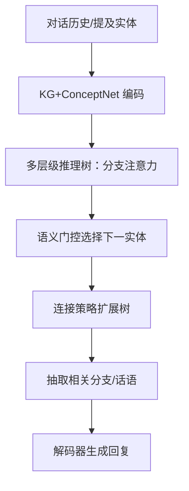
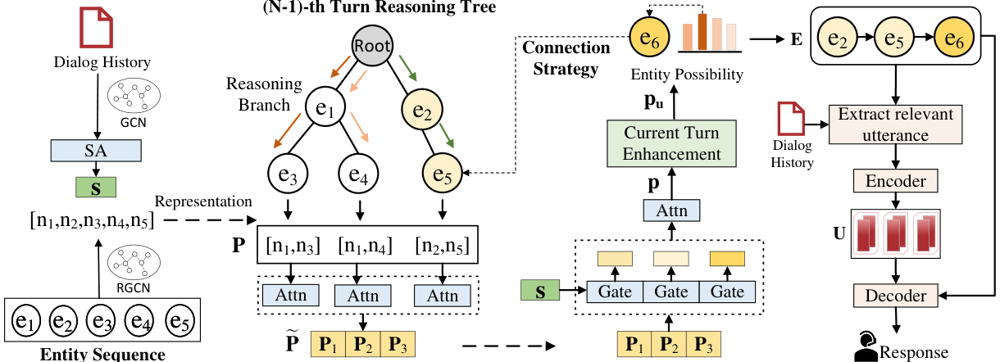

# TREA: Tree-Structure Reasoning Schema for Conversational Recommendation (树结构推理模式的对话推荐)

- **会议/期刊**: ACL 2023 (Main)
- **作者与机构**: Wendi Li, Wei Wei, Xiaoye Qu, Xianling Mao, Ye Yuan, Wenfeng Xie, Dangyang Chen；华中科技大学、北京理工大学、平安产险
- **推荐链路定位**: 召回（实体推荐）+ 端到端回复生成
- **研究方向**: 对话推荐与智能体仿真 / 图神经网络与知识图谱推荐
- **论文原文**: [https://arxiv.org/abs/2307.10543v1](https://arxiv.org/abs/2307.10543v1)
- **开源代码**: [https://github.com/WindyLee0822/TREA](https://github.com/WindyLee0822/TREA)

## TL;DR (1分钟核心速览)

针对 CRS 中实体因果链被线性链或固定两层结构压扁的问题，TREA 对每个提及实体做溯因推理，构建可随轮次扩展的多层级推理树；以分支注意力与对话语义门控选择下一实体，并把相关推理分支注入解码器生成回复。ReDial/TG-ReDial 采用全实体 R@n 与生成指标、t 检验 $p<0.05$；R@50 达 0.416/0.110，相对最佳基线 +1.7%/+41.0%，ReDial Dist-4 提升 31.3%。

## Background & Motivation (背景与核心矛盾)

- **主流范式**: CRS 用 KG/ConceptNet 增强实体与词表征，基于对话历史预测下一实体并生成自然语言回复。
- **前人局限**: 线性结构 CRFR 只建模相邻实体因果，无法处理“comedy→La La Land”式多跳跳转；CR-Walker 式固定两层树把历史实体展平，历史实体间因果被忽略。
- **核心洞察 (Key Insight)**: 对话兴趣表达多样且话题频繁迁移，因果边应保留多跳与层级；从根到叶的每条路径可视为独立推理分支，分支间不应相互污染。
- **本文切入点**: 为每个提及实体执行 abductive reasoning，构造多层级、可扩展的推理树，再用分支隔离损失保持推理路径独立。

<figure class="paper-figure" markdown="span">
  <figcaption>图1：对话推荐场景示例及CRS的三种推理结构。在对话示例中，实体以红色标出，左上角编号对应推理结构中的图。(1)对应线性结构。(2)对应具有两个固定层次（历史-预测）的结构，并在第一层展平所有提及的实体。(3)对应我们提出的TREA多层级结构。</figcaption>
</figure>

## Method (核心方法设计)

### 1. 整体框架 (Overall Architecture)

输入对话历史与提及实体，先用 RGCN/ConceptNet-GCN 编码实体与词；首轮以伪根节点初始化推理树。后续每轮将树中根到叶路径作为推理分支，分支内位置嵌入+线性注意力聚合，再与当前话语语义门控融合得用户表征 $p_u$，对全实体 softmax 选下一跳；选中实体按“KG 邻接优先，否则接根”策略接入树。扩展后的分支抽取相关实体与历史话语，供 Transformer 解码器生成回复。训练先优化推理交叉熵+隔离/对齐损失，再优化生成交叉熵。

<figure class="paper-figure" markdown="span">
  <figcaption>图2：我们提出的TREA概览。首先编码对话历史中的实体和句子。然后聚合当前推理树中各推理分支的信息。随后，对话语义的综合表示衡量各推理分支对当前推荐的贡献。经过当前轮增强后，我们采用连接策略选择实体加入推理树。扩展后的推理分支指导生成模块抽取相关文本信息。</figcaption>
</figure>

### 2. 关键设计拆解 (Key Designs)

1. **多层级推理树与连接策略（保留多跳因果）**：痛点在于线性链只能相邻推理、固定两层树丢失历史层级。本文以伪根节点起树，新实体 $e^*$在逆序历史实体中找 KG 邻接的$e$，有则加边$(e,e^*)$，否则接根；分支内用$\tilde{P}=\mathrm{Attn}(P),\ \alpha_r=\mathrm{Softmax}(b_r\tanh(W_rP))$ 聚合，使相关实体形成多跳链、无关话题留在浅层分支。
2. **语义门控与当前轮增强（判断哪条分支有用）**：不同分支对下一跳贡献不同，且最新轮更关键。先算 $p=\mathrm{Attn}(\gamma\tilde{P}+(1-\gamma)s),\ \gamma=\sigma(W_s[\tilde{P};s])$，再做$p_u=g(p,g'(\mathrm{Attn}(e_c),\mathrm{Attn}(s_c)))$，最后以$P_r^u=\mathrm{Softmax}([p_u e_0^T,\dots,p_u e_n^T])$ 选择实体；门控让语义与推理信息按轮次动态配比。
3. **推理引导生成与双辅助损失（让回复贴合推荐实体）**：生成模块只抽取包含新实体的分支及其中提及实体的话语，经 RGCN/Transformer 编码后 cross-attention 解码，并用 copy 机制增强知识词。推理损失为 $L_r=-\sum_u\sum_{e_i}\log P_r^u[e_i]+\lambda_I L_I+\lambda_a L_a$，其中$L_I=\sum_{i\neq j}\mathrm{sim}(e_{p_i},e_{p_j})$保持分支独立，$L_a=\lambda_c\mathrm{sim}(p_c,s_c)+(1-\lambda_c)\mathrm{sim}(p,s)$对齐实体与语义空间；生成用$L_g$ 交叉熵。训练无额外负采样，推理需全实体 softmax，长对话下分支数随历史实体增长。

## Experimental Setup & Evaluation Protocol (实验设置与评估协议)

- **数据集与预处理**: 原文未显式报告 5-core/用户物品统计，仅给出对话与话语规模。

| 数据集 | #Conv. | #Utter. | #Users | #Items | 场景 |
| :--- | :---: | :---: | :---: | :---: | :--- |
| ReDial | 10,006 | 182,150 | 未报告 | 未报告 | 英文电影推荐，AMT 人-推荐系统对话 |
| TG-ReDial | 10,000 | 129,392 | 未报告 | 未报告 | 中文电影推荐，半自动标注+主题路径 |

- **数据划分与防穿越 (Splitting Strategy)**: 原文未显式展开，仅称沿用 C2-CRS/CR-Walker 同预处理与 NTRD mask；未报告时间戳切分或冷启动划分。
- **排名评测协议 (Ranking Protocol)**: R@n 在 Eq.5 的全部实体概率分布上排序，属全实体集排序；未报告采样负例比例，训练为多分类交叉熵，无额外负采样描述。
- **对比基线与超参设置**: 基线含 ReDial、KBRD、KGSF、RevCore、CR-Walker、CRFR、C2-CRS、UCCR；推理/生成嵌入维度 300/128，GNN 1 层，batch 64，lr 0.001，$\lambda_c=0.9,\lambda_I=0.008,\lambda_a=0.002$，显著性 t 检验$p<0.05$。

## Key Experimental Results (实验关键数据)

### 1. 主实验对比 (Main Results)

表 1：ReDial/TG-ReDial 主实验（R@n 为全实体排序；括号为相对最佳基线的提升）

| Method | ReDial R@10 | ReDial R@50 | ReDial Dist-4 | ReDial Bleu-2 | TG R@10 | TG R@50 | TG Dist-4 | TG Bleu-2 |
| :--- | :---: | :---: | :---: | :---: | :---: | :---: | :---: | :---: |
| ReDial | 0.140 | 0.320 | 0.464 | 0.022 | 0.002 | 0.013 | 0.801 | 0.041 |
| KBRD | 0.150 | 0.336 | 0.489 | 0.024 | 0.032 | 0.077 | 0.997 | 0.042 |
| KGSF | 0.183 | 0.377 | 0.518 | 0.025 | 0.030 | 0.074 | 1.579 | 0.046 |
| RevCore | 0.204 | 0.392 | 0.528 | 0.025 | 0.029 | 0.075 | 1.663 | 0.047 |
| CR-Walker | 0.187 | 0.373 | 0.557 | 0.024 | — | — | — | — |
| CRFR | 0.202 | 0.399 | 0.639 | — | — | — | — | — |
| C2-CRS | 0.208 | 0.409 | 0.622 | 0.027 | 0.032 | 0.078 | 1.691 | 0.048 |
| UCCR | 0.202 | 0.408 | 0.564 | 0.026 | 0.032 | 0.075 | 1.668 | 0.049 |
| TREA | **0.213 (+2.4%)** | **0.416 (+1.7%)** | **0.839 (+31.3%)** | **0.028 (+3.7%)** | **0.037 (+15.6%)** | **0.110 (+41.0%)** | **1.712 (+1.2%)** | **0.050 (+2.0%)** |

### 2. 消融实验 (Ablation Study)

表 2：推荐消融（w/o Iso./Aln./IA）与生成消融（w/o Ent./Utt./EU，Dist-4/Rel. 为 ReDial）

| 设置 | ReDial R@10 | ReDial R@50 | TG R@10 | TG R@50 | Dist-4 | PPL↓ | Rel. |
| :--- | :---: | :---: | :---: | :---: | :---: | :---: | :---: |
| TREA | 0.214 | 0.418 | 0.037 | 0.110 | 0.839 | 4.49 | 2.43 |
| w/o Iso. | 0.202 | 0.405 | 0.028 | 0.079 | — | — | — |
| w/o Aln. | 0.209 | 0.412 | 0.035 | 0.103 | — | — | — |
| w/o IA. | 0.201 | 0.403 | 0.026 | 0.076 | — | — | — |
| w/o Ent. | — | — | — | — | 0.799 | 4.56 | 2.28 |
| w/o Utt. | — | — | — | — | 0.764 | 4.61 | 2.13 |
| w/o EU. | — | — | — | — | 0.789 | 4.78 | 2.10 |

### 3. 关键实验发现 (Key Findings)

1. **长候选/话题迁移场景收益更大**：TG-ReDial R@50 从最佳基线 0.078 升至 0.110（+41.0%），远高于 R@10 的 +15.6%；ReDial Dist-4 +31.3%，说明树式多跳因果既提升实体命中，也提升生成多样性。
2. **分支隔离损失最关键**：去掉 Iso. 后 ReDial R@10 0.214→0.202（-5.6%）、TG R@50 0.110→0.079（-28.2%）；同时去 IA 降至 0.026/0.076。t-SNE 显示无 Iso. 时 KG 实体表征更拥挤，分支独立性可防止无关实体表征坍缩。
3. **生成需精准抽取相关证据**：去掉历史话语抽取 Utt. 后 Dist-4 0.839→0.764（-8.9%）、Rel. 2.43→2.13；人类 Rel. 2.43 高于 C2-CRS 的 2.02，且长对话超过 12/14 轮时 UCCR 明显下降而 TREA 更稳。

## Highlights & Limitations (亮点、对比与审稿批判)

- **与代表作对比 (vs. Prior Work)**: CRFR 将实体序列线性化并靠 RL 追因果，CR-Walker 固定“历史-预测”两层，C2-CRS 用对比学习对齐多 KG；TREA 首次为每个提及实体建树，显式保留多跳层级，并用分支隔离而非单纯聚合。
- **可迁移亮点**: “KG 邻接优先、否则接根”的连接策略可迁移到 KG 增强的对话导购/客服 Agent；分支隔离损失适合多路径推理与多跳证据选择；推理引导抽取可直接用于推荐理由生成。
- **审稿级局限批判**: 作者承认树构建受 KG 完整性与噪声影响；分支数随轮次增长，全实体 softmax 与分支注意力带来推理开销。评估未明确划分/负采样细节，数据集统计与人评规模有限，$\lambda_I,\lambda_a$ 敏感性未系统分析。

## Rating (四维评分)

- **方法创新性 (Novelty)**: ⭐⭐⭐⭐ （首次为每个提及实体执行树状溯因，比线性链/固定两层更贴合多跳因果）
- **评估协议与实验扎实度 (Protocol & Experiments)**: ⭐⭐⭐ （两公开数据集、t 检验、人评与长对话分析较完整，但划分/负采样/统计披露不足）
- **写作与数学规范度 (Clarity & Rigor)**: ⭐⭐⭐⭐ （公式与连接算法清晰，门控与当前轮增强稍压缩，复杂度分析偏少）
- **工业落地与复现价值 (Industrial & Practical Value)**: ⭐⭐⭐ （代码开源，KG 依赖与分支增长带来工程成本，适合对话导购/客服推荐）

