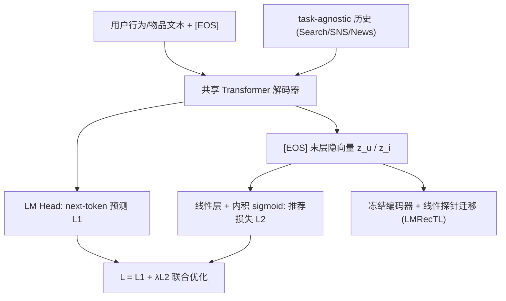
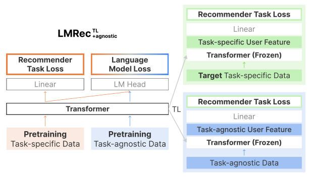

# Pivotal Role of Language Modeling in Recommender Systems: Enriching Task-specific and Task-agnostic Representation Learning (语言建模在推荐系统中的枢纽作用：强化任务相关与任务无关表征学习)

- **会议/期刊**: ACL 2023 (Main Conference)
- **作者与机构**: Kyuyong Shin, Hanock Kwak, Wonjae Kim, Jisu Jeong, Seungjae Jung, Kyung-Min Kim, Jung-Woo Ha, Sang-Woo Lee (NAVER / NAVER AI Lab)
- **推荐链路定位**: 召回（用户表征 + 线性点积打分，支持特征式迁移）
- **研究方向**: 大语言模型推荐 (LLM4Rec) / 跨域与多场景推荐
- **论文原文**: [https://arxiv.org/abs/2212.03760v5](https://arxiv.org/abs/2212.03760v5)
- **开源代码**: 暂未开源（自有业务数据因隐私与用户协议受限，仅在 Amazon / Online Retail 公开集上验证）

## TL;DR (1分钟核心速览)

针对"用户行为序列建模与语言建模(自回归 next-token 预测)长期割裂、预训练-微调两阶段易遗忘且表征过拟合单一业务语料"的痛点，本文提出 **LMRec**：用同一 Transformer 解码器联合优化行为文本的语言建模损失与用户-物品点积推荐损失，取 [EOS] 末层隐向量作定长用户表征；再用多业务 task-agnostic 历史扩充 LM 语料 (LMRec+agnostic)，并以冻结编码器的线性探针完成跨域迁移 (LMRecTL)。在 3 个自有业务 (OBS/OTA/ECOMM) 与 3 个公开集上，1:100 采样排序下 Recall@10 相对最强基线提升 **2.0%–8.8%**，线性探针迁移下游仅需 1.2M 可训练参数、推理加速 **×157**。

## Background & Motivation (背景与核心矛盾)

- **主流范式**: U-BERT / UniSRec / M6-Rec / CLUE 等统一用户模型把跨业务行为日志当"纯文本"拼接，先以对比学习或 prompt 调优做预训练，再在下游任务微调。
- **前人局限 (一)**: 预训练与微调阶段分离，下游微调时 LM 目标被直接丢弃，既易灾难性遗忘，也使损失地形更尖锐、泛化变差；从头训练的 CLUE 与 webtext 预训练模型在 ECOMM 上 Recall@10 仅 0.5500 / 0.6725。
- **前人局限 (二)**: 表征只来自目标业务的稀疏历史（OTA 平均仅 2.3 条），既过拟合单一 history corpus；而真实部署中 target App 在预训练时未知、跨公司 user ID 无法对齐、百万级用户逐任务微调算力不可承受。
- **核心洞察 (Key Insight)**: 线性探针实验表明，用行为语料做 LM 预训练的特征显著优于 webtext 语料——OBS 上 Recall@10 为 0.3769 (task-specific) vs. 0.3135 (webtext)，Scientific 为 0.0417 vs. 0.0335，尽管行为语料规模小好几个数量级；即"用户行为文本本身就是比通用网页文本更适配的语言建模语料"。
- **本文切入点**: 不再"先预训练再微调"，而是把 LM 目标与推荐目标放进同一优化式，一个编码器同时承担"通用语言理解"与"任务判别"，再用 task-agnostic 语料与线性探针迁移解耦部署。

## Method (核心方法设计)

### 1. 整体框架 (Overall Architecture)

输入为用户历史/物品文本经 BBPE 分词后以 `→` 拼接的序列，末尾追加 `[EOS]`；共享 Transformer 层同时驱动两条通路——LM Head 做自回归下一 token 预测，线性推荐层将 [EOS] 隐向量映射为 $d$维用户/物品向量并做内积打分。训练时两损失加权联合优化，推荐损失权重$\lambda$ 随 cosine 衰减以防下游过拟合。推理阶段，LMRec 可直接微调使用；LMRecTL 则冻结 Transformer，仅训练下游线性层做特征式线性探针。引入 task-agnostic 业务（Search/E-comm./SNS/News）历史时，模型标记为 LMRec+agnostic。

<figure class="paper-figure" markdown="span">
  ![图1：LMRec 示意图概述。任务特定数据指目标推荐任务的用户历史数据。任务无关数据从与目标任务不重叠的其他服务收集。（左）在每个输入末尾追加 \[EOS\] 标记，并使用 \[EOS\] 标记的最后一层隐藏向量作为用户特征。（右）Transformer 层在语言建模与推荐任务间共享，而顶层线性层不共享。LMRec+agnostic 加入额外任务无关数据，带来显著性能提升。](../../../../assets/papers/2212.03760v5/figure_1.png)<figcaption>图1：LMRec 示意图概述。任务特定数据指目标推荐任务的用户历史数据。任务无关数据从与目标任务不重叠的其他服务收集。（左）在每个输入末尾追加 [EOS] 标记，并使用 [EOS] 标记的最后一层隐藏向量作为用户特征。（右）Transformer 层在语言建模与推荐任务间共享，而顶层线性层不共享。LMRec+agnostic 加入额外任务无关数据，带来显著性能提升。</figcaption>
</figure>

### 2. 关键设计拆解 (Key Designs)

1. **LM-推荐联合优化 + [EOS] 池化表征（把语言建模当正则器）**：痛点在于两阶段训练丢弃 LM 目标。本文令 $\mathcal{L}=\mathcal{L}_1+\lambda\mathcal{L}_2$，其中$\mathcal{L}_1=-\sum_{j}\log P(h_j\mid h_{j-k},\dots,h_{j-1})$，表征取$z_u=\mathbf{M}(h_{\text{EOS}}\mid u)$，打分$p_{u,i}=\sigma(\langle \mathbf{W}_u z_u,\mathbf{W}_i z_i\rangle)$。之所以有效，是 LM 项持续提供 token 级监督，抑制推荐目标对稀疏正例的记忆；Hessian 最大特征值分析显示 LMRec 的谱峰值显著小于纯推荐模型 (LMRec-lm)，损失面更平坦。
2. **task-agnostic 语料增广 + 特征式迁移（一模型服务多业务）**：痛点在于未知目标域与 ID 不可对齐。LMRec+agnostic 仅把额外业务的用户历史并入 $\mathcal{L}_1$语料；LMRecTL 预训练多任务损失为$\mathcal{L}=\sum_{t\in\mathcal{T}_s,\mathcal{T}_a}\mathcal{L}^t_1+\lambda\sum_{t\in\mathcal{T}_s}\mathcal{L}^t_2$，下游冻结主干、只学线性层。直觉是"跨业务共享的是用户语义、不共享的是业务打分头"，且 task-agnostic 用户特征可与 task-specific 特征拼接，直接覆盖新用户无行为记录的冷启动缺口。
3. **训练目标、负采样与推理效率**：训练负样本为随机采样（非 hard negative、非 in-batch 免采样）；$\lambda$初值$3\times10^{-3}$并 cosine 衰减至 10%，AdamW + ZeRO + 梯度裁剪 0.1，按推荐验证损失早停 (patience 100)。主干为 125M 解码器 (12 层、$d_{emb}=768$、12 头、词表 50,258、最大长度 2,048)，下游仅 1.2M 可训练参数，OBS 单 batch 推理较全量 Transformer 加速 **×157**。

<figure class="paper-figure" markdown="span">
  <figcaption>图2：LMRecTL 的整体预训练与基于特征的迁移学习流程。</figcaption>
</figure>

## Experimental Setup & Evaluation Protocol (实验设置与评估协议)

- **数据集与预处理**: 公开集按 `5-core` 过滤用户与物品，物品文本取标题/类目/品牌，最大 512 token。

| 数据集 | #Users | #Items | #Interactions | 平均历史长度 | 特征/场景说明 |
| :--- | :---: | :---: | :---: | :---: | :--- |
| OBS | 300,000 | 42,453 | 495,992 | 1.5 | 自有在线预订服务 |
| OTA | 142,051 | 2,485 | 177,281 | 2.3 | 自有在线旅游，物品极稀疏 |
| ECOMM | 72,477 | 229,775 | 130,859 | 5.5 | 自有电商，物品空间最大 |
| Scientific | 8,442 | 4,385 | 59,427 | 4.5 | Amazon 工业与科学类 |
| Pantry | 13,101 | 4,898 | 126,962 | 8.5 | Amazon 食品杂货类 |
| Online Retail | 16,520 | 3,469 | 519,906 | 25.6 | Kaggle 零售，跨系统迁移 |
| Task-agnostic 预训练语料 | 10,156,217 | — | 94,011,305 | 128.7 | Search/E-comm./SNS/News，12B BBPE token |

- **数据划分与防穿越**: 自有数据在用户池上随机 80%/10%/10% 划分，检验用户表征泛化；公开数据严格 `Leave-One-Out`（末位为测试、倒数第二位为验证、其余训练）做 next-item 预测。
- **排名评测协议**: 自有数据为 `Sampled Ranking`，真值物品混入 **100 个随机负样本**（1:100）计算 Recall@10 / NDCG@10；公开数据为 `Full-Ranking`，在全库未交互物品上排序。
- **对比基线与超参设置**: BST、LightGCN（经典序列/图基线）；UserBERT、UniSRec、M6-Rec、CLUE（预训练-迁移路线）。除 CLUE 外基线均依赖 webtext 语言模型；M6 权重未公开，以 HuggingFace RoBERTa 复现。所有结果取 20 次运行平均。

## Key Experimental Results (实验关键数据)

### 1. 主实验对比 (Main Results)

Recall@10（自有集为 1:100 采样排序，公开集为全库 Full-Ranking；`Improv.` 为 LMRec+agnostic 相对最强基线的相对提升）：

| 方法 | OBS | OTA | ECOMM | Scientific | Pantry | Online Retail | Improv. |
| :--- | :---: | :---: | :---: | :---: | :---: | :---: | :---: |
| BST | 0.4675 | 0.7160 | 0.6611 | 0.0625 | 0.0388 | 0.1460 | — |
| LightGCN | 0.4628 | 0.7277 | 0.5378 | 0.0540 | 0.0402 | 0.1322 | — |
| LMRec-lm (去掉 $\mathcal{L}_1$) | 0.4654 | 0.7190 | 0.6667 | 0.0951 | 0.0626 | 0.1373 | — |
| UserBERT | 0.4600 | 0.7199 | 0.6934 | 0.1055 | 0.0630 | 0.1438 | — |
| UniSRec | 0.4745 | 0.7186 | 0.6725 | 0.1188 | 0.0636 | 0.1449 | — |
| CLUE | 0.4580 | 0.7225 | 0.5500 | 0.0894 | 0.0602 | 0.1258 | — |
| M6-Rec | 0.4615 | 0.7314 | 0.7093 | 0.0945 | 0.0645 | 0.1458 | — |
| LMRec (仅 task-specific) | 0.4867 | 0.7428 | 0.7322 | 0.1264 | **0.0692** | 0.1475 | +6.6%/+2.0%/+8.8%/+8.0%/+7.3%/+3.0% |
| **LMRec+agnostic** | **0.5060** | **0.7458** | **0.7715** | **0.1283** | 0.0683 | **0.1502** | **+6.6% / +2.0% / +8.8% / +8.0% / — / +3.0%** |

NDCG@10 同步领先：OBS 0.3048 (vs. UniSRec 0.2825, **+7.9%**)、ECOMM 0.6009 (vs. UserBERT 0.5202, **+15.5%**)、Scientific 0.0701 (**+9.4%**)、Online Retail 0.0732 (**+4.3%**)。

### 2. 消融实验 (Ablation Study)

| 配置 | OBS R@10 | OBS N@10 | 说明 |
| :--- | :---: | :---: | :--- |
| LMRec-lm（无 LM 目标） | 0.4654 | 0.2762 | 与 BST 持平，语言建模目标缺失 |
| SelfPretrain（预训练→微调） | 0.4742 | 0.2796 | 两阶段分离，劣于联合优化 |
| LMRec（联合优化） | 0.4867 | 0.2940 | 联合训练带来稳定增益 |
| +agnostic (0%:100% 语料) | 0.4703 | 0.2805 | 纯 task-agnostic 语料最弱 |
| +agnostic (50%:50%) | 0.4905 | 0.2991 | 混合语料已超越纯 task-specific |
| +agnostic (70%:30%) | **0.4917** | **0.3003** | 语料配比最优区间 |
| 线性探针 LMRecTL（冻结主干, OBS task-specific 特征） | 0.4687 | 0.2792 | 冻结主干仍逼近全量微调 |
| 线性探针 LMRecTL+agn（拼接 task-specific+agnostic 特征） | **0.5952** | **0.3766** | 远超同探针下 M6-Rec 0.5540 / CLUE 0.5416 |
| 线上 A/B（新用户） | CTR ×1.76 / GMV ×1.12 | — | 相对 GNN 线上基线，14 天实验 |

### 3. 关键实验发现 (Key Findings)

1. **语言建模目标是"增益来源"而非"锦上添花"**：仅加 $\mathcal{L}_1$ 的 LMRec 相对 LMRec-lm 在 ECOMM 上 Recall@10 由 0.6667 升至 0.7322（+9.8%），Scientific 由 0.0951 升至 0.1264（+32.9%），而 LMRec-lm 与 BST/LightGCN 几乎无差异，说明提升并非来自 Transformer 容量而是来自 token 级监督。
2. **语料配比存在最优混合点，而非越多 task-agnostic 越好**：0%:100% 语料仅 0.4703，低于纯 task-specific 的 0.4867；70%:30% 达到峰值 0.4917。即 task-agnostic 语料的价值在于"缓解单一 history corpus 过拟合"，但不能替代目标域的信号。
3. **迁移场景下"数据广度 + 特征拼接"收益最大，且新用户群体收益最显著**：三方拼接特征 (0.5952) 相比仅 task-specific 特征 (0.4687) 提升 **+27.0%**；线上新用户 CTR ×1.76、GMV ×1.12，明显高于全体用户的 ×1.24 / ×1.04，验证 task-agnostic 历史可补足冷启动用户的行为缺失。

## Highlights & Limitations (亮点、对比与审稿批判)

- **与代表作对比 (vs. Prior Work)**: 与 UniSRec / UserBERT 的"对比学习预训练 + 微调"不同，本文把 LM 目标保留到下游训练全程，无需构造增广视图；与 M6-Rec / CLUE 的 prompt / 对比统一框架不同，本文完全不依赖外部 PLM 权重、从零训练小体量 (125M/1.2M 可训练) 编码器，并给出 Hessian 谱的泛化解释。
- **可迁移亮点**: (1) 用 `[EOS]` 末层隐向量作为定长用户表征、与 LM Head 解耦，天然支持"一次编码、多任务复用"；(2) 特征式线性探针迁移只需 1.2M 参数与 ×157 推理加速，可作为大模型向轻量召回模型知识蒸馏的廉价替代路径。
- **审稿级局限批判**: (1) 核心收益依赖自有的 10M 用户 / 12B token 跨业务语料，公开可复现部分仅 Amazon 等弱规模数据，跨公司 ID 不可对齐时收益未知；(2) 报告中语料来源与混合比、物品信息粒度的探索均以"算力成本过高"为由搁置，导致 LMRec+agnostic 的 6.6%–8.8% 提升缺乏可控的归因边界，且自有数据不可开源削弱复现性。

## Rating (四维评分)

- **方法创新性 (Novelty)**: ⭐⭐⭐⭐ （"LM 与推荐共优化 + [EOS] 池化 + 冻结探针迁移"组合简洁实用，并用 Hessian 最大特征值谱给出平坦化解的机制解释，但单点算子本身不算全新）
- **评估协议与实验扎实度 (Protocol & Experiments)**: ⭐⭐⭐⭐ （3 自有 + 3 公开 + 线上 A/B + 20 次重复，采样与全库两种排序协议并用；不足是自有数据用 1:100 采样排序，未做显著性检验，公开集规模偏小）
- **写作与数学规范度 (Clarity & Rigor)**: ⭐⭐⭐⭐ （两损失与迁移损失公式干净、符号一致，架构与迁移流程各一张图；但语料配比、模型规模的消融只在单任务 OBS 上给出，结论外推略显单薄）
- **工业落地与复现价值 (Industrial & Practical Value)**: ⭐⭐⭐⭐ （下游仅 1.2M 参数、推理 ×157 加速、新用户 CTR ×1.76，工程价值明确；扣分在于自研数据与代码未开源，公开集复现难以覆盖核心的 task-agnostic 场景）

