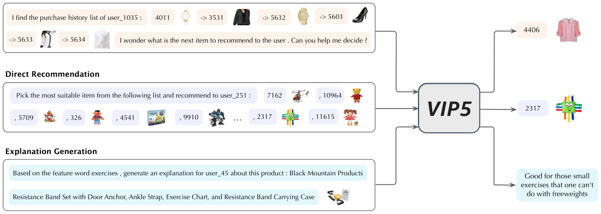
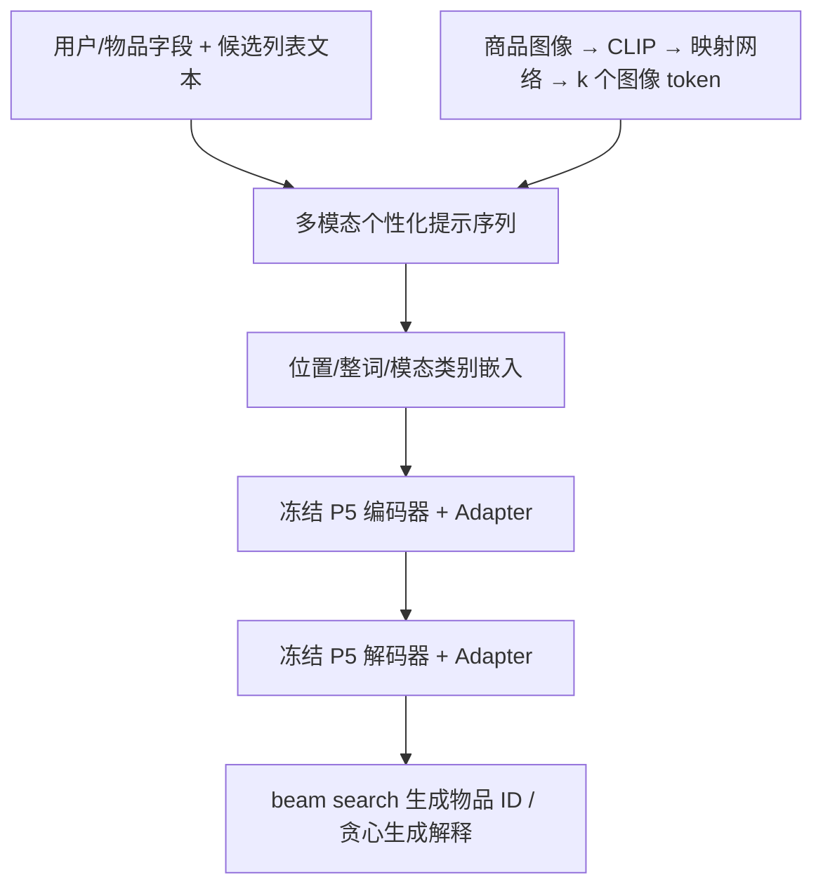
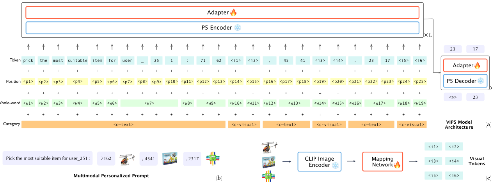

# VIP5: Towards Multimodal Foundation Models for Recommendation (面向推荐的多模态基础模型 VIP5)

- **会议/期刊**: EMNLP 2023
- **作者与机构**: Shijie Geng, Juntao Tan, Shuchang Liu, Zuohui Fu, Yongfeng Zhang (Rutgers University)
- **推荐链路定位**: 端到端生成式（LLM 序列生成式召回 + 解释生成）
- **研究方向**: 多模态推荐 / 大语言模型推荐 (LLM4Rec)
- **论文原文**: [论文原文链接](https://arxiv.org/abs/2305.14302v2)
- **开源代码**: [开源代码仓库链接](https://github.com/jeykigung/VIP5)

## TL;DR (1分钟核心速览)

P5 范式的推荐基础模型只吃文本，商品图像、跨任务统一与全参数预训练的高昂开销成为三大瓶颈。VIP5 把 CLIP 图像特征经两层映射网络投影为若干"图像 token"，与物品词 token 拼接成**多模态个性化提示**，并把 P5 主干完全冻结、只在自注意力/交叉注意力与 FFN 后插入瓶颈 Adapter 微调。在四个 Amazon 数据集上，以 Leave-One-Out + 100 候选采样排序协议评测，VIP5 在未见提示 (A-9/B-8) 下 Sports 顺序推荐 NDCG@5 相对 P5 提升 105.7%，直接推荐 Clothing HR@5 提升 51.5%，同时省 21.2% 训练时间与 18.1% 显存。

## Background & Motivation (背景与核心矛盾)

- **主流范式**: P5 / M6-Rec 用指令式个性化提示把多种推荐任务统一为"文本到文本"的自回归生成；多模态推荐（VBPR、PiNet、JRL）则把图像当辅助 side information 融入传统匹配模型。
- **前人局限**: (1) 传统多模态推荐模型仍是任务专用架构，无法在一个共享接口下同时处理召回、排序与解释生成；(2) P5 依赖全参数预训练，随着主干规模增长，训练时间与显存不可承受，且对小数据集易过拟合；(3) 纯文本提示完全丢弃了图像——而商品外观恰恰是服饰/玩具类目的决策主因。
- **核心洞察 (Key Insight)**: LLM 的 token 序列本身就是一种"万能接口"，只要把任意模态投影到同一 token 流形上，就能在不改动主干结构的前提下实现跨模态、跨任务统一。
- **本文切入点**: 用"图像 token 拼接 + Adapter 微调"两步，把视觉模态以最小侵入方式接入 P5 的提示序列。

<figure class="paper-figure" markdown="span">
  <figcaption>图 1：VIP5 的一个示例任务范围，涵盖三种主流推荐任务。基于交错语言和视觉 token 的多模态个性化提示（左），VIP5 能够将所有任务和所有模态转换为统一的序列格式，并依据特定任务描述生成目标输出（右）。VIP5 将大语言模型作为固定的通用接口，并微调额外的视觉和语言处理层，以获得处理多种推荐任务的能力。</figcaption>
</figure>

## Method (核心方法设计)

### 1. 整体框架 (Overall Architecture)

输入是一个交错文本与视觉 token 的多模态个性化提示：用户/物品字段、候选列表被分词为子词 token，每个物品的图像经 CLIP 图像分支提取特征 $x\in\mathbb{R}^{d_v}$，再由映射网络投影为$k$ 个图像 token 紧跟在物品 token 之后。整个序列叠加位置编码、整词嵌入 (whole-word embedding) 与模态类别嵌入 (textual/visual) 后送入冻结的 P5 编码器–解码器；训练时只更新映射网络、类别嵌入与各层 Adapter，目标是标准的条件 token 生成损失。推理时顺序/直接推荐用 beam search (B=20) 生成候选物品 ID，解释生成用贪心解码输出文本。

<figure class="paper-figure" markdown="span">
  <figcaption>图 2：VIP5 框架示意图。VIP5 构建于编码器–解码器 Transformer 模型之上，该模型接收文本输入以及图像输入，以生成响应或做出推荐决策。图中，火焰符号表示进行参数更新的训练，雪花符号代表冻结参数。</figcaption>
</figure>

### 2. 关键设计拆解 (Key Designs)

1. **多模态个性化提示 (Multimodal Personalized Prompt)**：痛点是视觉特征维度与词表空间不兼容，无法直接喂给冻结的 LLM。作者用两层线性映射 $f$把图像特征转为$k$ 个与词嵌入同维的 token，并与其物品 token 组成多模态个性化字段：
$M = w_1\cdots w_m \,|\, p_1,\dots,p_k,\quad p_{1..k}=f(x)$
直觉上这相当于给每个物品"配一段可学习的视觉描述"，且因为映射层可训练，视觉语义能自动对齐到 LLM 已有的文本流形。作者共构造 29 条提示模板覆盖三个任务族，序列/直接推荐提示中往往含多个多模态字段。

2. **Adapter 参数高效微调**：痛点是全量微调 100% 参数既昂贵又易过拟合简单任务。作者把瓶颈 Adapter 插在自注意力块与 FFN 之后、LayerNorm 之前（解码器侧另加交叉注意力后的 Adapter），主干参数冻结：
$S_{i+1} = A_2\big(\mathrm{FFN}(A_1(\mathrm{Attention}(S_iW_Q,S_iW_K,S_iW_V)))\big)$
$A(S_i) = f_{\text{up}}\big(\sigma(f_{\text{down}}(S_i))\big) + S_i$残差结构保证插入模块不破坏预训练表征，降采样率$r$控制可训练参数量（默认$r=8$，仅 3.58% 参数可训练）。

3. **训练目标、负采样与推理效率**：三任务共用同一自回归损失，无任何负采样（生成式范式把"排序"转化为"条件生成"，候选靠 beam search 现场列举）：
$\mathcal{L}_\theta = -\sum_{j=1}^{|y|}\log P_\theta(y_j \mid y_{<j}, t)$
相比全量微调，单 epoch 训练时间 14.08 → 11.10 分钟、显存 35.6 → 29.0 GB；代价是推理需自回归解码 + beam search，在线延迟显著高于双塔内积检索。

## Experimental Setup & Evaluation Protocol (实验设置与评估协议)

- **数据集与预处理**: 四个 Amazon 类目，均带评论文本与商品图。

| 数据集 | #Users | #Items | #Reviews | 稀疏度 | 特征/场景说明 |
| :--- | :---: | :---: | :---: | :---: | :--- |
| Clothing | 39,387 | 23,033 | 278,677 | 0.0307% | 服饰，22,299 张商品图 |
| Sports | 35,598 | 18,357 | 296,337 | 0.0453% | 运动户外，17,943 图 |
| Beauty | 22,363 | 12,101 | 198,502 | 0.0734% | 美妆，12,023 图 |
| Toys | 19,412 | 11,924 | 167,597 | 0.0724% | 玩具，11,895 图 |

- **数据划分与防穿越**: 序列/直接推荐沿用 P5 的 **Leave-One-Out**（每用户倒数第二项作验证、最后一项作测试，其余训练）；解释生成采用 **8:1:1 随机划分**，评论文本经 Sentires 抽取特征词。
- **排名评测协议**: 序列推荐为全库生成式排序（beam search 后比对真值）；直接推荐为 **Sampled Ranking**——从测试集构造 **100 候选列表（1 正 vs 99 负）**；解释生成用 BLEU-4/ROUGE-1/2/L，故其"排序"结果与全库 Full-Ranking 不可直接横向比较。
- **对比基线与超参设置**: 顺序任务 HGN / SASRec / S3-Rec；直接任务 BPR-MF / BPR-MLP / VBPR；解释任务 Attn2Seq / NRT / PETER(PETER+)；统一对照 P5。骨干为 P5-small（6 层编解码、$d=512$、8 头），CLIP 图像分支，映射默认 2 个图像 token，Adapter 降采样率 8，最大长度 1024，lr$1\times10^{-3}$，AdamW，batch 36，10 epoch，4×A100。每个任务族用一个 seen 提示（A-3/B-5/C-3）与一个 unseen 提示（A-9/B-8/C-12）分别评估。

## Key Experimental Results (实验关键数据)

### 1. 主实验对比 (Main Results)

顺序推荐（未见提示 A-9，生成式全库排序）：

| 数据集 | 指标 | SASRec | S3-Rec | P5 | **VIP5** | Improv. |
| :--- | :--- | :---: | :---: | :---: | :---: | :---: |
| Sports | HR@10 | 0.0350 | 0.0385 | 0.0346 | **0.0456** | +18.4% |
| Sports | NDCG@10 | 0.0192 | 0.0204 | 0.0188 | **0.0347** | +70.1% |
| Clothing | HR@10 | 0.0194 | 0.0135 | 0.0534 | **0.0597** | +11.8% |
| Beauty | NDCG@5 | 0.0249 | 0.0244 | 0.0358 | **0.0413** | +15.4% |
| Toys | HR@10 | 0.0675 | 0.0700 | 0.0701 | **0.0716** | +2.1% |

直接推荐（未见提示 B-8，100 候选采样排序）与解释生成（C-12）：

| 任务 | 数据集 | 指标 | BPR-MF | VBPR | P5 | **VIP5** | Improv. |
| :--- | :--- | :--- | :---: | :---: | :---: | :---: | :---: |
| 直接推荐 | Sports | NDCG@10 | 0.1220 | 0.0986 | 0.1269 | **0.1572** | +23.9% |
| 直接推荐 | Clothing | HR@5 | 0.1280 | 0.1410 | 0.1019 | **0.1544** | +9.5% |
| 直接推荐 | Beauty | NDCG@5 | 0.0857 | 0.0925 | 0.1099 | **0.1147** | +4.4% |
| 解释生成 | Toys | BLEU-4 | — | — | 2.6216 | **3.9293** | +49.9% |
| 解释生成 | Clothing | ROUGE-1 | — | — | 27.7922 | **28.9059** | +4.0% |

### 2. 消融实验 (Ablation Study)

| 消融维度 | 设置 | A-9 NDCG@5 | B-8 NDCG@5 | C-12 BLEU-4 |
| :--- | :--- | :---: | :---: | :---: |
| 模态 | 纯文本提示 (0 img token) | 0.0529 (Clothing) | 0.0621 (Clothing) | 1.1135 (Clothing) |
| 模态 | 多模态提示 (1 img token) | 0.0533 (Clothing) | 0.0706 (Clothing) | 1.2577 (Clothing) |
| Adapter 降采样率 $r$ | 32 / 16 / 8 / 4 / 2 | 0.0438 / 0.0555 / **0.0564** / 0.0594 / 0.0562 | 0.0599 / 0.0650 / 0.0661 / **0.0648** / 0.0605 | 1.1765 / 1.4626 / 1.6810 / **1.8898** / 1.1040 |
| 图像 token 数 | 1 / 2 / 3 / 5 | 0.0564 / 0.0563 / 0.0562 / **0.0578** | 0.0661 / 0.0671 / 0.0649 / **0.0687** | 1.6810 / **1.8421** / 1.6104 / 1.4537 |
| 视觉编码器 | RN50 / RN101 / ViT-B/32 / ViT-B/16 / ViT-L/14 | 0.0569 / 0.0564 / **0.0582** / 0.0559 / 0.0561 | 0.0647 / 0.0661 / 0.0677 / 0.0745 / **0.0761** | **1.6810** / 1.5947 / 1.4680 / 1.2945 (RN101 最优) |
| 微调策略 | 仅 self-attn / self+cross / 全量 | 略降 / 基准 | 略降 / 基准 | 明显降 / 基准 |
| 效率（Toys） | 全量微调 vs self+cross Adapter | 14.08 → 11.10 min/epoch；100% → 3.58% 参数可训练；35.6 → 29.0 GB | | |

### 3. 关键实验发现 (Key Findings)

1. **视觉信息增益高度任务异质**：直接推荐的四个数据集上多模态提示全部优于纯文本（Toys NDCG@5 0.0569 → 0.0661，+16.2%），且视觉编码器越强增益越大（B-8 NDCG@5 从 RN50 的 0.0647 单调升至 ViT-L/14 的 0.0761，+17.6%）；而顺序推荐几乎无增益（Clothing 0.0529 → 0.0533，Toys 甚至 0.0575 → 0.0564 微降），说明"下一次购买"由序列本身决定，图像是冗余信号。
2. **图像 token 数存在任务相关的甜点，且与延迟强耦合**：直接推荐随 token 数（1→5）单调受益至 0.0687，解释生成在 2 个 token 达峰（1.8421）后骤降（5 token 时 1.4537），而 5 token 相比 2 token 训练时间多 60.8%——默认 2 token 是性能/效率折中的产物而非最优精度点。
3. **Adapter 容量需与任务难度匹配**：降采样率 $r=4$（更多可训练参数）在直接推荐与解释生成上最优（B-8 0.0648、C-12 BLEU-4 1.8898），而$r=8$在顺序推荐最优（0.0564），$r=2$ 时三者全部崩塌，说明过度扩容的小 Adapter 反而破坏冻结主干的通用表征；同时 self+cross 双处插入 Adapter 才能逼近甚至匹配全量微调，仅激活 self-attn 会持续掉点。

## Highlights & Limitations (亮点、对比与审稿批判)

- **与代表作对比**: 相比 **VBPR**（视觉特征仅作匹配模型的 side info，任务专用、无法生成解释），VIP5 在统一生成式接口下同时做召回与解释，Clothing 直接推荐 NDCG@5 从 0.0877 提至 0.1058；相比 **P5**（全参数预训练、纯文本提示），VIP5 以 3.58% 可训练参数在全部三任务族上取得更优结果；相比 **M6-Rec**（文本化行为序列 + 任务特定损失），VIP5 保持了 P5 的跨任务共享损失与指令泛化能力，并额外接入视觉通道。
- **可迁移亮点**: (1) "模态映射网络 + 模态类别嵌入"是一种极轻量的多模态注入范式，可直接迁移到音频/视频或用户行为图嵌入接入任何冻结 LLM；(2) 用 Adapter 位置与降采样率作为"任务难度旋钮"，为跨任务联合微调提供了低成本调参轴。
- **审稿级局限批判**: (1) 直接推荐仅在 **100 候选采样**协议下评测，生成式模型在该协议下天然受益于候选列表较短，缺少全库 Full-Ranking 结果，难以判断真实工业召回价值；(2) 顺序推荐的视觉增益基本为零、Toys/Beauty 上直接推荐 HR@10 仍略逊于 P5，说明方法收益并不稳健；(3) 论文未报告推理延迟，而 beam search (B=20) 自回归解码在万级物品库上开销远超双塔 ANN 检索，工业可部署性存疑。

## Rating (四维评分)

- **方法创新性 (Novelty)**: ⭐⭐⭐⭐ （多模态 token 拼接 + Adapter 的"最小侵入式统一"思路清晰实用，但映射网络与 Adapter 均为已有组件的组合，缺少理论层面的新洞察）
- **评估协议与实验扎实度 (Protocol & Experiments)**: ⭐⭐⭐ （四数据集 × 三任务族 + 消融较全，但直接推荐仅用 100 候选采样排序、顺序推荐仍为生成式小库评测，且缺显著性检验与全库排序对照）
- **写作与数学规范度 (Clarity & Rigor)**: ⭐⭐⭐⭐ （提示模板 29 条在附录完整列出，公式表述规范；但 Eq.(2)(4) 仅复述标准 Adapter 结构，缺少复杂度与参数量的定量推导）
- **工业落地与复现价值 (Industrial & Practical Value)**: ⭐⭐⭐ （代码与数据开源、3.58% 参数微调显著降低训练成本，但自回归 beam search 推理延迟与万级候选库扩展性未验证，短期内更适合解释生成/冷启动辅助而非主召回链路）

