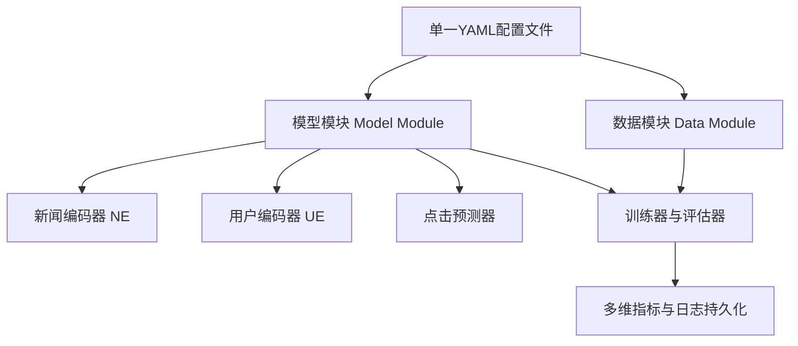
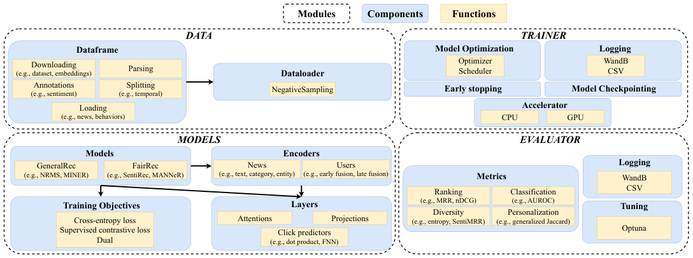

# NewsRecLib: A PyTorch-Lightning Library for Neural News Recommendation (面向神经新闻推荐的 PyTorch-Lightning 库)

- **会议/期刊**: EMNLP 2023
- **作者与机构**: Andreea Iana, Goran Glavaš, Heiko Paulheim（德国曼海姆大学、维尔茨堡大学）
- **推荐链路定位**: 端到端框架与基准评测（基础设施）
- **研究方向**: 序列与会话推荐 / 去偏公平与工业架构
- **论文原文**: [论文链接](https://arxiv.org/abs/2310.01146v1)
- **开源代码**: [代码仓库](https://github.com/andreeaiana/newsreclib)

## TL;DR (1分钟核心速览)

针对神经新闻推荐（NNR）研究长期存在的**不可复现**与**评估不公平**痛点，本文提出基于 PyTorch-Lightning 与 Hydra 的开源库 **NewsRecLib**。该库通过极致模块化与单一配置文件，统一了 2 个基准数据集、13 个前沿模型与多维评估协议。在 MIND 与 Adressa 上的系统性基准表明，PLM 编码器与对比学习目标在不同数据规模下存在显著性能分化，为组件级公平消融提供了标准基建。

## Background & Motivation (背景与核心矛盾)

- **主流范式**：当前新闻推荐依赖复杂神经网络（如注意力、图网络）精确捕捉用户基于内容的动态偏好。
- **前人局限**：模型代码多未公开且实现碎片化，导致难以复现；缺乏标准的数据划分与评测协议，且核心超参常被硬编码或省略，造成模型间**不公平对比**。
- **核心洞察 (Key Insight)**：现有库中模型子组件（如新闻编码器、用户编码器）与整体架构强绑定，导致研究者无法干净、独立地剥离特定组件或训练策略对最终性能的真实贡献。
- **本文切入点**：构建端到端、声明式配置的 NewsRecLib，将组件彻底解耦，以工程化方式强制实现透明、可复现且支持细粒度消融的 NNR 基准测试。

## Method (核心方法设计)

### 1. 整体框架 (Overall Architecture)

NewsRecLib 基于 PyTorch-Lightning 构建，将数据解析、模型组件（新闻/用户编码器、点击预测器）与训练评估完全解耦。整个实验流水线由**单一 YAML 配置文件**驱动，支持模块级配置的层级继承与覆盖。运行启动时自动合并并持久化完整配置对象，闭环涵盖数据加载、Optuna 超参搜索、多维指标评估与日志记录，彻底消除实验环境黑盒。

<figure class="paper-figure" markdown="span">
  <figcaption>图 1：NewsRecLib 框架示意图。</figcaption>
</figure>

### 2. 关键设计拆解 (Key Designs)

1. **极致模块化与组件解耦**：打破传统“模型即代码块”的绑定，将 NE、UE 与预测器抽象为可插拔子类。支持跨模型自由混搭（如将 NRMS 的用户编码器替换为全新 PLM 编码器），从而精准、无干扰地归因各组件对整体性能的增量贡献。
2. **基于 Hydra 的声明式复现机制**：所有实验参数、回调与依赖库版本通过单一配置文件定义。支持命令行直接覆盖配置，运行前自动将主配置与导入配置合并为单一对象并持久化，确保实验条件 100% 透明与一键复现。
3. **多维评估与超参优化**：集成 TorchMetrics 与 Optuna，除标准排序指标外，引入主题与情感层面的多样性/个性化指标。支持将编码器类型或损失权重作为超参，利用贝叶斯优化进行联合搜索。双目标训练损失定义为：
$\mathcal{L} = \alpha \mathcal{L}_{CE} + (1 - \alpha) \mathcal{L}_{SupCon}$，其中$\alpha$ 为权重系数，平滑切换分类与对比学习。

## Experimental Setup & Evaluation Protocol (实验设置与评估协议)

- **数据集与预处理**：

| 数据集 | #Users | #Items | #Interactions | 特征/场景说明 |
| :--- | :---: | :---: | :---: | :--- |
| MINDsmall | 约 12 万 | 约 1.6 万 | 约 24 万 | 英文新闻，含标题/摘要/实体/类别 |
| Adressa-1w | 约 1 万 | 约 2.2 万 | 约 5 万 | 挪威语新闻，仅含标题与类别 |

- **数据划分与防穿越**：MIND 因官方未公开测试集，采用**验证集作测试**，原训练集按时间戳切分为训练/验证；Adressa 按标准时序划分，因仅含正样本，**按 1:20 随机采样构建曝光印象日志**。
- **排名评测协议**：采用**采样排序协议**（基于构造的印象日志），核心指标包括 AUC、MRR、nDCG@5/10，以及主题多样性 $D_{ctg}$与情感多样性$D_{snt}$。
- **对比基线与超参**：涵盖 10 个通用模型与 3 个公平感知模型（含 DKN, NRMS, NAML, MINS, MANNeR 等）；仅微调 PLM 最后 4 层，Adam 优化器，学习率 $1e-4$，报告 5 次运行的均值与方差。

## Key Experimental Results (实验关键数据)

### 1. 主实验对比 (Main Results)

下表展示在 **MIND** 数据集上，代表性模型的内容推荐性能（最优加粗，次优下划线）：

| 模型 | AUC | MRR | nDCG@5 | nDCG@10 |
| :--- | :---: | :---: | :---: | :---: |
| DKN | 50.0 ±0.0 | 26.3±0.4 | 24.6 ±0.5 | 31.5±0.3 |
| NRMS | 54.1 ±0.8 | 27.2±0.6 | 25.3 ±0.5 | 31.9±0.4 |
| NAML | 50.2 ±0.0 | 33.4±0.6 | 31.8 ±0.7 | 38.1±0.5 |
| LSTUR | 58.8±2.1 | 32.2±0.9 | 30.4 ±0.9 | 36.8±0.9 |
| CAUM | 59.5 ±0.6 | 33.1±0.4 | 31.2 ±0.5 | 37.7±0.5 |
| MINS | 56.1 ±1.5 | 31.0±1.5 | 29.4 ±1.5 | 35.7±1.5 |
| **MANNeR** | **66.2±1.0** | **36.7±1.3** | **35.1 ±1.3** | **41.1±1.1** |

### 2. 消融实验 (Ablation Study)

通过 NewsRecLib 的组件解耦能力，对比原始 NE 与 PLM 增强 NE 在 MIND 上的性能差异：

| 模型变体 | AUC | MRR | 变体类型 |
| :--- | :---: | :---: | :---: |
| NRMS (Original) | 54.1 ±0.8 | 27.2±0.6 | 原生 CNN/注意力 |
| NRMS-PLM | 50.0 ±0.0 | 21.9±2.8 | RoBERTa 编码 |
| LSTUR (Original) | **58.8±2.1** | **32.2±0.9** | 原生注意力 |
| LSTUR-PLM | 50.0 ±0.0 | 30.7±0.6 | RoBERTa 编码 |

### 3. 关键实验发现 (Key Findings)

1. **PLM 编码器并非万能，数据规模是关键瓶颈**：在中小规模数据（如 MINDsmall）上，引入 PLM 的 NE 变体（如 NRMS-PLM, LSTUR-PLM）性能**普遍显著低于**原生 NE，证明大参数量模型在缺乏足够语料时易陷入过拟合，而非带来语义增益。
2. **复杂训练目标对数据规模高度敏感**：采用对比学习与延迟融合的 MANNeR 在 MIND（新闻量约 5 倍于 Adressa）上取得绝对最优（AUC 达 66.2），但在 Adressa 上表现平庸，说明高级训练策略需足够数据支撑才能发挥优势。
3. **多维评估揭示多样化目标的有效性**：引入情感/主题正则的公平感知模型（如 MANNeR）在 $D_{snt}$等多样性指标上大幅领先纯分类模型（如 LSTUR 的$D_{snt}$ 仅 27.7），验证了超越单一准确率指标进行系统评估的必要性。

## Highlights & Limitations (亮点、对比与审稿批判)

- **与代表作对比 (vs. Prior Work)**：相较于 RecBole 或 Microsoft Recommenders，NewsRecLib 专注前沿 NNR，**首次将模型子组件彻底解耦**，且原生支持公平感知推荐器与超越准确率的多维指标，填补了新闻推荐领域细粒度组件归因的基建空白。
- **可迁移亮点**：“单一 YAML 配置驱动全流水线”的 Hydra 声明式设计，以及将任意网络层作为超参交由贝叶斯优化的做法，可直接迁移至其他深度推荐系统的工程化与自动化评测中。
- **审稿级局限批判**：库的实现强依赖 PyTorch-Lightning 与 Hydra 的底层更新，存在版本维护风险；且引入 PLM 后计算与显存开销剧增，在无 GPU 环境下大规模复现实务中不切实际。

## Rating (四维评分)

- **方法创新性 (Novelty)**: ⭐⭐⭐⭐ （非算法创新，但在推荐系统评测基建上极具开创性，首次实现组件级无耦合的声明式基准框架。）
- **评估协议与实验扎实度 (Protocol & Experiments)**: ⭐⭐⭐⭐ （统一了易引发争议的数据划分与采样协议，主实验与组件消融数据详实，结论严谨且具有警示意义。）
- **写作与数学规范度 (Clarity & Rigor)**: ⭐⭐⭐⭐ （架构描述清晰，配置继承逻辑与评估指标定义规范，工程实现细节披露充分。）
- **工业落地与复现价值 (Industrial & Practical Value)**: ⭐⭐⭐⭐ （开源代码质量高，模块化设计极大降低了前沿模型复现与二次开发门槛，具有极高的社区工具价值。）

