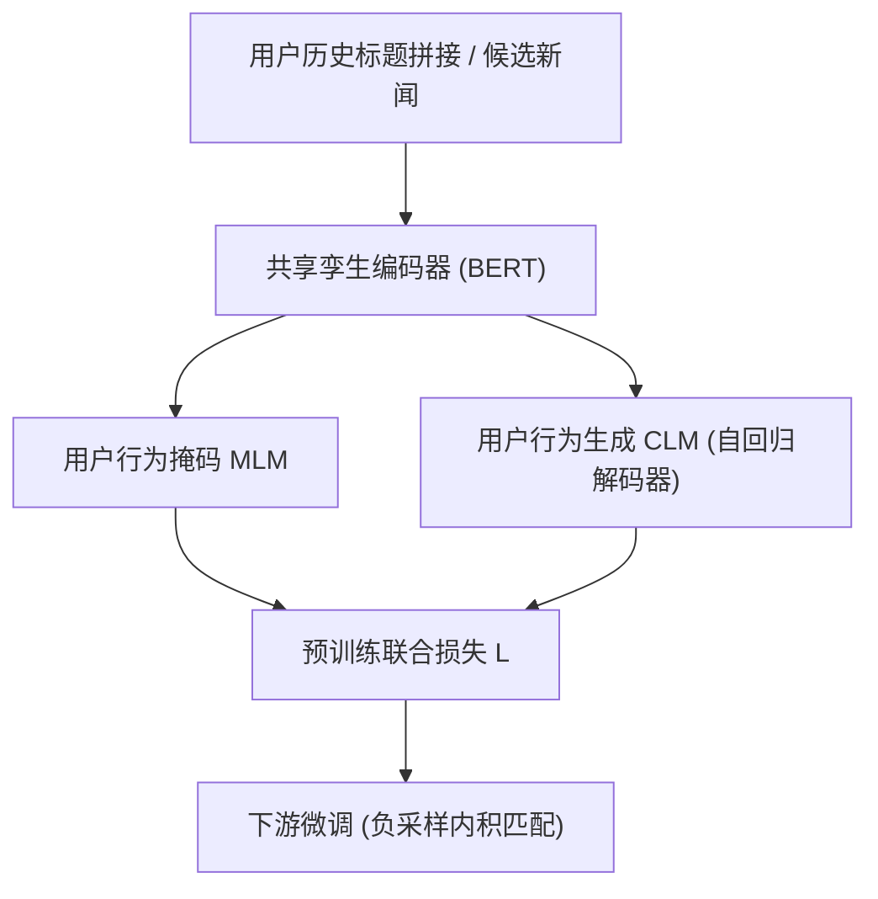
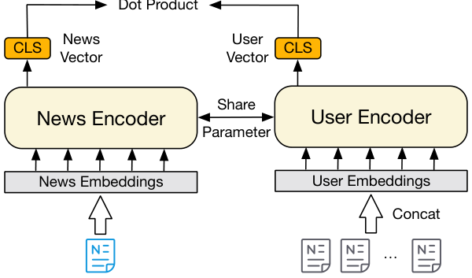
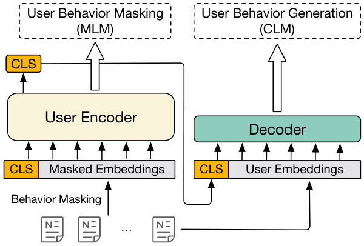

# PUNR: Pre-training with User Behavior Modeling for News Recommendation (面向新闻推荐的用户行为建模预训练)

- **会议/期刊**: Findings of EMNLP 2023
- **作者与机构**: Guangyuan Ma 等，中国科学院信息工程研究所、国科大网络空间安全学院、度小满金融
- **推荐链路定位**: 召回 / 精排（双塔匹配建模）
- **研究方向**: 序列与会话推荐 / 自监督对比学习与交互去噪
- **论文原文**: [论文原文链接](https://arxiv.org/abs/2304.12633v2)
- **开源代码**: [开源代码仓库链接](https://github.com/ma787639046/punr)

## TL;DR (1分钟核心速览)

针对现有 PLM 新闻推荐缺乏面向用户表征优化的无监督预训练方法的痛点，本文提出 PUNR。通过引入**用户行为掩码 (MLM)** 与**用户行为生成 (CLM)** 双预训练任务，配合简化的孪生编码器联合建模用户历史，将长序列行为信号压缩至 `[CLS]` 用户向量中。在 MIND 数据集上采用 1正4负 采样排序协议，AUC 较最强基线取得超 1.5 的显著提升，验证了无监督预训练对用户行为建模的增益。

## Background & Motivation (背景与核心矛盾)

- **主流范式**: 当前 PLM 新闻推荐多采用双塔架构，分别计算新闻向量与用户向量后进行内积匹配。
- **前人局限**: NRMS-BERT 等采用层级浅层聚合用户历史，导致用户建模能力较弱；UNBERT/AMM 等单塔拼接方法虽建模充分但计算开销过大，难以工业部署。
- **核心洞察 (Key Insight)**: 推荐效果高度依赖用户表征质量，但现有工作几乎全聚焦于下游微调，缺乏针对用户行为序列的专属无监督预训练范式。
- **本文切入点**: 摒弃复杂的层级聚合，改用单层 BERT 拼接用户历史，并设计行为掩码与自回归生成双任务，在预训练阶段强制优化用户向量。

## Method (核心方法设计)

### 1. 整体框架 (Overall Architecture)

PUNR 采用孪生编码器架构，将用户点击的新闻标题拼接为长序列输入用户编码器，候选新闻单独输入，两塔共享 BERT 参数。预训练阶段引入双任务：掩码任务随机掩盖整段新闻标题要求模型根据上下文还原，生成任务利用浅层自回归解码器根据用户向量还原完整历史。微调阶段直接取 `[CLS]` 作为用户/新闻向量进行负采样匹配。

<figure class="paper-figure" markdown="span">
  <figcaption>图 1：下游微调中新推荐的用户建模方法架构。孪生编码器同时用于建模新闻嵌入和用户嵌入。注意，预训练中以用户点击新闻的文本标题为输入，而非纯新闻 ID。</figcaption>
</figure>

### 2. 关键设计拆解 (Key Designs)

1. **用户行为掩码 (User Behavior Masking)**：前人缺乏用户序列上下文对齐。核心算子设定总掩码率 $\alpha$与行为掩码率$\beta$，随机将整篇新闻标题替换为 `[MASK]`，通过 MLM 还原，公式为$L_{mlm} = -\sum_{i\in M}\log p(t_i|Enc(E(m(\boldsymbol{T}))))$。直觉上，整段掩码迫使模型基于未掩码的历史上下文预测缺失行为，显式捕捉用户连贯的新闻阅读模式。

<figure class="paper-figure" markdown="span">
  <figcaption>图 2：我们提出的方法 PUNR 的预训练设计。在用户编码器的预训练阶段，我们引入了特殊的用户行为掩码策略和用户行为生成任务。</figcaption>
</figure>

2. **用户行为生成 (User Behavior Generation)**：为提升用户向量表达力，在编码器顶层加单层自回归解码器，以 `[CLS]` 向量为条件生成完整用户历史，公式为 $L_{dec} = -\sum_{i\in \boldsymbol{T}}\log p(t_{i+1}|Dec(h^{last}_0, E(\boldsymbol{T})))$。因解码器容量有限，必须从用户向量提取全部行为信息，从而将长序列语义强压缩至单点向量。

3. **训练目标与负采样**：总预训练损失为 $\mathcal{L} = L_{mlm} + L_{dec}$。微调阶段采用负采样交叉熵损失：$L_{ft} = -\log \frac{\exp(d(\boldsymbol{u}, \boldsymbol{v}^+))}{\exp(d(\boldsymbol{u}, \boldsymbol{v}^+)) + \exp(d(\boldsymbol{u}, \boldsymbol{v}^-))}$，其中$d(\cdot)$ 为内积。推理采用双塔向量内积，计算效率高。

## Experimental Setup & Evaluation Protocol (实验设置与评估协议)

- **数据集与预处理**: 使用 MIND 数据集，预处理采用新闻标题文本，未进行 `5-core` 过滤。

| 数据集 | #Users | #Items | #Interactions | 稀疏度/密度 | 特征/场景说明 |
| :--- | :---: | :---: | :---: | :---: | :--- |
| MIND-Small | 50k | 约16万 | 约50万 | 极稀疏 | 英文新闻，随机采样子集 |
| MIND-Large | 100万 | 约16万 | 2400万 | 极稀疏 | 完整版，含1580万曝光日志 |

- **数据划分与防穿越 (Splitting Strategy)**: 采用标准 `训练集训练 / 开发集评估` 划分，按时间戳分离防穿越。
- **排名评测协议 (Ranking Protocol)**: 采用 `Sampled Ranking`，从候选集中随机采样 **1个正样本与4个负样本** 进行打分排序，指标含 AUC、MRR、nDCG@5、nDCG@10。
- **对比基线与超参设置**: 涵盖 TF-IDF 因子分解 (LibFM/DeepFM)、CNN/DNN 模型 (DKN/NPA/NAML/LSTUR/NRMS/FIM) 及 PLM 模型 (NRMS-BERT/UNBERT/AMM)。Embedding 维度 $d$随 BERT-base 为 768，显著性检验采用双尾 t-test ($p \le 0.05$)。

## Key Experimental Results (实验关键数据)

### 1. 主实验对比 (Main Results)

| 方法 | MIND-Small AUC | MIND-Small nDCG@10 | MIND-Large AUC | MIND-Large nDCG@10 | Improv. (Large AUC) |
| :--- | :---: | :---: | :---: | :---: | :---: |
| LibFM | 59.74 | 34.29 | 61.85 | 37.13 | - |
| DeepFM | 59.89 | 34.06 | 61.87 | 37.05 | - |
| DKN | 61.75 | 35.38 | 64.07 | 38.66 | - |
| NPA | 63.21 | 37.81 | 65.92 | 40.37 | - |
| NAML | 65.50 | 39.31 | 66.46 | 41.40 | - |
| LSTUR | 64.38 | 38.17 | 67.08 | 40.93 | - |
| NRMS | 64.83 | 38.92 | 67.66 | 41.98 | - |
| FIM | 65.02 | 39.10 | 67.87 | 42.21 | - |
| NRMS-BERT | 65.52 | 40.38 | 69.50 | 43.72 | - |
| UNBERT | 67.62 | 41.02 | 70.68 | 44.78 | - |
| AMM | 67.96 | 42.77 | - | - | - |
| **PUNR** | **68.89** | **43.10** | **71.07** | **45.45** | **+1.57** |

### 2. 消融实验 (Ablation Study)

| 模型变体 | AUC | MRR | nDCG@5 | nDCG@10 |
| :--- | :---: | :---: | :---: | :---: |
| NRMS-BERT (Baseline) | 69.50 | 34.75 | 37.99 | 43.72 |
| w/ User Modeling | 70.52 | 34.60 | 38.38 | 44.81 |
| w/ Only User Behavior Masking | 70.79 | 34.86 | 38.65 | 45.11 |
| w/ Only User Behavior Generation | 70.92 | 35.02 | 38.86 | 45.28 |
| **w/ Both Pre-training Tasks (PUNR)** | **71.07** | **35.19** | **39.07** | **45.45** |

### 3. 关键实验发现 (Key Findings)

1. **双预训练任务互补增益显著**：联合使用掩码与生成任务较仅用生成任务 AUC 再提升 0.15，较基线累计提升 1.57，证明行为掩码提供的上下文对齐与生成任务的表征压缩机制互为补充，缺一不可。
2. **孪生架构兼顾效率与效果**：将用户建模从层级聚合简化为单层 BERT 拼接，不仅降低参数量，AUC 还独立提升 1.02，证明用户历史内部 token 级深度交互对用户表征至关重要。
3. **生成任务适配无参池化**：在 CLS 池化下 PUNR 达 71.07，而注意力池化反降至 70.77，说明自回归预训练已将行为语义压缩进 CLS 向量，引入参数化池化反而破坏该预训练对齐，进一步印证生成任务对表征的强约束。

## Highlights & Limitations (亮点、对比与审稿批判)

- **与代表作对比 (vs. Prior Work)**: 较 NRMS-BERT，PUNR 摒弃了浅层聚合，用拼接+预训练解决用户建模弱问题；较 UNBERT/AMM，PUNR 保持双塔独立编码结构，在获取单塔级用户建模能力的同时避免了候选新闻与用户历史全量拼接带来的高昂计算开销。
- **可迁移亮点**: 将 MLM 扩展至“整段行为掩码”可作为序列推荐的通用数据增广与去噪手段；利用浅层自回归解码器强制压缩长序列语义至 CLS 向量，为无参池化场景提供了新的表征学习范式。
- **审稿级局限批判**: 用户历史动态变化导致新闻嵌入无法离线缓存，推理时需实时全量前向计算，工业级低延迟场景落地受限；自回归解码器需在通用语料上单独预训练初始化，增加了预训练管线的复杂性与算力成本。

## Rating (四维评分)

- **方法创新性 (Novelty)**: ⭐⭐⭐⭐ （首次将用户行为掩码与自回归生成引入新闻推荐预训练，为序列推荐提供了无需负采样的表征优化新范式。）
- **评估协议与实验扎实度 (Protocol & Experiments)**: ⭐⭐⭐⭐ （涵盖 11 个主流基线，1正4负采样协议严谨，消融实验详尽且包含超参敏感性与池化方式分析。）
- **写作与数学规范度 (Clarity & Rigor)**: ⭐⭐⭐⭐ （公式推导清晰，动机阐述连贯，对解码器初始化与孪生架构的权衡分析逻辑严密。）
- **工业落地与复现价值 (Industrial & Practical Value)**: ⭐⭐⭐ （开源代码完整，但用户嵌入不可缓存的缺陷在工业级在线推理中存在明显延迟瓶颈，需依赖模型蒸馏缓解。）

