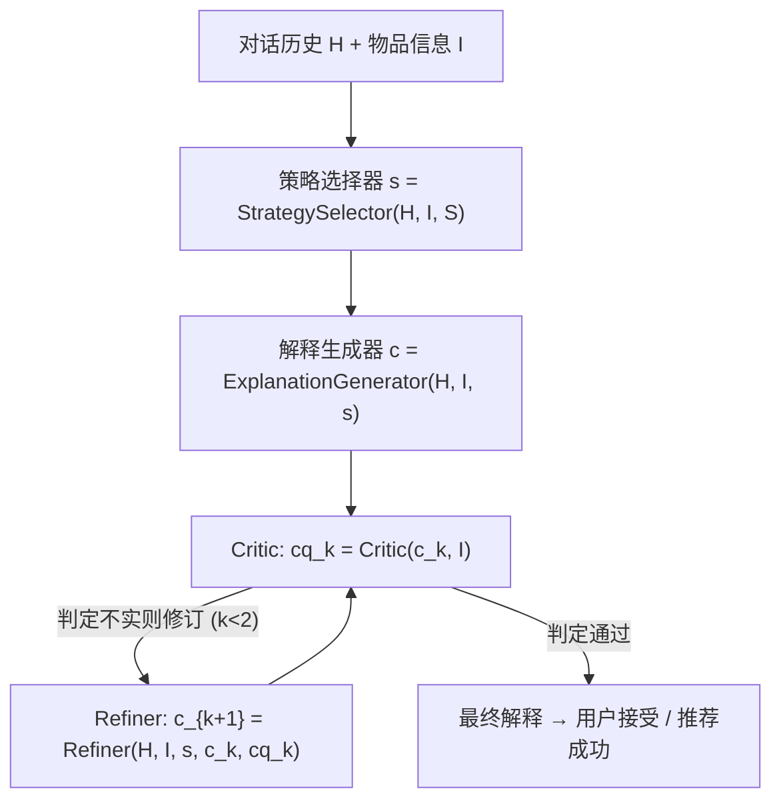
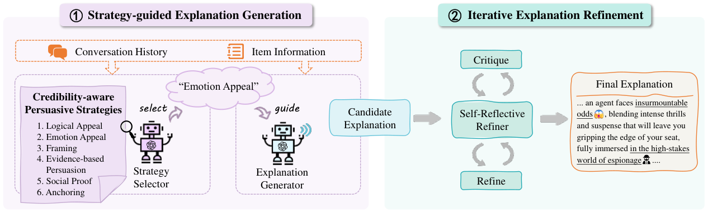
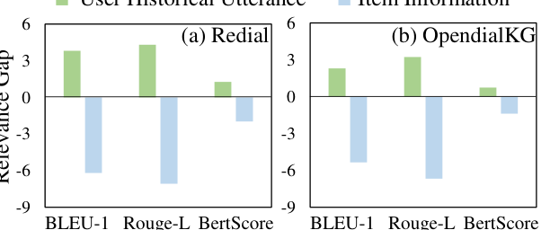

# Beyond Persuasion: Towards Conversational Recommender System with Credible Explanations (迈向"说服之外"：具备可信解释的对话推荐系统)

- **会议/期刊**: Findings of EMNLP 2024
- **作者与机构**: Peixin Qin, Chen Huang, Wenqiang Lei (四川大学)；Yang Deng (新加坡管理大学)；Tat-Seng Chua (新加坡国立大学)
- **推荐链路定位**: 端到端生成式（对话交互解释生成 + 双塔召回）
- **研究方向**: 对话推荐与智能体仿真 / 大语言模型推荐
- **论文原文**: [https://arxiv.org/abs/2409.14399v2](https://arxiv.org/abs/2409.14399v2)
- **开源代码**: [https://github.com/mumen798/PC-CRS](https://github.com/mumen798/PC-CRS)

## TL;DR (1分钟核心速览)

LLM 驱动的对话推荐（CRS）能生成极具说服力的解释，却常掺入与事实不符的内容以迎合用户，长期损害用户信任。PC-CRS 提出免训练的两阶段框架：先用 6 条**可信感知说服策略**引导生成候选解释，再经**自反思 Critic–Refiner** 迭代消除不实陈述。在 Redial / OpendialKG 的用户模拟器 + GPT-4o 评分协议下，可信度平均提升 8.17%、说服力 5.07%，并意外把 Redial 的 SR 从 30.26 推到 42.54。

## Background & Motivation (背景与核心矛盾)

- **主流范式**: LLM 时代的 CRS（InterCRS、ChatCRS、MACRS）把"说服"当作优化目标，用自然语言解释放大用户对推荐物的兴趣以提升接受率。
- **前人局限**: 其一，说服力与真实性脱钩——模型为迎合用户话语而夸大甚至编造物品属性（图1 中把动作片 *Mission: Impossible* 说成动作喜剧，用户看完后信任崩塌）；其二，现有"可信推荐"研究多停留在社会科学与人因理论层面，只做可行性分析，缺乏可落地的算法。
- **核心洞察 (Key Insight)**: 作者对低可信解释做归因分析（图3），发现**低可信解释与用户历史话语的 BLEU-1/Rouge-L/BERTScore 反而更高、与物品事实信息更低**——不实信息的根因是 LLM 在 RLHF 式奖励黑客下"讨好用户表述"而非"忠实描述物品"。
- **本文切入点**: 把"可信"显式注入生成前（策略约束）与生成后（事实校验）两个环节，且全程免训练。

## Method (核心方法设计)

### 1. 整体框架 (Overall Architecture)

给定对话历史 $H$与从知识库检索的物品信息$I$，PC-CRS 先由一个 LLM 策略选择器从 6 条可信感知说服策略中挑一条$s$，再用$s$显式约束 LLM 生成候选解释$c$；随后进入 Critic–Refiner 闭环，Critic 独立于对话上下文、只对照$I$核查$c_k$中的每条 claim，若判定存在不实则交由 Refiner 结合$H, I, s, c_k$ 与批评意见修订，循环至 critic 判定通过或达到最大迭代次数（实验取 2）。最终输出一条既说服人又经得起事实核查的解释，整条链路不含任何参数训练。

<figure class="paper-figure" markdown="span">
  <figcaption>图2：PC-CRS的两阶段流程。它首先选择合适策略来生成候选解释。然后，Self-Reflective Refiner以迭代方式消除候选解释中的不实信息。</figcaption>
</figure>

### 2. 关键设计拆解 (Key Designs)

1. **可信感知说服策略 (Credibility-aware Persuasive Strategies)**：痛点在于通用 LLM 的"说服"没有任何真实性约束。本文依据 Elaboration Likelihood Model 把说服拆成三条内容中心路径（Logical Appeal 呈现逻辑推理、Emotion Appeal 用可信情节唤起情绪、Framing 诚实强调正向结果）与两条边缘线索路径（Evidence-based 用奖项等客观可验证事实、Social Proof 用评分与大众评价），外加两者结合的 Anchoring（先抛可信锚点再展开）。每条策略的 prompt 均绑定"只允许引用 $I$ 中存在的事实"，从而在解码前就把幻觉的可行空间压缩。
2. **策略引导的候选生成 (Strategy-guided Generation)**：单条万能 prompt 难以同时兼顾说服力与可信度，故改为"先选后写"：
$$s=\mathrm{StrategySelector}(H,I,\mathcal{S}),\qquad c=\mathrm{ExplanationGenerator}(H,I,s)$$
策略随对话轮次动态切换，使解释能贴合上下文情绪（如用户表达"boring"时优先 Framing），比固定模板更不易被识别为套话。
3. **自反思迭代精炼 (Iterative Explanation Refinement)**：针对生成模型"上下文连贯优先于事实忠实"的固有倾向，用无上下文偏置的 Critic 做事实审计，再用保留策略与人设的 Refiner 做靶向修复：
$$cq_k=\mathrm{Critic}(c_k,I),\qquad c_{k+1}=\mathrm{Refiner}(H,I,s,c_k,cq_k)$$
关键设计是 **Critic 不接入 $H$**——切断"继续迎合用户"的通路，使其只对齐$I$，这是把"说服"与"说谎"解耦的核心算子。训练目标即无目标：无损失函数、无负采样，全部由 In-Context 提示驱动；在线开销主要来自最多$2+1$ 次 LLM 调用（1 次选策略 + 1 次生成 + ≤2 次 Critic/Refiner）。

## Experimental Setup & Evaluation Protocol (实验设置与评估协议)

- **数据集与预处理**: 采用对话推荐两大公开基准 Redial 与 OpendialKG（电影域），原文主文未列出统计量，详见附录 B：

| 数据集 | #Users | #Items | #Interactions | 稀疏度/密度 | 特征/场景说明 |
| :--- | :---: | :---: | :---: | :---: | :--- |
| Redial | 见附录 B | 见附录 B | 见附录 B | — | 电影对话推荐，含用户偏好与人设 |
| OpendialKG | 见附录 B | 见附录 B | 见附录 B | — | 知识图谱对话推荐，物品属性更丰富 |

- **数据划分与防穿越 (Splitting Strategy)**: 非离线划分，而是**用户模拟器在线交互评估**——模拟器以"偏好属性组合"初始化，**不可见目标物品**，与 CRS 自由对话，直至推荐被接受或达到最大轮数，天然规避训练/测试泄漏。
- **排名评测协议 (Ranking Protocol)**: 推荐模块统一用双塔编码器做**全库检索**，报告 $R@1/R@5/R@10$与 SR；解释质量由 **GPT-4o (gpt-4o-2024-05-13) 依细粒度评分卡打分**，含 Persuasiveness、Credibility、Convincing Acceptance 三项。说服力定义为$1-\frac{i_{true}-i_{post}}{i_{true}-i_{pre}}$，即解释在多大程度上把用户"看前意愿"推向"真实意愿"。
- **对比基线与超参设置**: PLM 基线 BARCOR、UniCRS；LLM 基线 InterCRS、ChatCRS、MACRS；所有 LLM-based CRS 统一 ChatGPT (gpt-3.5-turbo-0125) 作骨干与模拟器，最大精炼迭代 2 次。人评校验：GPT-4o 打分与人工的 Spearman 相关为 0.59（观看意愿）/0.62（可信度），模拟器自然度 3.88、有用性 3.79。

## Key Experimental Results (实验关键数据)

### 1. 主实验对比 (Main Results)

| 模型 | Redial Persu.↑ | Redial Cred.↑ | Redial CA↑ | OpendialKG Persu.↑ | OpendialKG Cred.↑ | OpendialKG CA↑ |
| :--- | :---: | :---: | :---: | :---: | :---: | :---: |
| BARCOR (PLM) | 34.44 | 2.23 | / | 20.27 | 1.95 | / |
| UniCRS (PLM) | 13.74 | 2.77 | / | 25.57 | 2.42 | / |
| InterCRS (LLM) | 73.05 | 3.50 | 63.01 | 76.36 | 3.85 | 71.30 |
| ChatCRS (LLM) | 71.68 | 3.66 | **73.89** | **79.64** | 3.26 | 66.67 |
| MACRS (LLM) | 76.77 | 3.87 | 73.86 | 78.89 | 3.14 | 59.34 |
| **PC-CRS (ours)** | **82.12** | **4.15** | 78.07 | 82.16 | **4.20** | **87.67** |
| **Improv.%** | **+6.97%** | **+7.24%** | **+5.66%** | **+3.16%** | **+9.10%** | **+22.96%** |

> 说明：CA 为 Convincing Acceptance；PLM 基线因从未产生被接受的推荐，CA 不可计算。Redial 上 CA 最优为 ChatCRS (73.89)，PC-CRS 为 78.07（相对最强基线 +5.66%）。

### 2. 消融实验 (Ablation Study)

原文以图 5 给出（未在正文列表数值），下表为方向性归纳：

| 配置 | 说服力 | 可信度 | Convincing Acceptance | Recall@10 | SR | 归因 |
| :--- | :---: | :---: | :---: | :---: | :---: | :--- |
| PC-CRS (完整) | 基准 | 基准 | 基准 | 基准 | 基准 | — |
| w/o SEG (去策略引导) | ↓↓ | ↓↓ | ↓↓ | ↓↓ | ↓↓ | 失去"说服+可信"的显式约束，全线崩塌 |
| w/o IER (去迭代精炼) | ≈ 持平 | ↓ | ↓ | ↓ | ↓ | 主要损失保真度与上下文洁净度，说服力尚可 |

### 3. 关键实验发现 (Key Findings)

1. **可信度是说服力的"护栏"而非"刹车"**：OpendialKG 上 Cre­di­bi­li­ty 从最佳基线 InterCRS 的 3.85 升至 4.20（+9.10%），同时 CA 从 71.30 暴涨至 87.67（+22.96%）——说明基线的高接受率中相当比例来自"被误导式接受"，剔除不实信息后真实说服转化反而更高。
2. **不实解释的根因是"讨好用户 > 忠实物品"**（图3）：低可信解释相对高可信解释，在用户历史话语上的 BLEU-1/Rouge-L/BERTScore 系统性更高、在物品信息上系统性更低；而 PC-CRS 同时提升了两侧对齐（Redial 对物品 BLEU-1 14.76 vs InterCRS 12.30，对用户 19.09 vs 13.46），证明"可信"与"贴人设"并非零和。
3. **可信解释反哺推荐精度**：Redial 上 SR 42.54 vs InterCRS 30.26、$R@1$43.42 vs 35.53；OpendialKG SR 45.31 vs 39.06（平均$R@1$ +12%、SR +28%）。机制解释是幻觉内容作为噪声污染了对话上下文，扭曲偏好估计；去噪后推荐模块更容易锁定真实意图。

<figure class="paper-figure" markdown="span">
  <figcaption>图3：相关性差距上的结果。其计算方式为：用低可信度解释的指标得分减去高可信度解释的指标得分。基于LLM的CRS迎合用户表述，却忽视事实信息。</figcaption>
</figure>

## Highlights & Limitations (亮点、对比与审稿批判)

- **与代表作对比 (vs. Prior Work)**: 与 InterCRS/MACRS 等"把说服力单目标最大化"的 LLM-CRS 本质不同，本文将说服力与可信度视为**双约束**而非权衡曲线上的自由点；与纯理论/人因研究的可信推荐工作相比，本文给出了首个可运行、免训练、可插拔的工程化方案。
- **可迁移亮点**: ① "Critic 隔离对话上下文"这一设计可直接迁移到任何需要事实核查的生成式推荐（如商品卖点文案、行程解释），用上下文隔离切断模型迎合式幻觉的捷径；② 六策略库 + 动态选择可作为通用 prompt 路由模块，复用到多场景推荐话术生成。
- **审稿级局限批判**: ① **迭代与说服力的目标冲突未解**——图4 显示精炼轮数增加时可信度单调上升但说服力下降，本文只暴露该矛盾而未给出帕累托优化方案；② **策略选择"千人一面"且评估成本受限**——实验中不论何种人设，模型都偏好 Logical Appeal / Emotion Appeal / Framing，且仅在 ChatGPT 骨干上验证（受预算限制未覆盖 GPT-4 等），全部指标依赖 GPT-4o 自动评分，主文亦未报告显著性检验，跨骨干稳健性存疑。

## Rating (四维评分)

- **方法创新性 (Novelty)**: ⭐⭐⭐⭐ （首个将"说服"与"可信"显式解耦的 CRS 框架，策略库源自说服理论 + Critic 上下文隔离算子均有清晰动机支撑）
- **评估协议与实验扎实度 (Protocol & Experiments)**: ⭐⭐⭐ （模拟器在线评估规避泄漏且做人评校验，但仅两数据集、无显著性检验、消融只给曲线不给数值）
- **写作与数学规范度 (Clarity & Rigor)**: ⭐⭐⭐⭐ （公式极简但每个算子意图明确，说服力指标定义有巧思；理论推导深度有限）
- **工业落地与复现价值 (Industrial & Practical Value)**: ⭐⭐⭐⭐ （完全免训练、代码开源、可作为插件叠加在任意 CRS 之上；代价是每轮 3–4 次 LLM 调用的延迟与成本）

