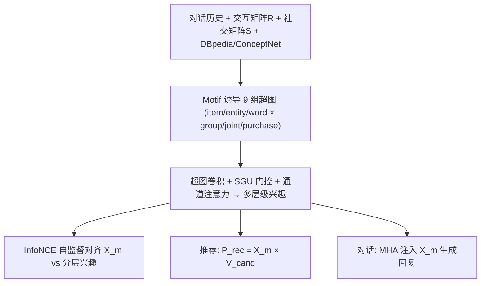
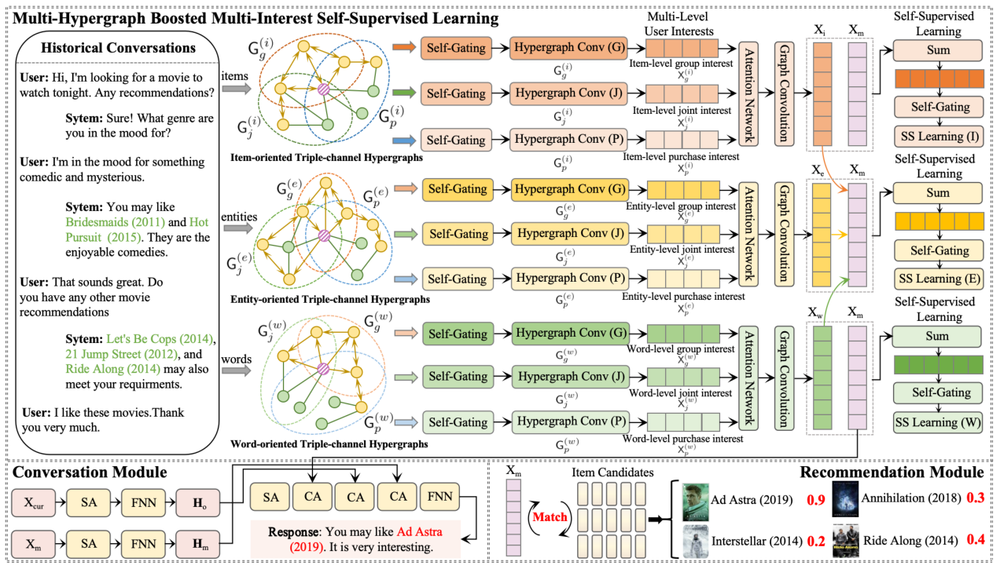

# Mitigating Matthew Effect: Multi-Hypergraph Boosted Multi-Interest Self-Supervised Learning for Conversational Recommendation (多超图增强多兴趣自监督学习的对话推荐)

- **会议/期刊**: EMNLP 2024 (pp. 1455–1466)
- **作者与机构**: Yongsen Zheng, Ruilin Xu, Guohua Wang, Liang Lin, Kwok-Yan Lam（南洋理工大学、中山大学、华南农业大学、鹏城实验室）
- **推荐链路定位**: 端到端（对话模块生成回复 + 推荐模块在全候选集上打分）
- **研究方向**: 对话推荐与智能体仿真 / 图神经网络与知识图谱推荐
- **论文原文**: [https://arxiv.org/abs/2607.18609v1](https://arxiv.org/abs/2607.18609v1)
- **开源代码**: [https://github.com/zysensmile/HiCore](https://github.com/zysensmile/HiCore)

## TL;DR (1分钟核心速览)

对话推荐（CRS）中的马太效应会随「用户—系统」动态反馈循环被逐轮放大，而现有超图方案多为**单通道**，只能刻画单一类型高阶关系，稀疏交互下甚至退化为普通 KG。HiCore 构造「物品 / 实体(DBpedia) / 词(ConceptNet)」三类节点 × 「group / joint / purchase」三条社交语义通道共 9 组 motif 诱导超图，经超图卷积与通道注意力汇聚为**多层级多兴趣** $\mathbf{X}_m$，用 InfoNCE 自监督对齐后同时注入推荐与对话模块。REDIAL 上 R@10 由 0.1966 提至 0.2192（+11.5%），Dist-2 提升约 79%，并在覆盖率与推荐平均流行度上取得最优的多样性与长尾表现。

## Background & Motivation (背景与核心矛盾)

- **主流范式**: CRS 采用 Seq2Seq/Transformer 联合建模对话与推荐；缓解马太效应则依赖超图刻画高阶用户关系以"拓宽"兴趣面。
- **前人局限**: ① 去偏工作几乎都在**静态/准静态**离线场景，忽略 CRS 里逐轮反馈会自我强化回声室与信息茧房；② 现有多兴趣超图是**单通道**（仅 group 社交或仅 joint 共购），无法同时表达多种关系模式，且在交互稀疏时会退化为成对 KG，学不到多样化兴趣。
- **核心洞察 (Key Insight)**: 马太效应的根源是**用户兴趣被窄化约束**；因此缓解手段不是压制热门物品，而是让系统从多种高阶关系视图中"看见"更宽的兴趣谱系。
- **本文切入点**: 用"节点类型 × 社交语义通道"的正交笛卡尔积构造多通道超图，让三通道兴趣在注意力层显式竞争，再由自监督信号约束其互不塌缩。

## Method (核心方法设计)

### 1. 整体框架 (Overall Architecture)

输入为对话历史、用户—物品交互矩阵 $\mathbf{R}$与社交矩阵$\mathbf{S}$；预处理阶段即离线完成 motif 超图抽取（作者将此步从训练中前移以消除实时构图瓶颈）。9 组超图分别经过"自门控映射$\to$超图卷积$\to$通道注意力$\to$层间注意力"得到物品级、实体级、词级兴趣，再融合为$\mathbf{X}_m$：在推荐侧与全候选物品矩阵相乘得$P_{rec}$，在对话侧作为 MHA 的 key/value 注入解码器。三任务损失（推荐 CE、对话 CE、InfoNCE 自监督）端到端联合优化。

<figure class="paper-figure" markdown="span">
  <figcaption>图1：我们的 HiCore 框架概览。该框架由多超图增强的多兴趣自监督学习和兴趣增强的 CRS 组成。前者旨在学习多层级用户兴趣，后者负责在对话模块中生成回复，并在推荐模块中预测物品。</figcaption>
</figure>

### 2. 关键设计拆解 (Key Designs)

1. **Motif 诱导的三通道超图构造**：痛点是把"朋友共同购买""同群组偏好""无社交但买同物"混为一条边，导致高阶结构丢失。作者用 7 种三角模体（图 2）显式枚举局部结构，得到通道专属邻接矩阵。purchase 通道采用**残差式去重**算子，避免与 joint 通道的信息完全重叠：
$\mathbf{A}^{(i)}_g=\sum_{k=1}^{7}\mathbf{A}^{(i)}_{M^{g}_k},\ \mathbf{A}^{(i)}_j=\mathbf{A}_{M_8}+\mathbf{A}_{M_9},\ \mathbf{A}^{(i)}_p=\mathbf{A}_{M_{10}}-(\mathbf{A}_{M_8}+\mathbf{A}_{M_9})$
直觉上 group 通道提供"社交可信度"先验、joint 通道提供"共同行为"强证据、purchase 通道覆盖无社交连边用户，三者互补地扩大可触达物品空间，正是压低长尾物品曝光门槛的关键。

2. **多兴趣超图卷积与分层注意力**：单通道 GCN 会把长尾节点在少数热门邻居上重复平滑。HiCore 先用 SGU 从基用户向量 $\mathbf{P}^{(0)}$ 派生各通道初值以抑制跨通道同质化，再执行
$\mathbf{P}^{(l+1)}_c=\tilde{\mathbf{D}}^{-1}_c\mathbf{A}^{(i)}_c\mathbf{P}^{(l)}_c$其中$\tilde{\mathbf{D}}_c$为$\mathbf{A}^{(i)}_c$的度矩阵；通道内注意力$\mathrm{Atta}(\mathbf{X}^{(h)}_g;\mathbf{X}^{(h)}_j;\mathbf{X}^{(h)}_p)$后接一次 GConv，层级间再以$\mathrm{Atta}(\mathbf{X}_i;\mathbf{X}_e;\mathbf{X}_w)$汇聚成$\mathbf{X}_m$。将"通道选择"学成可微权重，等价于让模型按对话上下文动态决定该相信社交证据还是语义/词面证据。

3. **训练目标、负采样与推理效率**：自监督项用 InfoNCE，正样本为分层兴趣 $\mathbf{z}^h_u$，**负样本由打乱$\mathbf{z}^h_u$ 的行列得到**（免额外采样器）：
$\mathcal{L}_s=-\sum_{h}\sum_{u\in\mathcal{U}}\big[\log\sigma(f(\mathbf{X}_m,\mathbf{z}^h_u)-f(\mathbf{X}_m,\hat{\mathbf{z}}^h_u))+\log\sigma(f(\mathbf{z}^h_u,\mathbf{k}^h)-f(\hat{\mathbf{z}}^h_u,\mathbf{k}^h))\big]$总损失$\mathcal{L}=\mathcal{L}_{rec}+\mathcal{L}_{conv}+\beta\mathcal{L}_s$；对话侧以$\mathbf{A}^n_4=\beta\mathbf{A}^n_2+(1-\beta)\mathbf{A}^n_3$ 在"当前话语"与"历史话语"分支间调流。在线推理只做一次超图卷积前向 + 候选内积，超图构建已离线化并按通道分卡并行，故延迟可控。

## Experimental Setup & Evaluation Protocol (实验设置与评估协议)

- **数据集与预处理**:

| 数据集 | #Users | #Items | #Interactions/规模 | 稀疏度/密度 | 特征/场景说明 |
| :--- | :---: | :---: | :---: | :---: | :--- |
| REDIAL | 956 | 6,924 | 11,348 dialogues | 未报告 | 电影对话推荐，含 DBpedia 实体 |
| TG-REDIAL | 1,482 | 33,834 | 10,000 dialogues | 未报告 | 主题引导版，物品空间更大更稀疏 |
| OpenDialKG | 未报告 | 多域 | 跨域对话 | 未报告 | 电影/音乐/书/体育/餐厅/新闻 |
| DuRecDial | 未报告 | 多域 | 跨域对话 | 未报告 | 多域任务型对话推荐 |

- **数据划分与防穿越 (Splitting Strategy)**: 原文沿用 MHIM (Shang et al., 2023) 的设定，正文**未显式声明**是 Leave-One-Out 还是比例划分，也未说明对话轮次截断策略，复现时需查代码确认。
- **排名评测协议 (Ranking Protocol)**: 采用 R@K、MRR@K、NDCG@K（K=1/10/50），指标形态对应**全候选集排序**（$P_{rec}=\mathbf{X}_m\times\mathbf{V}_{cand}$ 对全部候选物品打分），但未报告是否对训练集已交互物品做 mask；对话侧用 Distinct-2/3/4；去偏侧用 Coverage@k、Average Popularity A@K、Long-Tail Ratio L@K。
- **对比基线与超参设置**: 基线含序列模型（SASRec/BERT4Rec/TextCNN）、CRS 代表（ReDial、KGSF、KBRD、TG-ReDial、KGConvRec）、预训练/LLM 系（BERT/XLNet/BART/DialoGPT/GPT-3、UniCRS、C2-CRS、LOT-CRS）、以及最强对手 MHIM 与 HyCoRec；显著性标为 $p<0.05$。关键超参为嵌入维度$d$、自监督权重$\beta$、超图卷积层数$N$（取 2 层足够）、超边阈值$P$。

## Key Experimental Results (实验关键数据)

### 1. 主实验对比 (Main Results)

| Model | REDIAL R@10 | REDIAL R@50 | REDIAL N@10 | TG-REDIAL R@10 | TG-REDIAL R@50 | TG-REDIAL N@50 |
| :--- | :---: | :---: | :---: | :---: | :---: | :---: |
| SASRec | 0.1117 | 0.2329 | 0.0674 | 0.0043 | 0.0178 | 0.0047 |
| BERT4Rec | 0.1285 | 0.3032 | 0.0663 | 0.0043 | 0.0226 | 0.0058 |
| ReDial | 0.1705 | 0.3077 | 0.0925 | 0.0038 | 0.0165 | 0.0045 |
| KGSF | 0.1785 | 0.3690 | 0.0956 | 0.0215 | 0.0643 | 0.0194 |
| KBRD | 0.1796 | 0.3421 | 0.0972 | 0.0201 | 0.0501 | 0.0171 |
| KGConvRec | 0.1819 | 0.3587 | 0.0969 | 0.0220 | 0.0524 | 0.0185 |
| **MHIM** (最强基线) | 0.1966 | 0.3832 | 0.1027 | **0.0300** | **0.0783** | **0.0256** |
| **HiCore** | **0.2192** | **0.4163** | **0.1107** | 0.0270 | 0.0769 | 0.0225 |
| Improv. vs 最强基线 | +11.5% | +8.6% | +7.8% | −10.0% | −1.8% | −12.1% |

跨域结果：OpenDialKG 上 HiCore R@10 **0.4526**（HyCoRec 0.4490、TGReDial 0.4035），但 R@1 0.2628 略低于 HyCoRec 0.2742；DuRecDial 上 R@1 **0.1735**（KGSF 0.1395，+24.4%）、R@10 **0.5471**（TGReDial 0.4882）。对话质量 REDIAL Dist-2 **0.5871** vs MHIM 0.3278（+79.1%），TG-REDIAL Dist-2 **2.8610** vs MHIM 1.1100（+157.8%）。

### 2. 消融实验 (Ablation Study)

| 变体 | REDIAL R@10 | REDIAL R@50 | TG-REDIAL R@10 | TG-REDIAL R@50 |
| :--- | :---: | :---: | :---: | :---: |
| HiCore (full) | **0.2192** | **0.4163** | **0.0270** | **0.0769** |
| w/o 物品-group | 0.2075 | 0.4160 | 0.0234 | 0.0742 |
| w/o 物品-joint | 0.2012 | 0.4026 | 0.0217 | 0.0706 |
| w/o 物品-purchase | 0.1939 | 0.4096 | 0.0220 | 0.0739 |
| w/o 实体-group | 0.2067 | 0.4044 | 0.0247 | 0.0713 |
| w/o 实体-joint | 0.2142 | 0.4122 | 0.0253 | 0.0756 |
| w/o 实体-purchase | 0.1971 | 0.4110 | 0.0243 | 0.0693 |
| w/o 词-group | 0.2067 | 0.4142 | 0.0264 | 0.0761 |
| w/o 词-joint | 0.2151 | 0.4145 | 0.0223 | 0.0733 |
| w/o 词-purchase | 0.2067 | 0.3974 | 0.0263 | 0.0759 |

### 3. 关键实验发现 (Key Findings)

1. **物品级超图是主承重墙，purchase 通道尤甚**：删除物品-purchase 使 REDIAL R@10 从 0.2192 掉到 0.1939（−11.5%），跌幅大于任何 entity/word 视图；说明覆盖"无社交连边但共购同物"的隐式高阶关系，是撬动长尾物品曝光的主要杠杆，而词级超图删除影响最小（−1.9% ~ −4.6%），更像锦上添花的语义补丁。
2. **去偏指标与精度同向改善**：HiCore 取得最高 Coverage@k（图 3），同时 Average Popularity 最低（OpenDialKG A@30 0.0065 vs MHIM 0.0075；DuRecDial A@30 0.0751 vs 0.0789），证明"多通道兴趣扩展"不是用精度换多样性，而是同时降低对热门物品的依赖。
3. **对话增益远大于推荐增益**：Dist-2 相对提升 79%–158%，而推荐 R@10 仅 +11.5%，且 TG-REDIAL 上 HiCore（0.0270/0.0769）反而**小幅落后 MHIM**（0.0300/0.0783）；这与 TG-REDIAL 物品数（33,834）远多于 REDIAL 相符——超图通道在高稀疏、大物品空间下平滑不足，收益被摊薄。

## Highlights & Limitations (亮点、对比与审稿批判)

- **与代表作对比 (vs. Prior Work)**: 相较 KGSF/KGConvRec 这类"成对 KG 融合"，HiCore 用超边一次性编码 >2 节点的高阶共性；相较同组前作 MHIM/HyCoRec 的单通道多粒度超图，本文把"通道"从无关变量提升为正交设计维度（节点类型 × 社交语义），并用 purchase 通道的残差去重避免通道冗余。
- **可迁移亮点**: ①「purchase 通道 = $\mathbf{R}\mathbf{R}^{\top}$ 减去 joint 通道」这种**去冗余通道构造**可直接搬到多行为电商/短视频多场景超图；②用"打乱行列构造负样本"的免采样 InfoNCE，在缺少可靠负样本源的对话/会话场景非常实用。
- **审稿级局限批判**: ①**评估协议不透明**：未声明划分方式、是否 mask 已交互物品、是否全库排序，且 TG-REDIAL 上多数指标未超越 MHIM，"new SOTA"的措辞与表中数字不完全自洽；②**复杂度过高且难复现规模**：9 组超图 + 三级注意力，作者自承需离线构图、稀疏存储、多卡并行，且在大数据集上"存在过拟合与可扩展性风险"；L@K 指标方向（越长尾应越高还是越低）文中表述与命名相悖，削弱了去偏结论的可验证性。

## Rating (四维评分)

- **方法创新性 (Novelty)**: ⭐⭐⭐⭐ （"节点类型 × 社交语义"双维正交通道 + motif 级邻接构造有清晰的结构新意，purchase 通道去重算子尤为巧思，但单点算子级突破有限）
- **评估协议与实验扎实度 (Protocol & Experiments)**: ⭐⭐⭐ （四数据集 + 九组消融 + 三类去偏指标较完整，但划分/排序协议缺披露，TG-REDIAL 与 OpenDialKG R@1 未全面领先却统称 SOTA）
- **写作与数学规范度 (Clarity & Rigor)**: ⭐⭐⭐ （motif 矩阵与超图卷积公式完整，但符号重复使用（$\beta$ 同时表对比权重与对话融合系数）、式 (11) 括号错位、TG-REDIAL 的 M@K 数值明显异常，影响可读性）
- **工业落地与复现价值 (Industrial & Practical Value)**: ⭐⭐⭐ （代码已开源、构图已离线化并支持多卡并行，工程路径清晰；但 9 超图存储与三级注意力的内存/延迟开销在高并发线上场景仍需裁剪）

