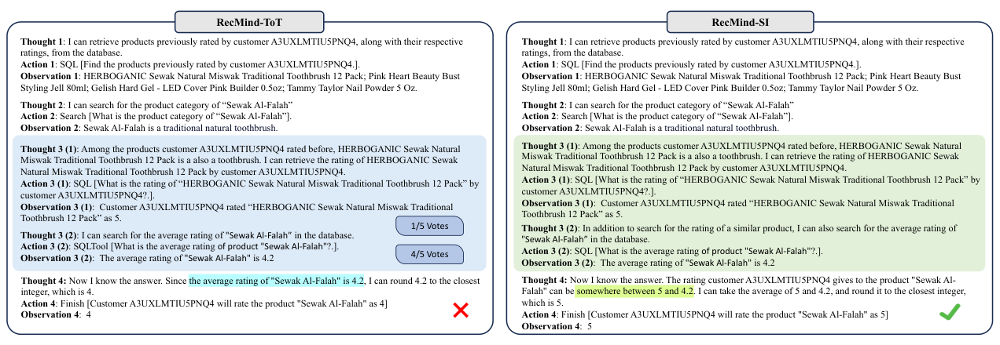
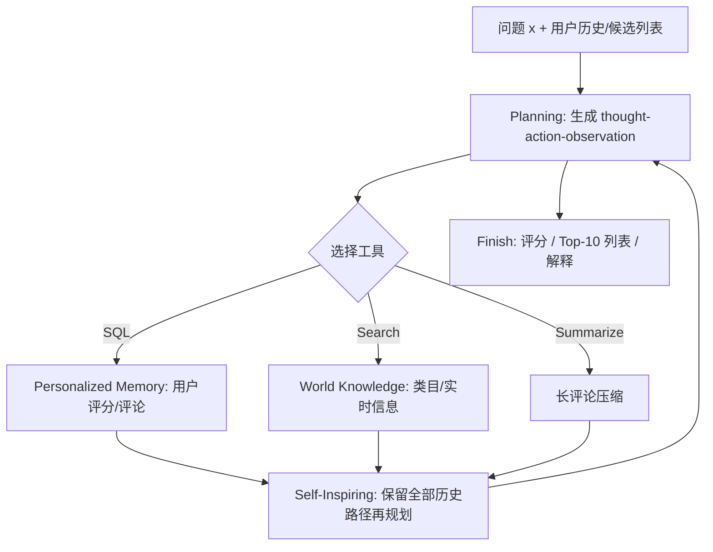

# RecMind: Large Language Model Powered Agent For Recommendation (LLM 驱动的自主推荐智能体)

- **会议/期刊**: NAACL 2024 (Findings)
- **作者与机构**: Yancheng Wang, Ziyan Jiang, Zheng Chen, Fan Yang, Yingxue Zhou, Eunah Cho, Xing Fan, Xiaojiang Huang, Yanbin Lu, Yingzhen Yang（Arizona State University & Amazon Alexa AI）
- **推荐链路定位**: 端到端生成式（Agent 多步推理式推荐，覆盖评分预测 / 序列推荐 / 直接推荐 / 解释生成 / 评论摘要）
- **研究方向**: 对话推荐与智能体仿真 / 大语言模型推荐
- **论文原文**: [https://arxiv.org/abs/2308.14296v3](https://arxiv.org/abs/2308.14296v3)
- **开源代码**: 暂未开源

## TL;DR (1分钟核心速览)

现有推荐模型绑定任务数据微调，既用不上外部世界知识，也换不了任务；纯 prompt 的 ChatGPT 在列表级推荐上近乎失效（Beauty HR@5 仅 0.0228）。本文把推荐形式化为 Agent 的 thought–action–observation 轨迹，用「个性化记忆 + SQL/Search/摘要三工具 + Self-Inspiring 规划（保留全部历史分支而非 ToT 式剪枝回溯）」实现零样本推荐。在 Amazon Beauty/Yelp 上，评分预测 MAE 0.6892 超过全训练 P5（0.8474），直接推荐 HR@5 较最强提示基线提升 24.7%，但仍不及全训练 ENMF。

## Background & Motivation (背景与核心矛盾)

- **主流范式**: DNN/预训练语言模型（P5 等）在任务特定数据上微调，把用户-物品交互、评论、元数据序列化后统一生成；LLM 路线则以 prompt 直接做 zero/few-shot 预测。
- **前人局限**: ① 模型规模与数据量受限，无法吸收物品文本知识与**实时外部信息**；② 单任务微调难以泛化到未见任务/领域，P5 在域迁移中明显过拟合。
- **核心洞察 (Key Insight)**: 推荐本质是"检索—聚合—推理"的多步过程，而 ToT 一旦评判失败就丢弃中间状态；被剪枝的分支（如"该商品属于牙刷类目""该用户曾给同类牙刷打 5 分"）其实对最终决策有用，应全部保留。
- **本文切入点**: 用 LLM 作控制器，把规划、记忆、工具三件套拼成通用推荐 Agent，并提出 Self-Inspiring 规划替代 CoT/ToT。

<figure class="paper-figure" markdown="span">
  <figcaption>图1：RecMind-ToT（左）与RecMind-SI（右）的评分预测对比。在第2步搜索该物品的产品类别后，RecMind-ToT首先生成思路3（1）以检索相似物品的评分。经基于投票的评估器评估后，RecMind-ToT剪除选项3（1），并提出另一条思路3（2）以检索该物品的平均评分，然后仅基于该评分进行预测。相比之下，尽管RecMind-SI在第3步提出了相同的备选选项，但它同时考虑了来自两者的思路、动作和观察</figcaption>
</figure>

## Method (核心方法设计)

### 1. 整体框架 (Overall Architecture)

问题 $x$与个性化上下文进入 RecMind：LLM（gpt-3.5-turbo-16k）作为推理内核，Planning 模块把任务拆成可管理的子目标，每步产出一个状态$s_t=(h_t,a_t,o_t)$（思考-动作-观察）；动作触发三类工具——Database Tool 把自然语言问题译为 SQL 查询 MySQL 中的用户历史评分/评论与物品元数据（个性化记忆 + 域内知识），Search Tool 抓取实时外部知识（如商品类目），Summarization Tool 汇总长评论；观察结果回填给 LLM 继续规划，直至输出 "Finish" 动作给出评分/推荐列表/解释文本。全过程零参数更新，仅在 prompt 中组装工具返回的结构化事实。

### 2. 关键设计拆解 (Key Designs)

1. **Self-Inspiring 规划（保留全历史状态，不做回溯剪枝）**：CoT 只沿单路径采样 $s_{t+1}\sim p_\theta(\cdot|x,s_1,...,s_t)$；ToT-DFS 剪枝后回溯，最终只用一条路径$z^{(n)}$，被丢弃状态的信息永久丢失。SI 在第$m$条路径第$t$步让模型同时看见此前所有路径：$s^{(m)}_{t+1}\sim p_\theta\big(\cdot\,\big|x,z^{(1)},...,z^{(m)}\big)$，最终$y\sim p_\theta(x,z^{(1)},...,z^{(n)})$。直觉：推荐需要同时兼顾"同类物品偏好"与"物品全局口碑"，多视角并置比单点最优更能压低方差；且因无需重放回溯，实测推理时间反低于 ToT。

2. **记忆分层 + 工具化知识访问**：把"模型权重里没有的知识"显式拆为 Personalized Memory（用户评分/评论，SQL 可查）与 World Knowledge（物品元数据 + 搜索引擎）。这使评分预测退化为"查同类评分 + 查全局均分 + 取整聚合"的可解释算术，而非隐式拟合，直接解释了其在稀疏打分上的优势与 P5 过拟合的对照。

3. **训练目标、负采样与推理效率**：本文**无训练目标、无损失函数、无负采样**（完全 in-context）；仅 Direct Recommendation 评测时由外部构造 1 正 + 99 随机负的候选集。推理开销为每步 1 次 LLM API + 0~1 次工具调用，SI 因保留全部路径使 prompt 随步数线性膨胀，构成主要成本瓶颈。

## Experimental Setup & Evaluation Protocol (实验设置与评估协议)

- **数据集与预处理**（沿用 P5 协议；原文未报告用户/物品规模与过滤细节）：

| 数据集 | 领域 | 覆盖任务 | 核心指标 | 备注 |
| :--- | :---: | :---: | :---: | :--- |
| Amazon Reviews | Beauty / Sports / Toys&Games | 评分预测、序列、直接推荐、解释生成、评论摘要 | RMSE/MAE, HR@5,10, NDCG@5,10, BLEU-n, ROUGE-n | 全量评论入库 MySQL |
| Yelp | 本地生活 | 同上 | 同上 | 域迁移与跨任务泛化验证 |

- **数据划分与防穿越**: 沿用 P5 的划分方式，**原文未明示具体切分比例/时间戳策略**，也未说明是否按时间切分，存在复现歧义。
- **排名评测协议**: Direct Recommendation 为 `Sampled Ranking`（1 正 + 99 随机负，Top-10 输出）；Sequential Recommendation 要求模型给出 Top-10 物品标题，指标为 HR@5,10 / NDCG@5,10，但**是否全库 Full-Ranking 未交代**，实际受 prompt 长度与位置偏置约束，属弱化协议。
- **对比基线与超参**: MF/MLP/AFM（评分）、BPR-MLP/ENMF（直接推荐）、S3-Rec/SASRec（序列）、P5（全量微调专家模型，HF 权重重跑）、ChatGPT zero/few-shot、RecMind-CoT/ToT-BFS/ToT-DFS；骨干为 gpt-3.5-turbo-16k，游戏推理任务用 GPT-4，ToT/SI 每步候选数 $k=5$；**无多次运行标准差与显著性检验**（仅 backbone 消融为 5 次取均值）。

## Key Experimental Results (实验关键数据)

### 1. 主实验对比 (Main Results)

| 方法 (few-shot) | Beauty RMSE↓ | Beauty MAE↓ | Direct HR@5 | Direct NDCG@5 | Seq HR@5 | Yelp MAE↓ | Yelp Direct HR@5 |
| :--- | :---: | :---: | :---: | :---: | :---: | :---: | :---: |
| AFM | 1.1097 | 0.8815 | – | – | – | 1.0019 | – |
| BPR-MLP | – | – | 0.1392 | 0.0848 | – | – | 0.1876 |
| ENMF | – | – | **0.1537** | **0.1124** | – | – | **0.2235** |
| P5 (全量微调) | 1.2982 | 0.8474 | 0.1478 | 0.1003 | **0.0459** | 1.0054 | 0.2105 |
| ChatGPT (few-shot) | 1.1589 | 0.7327 | 0.0228 | 0.0157 | 0.0179 | 1.0016 | 0.0512 |
| RecMind-CoT | 1.1326 | 0.7167 | 0.0682 | 0.0387 | 0.0349 | 0.9794 | 0.1262 |
| RecMind-ToT-BFS | 1.1197 | 0.7059 | 0.0734 | 0.0402 | 0.0387 | 0.9766 | 0.1649 |
| RecMind-ToT-DFS | 1.1205 | 0.7103 | 0.0705 | 0.0407 | 0.0365 | 0.9774 | 0.1601 |
| **RecMind-SI** | **1.0756** | **0.6892** | 0.0915 | 0.0624 | 0.0415 | **0.9698** | 0.1749 |
| Improv. (vs 最强 LLM 基线) | 3.9%↑ | 2.4%↑ | 24.7%↑ | 53.3%↑ | 7.2%↑ | 0.7%↑ | 6.1%↑ |

解释生成（Beauty）：SI 的 BLEU2/ROUGE-1 = 1.3459 / 13.26，优于全训练 P5 的 0.9783 / 17.04（BLEU 更高、ROUGE-1 略低），ChatGPT few-shot 仅 1.1766 / 11.89。

### 2. 消融实验 (Ablation Study)

原文未做"w/o Memory""w/o Tools"的组件消融，其"消融"仅覆盖规划算子、基座模型与迁移设定：

| 消融维度 | 配置 | 结果 | 结论 |
| :--- | :--- | :--- | :--- |
| 规划算子 (Beauty Direct HR@5) | CoT / ToT-BFS / ToT-DFS / **SI** | 0.0682 / 0.0734 / 0.0705 / **0.0915** | SI 相对 ToT-BFS +24.7% |
| 规划算子 (Beauty Seq HR@5) | CoT / ToT-BFS / ToT-DFS / **SI** | 0.0349 / 0.0387 / 0.0365 / **0.0415** | 序列任务增益弱于列表任务 |
| 域迁移 (Beauty→Toys) | P5 / ChatGPT / ToT / **SI** | MAE 0.7932 / 0.7354 / 0.6845 / **0.6779** | 免训练迁移优于重训 |
| 域迁移 (Beauty→Sports) | P5 / ChatGPT / ToT / **SI** | MAE 0.7013 / 0.6895 / 0.6457 / **0.6245** | P5 过拟合最严重 |
| 通用推理 Game of 24 | CoT / ToT / **SI** | 4% / 74% / **80%** | SI 非推荐专用 |
| 通用推理 Mini Crosswords (game-level) | CoT / ToT / **SI** | 1% / 20% / **26%** | 同上 |
| 基座模型 (SI@three domains) | Llama2-70B / text-davinci-003 / GPT-3.5 / GPT-4 | 差异小，Llama2 方差最大 | 框架不绑基座 |

### 3. 关键实验发现 (Key Findings)

1. **增益主要来自"多路径并置"而非 LLM 本身**：在 100 候选的列表级任务上，SI 比 ToT-BFS 高 24.7%（0.0915 vs 0.0734），比 CoT 高 34.2%，机制是保留被剪枝分支后逐步缩小候选、缓解候选列表的位置偏置；但 RecMind 全系仍显著落后全训练 ENMF（0.1537 vs 0.0915，约 −40%），证明 LLM 无法在长上下文中替代精排模型。
2. **工具化的记忆检索才是评分任务的胜负手**：SQL 直接取"同类物品该用户评分 + 物品全局均分"使 Beauty MAE 达 0.6892，优于全训练 P5 的 0.8474（−18.7%）与 ChatGPT few-shot 的 0.7327（−5.9%）；Yelp 上仅领先 ToT 0.7%，说明该优势依赖数据库内是否存在同类目历史，稀疏领域即失效。
3. **知识在 prompt+DB 而非权重，故迁移几乎零成本**：Beauty 的 few-shot 示例直接用于 Toys/Sports，MAE 0.6779/0.6245 全面优于 P5 的 0.7932/0.7013；同时 GPT-3.5 与 GPT-4 差距很小，说明收益上限由工具与规划协议决定，而非基座参数量。

## Highlights & Limitations (亮点、对比与审稿批判)

- **与代表作对比 (vs. Prior Work)**: 对比 P5，本文无需任何训练与任务头，靠外部数据库+搜索即可跨任务；对比 ChatGPT 提示式推荐（Liu et al.），用工具获取事实而非把交互塞进上下文；对比 ToT，SI 不剪枝回溯，信息不丢失且推理调用更少。
- **可迁移亮点**: ①"全历史路径回灌"这一 planning trick 可直接用于 LLM 重排/多轮澄清；②把评分预测显式拆成"同类偏好 + 全局均分 + 聚合"的可审计推理链，解释性与可调试性远优于黑箱打分。
- **审稿级局限批判**: ①**评测协议偏弱**——直接推荐仅 100 候选（1:99 采样）而非全库排序，序列推荐候选集未交代，单次运行无显著性检验，与 P5 的比较依赖重新加载的 HF 权重，公平性存疑；②**成本与位置偏置未被解决**——每样本多轮 API 调用 + 全路径入 prompt 使上下文线性膨胀，作者自认长上下文/位置偏置为主要瓶颈，却未给"路径摘要压缩"的定量结果，也缺失 memory/tools 组件的严格消融，复现性与线上可用性均受限。

## Rating (四维评分)

- **方法创新性 (Novelty)**: ⭐⭐⭐ （Self-Inspiring 是对 ToT 剪枝策略的合理但经验性修补，缺理论/复杂度分析；记忆与工具组合属 Agent 工程整合）
- **评估协议与实验扎实度 (Protocol & Experiments)**: ⭐⭐ （100 候选采样排序、划分方式与显著性检验缺失，无记忆/工具组件消融，仅 5 任务 2 数据集）
- **写作与数学规范度 (Clarity & Rigor)**: ⭐⭐⭐⭐ （CoT/ToT/SI 的路径公式与 Algorithm 1 表述清晰，ToT 与 SI 的状态演化对比直观，工具 prompt 详列附录）
- **工业落地与复现价值 (Industrial & Practical Value)**: ⭐⭐ （无开源、依赖闭源 API 与自建 MySQL，单请求多轮调用延迟不适合线上精排，更适合解释生成与冷启动兜底）

