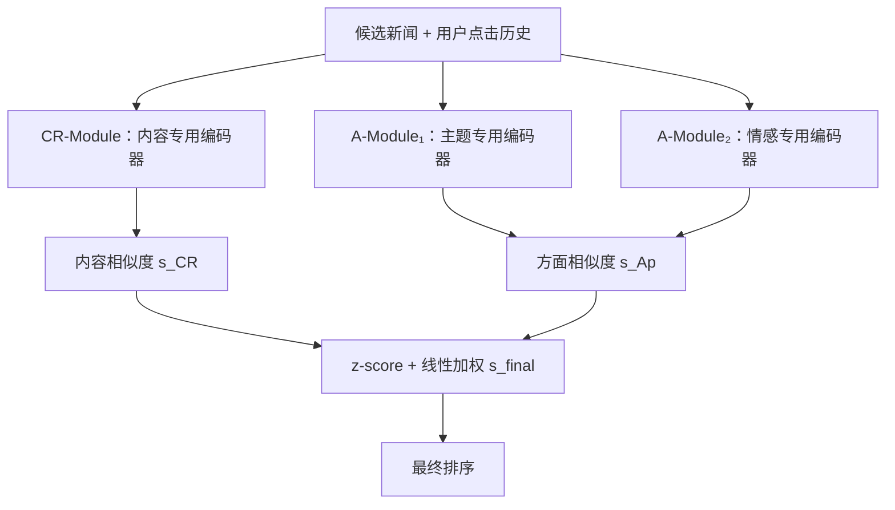
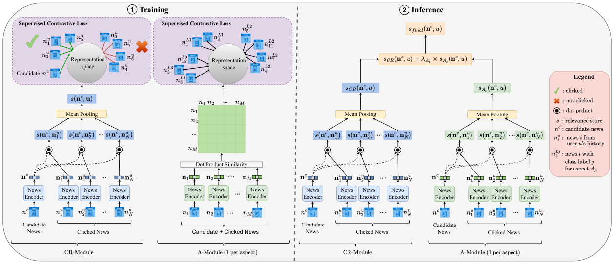

# Train Once, Use Flexibly: A Modular Framework for Multi-Aspect Neural News Recommendation (一次训练、灵活多用：多面神经新闻推荐模块化框架)

- **会议/期刊**: EMNLP 2024
- **作者与机构**: Andreea Iana, Goran Glavaš, Heiko Paulheim（曼海姆大学、维尔茨堡大学）
- **推荐链路定位**: 排序（打分）
- **研究方向**: 协同过滤与双塔召回 / 自监督对比学习与交互去噪
- **论文原文**: [https://arxiv.org/abs/2307.16089v3](https://arxiv.org/abs/2307.16089v3)
- **开源代码**: 暂未开源

## TL;DR (1分钟核心速览)

现有神经新闻推荐器把主题、情感等“方面”约束硬编码进网络或损失，换一种个性化/多样化目标就得重训。MANNeR 以监督对比学习为骨干，为内容及每个方面分别训练专用新闻编码器，推理时用线性加权组合各模块相似度分数，正/负权重即时切换个性化与多样化。在 MIND 与 Adressa 上，内容个性化 nDCG@10 相对最佳基线提升 2.3%，且无需重训即可获得更优的方面定制折中。

## Background & Motivation (背景与核心矛盾)

- **主流范式**: 神经内容推荐器用 PLM 编码新闻、用户编码器聚合点击历史，以分类损失+负采样训练，按候选-用户相似度排序。
- **前人局限**: ①方面信息（主题、情感、媒体）多以额外输入或辅助任务注入，模型与某一固定推荐目标绑定；②个性化与多样化目标相互冲突，却无法在推理时为不同用户或场景调整权衡。
- **核心洞察 (Key Insight)**: 若把“内容相关性”和“方面相似性”解耦到不同表征空间，则二者分数可线性组合；正权重强化方面个性化，负权重即可实现方面多样化。
- **本文切入点**: 用度量学习为每个方面独立微调一个 PLM 新闻编码器，推理时仅组合点积分数，实现“一次训练、灵活多用”。

## Method (核心方法设计)

### 1. 整体框架 (Overall Architecture)

MANNeR 由内容模块 CR-Module 与若干方面模块 A-Module 组成。每个模块含一个共享 PLM 初始化的双塔式新闻编码器（文本 [CLS]+实体注意力向量拼接），但各自用监督对比损失独立微调。训练阶段，CR-Module 以用户点击新闻为正、未点击为负（每正采 4 负）；每个 A-Module 以同方面类别新闻为正、异类新闻为负。推理阶段，候选新闻与用户历史点击分别经各模块编码，点积得模块相似度，z-score 归一化后线性加权为最终排序分数；新方面只需增训一个 A-Module，无需改动其他模块。

<figure class="paper-figure" markdown="span">
  <figcaption>图 1：MANNeR 框架示意图。1⃝ 我们使用基于度量的对比学习训练面向特定方面的 NEs（即用于基于内容的个性化的 CR-Module、用于基于方面相似性的 A-Module）。2⃝ 推理：我们将候选新闻与点击新闻之间特定方面的相似度分数线性聚合，用于最终排序。</figcaption>
</figure>

### 2. 关键设计拆解 (Key Designs)

1. **方面专用表征的监督对比学习**：针对“硬编码方面约束导致无法复用”的痛点，对每个方面独立优化 SCL，将同类方面新闻拉近、异类推远：
   $\mathcal{L}=-\sum_{i=1}^{N}\frac{1}{N_{y_i}-1}\sum_{j\in[1,N],i\neq j,y_i=y_j}\log\frac{e^{\boldsymbol{n}_i\cdot\boldsymbol{n}_j/\tau}}{\sum_{k\in[1,N],i\neq k}e^{\boldsymbol{n}_i\cdot\boldsymbol{n}_k/\tau}}$其中$\boldsymbol{n}_i$为新闻向量，$y_i$为方面类标，$\tau$ 为温度。这样编码器只学“方面相似性”，不依赖用户偏好标签，因此可跨用户、跨场景复用。

2. **线性可组合打分与正负权重定制**：针对“换目标就要重训”的痛点，推理分数定义为
   $s_{\text{final}}(n_c,u)=s_{\text{CR}}+\sum_{A_p\in\mathcal{A}}\lambda_{A_p}s_{A_p}$各模块分数先按用户 z-score 归一化以消除尺度差异。$\lambda_{A_p}=0$退化为标准内容个性化；$\lambda_{A_p}>0$强化方面个性化；$\lambda_{A_p}<0$ 则内容个性化与方面多样化同时发生。线性结构使任意多面组合无需额外训练，物理直觉是“内容相关性”与“方面一致性”近似可加。

3. **训练目标、负采样与推理效率**：总损失为各模块 SCL 之和，模块间独立训练。CR-Module 采用批内负采样（1 正:4 负），A-Module 每类采 20 条构造类内正对与类间负对；不使用额外硬负采样。推理时以无参数均值池化替代参数化用户编码器，仅计算候选与历史点击的点积，A-Module 每 epoch 训练比 CR-Module 快 204–277 倍，适合模块并行部署。

## Experimental Setup & Evaluation Protocol (实验设置与评估协议)

- **数据集与预处理**:

| 数据集 | #Users | #Items | #Interactions | 稀疏度/密度 | 特征/场景说明 |
| :--- | :---: | :---: | :---: | :---: | :--- |
| MIND large | 约1.0M | 约161k | 约24M | 极稀疏 | 英文新闻，含标题、摘要、实体、主题；用曝光日志 |
| Adressa-1week | 见原文Table 4 | 约16k | 数百万 | 极稀疏 | 挪威语新闻，仅标题可用；无实体链接，主题+情感 |

- **数据划分与防穿越 (Splitting Strategy)**: MIND 按时间切分：前4天训练、第5天验证、原验证集作测试（测试标签未公开）；Adressa 前5天构建用户历史，第6天训练，最后1天随机20%作验证、其余测试，严格时间切分。
- **排名评测协议 (Ranking Protocol)**: MIND 在曝光候选（点击+未点击）上排序；Adressa 每点击随机采20个负样本构造曝光，属于 `Sampled Ranking`（正负比约1:20），非全库排序。指标为 AUC、MRR、nDCG@5/10；方面多样性 $D_{A_p}@k$用归一化熵，方面个性化$PS_{A_p}@k$用广义 Jaccard，权衡指标$T$取 nDCG 与$D$或$PS$ 的调和平均。
- **对比基线与超参设置**: 对比 NRMS、MINER、NAML、LSTUR、MINS、CAUM、TANR、SentiRec、SentiDebias，均替换为同一 PLM 编码器以公平比较；MANNeR 用 RoBERTa Base（MIND）/NB-BERT Base（Adressa），历史长度50，5个随机种子取均值±标准差，未报告显著性 $p$ 值。

## Key Experimental Results (实验关键数据)

### 1. 主实验对比 (Main Results)

MIND 内容个性化（CR-Module，$\lambda=0$）结果如下：

| 模型 | AUC | MRR | nDCG@5 | nDCG@10 |
| :--- | :---: | :---: | :---: | :---: |
| NRMS-PLM | 63.0 | 35.5 | 33.4 | 39.9 |
| NAML-PLM | 60.6 | 37.6 | 35.9 | 42.2 |
| LSTUR-PLM | 54.6 | 33.3 | 31.7 | 38.3 |
| MINS-PLM | 61.3 | 36.2 | 34.5 | 40.8 |
| CAUM-PLM | 66.4 | 36.2 | 34.3 | 40.8 |
| TANR-PLM | 63.3 | 37.0 | 35.2 | 41.6 |
| SentiRec-PLM | 62.2 | 35.7 | 33.9 | 40.5 |
| **MANNeR (CR-Module)** | **69.7** | **38.6** | **37.0** | **43.2** |
| **Improv.%** | **+5.4** | **+2.8** | **+3.1** | **+2.3** |

单方面定制中，$\lambda_{\text{ctg}}=-0.2$时 MIND 的$T_{\text{ctg}}@10=46.2$（TANR 为45.0）；$\lambda_{\text{snt}}=-0.3$时$T_{\text{snt}}@10=52.7$（SentiDebias 为43.8）。多面多样化最佳$T_{\text{all}}@10=51.7$，超过所有基线。

### 2. 消融实验 (Ablation Study)

基于 MIND 的模块开关/权重消融（$\lambda<0$为多样化，$\lambda>0$ 为个性化）：

| 配置 | nDCG@10 | $D_{\text{ctg}}@10$|$D_{\text{snt}}@10$|$T_{\text{ctg}}@10$|$T_{\text{snt}}@10$|$T_{\text{all}}@10$ |
| :--- | :---: | :---: | :---: | :---: | :---: | :---: |
| CR only | 43.2 | 49.3 | 65.4 | 46.0 | 52.0 | 51.1 |
| + ctg A-Module ($\lambda=-0.2$) | 42.0 | **51.5** | 65.6 | **46.2** | 51.2 | 51.3 |
| + snt A-Module ($\lambda=-0.3$) | 42.8 | 49.8 | **68.7** | 46.0 | **52.7** | **51.7** |

### 3. 关键实验发现 (Key Findings)

- **均值池化足以胜任内容个性化**：仅用 CR-Module（无参数用户编码器）即在 MIND 上比 CAUM 的 nDCG@10 高 2.4 个点，说明复杂用户编码器并非新闻推荐的必要条件，双塔点积+SCL 已能充分建模内容兴趣。
- **负权重实现“零重训”多样化**：$\lambda_{\text{snt}}=-0.3$将情感多样性从 65.4 提至 68.7，同时$T_{\text{snt}}$ 从 52.0 升至 52.7；而内容 nDCG 仅从 43.2 降至 42.8，证明线性负权重能以极小内容代价换取方面多样性。
- **方面模块可跨语言迁移**：在 Adressa（挪威语）上训练的 A-Module 迁至 MIND（英语）后，情感定制性能接近全英文训练；A-Module 每 epoch 训练速度比 CR-Module 快 204–277 倍，支持低资源语言快速扩展方面。

## Highlights & Limitations (亮点、对比与审稿批判)

- **与代表作对比 (vs. Prior Work)**: 与 NRMS/NAML 等将方面作为输入或辅助任务不同，MANNeR 把方面从“训练约束”变为“推理插件”；与 SentiRec/SentiDebias 的固定多样化目标相比，MANNeR 用正负 $\lambda$ 在同一模型内连续调节个性化-多样化折中，无需为每种目标重训。
- **可迁移亮点**: ①“模块化对比学习+推理线性组合”可迁移到多目标重排或跨域推荐，把域/行为目标拆成独立打分器；②负权重作为“反向检索”信号，可用于多样性约束或去偏。
- **审稿级局限批判**: ①仅用文本特征，未利用图像/视频或协同过滤信号，新闻场景外的多模态扩展未验证；②每个模块全参微调一个 PLM，内存开销随方面数线性增长，虽可换 LoRA 但未实验；③Adressa 采用1:20采样排序，可能高估简单负例下的收益，且 MIND 以验证集作测试，缺少全库排序与线上 A/B 证据。

## Rating (四维评分)

- **方法创新性 (Novelty)**: ⭐⭐⭐⭐ （模块化方面编码器+推理时线性组合的思路新颖，负 $\lambda$ 实现多样化的设计简洁有效；但核心仍是对比学习与线性打分，理论深度有限）
- **评估协议与实验扎实度 (Protocol & Experiments)**: ⭐⭐⭐⭐ （两个数据集、多指标、5次重复并报告标准差，定制实验较全面；但采样排序、MIND验证作测试及缺少显著性检验削弱说服力）
- **写作与数学规范度 (Clarity & Rigor)**: ⭐⭐⭐⭐ （框架图与公式清晰，SCL、打分、多样性/个性化指标定义完整；复杂度与训练细节充分）
- **工业落地与复现价值 (Industrial & Practical Value)**: ⭐⭐⭐⭐ （模块可插拔、A-Module训练高效、推理可并行，适合多目标新闻场景；但多PLM显存开销大且暂未开源）

