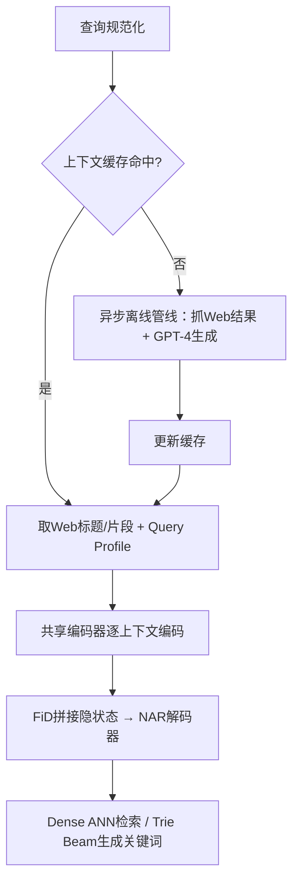
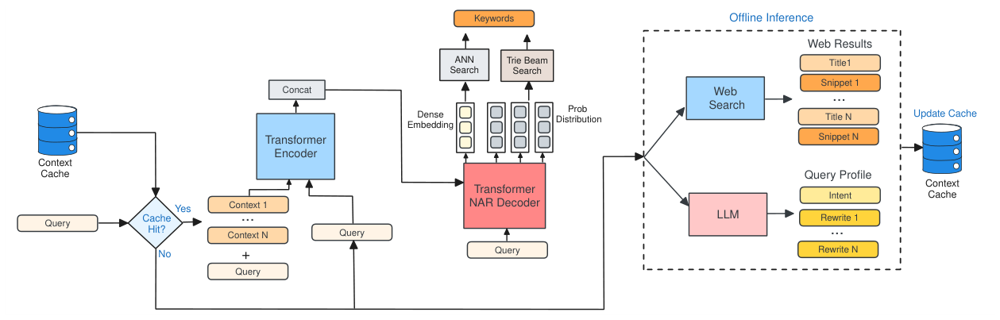

# Improving Retrieval in Sponsored Search by Leveraging Query Context Signals (利用查询上下文信号提升赞助搜索召回)

- **会议/期刊**: EMNLP 2024 Industry Track
- **作者与机构**: Akash Kumar Mohankumar, Gururaj K, Gagan Madan, Amit Singh; Microsoft India
- **推荐链路定位**: 召回（赞助搜索 bid keyword retrieval）
- **研究方向**: CTR/CVR预估与特征交叉 / LLM4Rec
- **论文原文**: [论文原文链接](https://arxiv.org/abs/2407.14346v2)
- **开源代码**: 暂未开源

## TL;DR (1分钟核心速览)

赞助搜索中短查询、歧义查询（如“ad623armz reel”）常因浅层双塔/生成式检索缺乏世界知识而召回错误关键词。本文提出 Augmented Unity：用 Web 搜索结果标题/片段与 GPT-4 生成的 Query Profile 作为上下文，经 Fusion-in-Decoder 同时增强 dense 与 NAR 生成式检索，并用 context glancing 课程学习保证无上下文时鲁棒。在 1B 关键词候选库、P@100/200 与 GPT-4 judge 协议下，DR exact P@100 相对 Unity 提升 20.4%；在线 A/B 英文/非英文收入分别 +1.00%/+1.44%。

## Background & Motivation (背景与核心矛盾)

- **主流范式**: 赞助搜索关键词召回主要采用双塔 dense retrieval、非自回归生成式检索，以及统一二者的 Unity 框架。
- **前人局限**: 短歧义查询需要世界知识，但在线延迟约束只能使用浅层 Transformer；仅靠查询本身无法消解专有名词与多义词。另一方面，引入外部上下文又会推高在线服务成本，且缓存未命中时模型可能退化。
- **核心洞察 (Key Insight)**: Web 搜索结果可将查询锚定到现实实体，GPT-4 生成的改写与意图解释可显式消歧；这些信号可预计算缓存，并通过 FiD 低成本融合。
- **本文切入点**: 以“缓存上下文 + FiD 融合 + context glancing”替代单纯扩大模型或词表。

## Method (核心方法设计)

### 1. 整体框架 (Overall Architecture)

查询先做拼写纠正等规范化，再查上下文缓存（约 70% 请求命中）。未命中时触发异步离线管线：抓取该查询 top-10 Web 结果的标题与片段，并调用 GPT-4 生成多条改写与一条意图解释，写回缓存。Augmented Unity 使用共享编码器分别编码查询与每个上下文，FiD 拼接所有隐状态后送入非自回归解码器；解码器以原查询为输入，同时输出 dense 向量与词表概率分布。推理时，dense 分支走 ANN 检索，NLG 分支用 Trie 约束 beam search 生成关键词。训练联合对比损失与 NLL 损失。

<figure class="paper-figure" markdown="span">
  <figcaption>图1：面向上下文感知检索的 Augmented Unity 架构概览。系统利用上下文缓存存储并检索预计算的查询上下文信号，并对缓存未命中采用离线流水线。Augmented Unity 模型采用 Fusion-in-Decoder 方法，有效组合查询表示</figcaption>
</figure>

### 2. 关键设计拆解 (Key Designs)

1. **FiD 上下文融合（Augmented Unity）**：痛点在于若把 N 个上下文与查询直接拼接编码，注意力复杂度为 $O(N^2L_{\max}^2)$。本文将查询与各上下文独立编码后拼接$\tilde{\mathbf{H}}=[\mathbf{H}_0,\ldots,\mathbf{H}_n]\in\mathbb{R}^{l\times d}$，再由 NAR 解码器交叉注意，复杂度降为$O(NL_{\max}^2)$；dense 向量与 token 概率分别为$e(Q)=\mathrm{Attention}(\tilde{\mathbf{g}},\mathbf{G}\mathbf{W}_K,\mathbf{G}\mathbf{W}_V)$、$P(k_t|Q)=\mathrm{Softmax}(\mathbf{W}_O\mathbf{g}_t)$。直觉是“先分编码、后融合”，以近似线性成本吃下 13 倍上下文 token。
2. **Context Glancing 课程学习**：模型易过度依赖上下文，缓存未命中时 Phrase P@100 可从 19.80 掉到 14.36。训练前 3 epoch 使用全上下文，随后将随机丢弃率 $d_{\text{rand}}$、整类丢弃率$d_{\text{web}},d_{\text{qp}}$与全丢弃率$d_{\text{all}}$ 线性升至 10%，让模型逐步适应部分缺失与完全缺失上下文。
3. **训练目标、负采样与推理效率**：DR 使用 in-batch negatives 的对比损失，NLG 使用逐 token NLL，总目标为 $\mathcal{L}=-\frac{1}{|\mathcal{B}|}(\mathcal{L}_N+\lambda\mathcal{L}_D)$，其中$\mathcal{L}_D=\sum_{Q,K\in\mathcal{B}}\log\frac{\exp(\mathrm{Sim}(Q,K))}{\sum_{K'\in\mathcal{B}}\exp(\mathrm{Sim}(Q,K'))}$，$\lambda=1$。推理无需自回归解码，GPU 成本仅比 Unity 高 7–9%。

## Experimental Setup & Evaluation Protocol (实验设置与评估协议)

- **数据集与预处理**: 训练集来自某商用搜索引擎日志，覆盖 40 种语言；关键词为 exact/phrase/smart match 变体。测试集 1M 查询，候选库为从全量 bid keyword 中抽样的 1B 关键词。

| 数据集/语料 | #Queries | #Keywords | #Query-Keyword Pairs | 稀疏度/密度 | 特征/场景说明 |
| :--- | :---: | :---: | :---: | :---: | :--- |
| 训练集 | 60M | 240M | 900M | ~15 对/查询 | 40 语言，exact/phrase/smart |
| 测试集 | 1M | 1B（候选库） | — | 极稀疏 | 跨语言采样，大规模召回 |
| 上下文缓存 | ~70% 请求命中 | top-10 Web/查询 | — | — | Web 标题/片段 + GPT-4 Profile |

- **数据划分与防穿越 (Splitting Strategy)**: 从搜索日志构建训练/测试查询，原文未明确全局时间戳切分；测试查询按语言采样，候选库独立抽样，需注意潜在分布漂移。
- **排名评测协议 (Ranking Protocol)**: 在 1B 关键词候选库上做大规模检索并计算 P@100/P@200，属于“近似 Full-Ranking”而非采样负例排序；训练 DR 使用 in-batch negatives，NLG 使用 NLL。离线相关性由 GPT-4 标注蒸馏出的学生模型判定 exact/phrase/smart match 质量。
- **对比基线与超参设置**: NLG 基线 CLOVERv2、Unity NLG、PIXAR；DR 基线 NGAME、SimCSE、Unity DR。模型为 4 层编码器 + 4 层 NAR 解码器，hidden $d=512$，dense 维度$d'=128$，XLM-R 250k 词表，batch 16384，lr$5\times10^{-5}$；在线 A/B 以$p<0.01$ 标注显著。

## Key Experimental Results (实验关键数据)

### 1. 主实验对比 (Main Results)

| 模型 | 类型 | Exact P@100 | Phrase P@100 | Smart P@100 | GPU Cost |
| :--- | :---: | :---: | :---: | :---: | :---: |
| CLOVERv2 | NLG | 6.78 | 16.58 | 31.83 | 1.17x |
| Unity NLG | NLG | 7.00 | 16.93 | 32.69 | 1.17x |
| PIXAR | NLG | 7.50 | 18.12 | 34.87 | 1.41x |
| **Aug Unity NLG** | NLG | **8.43** | **19.06** | **36.88** | 1.26x |
| NGAME | DR | 9.66 | 16.21 | 42.86 | 1.00x |
| SimCSE | DR | 9.70 | 16.50 | 43.88 | 1.00x |
| Unity DR | DR | 10.58 | 18.34 | 48.29 | 1.00x |
| **Aug Unity DR** | DR | **12.74** | **20.86** | **52.05** | 1.09x |
| **Improv.% (NLG vs PIXAR)** | — | +12.4% | +5.2% | +5.8% | — |
| **Improv.% (DR vs Unity)** | — | +20.4% | +13.7% | +7.8% | — |

### 2. 消融实验 (Ablation Study)

| 消融配置 | Exact P@100 | Phrase P@100 | Smart P@100 |
| :--- | :---: | :---: | :---: |
| Full Aug Unity DR | **12.74** | **20.86** | **52.05** |
| 移除全部上下文 | 10.45 | 17.35 | 45.70 |
| 仅 Web（去 QProfile） | 11.63 | 19.18 | 49.70 |
| 仅 QProfile（去 Web） | 12.17 | 20.15 | 49.96 |
| 去 Context Glancing（无上下文/全上下文） | — | 14.36 / 19.80 | — |

### 3. 关键实验发现 (Key Findings)

1. **上下文信号互补且意图解释最有效**：All(13) 相比仅 Web 在 Exact/Phrase/Smart 上分别 +1.11/+1.68/+2.35；单用 QProfile Intent 即把 Exact 从 10.45 提到 12.07，说明 GPT-4 的意图说明直接帮助消歧。
2. **Context Glancing 同时提升鲁棒性与全上下文性能**：无上下文时 Phrase P@100 从 14.36 提至 17.35（+20.8%），全上下文时从 19.80 提至 20.86（+5.3%），避免缓存未命中时大幅退化。
3. **在线收益集中于长尾与低资源语言**：英文/非英文收入 +1.00%/+1.44%，点击 +0.33%/+0.72%，QBR 与 defect 无显著恶化；低资源语言 Maltese/Icelandic 的 Phrase P@100 相对提升 44.1%/41.8%，上下文可部分弥补训练数据不足。

## Highlights & Limitations (亮点、对比与审稿批判)

- **与代表作对比 (vs. Prior Work)**: Unity 统一 DR/NLG 但仍是无上下文模型，本文 DR Exact P@100 相对其 +20.4%；PIXAR 靠扩大词表提升生成式检索，本文靠补上下文，NLG Exact +12.4% 且 GPU 成本 1.26x 低于 PIXAR 的 1.41x，两者可互补；NGAME/SimCSE 仅优化双塔对比学习，缺乏世界知识。
- **可迁移亮点**: FiD“逐上下文编码再融合”适合任何多源特征/证据注入场景；context glancing 可用于缓存、用户画像等可选信号缺失时的鲁棒训练；异步缓存 + 离线 LLM 生成可规避在线大模型延迟。
- **审稿级局限批判**: 约 30% 请求缓存未命中，新查询首访需异步生成，无法即时受益；Web 结果可能引入位置偏差与片段噪声（原文表 10 出现 UK 地域偏置、snippet 误引“income”），且上下文数量超过 4 后性能反降，需调参。离线评估依赖 GPT-4 蒸馏判官而非人工标注，且未报告离线显著性检验，结论需结合在线 A/B 解读。

## Rating (四维评分)

- **方法创新性 (Novelty)**: ⭐⭐⭐⭐ （FiD 融合缓存上下文与 context glancing 组合新颖，但单点组件并非全新）
- **评估协议与实验扎实度 (Protocol & Experiments)**: ⭐⭐⭐⭐ （1B 候选库、GPT-4 judge、在线 A/B 较完整，但候选库为抽样且缺离线显著性检验）
- **写作与数学规范度 (Clarity & Rigor)**: ⭐⭐⭐⭐ （架构与公式简洁清晰，复杂度分析到位，部分实现细节置于附录）
- **工业落地与复现价值 (Industrial & Practical Value)**: ⭐⭐⭐⭐⭐ （真实引擎 160+ 国家在线 A/B，GPU 成本仅增 7–9%，缓存方案可直接工程化）

