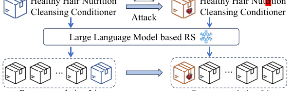
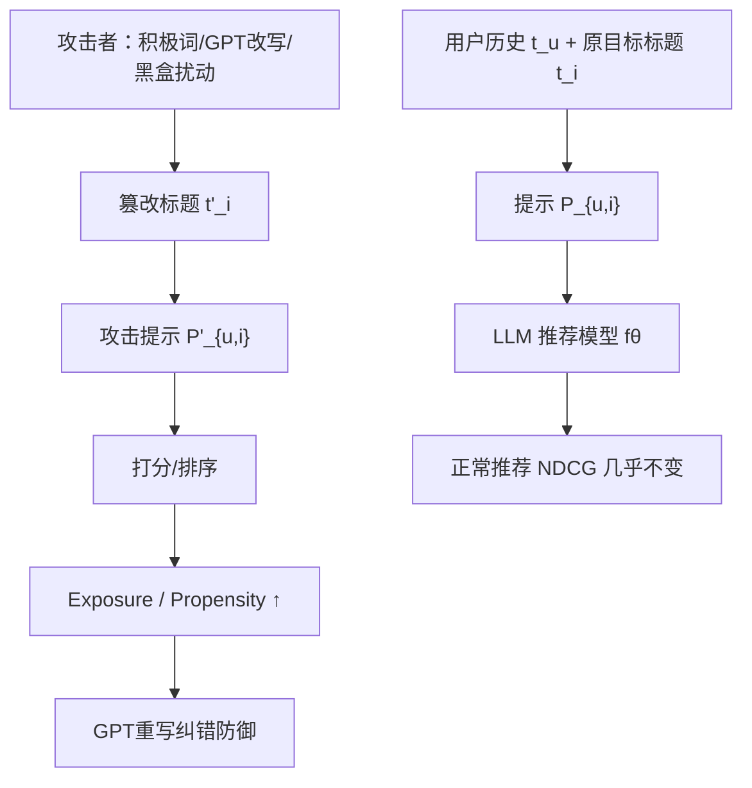

# Stealthy Attack on Large Language Model based Recommendation（面向大语言模型推荐的隐蔽文本攻击）

- **会议/期刊**: ACL 2024 (Main)
- **作者与机构**: Jinghao Zhang 等；中科院自动化所 NLPR/MAIS、国科大、东北大学
- **推荐链路定位**: 排序/重排（LLM-based 推荐打分）
- **研究方向**: 可信隐私与工业架构 / 大语言模型推荐
- **论文原文**: [arXiv:2402.14836](https://arxiv.org/abs/2402.14836v2)
- **开源代码**: [RecFormer（受害者模型；攻击代码称将开源）](https://github.com/AaronHeee/RecFormer)

## TL;DR (1分钟核心速览)

LLM推荐高度依赖物品标题文本，现有安全评测却沿用注入假用户的 shilling attack。本文提出测试期仅篡改标题的文本攻击：不改训练、只改 $t_i$，用积极词插入、GPT改写及黑盒文本扰动提升目标曝光。RecFormer 全库 Top-50 下 TextFooler 在 Beauty 将曝光从 0.00458 提至 0.02844（+520.4%），而 NDCG@10 仅 0.01258→0.01224，整体性能与语义相似度基本不变，暴露 LLM 推荐的新攻击面。

## Background & Motivation (背景与核心矛盾)

- **主流范式**: LLM4Rec 将用户历史与目标物品标题拼成 prompt，由 LLM 打分/排序；RecFormer、P5、TALLRec、CoLLM 均属此范式。
- **前人局限**: 传统 shilling attack 需注入假用户污染训练，影响整体指标、易被平台检测；而 LLM 推荐对文本语义高度敏感，却缺少测试期内容篡改的威胁模型。
- **核心洞察 (Key Insight)**: 仅微调标题中 1–5 个词即可大幅改变目标物品的匹配分数，而全局排序几乎不变，因此攻击可同时“有效”且“隐蔽”。
- **本文切入点**: 提出模型无关的 test-time text attack，并从有效性、隐蔽性、迁移性、防御四维评估。

<figure class="paper-figure" markdown="span">
  <figcaption>图1：所提出的针对基于LLM的RS模型的文本攻击范式。恶意攻击者修改目标物品的标题，以误导RS模型将其排名提高。该攻击高度隐蔽，因为修改细微且整体推荐性能几乎不变。</figcaption>
</figure>
*图1：LLM推荐上的测试期标题文本攻击范式：攻击者只改目标物品标题，使排序提升且整体推荐几乎不变。*

## Method (核心方法设计)

### 1. 整体框架 (Overall Architecture)

输入用户历史标题序列 $t_u$与目标标题$t_i$，拼成提示$P_{u,i}=[t_u,t_i,x_u,x_i]$；攻击者替换为$P'_{u,i}=[t_u,t'_i,x_u,x_i]$，经受害模型得到$\hat{y}_{u,i}=f_\theta(P)$。RecFormer 可全库排序，其余模型输出交互概率。攻击不训练、不注入假用户，直接优化目标物品标题，以曝光率或购买倾向衡量提升；同时用 NDCG@10、余弦相似度、ROUGE-L、GPT-Neo 困惑度与扰动词数约束隐蔽性。

### 2. 关键设计拆解 (Key Designs)

1. **测试期标题篡改威胁模型**：传统 shilling attack 需假用户数据 $\mathcal{D}_{fake}$参与训练；本文只改$t_i\to t'_i$，不触碰训练集与模型参数。目标函数为$\arg\max_{t'_i}\mathbb{E}_{u\in U'} f_\theta(P'_{u,i})$。由于只影响目标物品、对全局排序扰动小，攻击天然隐蔽。
2. **黑盒文本攻击四件套**：Goal Function 最大化曝光/交互概率；Constraints 用语义余弦与词性约束保持可读；Transformation 采用字符级（DeepwordBug、PuncAttack）或词级替换（TextFooler、BertAttack）；Search 用贪心 WIR。成功率阈值设为曝光 +0.05、P5/TALLRec/CoLLM 交互概率 +0.3/+0.15/+0.15。
3. **双轨评估与 GPT 重写防御**：曝光率 $exp_i=N^i_{rec}/N_u$，购买倾向$p_i=\mathbb{E}_{u\in U}\hat{y}_{ui}$。防御用 GPT-3.5 纠正拼写、语法与可疑替换；对字符级攻击有效，对词级替换有限。

**训练目标、负采样与推理效率**：无训练损失、无负采样；成本为黑盒查询次数。Beauty 上 PuncAttack 72.7、TextFooler 104.1、BertAttack 208.8 次/目标物品；需反复前向受害模型，大规模线上系统难承受。

## Experimental Setup & Evaluation Protocol (实验设置与评估协议)

- **数据集与预处理**: Amazon 5-core，每用户/物品至少 5 次交互；随机选 10% 物品为目标物品。

| 数据集 | #Users | #Items | #Interactions | 密度 | 场景 |
| :--- | :---: | :---: | :---: | :---: | :--- |
| Sports | 35,598 | 18,357 | 256,308 | 0.00039 | Amazon 体育 |
| Beauty | 22,363 | 12,101 | 172,188 | 0.00064 | Amazon 美妆 |
| Toys | 19,412 | 11,924 | 145,004 | 0.00063 | Amazon 玩具 |

- **数据划分与防穿越**: 沿用各受害模型原始训练/测试设置，攻击仅在测试期改标题、不参与训练；论文未二次说明统一划分。
- **排名评测协议**: RecFormer 用无偏 Full-Ranking（全库未交互排序），Exposure@Top-50；P5/TALLRec/CoLLM 无法全排序，用平均交互概率 Propensity（非传统 Sampled Ranking）。
- **对比基线与超参**: 文本攻击含 ChatGPT、Trivial、DeepwordBug、TextFooler、PuncAttack、BertAttack；shilling 含 Random、Bandwagon、Aush、LegUP。Backbone 为 Longformer/LLaMA/T5 等，无统一 Embedding 维度 $d$；未报告显著性检验。

## Key Experimental Results (实验关键数据)

### 1. 主实验对比 (Main Results)

表1：RecFormer-Beauty 主实验（加粗为黑盒攻击最优；Clean 为参考）。

| 方法 | Exposure↑ | Rel. Impro.↑ | #Queries↓ | NDCG@10 | Cos.↑ | ROUGE-L↑ | PPL↓ | #pert.↓ |
| :--- | :---: | :---: | :---: | :---: | :---: | :---: | :---: | :---: |
| Clean | 0.00458 | - | - | 0.01258 | 1.000 | 1.000 | 611.6 | - |
| ChatGPT | 0.00583 | +27.2% | - | 0.01197 | 0.822 | 0.516 | **501.8** | - |
| Trivial | 0.00389 | -15.2% | - | 0.01249 | 0.939 | 0.901 | 1189.5 | - |
| DeepwordBug | 0.02134 | +365.4% | **47.0** | 0.01257 | 0.806 | 0.649 | 2261.5 | 3.7 |
| TextFooler | **0.02844** | **+520.4%** | 104.1 | 0.01224 | 0.816 | 0.640 | **960.9** | 3.7 |
| PuncAttack | 0.01654 | +260.8% | 72.7 | 0.01257 | **0.881** | **0.734** | 1018.3 | **2.8** |
| BertAttack | 0.02705 | +490.0% | 208.8 | 0.01213 | 0.863 | 0.709 | 1764.4 | 3.2 |

Sports/Toys 上 TextFooler 同样最优：Exposure 0.01547/0.02232，相对提升 +448.2%/+408.8%。

### 2. 消融实验 (Ablation Study)

表2：GPT 重写防御前后曝光率（攻击→防御）。

| 攻击 | Sports | Beauty | Toys |
| :--- | :---: | :---: | :---: |
| DeepwordBug | 0.01488→**0.00349** | 0.02134→**0.00587** | 0.01595→**0.00551** |
| PuncAttack | 0.01138→**0.00399** | 0.01654→**0.00601** | 0.01241→**0.00623** |
| TextFooler | 0.01547→0.01510 | 0.02844→0.02012 | 0.02232→0.01867 |
| BertAttack | 0.01371→0.01065 | 0.02705→0.02043 | 0.01384→0.01161 |

### 3. 关键实验发现 (Key Findings)

1. **有效性与隐蔽性可同时成立**：Beauty 上 TextFooler 将 Exposure 从 0.00458 提至 0.02844（+520.4%），而 NDCG@10 仅从 0.01258 降至 0.01224；PuncAttack 的 Cos.=0.881、ROUGE-L=0.734，说明攻击文本仍高度可读。
2. **传统 shilling attack 在 LLM-RS 上近乎失效**：RecFormer-Sports 的 Clean 曝光为 0.00289，TextFooler 达 0.01074，而 Bandwagon/LegUP 仅 0.00299，Aush 为 0.00283；且 shilling 会拉低整体 NDCG，更易暴露。
3. **跨模型有效但依赖骨干与流行度**：P5-Beauty 的 Propensity 从 0.08218 升至 0.25010（+204.3%），TALLRec-Beauty 从 0.0566 升至 0.1724（+204.6%）；高流行度目标提升更大（Beauty-TextFooler 高 0.024 vs 低 0.015），会加剧流行度偏差；微调后的 RecFormer 更鲁棒（Beauty-TextFooler 0.02844→0.01886）。

## Highlights & Limitations (亮点、对比与审稿批判)

- **与代表作对比 (vs. Prior Work)**: 相比 Random/Bandwagon/Aush/LegUP 等 shilling attack，本文无需污染训练、仅测试期改标题；相比 NLP 通用文本攻击（DeepwordBug/TextFooler），本文把目标函数改为推荐曝光/交互概率，并联合评估 NDCG 不变与语义保持。
- **可迁移亮点**: “Exposure/Propensity + 语义相似度 + 全局 NDCG 不变”的三重隐蔽性评估，可直接用于其他生成式/语义推荐的安全红队；GPT 重写对字符级扰动防御成本低、可作为线上兜底。
- **审稿级局限批判**: 黑盒攻击查询成本高（Beauty-BertAttack 208.8 次/项），真实大规模系统难复现；仅研究标题文本，未覆盖图像/视频多模态；防御对 TextFooler/BertAttack 仍有限（0.02844→0.02012），且论文缺少显著性检验与理论保证。

## Rating (四维评分)

- **方法创新性 (Novelty)**: ⭐⭐⭐⭐ （首次系统揭示 LLM-based RS 的测试期标题文本攻击面，威胁模型与隐蔽性指标设计新颖）
- **评估协议与实验扎实度 (Protocol & Experiments)**: ⭐⭐⭐⭐ （覆盖 4 个受害模型、3 个 Amazon 数据集及 MIND，含全排序/倾向双协议、迁移与防御实验；但缺显著性检验）
- **写作与数学规范度 (Clarity & Rigor)**: ⭐⭐⭐⭐ （攻击四件套与目标函数定义清晰，公式简洁；理论分析偏少，偏实证）
- **工业落地与复现价值 (Industrial & Practical Value)**: ⭐⭐⭐ （安全红队价值高、防御可落地；但攻击查询成本高、攻击代码未随文开源，线上部署受限）

