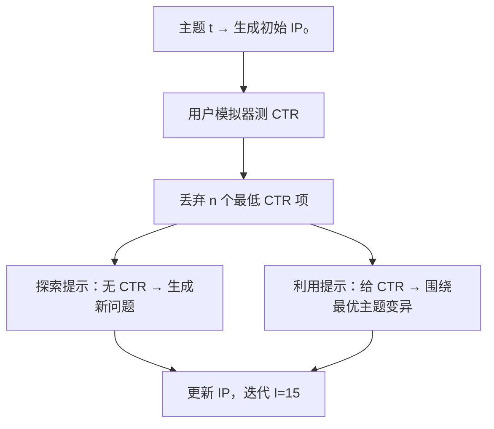
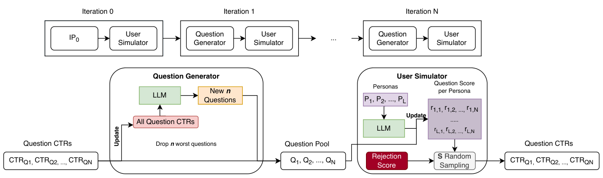

# Generative Explore-Exploit: Training-free Optimization of Generative Recommender Systems using LLM Optimizers (生成式探索-利用：用 LLM 优化器免训练优化生成式推荐系统)

- **会议/期刊**: ACL 2024 Main Proceedings
- **作者与机构**: Lütfi Kerem Senel 等（LMU Munich / Amazon）
- **推荐链路定位**: 端到端生成式（Open-set 内容生成 + CTE 反馈闭环）
- **研究方向**: 生成式推荐与离散语义 ID / 大语言模型推荐 (LLM4Rec)
- **论文原文**: [https://arxiv.org/abs/2406.05255v1](https://arxiv.org/abs/2406.05255v1)
- **开源代码**: 暂未开源

## TL;DR (1分钟核心速览)

传统生成式推荐器在开放集（如提问建议）上无法靠昂贵微调吸收反馈。本文提出**免训练的生成式“探索-利用”框架**：把物品池 CTR 作为 in-context 数据喂给 LLM 优化器，双路生成“探索新话题 + 利用高分形式”的新问题，迭代 15 轮淘汰低 CTR 项。在电商与维基两域的**LLM 用户点击模拟器**（S=5000、K=3、RS=11）下，EXPLORE-EXPLOIT 在全部 Persona 上稳定超越贪心 FULL-CTR，末轮 CTR 相对提升最高达 +28%（Quality 23.4% vs 18.2%），人工评估 88% 偏好末轮问题池。

## Background & Motivation (背景与核心矛盾)

- **主流范式**：LLM 生成式推荐器（Zheng et al. 2023、Li et al. 2023a）直接在开放集上生成物品/文本，但其内容质量改进仍需指令微调。
- **前人局限**：① 持续性微调 LLM 成本极高，无法对海量输入上下文逐条调优；② 检索式/固定物品池范式对演化的目录与多样新用户失效。
- **核心洞察 (Key Insight)**：Yang et al. (2023) 表明 LLM 具备“理解文本与其目标任务表现间关系”的 in-context 优化能力——那么把 CTR 当成文本证据塞进 prompt，LLM 就能在**零梯度**下自我优化生成。
- **本文切入点**：用 CTR 反馈闭环连接 LLM 优化器，并显式引入**探索相（explore）**打破贪心利用的偏好锁死。

## Method (核心方法设计)

### 1. 整体框架 (Overall Architecture)

给定主题 $t$，LLM 先生成初始物品池$\mathrm{IP}_0$（5 个问题）；每轮经由用户模拟器测量各问题的群体 CTR，随后**丢弃$n$个最差项、生成$n$个新项**，循环$I=15$轮。新项由两支提示驱动：FULL-CTR 直接给历史问题+CTR 让其生成高 CTR 问题（纯利用，易偏好锁死）；EXPLORE-EXPLOIT 则并行“探索提示（仅给 IP，不给 CTR，鼓励新话题）”与“利用提示（围绕最高 CTR 问题的主题变异）”，从而在最优形式的主题上与更广视角间平衡，避免$IP_{i+1}$ 被单一主题饱和。

<figure class="paper-figure" markdown="span">
  <figcaption>图 2：我们的免训练生成式推荐方法概述。我们的方法生成一个问题池，该问题池与其底层用户群体具有最大相关性。在没有任何关于用户兴趣是什么的显式信号的情况下，它利用问题的点击率（CTR）来迭代细化生成什么样的问题形式以及关于哪些方面的问题。最初，在第一次迭代中，问题不太可能与其用户群体相关；然而，随着在多轮反馈迭代中收集 CTR 信号，我们的方法能够逐步改进。</figcaption>
</figure>

### 2. 关键设计拆解 (Key Designs)

1. **LLM in-context 优化器（免训练利用相）**：痛点在于梯度更新成本不可承受；本文把 $(\text{question}, \text{CTR})$ 对拼进 prompt，让模型依赖正负样本自学“何种提问形式→高 CTR”的映射；无参数更新，物理直觉是让 LLM 在上下文中充当无梯度优化器。
2. **生成式探索相（EXPLORE-EXPLOIT 的核心增量）**：纯 FULL-CTR 只利用已观测偏好，会限制多样性。本文每轮额外给一份**不含 CTR** 的 IP，提示 LLM 生成与最优主题**不同**的新问题，实现“已知高参与度上利用 + 对潜在隐藏偏好主动探索”的双向覆盖。
3. **用户点击模拟器（评估内核）**：采用 Persona-问题相关性打分 $r_{ij}=\mathrm{QS}(q_i,p_j,t)$（温度 1 采样一次），再用温度$T$的 softmax 采样点击动作——$P(\text{CLICK}|p_j,q_i)=\frac{e^{r_{ij}/T}}{e^{RS/T}+\sum_{q_k\in K}e^{r_{kj}/T}}$，$RS$为“均不点击”的拒绝分数（实验$T=1.5,\,RS=11$）。$RS<10$会虚高 CTR（>90%），$RS>12$又压制提升空间，$RS=11$ 兼顾真实性与可优化性。

## Experimental Setup & Evaluation Protocol (实验设置与评估协议)

- **数据集与预处理**: 非标准交互数据集，而以主题+Persona 构造群体：

| 领域 | 输入主题 | 规模 | Personas | 场景说明 |
| :--- | :--- | :---: | :--- | :--- |
| E-Commerce | Amazon 产品类别 | 50 类 | 5 种购物偏好（价格/质量/品牌/功能/伦理） | 商品探索式提问建议 |
| General Knowledge | Wikipedia 精选条目 | 50 篇 | 5 种阅读焦点（论述/历史/事件/人物/地点） | 条目追问建议 |

- **数据划分与防穿越**: 无传统训练/测试切分；采用**迭代在线反馈**（每轮 $I$收集 5000 次点击模拟，$K=3$题展示、$S=5000$），末轮问题池与初始池对比即评测。
- **排名评测协议**: 非全库排序，而是**模拟点击 CTR**（温度 softmax 动作采样，含拒绝项 RS=11），辅以相关性分数与人工两两偏好（188 对，双标注者）。
- **对比基线与超参**: NO-DROP（只扩不丢）、RANDOM-CTR（随机 CTR）、PARTIAL-CTR（用 CTR 筛选但 prompt 不给 CTR）、FULL-CTR（全 CTR 贪心）。模型为 GPT-4-1106-preview，$\mathrm{IP}$大小 5、$n=1$、$I=15$；显著性用比例 Z 检验（$p<.001$）。

## Key Experimental Results (实验关键数据)

### 1. 主实验对比 (Main Results)

末轮 CTR@IP15（%），加粗为最优，`Improv.` 相对最优基线：

| 场景/Persona | NO-DROP | RANDOM-CTR | PARTIAL-CTR | FULL-CTR | EXPLORE-EXPLOIT | Improv. |
| :--- | :---: | :---: | :---: | :---: | :---: | :---: |
| Price (电商) | 1.4 | 1.3 | 3.0 | 3.2 | **5.5** | +71.9% |
| Quality (电商) | 6.0 | 5.9 | 15.1 | 18.2 | **23.4** | +28.6% |
| Features&Func. (电商) | 13.7 | 14.1 | 25.7 | 26.3 | **29.5** | +12.2% |
| Ethical Cons. (电商) | 2.2 | 1.7 | 5.8 | 15.7 | **20.3** | +29.3% |
| 3-Preference (混合) | 2.8 | 2.7 | 6.2 | 7.3 | **9.5** | +30.1% |
| Discussion (维基) | 18.2 | 20.3 | 29.1 | 30.9 | **30.9** | 持平 |
| Event (维基) | 15.3 | 14.4 | 23.5 | 25.4 | **27.4** | +7.9% |
| Person (维基) | 10.1 | 9.4 | 19.2 | 20.8 | **25.1** | +20.7% |

### 2. 消融实验 (Ablation Study)

各方法本质是本文组件的逐步消融（末轮 CTR%）：

| 消融配置 | Quality | Ethical | 3-Preference | 核心说明 |
| :--- | :---: | :---: | :---: | :--- |
| NO-DROP | 6.0 | 2.2 | 2.8 | 无反馈，基本停滞 |
| RANDOM-CTR | 5.9 | 1.7 | 2.7 | 随机信号≈无效 |
| PARTIAL-CTR | 15.1 | 5.8 | 6.2 | 有 CTR 筛选，无 in-context 证据 |
| FULL-CTR | 18.2 | 15.7 | 7.3 | 全 CTR 贪心利用 |
| EXPLORE-EXPLOIT | **23.4** | **20.3** | **9.5** | +探索相 |

### 3. 关键实验发现 (Key Findings)

1. **CTR 反馈闭环是地基**：PARTIAL-CTR 相对 NO-DROP/RANDOM-CTR 在 Quality 上从 6.0%→15.1%、Ethical 从 2.2%→5.8%，而随机/不丢方法全程不涨——说明信号驱动的“淘汰-生成”是唯一有效的机制。
2. **探索相带来利用所不能及的增益**：EXPLORE-EXPLOIT 相对贪心 FULL-CTR 在 Ethical（20.3 vs 15.7）、3-Preference（9.5 vs 7.3）、Event（27.4 vs 25.4，+8.8% 末轮）均显著领先，证实主动探索能挖出隐藏偏好而非被既有高分主题饱和。
3. **迭代收敛且与人判一致**：EXPLORE-EXPLOIT 从 IP₀→IP₁₅ 相关性分数提升约 +2 分、CTR 提 +7~18 个百分点；人工 25 对比较中 88% 偏好末轮问题池，LLM 打分与人工一致性达 77.3%。

## Highlights & Limitations (亮点、对比与审稿批判)

- **与代表作对比**: 相较检索式生成推荐（Zheng/Li 2023）——无需固定池、免训练；相较 FULL-CTR 这一自然变体——多了显式探索相；相比 LLM-as-rating-predictor（Liu 2023）——同框架内“生成+优化 CTR”一体。
- **可迁移亮点**: ① 把数值型参与度信号作为 in-context 证据，实现零梯度的生成器持续优化；② “探索相/利用相”拆分提示词，可迁移至标题生成、摘要、追问建议等开放集生成。
- **审稿级局限批判**: ① 全程仅用 LLM 用户模拟器，无真实用户 A/B，Persona 仅为群体级而非用户级个性化；② 强依赖 GPT-4，初步实验显示 <70B 开源模型难以在数值 CTR 上稳定推理；③ 仅验证提问生成单任务，与 bandit/奖励模型等优化范式的公平对比缺失。

## Rating (四维评分)

- **方法创新性 (Novelty)**: ⭐⭐⭐⭐ （免训练 + 生成式探索-利用的组合新颖，但根基仍借力已知的 LLM in-context 优化能力）
- **评估协议与实验扎实度 (Protocol & Experiments)**: ⭐⭐⭐ （仅模拟点击+Persona，无真实榜单基准，靠人工 88% 偏好评估补足说服力）
- **写作与数学规范度 (Clarity & Rigor)**: ⭐⭐⭐⭐ （模拟器公式推导清晰、温度/RS 敏感性分析完整，但核心优化过程无严格数学刻画）
- **工业落地与复现价值 (Industrial & Practical Value)**: ⭐⭐⭐ （免微调可扩展至海量物品，但离线验证为主、依赖闭源大模型，落地仍待线上证实）

