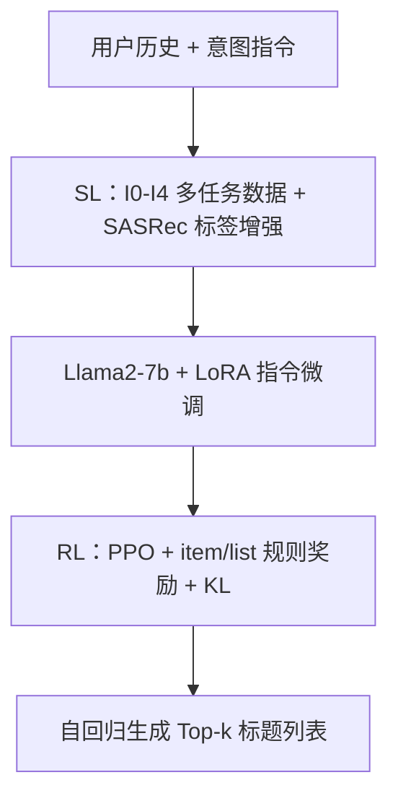
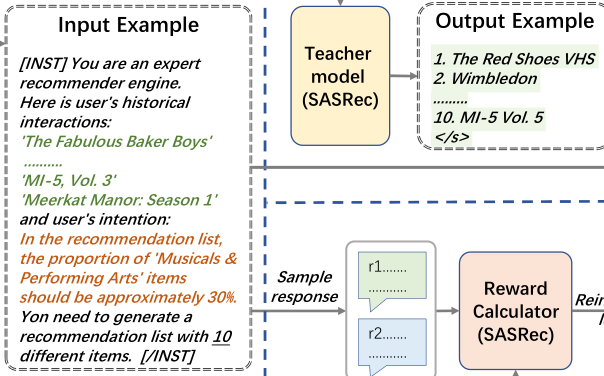

# Aligning Large Language Models for Controllable Recommendations (面向可控推荐的大语言模型对齐)

- **会议/期刊**: ACL 2024
- **作者与机构**: Wensheng Lu, Jianxun Lian, Wei Zhang 等；深圳大学、微软亚洲研究院
- **推荐链路定位**: 端到端生成式（Top-k 列表生成，指令微调 + 对齐）
- **研究方向**: LLM4Rec / 对话与智能体推荐
- **论文原文**: [https://arxiv.org/abs/2403.05063v2](https://arxiv.org/abs/2403.05063v2)
- **开源代码**: [https://github.com/microsoft/RecAI/tree/main/RecLM-gen](https://github.com/microsoft/RecAI/tree/main/RecLM-gen)

## TL;DR (1分钟核心速览)

现有 LLM 推荐微调多聚焦固定模板下的准确率，忽视多意图指令遵循，常出现重复、非存在或历史项等格式错误。本文以 Llama2-7b 为底座，构建序列推荐、类目正负控制、比例控制与物品搜索等 SL 任务，并用 SASRec 生成标签弥补稀疏监督；随后用 PPO 与 item/list 规则奖励做对齐。在 Movie/Steam 的 Leave-One-Out 生成式 top-k 评测中，完整模型将 I1 正控制 TCP 提至 93.52%/95.80%，I2 比例 CPA 达 69.81%/88.40%，格式重复率降至 1.14%/0.23%。

## Background & Motivation (背景与核心矛盾)

- **主流范式**: 将推荐任务改写为自然语言，基于 LLM 指令微调生成 top-k 列表；代表工作有 InstructRec、PALR。
- **前人局限**: 多数方法只覆盖固定推荐/搜索模板，未显式覆盖 item-wise 与 list-wise 意图；且 SL 只有正样本，模型易输出重复项、历史项或不存在项。
- **核心洞察 (Key Insight)**: 可控推荐须同时优化单物品相关性、列表级约束与格式合法性；用户意图可拆为隐式、物品级、列表级三层。
- **本文切入点**: 用多任务 SL 注入领域知识与控制格式，再用规则化 RL 提供负反馈，提升指令遵循与泛化。

## Method (核心方法设计)

### 1. 整体框架 (Overall Architecture)

输入由用户历史标题序列与可选意图指令构成，输出为 k 个不同物品标题。SL 阶段混合 I0 序列推荐、I1 类目正/负控制、I2 类目比例控制、I3 物品搜索及 I4 ShareGPT，以 LoRA 微调 Llama2-7b；其中 I0-I2 的首项用真实下一交互，其余 k−1 项由教师 SASRec 的 top 预测按指令过滤生成。RL 阶段以 PPO 继续优化 LoRA 策略，奖励由 item 级相关性/合法性、list 级控制满足度及 KL 惩罚组成。训练后模型直接自回归解码推荐列表，无需全库打分。

<figure class="paper-figure" markdown="span">
  <figcaption>图1：所提方法的概述。</figcaption>
</figure>

### 2. 关键设计拆解 (Key Designs)

1. **意图分层与教师标签增强**：稀疏真实行为不足以构造完整 k 项正解，本文用 SASRec 预测补全其余项，并按 I0/I1/I2 的约束过滤；同时把控制意图拆为正向、负向与比例三类。核心构造可写为 $a_{1:k}=[i_n;\mathrm{TopK}_{i\in\mathcal{P}_{SASRec}\setminus\{i_n\}}(s_i)]$，其中 I1/I2 会按目标类别$C_{\mathrm{target}}$ 过滤。直觉是既保留真实下一项，又用教师模型蒸馏出高质量候选，使 LLM 学会“列表长什么样”。

2. **规则化 item/list 奖励**：SL 只有正例，无法惩罚重复、历史项、非存在项及控制失败。对每个生成项计算 $S_i=\begin{cases}-1,&\text{illegal}\\ +1,&\text{target}\\ 1/\log_2(\mathrm{Rank}_i+3),&\text{else}\end{cases}$，再与类别控制分合成$R_{\mathrm{item}}=0.5S_i+0.5S_i^{\mathrm{ctl}}$；列表级奖励为$R_{\mathrm{list}}=0.5\sum_i S_i^*+0.5S_{\mathrm{list}}^{\mathrm{ctl}}$，其中$S_i^*=S_i/\log_2(i+2)$ 鼓励真实目标靠前。该设计无需训练 reward model，且能精确惩罚格式错误。

3. **训练目标、负采样与推理效率**：最终奖励为 $R_{\mathrm{final}}=R_{\mathrm{item}}+R_{\mathrm{list}}-\eta KL(\pi_\theta^{RL}\|\pi^{SFT})$，原文将$R_{\mathrm{list}}$放大 10 倍，$\eta=0.3$，并用 PPO clip 与 GAE。训练无显式负采样；负反馈来自非法项、重复项、历史项和非目标类别。推理仅需 7B LoRA 解码，但 max output 512 tokens，生成开销高于传统打分模型。

## Experimental Setup & Evaluation Protocol (实验设置与评估协议)

- **数据集与预处理**:

| 数据集 | #Users | #Items | #Interactions | 稀疏度 | 特征/场景说明 |
| :--- | :---: | :---: | :---: | :---: | :--- |
| Movie | 13,218 | 18,744 | 744,313 | 99.70% | Amazon Movies & TVs，含类目 |
| Steam | 12,658 | 8,572 | 632,900 | 99.42% | Steam 游戏，含类目 |

- **数据划分与防穿越**: 采用 `Leave-One-Out`；用户前 $n-1$项构造历史，第$n$ 项为测试目标，测试集规模等于用户数。验证集含 I0、I1+、I1−、I2≈50% 四类指令各 320 条。
- **排名评测协议**: 非 `Full-Ranking`，也非采样排序；LLM 直接生成 k 个标题，按生成列表计算 HR@K/NDCG@K。控制指标为 TCP@10（目标类目占比）与 CPA（是否满足 ≤/≥/≈ 比例约束）。
- **对比基线与超参**: General LLM：GPT-3.5、Llama2-7b；Fine-tuned：InstructRec、PALR；教师：SASRec；本文变体 Ours_v1/v2/v3/full。底座 Llama2-7b-chat，SL LoRA rank=16、alpha=8、lr=1e-3、batch=64；RL LoRA rank=4、alpha=2、lr=5e-6、temperature=0.7。原文未报告显著性检验。

## Key Experimental Results (实验关键数据)

### 1. 主实验对比 (Main Results)

表1 I0 顺序推荐（括号为相对 PALR 的 HR@10 提升；加粗为全表最优）：

| 数据集 | 方法 | HR@10 | NDCG@10 |
| :--- | :--- | :---: | :---: |
| Movie | SASRec(teacher) | **0.1229** | 0.0913 |
| Movie | GPT-3.5 | 0.0050 | 0.0025 |
| Movie | Llama2-7b | 0.0120 | 0.0056 |
| Movie | InstructRec | 0.0524 | 0.0381 |
| Movie | PALR | 0.0868 | 0.0787 |
| Movie | Ours_v2 | 0.1211 (+39.5%) | **0.0927** |
| Movie | Ours_full | 0.1148 (+32.3%) | 0.0867 |
| Steam | SASRec(teacher) | **0.1121** | **0.0648** |
| Steam | GPT-3.5 | 0.0160 | 0.0079 |
| Steam | Llama2-7b | 0.0052 | 0.0028 |
| Steam | InstructRec | 0.0220 | 0.0113 |
| Steam | PALR | 0.0408 | 0.0320 |
| Steam | Ours_v2 | 0.1036 (+153.9%) | 0.0583 |
| Steam | Ours_full | 0.1001 (+145.3%) | 0.0551 |

表2 可控性：I1 类目控制与 I2 比例控制（关键基线 vs. 完整模型）：

| 数据集 | 方法 | I1+ TCP↑ | I1− TCP↓ | I2≈30 CPA↑ | I2≥30 CPA↑ |
| :--- | :--- | :---: | :---: | :---: | :---: |
| Movie | InstructRec | 37.39 | 56.61 | 31.24 | 57.58 |
| Movie | PALR | 8.70 | 46.64 | 10.28 | 11.17 |
| Movie | Ours_full | **93.52** | **11.49** | **69.81** | **61.98** |
| Steam | InstructRec | 51.70 | 70.39 | 13.22 | 55.90 |
| Steam | PALR | 13.04 | 47.01 | 13.39 | 20.11 |
| Steam | Ours_full | **95.80** | **5.51** | **74.29** | **88.40** |

### 2. 消融实验 (Ablation Study)

Movie 数据集消融（Ours_v1 仅 I0；v2 全 SL；v3 RL 无 item reward；full 完整）：

| 变体 | I1+ TCP↑ | I1− TCP↓ | I2≈30 CPA↑ | RepeatItem↓ | NonExist↓ | InHistory↓ |
| :--- | :---: | :---: | :---: | :---: | :---: | :---: |
| Ours_v1 | 8.69 | 35.99 | 16.14 | 13.63 | 7.03 | 5.76 |
| Ours_v2 | 81.38 | 19.35 | 58.71 | 9.61 | 5.27 | 4.02 |
| Ours_v3 | 89.06 | 15.80 | 65.78 | 2.37 | 1.14 | 1.36 |
| Ours_full | **93.52** | **11.49** | **69.81** | **1.14** | **0.95** | **1.24** |

### 3. 关键实验发现 (Key Findings)

- 多任务 SL 是控制能力的主开关：Movie 上仅 I0 的 Ours_v1 的 I1+ TCP 仅 8.69%，加入 I1/I2/I3 后 Ours_v2 升至 81.38%，I2≈30 CPA 从 16.14% 升至 58.71%。
- RL 与 item 级奖励主要治格式：Movie 从 Ours_v2 到 full，RepeatItem 由 9.61% 降至 1.14%，NonExist 由 5.27% 降至 0.95%，InHistory 由 4.02% 降至 1.24%。
- 可控性与精度存在轻量权衡：Movie I0 HR@10 从 Ours_v2 的 0.1211 降至 full 的 0.1148（−5.2%），但仍显著高于 PALR 的 0.0868，且 I1+ 的 TCP 由 81.38% 提至 93.52%。

## Highlights & Limitations (亮点、对比与审稿批判)

- **与代表作对比 (vs. Prior Work)**: InstructRec 依赖多类指令但固定模板，PALR 仅用两类指令且无教师标签增强；本文显式拆分三类意图，并用 SASRec 蒸馏 + RL 规则奖励补齐“负反馈”，在 TCP/CPA 上大幅领先。
- **可迁移亮点**: 用教师推荐模型补全稀疏正解、用列表级规则奖励直接编码约束，均可迁移到对话推荐、可解释重排与生成式推荐。
- **审稿级局限批判**: 评估为生成式 top-k，未构造全库候选，HR 与全库 Full-Ranking 不可直接横比；控制仅覆盖类目及比例，组合指令下 Movie C1 比例 CPA 仅 45.14%，且 7B 自回归推理成本与 GSM8K 遗忘仍需关注。

## Rating (四维评分)

- **方法创新性 (Novelty)**: ⭐⭐⭐⭐ （首个将多任务 SL 与规则化 PPO 结合用于可控 LLM 推荐，意图分层清晰）
- **评估协议与实验扎实度 (Protocol & Experiments)**: ⭐⭐⭐ （两真实数据集、Leave-One-Out、控制与格式指标较全，但无显著性检验且非全库排序）
- **写作与数学规范度 (Clarity & Rigor)**: ⭐⭐⭐⭐ （奖励公式、任务构造与超参交代清楚，PPO 细节完整）
- **工业落地与复现价值 (Industrial & Practical Value)**: ⭐⭐⭐ （代码开放、LoRA 可降训练成本，但 7B 在线生成与 RL 对齐成本仍高）

