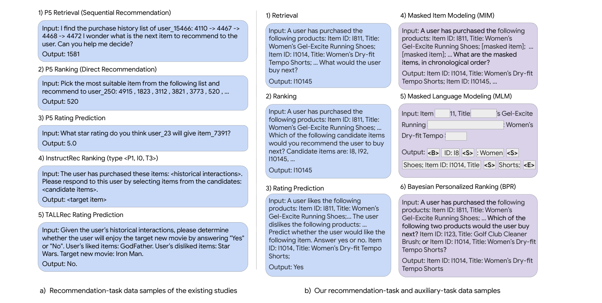
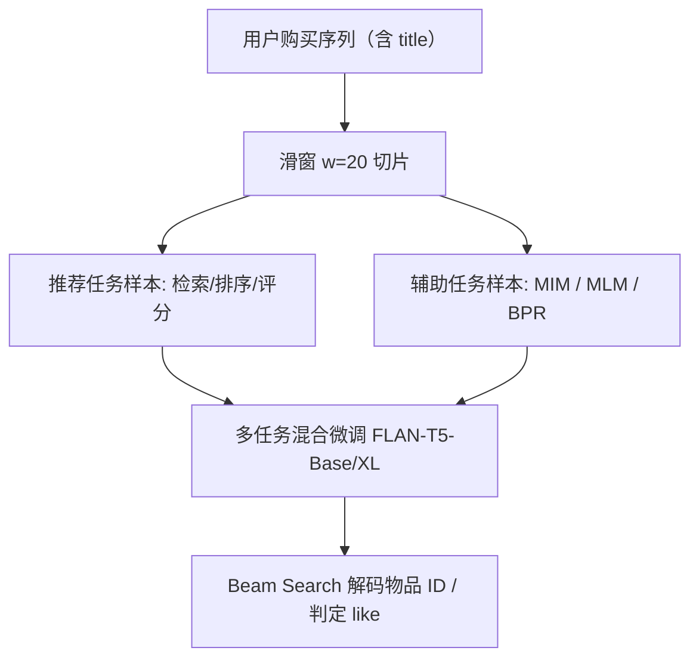

# Aligning Large Language Models with Recommendation Knowledge (让大语言模型对齐推荐知识)

- **会议/期刊**: NAACL 2024 (Findings)
- **作者与机构**: Yuwei Cao (UIC, Google 实习), Nikhil Mehta, Xinyang Yi, Raghunandan Keshavan, Lukasz Heldt, Lichan Hong, Ed H. Chi, Maheswaran Sathiamoorthy (Google DeepMind / Google)
- **推荐链路定位**: 端到端生成式（生成式检索 / 列表排序 / 评分预测统一为文本生成）
- **研究方向**: 大语言模型推荐 (LLM4Rec) / 序列推荐
- **论文原文**: [https://arxiv.org/abs/2404.00245v1](https://arxiv.org/abs/2404.00245v1)
- **开源代码**: [https://github.com/jeykigung/P5](https://github.com/jeykigung/P5)（沿用 P5 仓库流程，本文数据生成未单独发版）

## TL;DR (1分钟核心速览)

零样本或直接指令微调的 LLM（FLAN-T5-XL）在 Amazon 三域的全库检索上 NDCG@5 近乎为 0（$2e^{-5}$），说明 LLM 的前置知识里缺的是"用户—物品高阶共现关系"而非自然语言推理力。本文把传统推荐器的 **MIM / MLM / BPR** 三大经典算子用自然语言提示"仿真"成辅助任务样本，与精简后的推荐任务样本（去掉 user ID、补 item title、短 ID 映射）一起多任务微调 FLAN-T5-Base/XL。在 5-core + Leave-One-Out + **Full-Ranking** 协议下，检索任务全面超越 TIGER（Toys +5.66%、Beauty **+19.00%** NDCG@5），排序任务在 Toys 上 HR@1 提升 256.72%。

## Background & Motivation (背景与核心矛盾)

- **主流范式**: 以 P5 / InstructRec / TALLRec 为代表的指令微调路线，把推荐任务写成自然语言指令，让 T5/FLAN-T5 直接生成物品 ID 或 yes/no，以此借用 LLM 的语义与推理能力。
- **前人局限**: ① 这类样本只教会 LLM"任务形式"（该输出什么），而输入仍是裸 ID 序列，无法传递目标域的物品共现结构，导致 LLM 在检索上被 SASRec/TIGER 等监督模型反超；② P5 保留海量 user ID（如 Sports & Outdoors 有 35,598 个用户），把输出空间撑得过大，LLM 被迫"背 ID 表"而非学偏好。
- **核心洞察 (Key Insight)**: LLM 擅长语言推理，但推荐的本质是用户—物品交互建模，二者知识形态不匹配（knowledge mismatch）；传统推荐器恰恰通过 MIM、BPR 等算子把共现结构"喂"进模型——那么这些算子能否被翻译成自然语言，成为 LLM 的辅助训练信号？
- **本文切入点**: 不改架构、不加协同过滤塔，仅靠**数据侧**（辅助任务样本 + 更干净的任务样本）把推荐知识注入 LLM。

<figure class="paper-figure" markdown="span">
  <figcaption>图1：现有研究和本工作采用的数据样本。(a) 展示现有研究的推荐任务数据样本。具体而言，(a1)-(a3) 展示 P5 (Geng 等，2022) 的检索、排序和评分预测数据样本；(a4) 展示 InstructRec (Zhang 等，2023) 的一个排序（类型 &lt;P1, I0, T3&gt;）数据样本；(a5) 是 TALLRec (Bao 等，2023) 的一个评分预测数据样本。(b) 展示我们的推荐任务（蓝色框）和辅助任务（紫色框）数据样本（我们在附录 C 中展示了更多样本）。</figcaption>
</figure>

## Method (核心方法设计)

### 1. 整体框架 (Overall Architecture)

用训练集历史序列生成两类样本：(i) 推荐任务样本（检索 / 排序 / 评分预测），(ii) 辅助任务样本（MIM / MLM / BPR），后者由用户购买序列的滑窗子序列随机采样产出；二者混合后以多任务方式全参数微调 FLAN-T5 主干，测试时用同分布的推荐任务提示做 beam search（宽度 20）解码物品短 ID 并按生成概率打分排序。

### 2. 关键设计拆解 (Key Designs)

1. **MIM / MLM 的语言化（物品级 + 片段级共现）**: 前人在 BERT4Rec/S3-Rec 中靠 Cloze 学共现，但 LLM 无法直接吃 masked 序列 tensor。本文将序列中 20% 位置替换为 "[masked item]"，提示 LLM 按时间顺序输出被遮物品的 ID+Title，本质是把 $\mathcal{L}_{\text{MIM}}=\frac{1}{|\mathcal{S}_u^{m}|}\sum_{i_m\in\mathcal{S}_u^{m}}-\log P(i_m\mid \mathcal{S}_u')$ 的条件概率项改写成自回归文本生成；MLM 进一步把单物品掩码升级为**连续 span** 破坏（span corruption），补足多物品间的细粒度关联。直觉：物品级掩码学"点"共现，片段级重建学"段"转移模式，两者互补。
2. **BPR 的二选一改写成对（对比负样本）**: 传统 $\mathcal{L}_{\text{BPR}}=\mathbb{E}_{(u,i^+)\sim p_{pos}}-\log\sigma\big(s(u,i^+)-s(u,i^-)\big)$ 需要打分函数，LLM 没有显式内积。本文把它转成二元选择题：给出一个正例（滑窗后紧邻的真实下一件）与一个按流行度采样的负例，让模型输出正例 ID；负例按流行度采样 = 用困难负例逼近真实曝光竞争。这使得"偏好序"而非"绝对标签"被注入模型。
3. **推荐任务的提示精简 + 训练/推理开销**: 删除全部 user ID（用户以其历史购买表征）、原始长 ID（如 `0000031852`）随机映射为短 ID（`I123`）、序列物品补 title 而候选与答案只用 ID，滑窗 $w=20$ 控长。总损失即多个任务样本的负对数似然之和（多任务混合采样，BPR/MIM/MLM 采用 dynamic sampling 平衡比例）；免负采样对比损失，推理为纯自回归 beam search，开销主要来自 3B 主干的前向。

## Experimental Setup & Evaluation Protocol (实验设置与评估协议)

- **数据集与预处理**: Amazon 三个类目，遵循 SASRec/P5 保留 **5-core** 过滤，交互按时间戳升序排序。

| 数据集 | #Users | #Items | 序列长度 (均值±std) | 特征/场景说明 |
| :--- | :---: | :---: | :---: | :--- |
| Toys & Games | — | — | 8.63 ± 8.51 | 玩具，标题语义丰富 |
| Beauty | — | — | 8.88 ± 8.16 | 美妆，序列最长 |
| Sports & Outdoors | 35,598 | — | 8.32 ± 6.07 | 运动户外，序列最短最稀疏 |

（完整 #Items/#Interactions 统计见原文附录 B；本文正文仅给出上述量级。）

- **数据划分与防穿越 (Splitting Strategy)**: **Leave-One-Out**——每条用户序列最后 1 个交互作测试、倒数第 2 个作验证、其余作训练，严格按时间戳切分，无未来信息泄漏。
- **排名评测协议 (Ranking Protocol)**: 检索为无偏 **Full-Ranking**（从全库未交互物品中召回唯一真值，非采样）；排序为 **Sampled Ranking**，候选池 = 1 正 + 99 按流行度采样的负例（1:99），正例位置随机；指标为 HR@{5,10}、NDCG@{5,10}（排序另报 HR@1）；评分预测把 rating>3 记为 like，报 AUC-ROC。
- **对比基线与超参**: 序列类 Caser/HGN/GRU4Rec/BERT4Rec/FDSA/SASRec/S3-Rec/**TIGER**（前 SOTA）；CF 类 BPR-MF/BPR-MLP/SimpleX；评分类 History/DMF/Wide&Deep；LLM 类 **P5/P5-XL/FLAN-T5-Base/FLAN-T5-XL**（后两者零样本）。主干 FLAN-T5-XL(3B) 训 70k step、batch 16；FLAN-T5-Base(223M) 训 10k step、batch 64；lr=0.001，warm-up 1,000；掩码率 20%，beam=20。

## Key Experimental Results (实验关键数据)

### 1. 主实验对比 (Main Results)

**检索（Full-Ranking，Table 1）**

| Method | Toys N@5 | Toys N@10 | Beauty N@5 | Beauty N@10 | Sports N@5 | Sports N@10 |
| :--- | :---: | :---: | :---: | :---: | :---: | :---: |
| SASRec | 0.0306 | 0.0374 | 0.0249 | 0.0318 | 0.0154 | 0.0192 |
| S3-Rec | 0.0294 | 0.0376 | 0.0244 | 0.0327 | 0.0161 | 0.0204 |
| TIGER (SOTA) | 0.0371 | 0.0432 | 0.0321 | 0.0384 | 0.0181 | 0.0225 |
| P5-XL | 0.0023 | 0.0031 | 0.0036 | 0.0050 | 0.0029 | 0.0035 |
| FLAN-T5-XL (zero-shot) | $2e^{-5}$|$2e^{-5}$ | 0.0000 | 0.0000 | 0.0000 | 0.0000 |
| **ReAT (Ours)** | **0.0390** | **0.0461** | **0.0382** | **0.0442** | **0.0188** | **0.0232** |
| UT+AT (Ours) | **0.0392** | 0.0459 | 0.0329 | 0.0397 | 0.0178 | 0.0219 |
| **Improv.% (best Ours vs best base)** | +5.66 | +6.71 | **+19.00** | +15.10 | +3.87 | +3.11 |

**排序（1:99 候选，Table 2）**

| Method | Toys N@5 | Toys HR@1 | Toys HR@10 | Beauty N@5 | Beauty HR@1 | Sports N@5 | Sports HR@1 |
| :--- | :---: | :---: | :---: | :---: | :---: | :---: | :---: |
| BPR-MF | 0.0641 | 0.0233 | 0.2003 | 0.0857 | 0.0311 | 0.0848 | 0.0314 |
| SimpleX | 0.1244 | 0.0268 | 0.2662 | 0.1441 | 0.0325 | **0.1505** | 0.0331 |
| P5-XL | 0.0290 | 0.0097 | 0.0977 | 0.0298 | 0.0110 | 0.0286 | 0.0097 |
| **RaAT (Ours)** | **0.1714** | **0.0956** | 0.3453 | 0.1376 | **0.0702** | 0.0933 | **0.0424** |
| **UT+AT (Ours)** | 0.1703 | 0.0938 | **0.3562** | **0.1441** | 0.0742 | 0.0997 | 0.0468 |
| **Improv.%** | +37.78 | **+256.72** | +33.81 | 0.00 | **+128.31** | −33.75 | +33.33 |

**评分预测（AUC-ROC，Table 3）**: Wide&Deep 70.93 / 67.10 / **67.60**；RpAT (Ours) **71.16** / **68.27** / 65.87（Δ = +0.32 / +1.74 / −2.56）。

### 2. 消融实验 (Ablation Study)

Toys & Games，主干 FLAN-T5-XL，逐步叠加任务（Table 4/5/6）：

| 增量配置 | 检索 N@5 | 排序 N@5 | 排序 HR@1 | 评分 AUC |
| :--- | :---: | :---: | :---: | :---: |
| 零样本 FLAN-T5-XL | $2e^{-5}$ | 0.0160 | 0.0026 | 55.23 |
| + 主推荐任务 (retrieval/ranking/rating) | 0.0182 | 0.1520 | 0.0807 | 70.38 |
| + MLM | 0.0306 | 0.1580 | 0.0854 | 71.08 |
| + MIM | **0.0390** | 0.1677 | 0.0938 | **71.16** |
| + BPR | — | **0.1714** | **0.0956** | — |
| 参考: TIGER / SimpleX / Wide&Deep | 0.0371 | 0.1244 | 0.0268 | 70.93 |
| FLAN-T5-Base 走完整流程 | 0.0242 | 0.1534 | 0.0844 | 68.24 |

### 3. 关键实验发现 (Key Findings)

1. **辅助任务才是"知识补丁"，其中 MIM 最关键**: 仅用推荐任务样本时检索 N@5 只有 0.0182（低于 SASRec），加 MLM 升到 0.0306（仍逊于 TIGER 0.0371），再加 MIM 才跃到 0.0390 反超 SOTA——证明物品级掩码共现信号是不可替代的临界增量。
2. **BPR 是"排序专用"、增益最小**: 排序序列上 0.1677→0.1714 有小幅提升，但作者明确报告 BPR 对检索与评分无益故未使用；评分任务上 MLM+MIM 仅带来 70.38→71.16 的边际增益，说明共现信号主要服务"从全库挑对"而非"判喜好"。
3. **@1 指标的结构性优势与序列依赖短板**: 排序任务 HR@1 相对最佳基线提升 +256.72%(Toys)/+128.31%(Beauty)，说明 LLM 的语义先验在头部决策上极强；但 Sports & Outdoors 上排序 N@5 反落后 SimpleX 33.75%，作者归因于该域序列最短最贫乏（8.32±6.07 vs 8.88/8.63），依赖序列共现的方法在此处失去燃料，而 CF/上下文基线不受影响。

## Highlights & Limitations (亮点、对比与审稿批判)

- **与代表作对比 (vs. Prior Work)**: 与 P5 的本质差别在于"喂什么"——P5 只给任务指令+裸 ID 且保留 user ID，本文去 user ID、加 title、并额外注入 MIM/MLM/BPR 辅助样本；与 TIGER 的差别在于 TIGER 用 RQ-VAE 语义 ID + 编码器-解码器从零训练，无语言先验，本文直接复用 3B 指令微调主干，检索上以 +5.66%~+19.00% 反超且保留自然语言推理能力。
- **可迁移亮点**: ① "把传统推荐算子翻译成自然语言辅助任务"这一范式可平移到 LightGCN 邻域采样、对比学习增广（SGL 的 dropout 视图可写成"哪条序列被扰动"判别任务）；② 短 ID 随机映射 + 去 user ID 的输出空间压缩，对任何生成式推荐（TIGER 类语义 ID）都有直接参考价值。
- **审稿级局限批判**: ① 训练/推理成本未量化，3B 主干 70k step + beam=20 的全库解码在工业级候选量下延迟不可接受，论文仅在 Limitations 中一笔带过；② 短 ID 采用**随机映射**而非语义 ID，作者自承可能损失性能且不利于新物品泛化；③ 三域均为 Amazon 5-core 短序列，Sports & Outdoors 上排序/评分双线落后，说明结论对序列质量的鲁棒性未验证；④ 排序使用 1:99 流行度采样，与检索的 Full-Ranking 口径不一致，两表不可直接横比。

## Rating (四维评分)

- **方法创新性 (Novelty)**: ⭐⭐⭐ （"算子语言化"思路朴素但切中 LLM 缺交互建模的痛点，MIM/MLM/BPR 三件套的组合与消融归因做得干净，无理论/谱分析支撑）
- **评估协议与实验扎实度 (Protocol & Experiments)**: ⭐⭐⭐⭐ （检索用 Full-Ranking 无偏口径、Leave-One-Out 防穿越、三域三任务 + 双主干规模消融齐全，但排序用 1:99 采样且缺显著性检验）
- **写作与数学规范度 (Clarity & Rigor)**: ⭐⭐⭐⭐ （传统损失 $\mathcal{L}_{\text{MIM}}$/$\mathcal{L}_{\text{BPR}}$ 与语言化提示的对应关系交代清晰，公式克制不堆砌，但数据统计表被推入附录影响自洽阅读）
- **工业落地与复现价值 (Industrial & Practical Value)**: ⭐⭐⭐ （数据生成流程简单可复用、基于 P5 仓库易复现，但 3B 主干 + beam search 全库解码的在线成本与随机 ID 映射的可扩展性仍是落地硬门槛）

