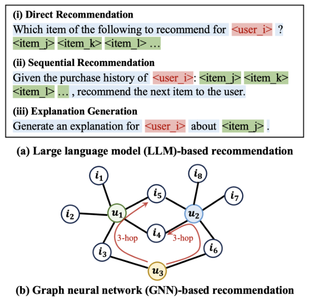
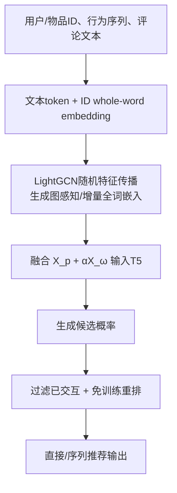
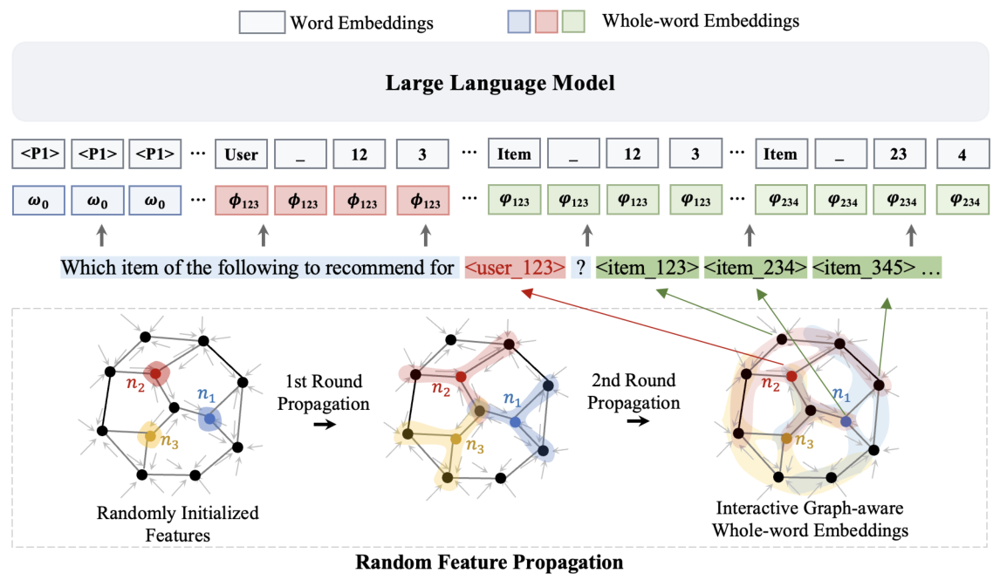

# Enhancing High-order Interaction Awareness in LLM-based Recommender Model (增强基于 LLM 的推荐模型的高阶交互感知)

- **会议/期刊**: EMNLP 2024 Main (Long Paper)
- **作者与机构**: Xinfeng Wang, Jin Cui, Fumiyo Fukumoto, Yoshimi Suzuki; University of Yamanashi
- **推荐链路定位**: 端到端生成式（直接推荐 + 序列下一项预测）
- **研究方向**: 大语言模型推荐 / 图神经网络推荐
- **论文原文**: [arXiv:2409.19979v4](https://arxiv.org/abs/2409.19979v4)
- **开源代码**: [WangXFng/ELMRec](https://github.com/WangXFng/ELMRec)

## TL;DR (1分钟核心速览)

现有 LLM 推荐器以文本提示串联用户与物品，既看不到高阶协同信号，又受 ID 子词切分导致的伪相关困扰。ELMRec 用 LightGCN 随机特征传播生成图感知全词嵌入，注入 T5 的自注意力，并加免训练重排；在 Amazon 三域 Leave-One-Out 协议下，直接推荐相对 NCL 的 H@10 提升 15.9%–22.6%，序列推荐相对 POD 提升 2.7%–7.8%。

## Background & Motivation (背景与核心矛盾)

- **主流范式**: P5/POD 将直接推荐、序列推荐、解释生成统一为 text-to-text，靠提示词与 whole-word embedding 蒸馏多任务知识。
- **前人局限**: 文本提示只连接用户与物品，无法传播 3 跳邻居的高阶协同；BPE 又把 `user_1234` 切成 `user`、`_`、`12`、`34`，共享子词制造伪相关，且数字子词少导致 ID embedding 低秩。
- **核心洞察 (Key Insight)**: whole-word embedding 会进入 self-attention 的 cross term，可放大同一 ID 内 token 的相关性；若用 LightGCN 随机传播后的节点嵌入作 whole-word，可把图相对位置编码进 LLM，而无需图预训练。
- **本文切入点**: 图感知全词嵌入负责直接推荐，增量全词嵌入 + 免训练重排负责序列推荐。

<figure class="paper-figure" markdown="span">
  <figcaption>图1：我们的动机示意图。在 (a) 中，基于 LLM 的推荐器通过文本提示（蓝色）连接用户（粉色）和物品（绿色），未能捕获高阶交互信号。相反，GNNs 可以捕获这些信号，例如 (b) 中的 3 跳邻居（红色箭头）。</figcaption>
</figure>

## Method (核心方法设计)

### 1. 整体框架 (Overall Architecture)

输入用户/物品 ID、交互序列与评论文本，先按 P5/POD 组织为文本 token 与任务提示；再将 ID 的 whole-word embedding 与文本 embedding 相加送入 T5。直接推荐用 LightGCN 随机特征传播得到图感知全词嵌入，序列推荐改用按出现顺序递增的增量全词嵌入；解码后过滤已交互项，对 $k+N$个候选重排并输出 top-$k$。训练仅优化多任务生成对数似然，图传播与重排均不需额外预训练。

<figure class="paper-figure" markdown="span">
  <figcaption>图3：将交互图感知集成到 LLMs 的示意图。我们首先利用基于 LightGCN 的随机特征传播获得整词嵌入，这些嵌入可通过红、蓝、黄边所传达的语义相似性反映用户–物品在交互图中的位置。然后，我们融合整词嵌入与词嵌入，以增强 LLMs 的交互图感知能力。</figcaption>
</figure>

### 2. 关键设计拆解 (Key Designs)

1. **Graph-aware Whole-word Embedding（直接推荐主增益）**：LightGCN 从 $\mathcal{N}(0,\sigma^2)$ 随机初始化开始传播，不做事前图预训练；取各层平均作为 user/item 节点向量，并直接替换对应 ID 的 whole-word 向量。这样同一 ID 的所有子词共享图位置向量，既缓解共享子词伪相关，也让 self-attention 的 cross term 携带高阶协同：
   $\hat{\psi}(v)=\frac{1}{L+1}\sum_{l=0}^{L}\psi(v)^{(l)},\quad \psi(v)^{(l+1)}=\sum_{u\in\mathcal{N}_v}\frac{\phi(u)^{(l)}}{\sqrt{|\mathcal{N}_v||\mathcal{N}_u|}}$。
   直觉是：共同交互越多、共享物品越冷门、目标用户越不活跃，传播影响越强；真实物品与目标用户在图中更近，注意力更易被放大。

2. **增量全词嵌入 + 免训练重排（序列推荐修正）**：图感知会强调全部历史交互，反而稀释序列顺序；因此按出现次序给 ID 编 `#0…#N`，从全局矩阵取递增 whole-word，使近期交互获得更大索引。解码后再把 top-$(k+N)$ 中已交互项滤除并重排：
   $p_{(:k)}(y\mid Y_{<t},X)\leftarrow\operatorname{rerank}\big(p_{(:k+N)}(y\mid Y_{<t},X)\big)$。
   这直接缓解“LLM 过度依赖早期交互”的问题，且无需训练；原文显示 $N=5$已覆盖大部分收益，$N>10$ 增益边际化。

3. **训练目标、负采样与推理效率**：总损失为三任务日志似然：
   $\mathcal{L}_\Theta=-\frac{1}{|\mathcal{D}|}\sum_{(X,Y)\in\mathcal{D}}\frac{1}{|Y|}\sum_{t=1}^{|Y|}\log p(y_t\mid Y_{<t},X)$。
   直接推荐沿用 P5/POD 的候选列表随机负例，序列推荐为 next-item 生成；无额外对比学习或图预训练。复杂度约 $O(m^2+n^2)$，$m$为 token 数、$n$为用户+物品数，实际瓶颈在 LightGCN 的$n^2$。

## Experimental Setup & Evaluation Protocol (实验设置与评估协议)

- **数据集与预处理**: 沿用 P5/POD 的 Amazon 三域数据；原文统计如下：

| 数据集 | #Users | #Items | #Interactions/Reviews | 稀疏度/密度 | 特征/场景说明 |
| :--- | :---: | :---: | :---: | :---: | :--- |
| Sports | 35,598 | 18,357 | 296,337 | 0.0453% | Amazon Sports & Outdoors；评论文本+交互图 |
| Beauty | 22,363 | 12,101 | 198,502 | 0.0734% | Amazon Beauty；评论文本+交互图 |
| Toys | 19,412 | 11,924 | 167,597 | 0.0724% | Amazon Toys & Games；评论文本+交互图 |

- **数据划分与防穿越 (Splitting Strategy)**: 直接/序列推荐均为 `Leave-One-Out`：最后交互作测试、次后作验证、其余训练；解释生成按 8:1:1 划分。
- **排名评测协议 (Ranking Protocol)**: 直接推荐为候选列表采样排序（1 正 + 随机负例，继承 P5/POD）；序列推荐为全库 next-item 排序（候选规模远大于直接推荐）。指标为 HR@5/10、NDCG@5/10。
- **对比基线与超参设置**: 直接推荐对比 SimpleX、P5、RSL、POD、LightGCN、NCL、XSimGCL；序列推荐对比 SASRec、S3-Rec、P5、RSL、POD 等。LLM 采用 T5-small；10-trial T-test，$p<0.05$为显著；对$\alpha,\sigma,L,N$ 做敏感性分析。

## Key Experimental Results (实验关键数据)

### 1. 主实验对比 (Main Results)

**表2 直接推荐（采样候选排序，H@10 / N@10）**

| 方法 | Sports |  | Beauty |  | Toys |  |
| :--- | :---: | :---: | :---: | :---: | :---: | :---: |
| SimpleX | 0.3290 | 0.1800 | 0.3090 | 0.1711 | 0.2662 | 0.1469 |
| P5 | 0.2802 | 0.1627 | 0.2300 | 0.1332 | 0.2023 | 0.1114 |
| POD | 0.2889 | 0.1782 | 0.2677 | 0.1639 | 0.2119 | 0.1244 |
| LightGCN | 0.5436 | 0.3418 | 0.5383 | 0.3451 | 0.5106 | 0.3272 |
| NCL | 0.5592 | 0.3551 | 0.5542 | 0.3607 | 0.5120 | 0.3325 |
| XSimGCL | 0.4486 | 0.2992 | 0.4392 | 0.3012 | 0.4186 | 0.2885 |
| **ELMRec** | **0.6479** | **0.4852** | **0.6794** | **0.4973** | **0.6045** | **0.4141** |

相对最强基线 NCL：H@10 分别提升 15.9%/22.6%/16.0%，N@10 提升 36.6%/37.9%/24.5%，均 $p<0.05$。

**表3 序列推荐（全库 next-item 排序，H@10 / N@10）**

| 方法 | Sports |  | Beauty |  | Toys |  |
| :--- | :---: | :---: | :---: | :---: | :---: | :---: |
| SASRec | 0.0350 | 0.0192 | 0.0605 | 0.0318 | 0.0675 | 0.0374 |
| S3-Rec | 0.0385 | 0.0204 | 0.0647 | 0.0327 | 0.0700 | 0.0376 |
| P5 | 0.0460 | 0.0336 | 0.0664 | 0.0429 | 0.0709 | 0.0587 |
| RSL | 0.0512 | 0.0375 | 0.0667 | 0.0446 | 0.0712 | 0.0596 |
| POD | 0.0585 | 0.0422 | 0.0696 | 0.0471 | 0.0744 | 0.0601 |
| **ELMRec** | **0.0616** | **0.0471** | **0.0750** | **0.0529** | **0.0764** | **0.0618** |

相对 POD：H@10 提升 5.3%/7.8%/2.7%，N@10 提升 11.6%/12.3%/2.8%；Toys 增益未标显著。

### 2. 消融实验 (Ablation Study)

| 任务/设置 | Sports H@10/N@10 | Beauty H@10/N@10 | Toys H@10/N@10 |
| :--- | :---: | :---: | :---: |
| Direct w/o Text Prompt | 0.1270/0.1006 | 0.0381/0.0296 | 0.0190/0.0180 |
| Direct w/o Graph-aware | 0.2890/0.1783 | 0.2687/0.1650 | 0.2141/0.1243 |
| **Direct ELMRec** | **0.6479/0.4852** | **0.6794/0.4973** | **0.6045/0.4141** |
| Seq w/o Reranking | 0.0599/0.0435 | 0.0703/0.0471 | 0.0737/0.0572 |
| **Seq ELMRec** | **0.0616/0.0471** | **0.0750/0.0529** | **0.0764/0.0618** |

### 3. 关键实验发现 (Key Findings)

1. **图感知全词嵌入是直接推荐的绝对主增益**：移除后 H@10 从 0.6479/0.6794/0.6045 跌至 0.2890/0.2687/0.2141，降幅约 55.4%–64.6%；而移除文本提示更惨（0.1270/0.0381/0.0190），说明提示词是任务接口，图感知是协同信号增益。
2. **序列推荐不能照搬图感知**：Sports 上 graph-aware H@10 仅 0.0556，低于 incremental 的 0.0616；重排主要抬高 NDCG，NDCG@10 原文报告提升 8.3%/7.7%/8.0%，H@10 仅 2.7%/6.7%/3.7%，且 $N=5$ 后收益饱和。
3. **高阶传播有层数上限与工程代价**：$L>4$后高阶特征收益有限甚至负向；$\alpha$在直接推荐需较大、序列推荐需较小。Sports 预训练约 4h07m，直接/序列推理约 17m/7m38s，$O(n^2)$ 图传播是部署瓶颈。

## Highlights & Limitations (亮点、对比与审稿批判)

- **与代表作对比 (vs. Prior Work)**: P5/POD 有文本提示与 whole-word embedding，但无图传播；LightGCN/NCL 能捕获高阶协同，却缺少 LLM 的文本语义与生成能力。ELMRec 的本质区别是把图节点嵌入变成 LLM 的 whole-word 软 token，直接进入自注意力，而不是在提示里枚举邻居。
- **可迁移亮点**: 可将知识图谱/社交图节点嵌入作为 whole-word 软 token 注入 LLM；免训练“过滤已交互 + top-$(k+N)$ 重排”可低成本缓解召回中的历史偏置。
- **审稿级局限批判**: 一是 LightGCN 的 $O(n^2)$ 与冷启动需重训，工业大规模图成本高；二是直接推荐采样排序与序列全库排序协议不一致，且图感知在序列任务上反而有害，说明“高阶交互”并非无条件有益；重排增益在 Toys 上较小，缺少线上 A/B 与延迟评估。

## Rating (四维评分)

- **方法创新性 (Novelty)**: ⭐⭐⭐⭐ （把随机特征传播的图节点嵌入作为 whole-word 注入 LLM 自注意力，免图预训练，思路新且自注意力分解有解释力）
- **评估协议与实验扎实度 (Protocol & Experiments)**: ⭐⭐⭐⭐ （三 Amazon 域、Leave-One-Out、HR/NDCG@5/10、10-trial T-test 与较完整消融；但直接/序列协议混用，部分百分比与表格数值略不一致）
- **写作与数学规范度 (Clarity & Rigor)**: ⭐⭐⭐⭐ （整体框架与公式清晰，图感知/增量嵌入的任务边界有交代；复杂度与冷启动分析偏简）
- **工业落地与复现价值 (Industrial & Practical Value)**: ⭐⭐⭐ （T5-small 与开源代码利于复现，重排可插拔；但 LightGCN 预训练 2–4 小时、$O(n^2)$ 图传播与冷启动重训限制大规模部署）

