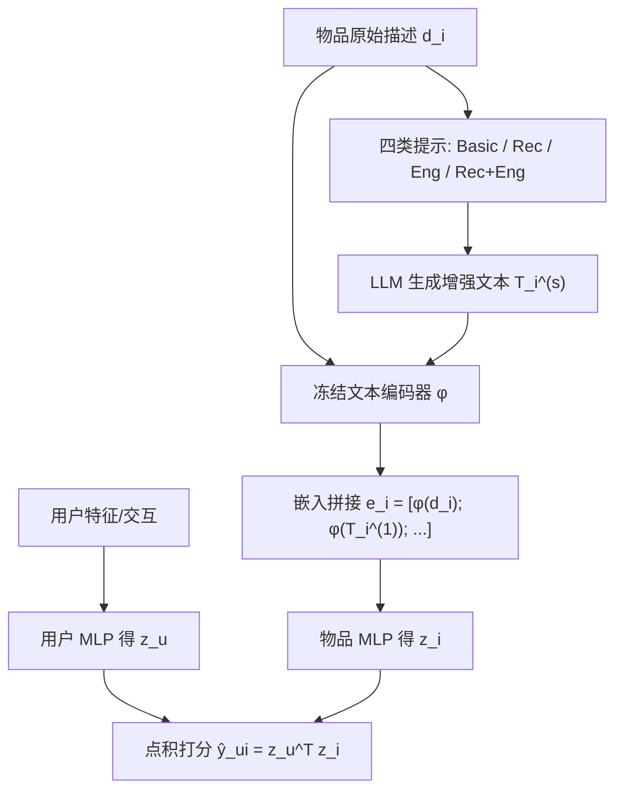
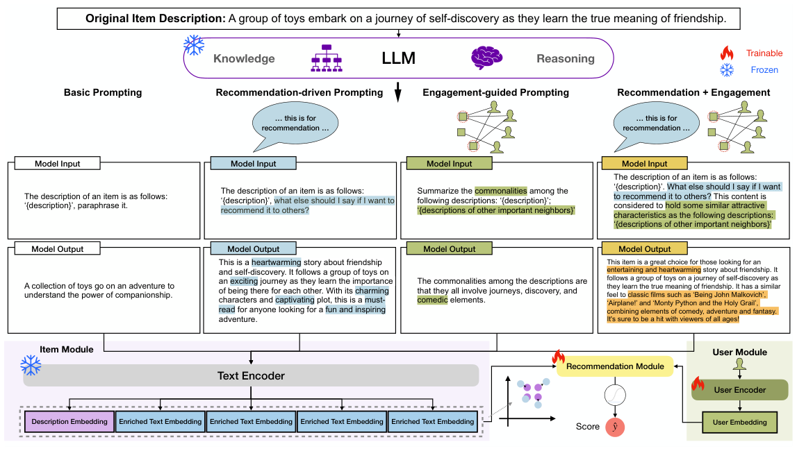

# LLM-Rec: Personalized Recommendation via Prompting Large Language Models (提示大语言模型增强个性化文本推荐)

- **会议/期刊**: ACL 2024（arXiv v3）
- **作者与机构**: Hanjia Lyu, Song Jiang, Hanqing Zeng, Yinglong Xia, Qifan Wang, Si Zhang, Ren Chen, Christopher Leung, Jiajie Tang, Jiebo Luo；University of Rochester、UCLA、Meta AI
- **推荐链路定位**: 召回/打分（文本增强）
- **研究方向**: 大语言模型推荐 / 文本增强推荐
- **论文原文**: [论文原文链接](https://arxiv.org/abs/2307.15780v3)
- **开源代码**: 暂未开源（检索到的 DeepCTR 为基线库，非本文实现）

## TL;DR (1分钟核心速览)

针对原始物品描述信息不全、难对齐用户偏好的痛点，本文提出 LLM-Rec：用基础、推荐驱动、参与引导及组合四类提示，让 GPT-3/Llama-2 生成增强描述，再与原始描述分别编码并拼接，输入简单 MLP+点积打分。在 MovieLens-1M/Recipe 的 8:1:1 随机划分、1:1000 采样排序下，GPT-3 版 NDCG@10 相对 MLP 提升 8.54%/21.72%。

## Background & Motivation (背景与核心矛盾)

- **主流范式**: 文本推荐通常编码物品原始描述，再用 MLP、AutoInt、DCN-V2 等内容/特征交叉模型学习用户-物品匹配。
- **前人局限**: 原始描述常缺少物品细粒度属性（如电影类型、氛围、食谱易用性）；知识增强方法如 KAR 依赖领域知识且生成内容可能与目标物品错配，TagGPT 仅抽取标签，信息面窄。
- **核心洞察 (Key Insight)**: LLM 的常识与推理可把“简短描述”改写成带推荐语境、用户群体线索和相似物品共性的增强文本，补足偏好对齐所需语义。
- **本文切入点**: 不设计复杂推荐结构，而是系统设计四类提示，将 LLM 增强文本作为额外内容嵌入，与原始描述拼接后交给轻量打分器。

## Method (核心方法设计)

### 1. 整体框架 (Overall Architecture)

LLM-Rec 以物品描述为唯一内容源。离线阶段对每个描述 $d_i$套用四类提示，得到多个增强文本$T_i^{(s)}$；冻结文本编码器$\phi$分别编码原始描述与增强文本，再按维度拼接为物品表示。用户侧经 MLP 得$\mathbf{z}_u$，物品侧经 MLP 映射拼接表示得$\mathbf{z}_i$，最终以点积$\hat{y}_{ui}=\mathbf{z}_u^\top\mathbf{z}_i$ 排序。训练使用隐式正负样本；增强文本可离线缓存，在线只运行轻量 MLP 与内积，部署成本接近 MLP 基线。

<figure class="paper-figure" markdown="span">
  <figcaption>图2：LLM-REC 采用四种提示策略来增强原始物品描述，这些描述通常包含不完整的推荐信息。随后将增强文本拼接，形成后续推荐模块的新输入。LLM-REC 在使大语言模型提供相关上下文并帮助更好地对齐用户偏好方面发挥关键作用。提示和增强文本已高亮显示。</figcaption>
</figure>
图2：LLM-Rec 的四类提示与推荐模块示意（原文图2）。

### 2. 关键设计拆解 (Key Designs)

1. **四类提示与推荐语境注入**：原始描述缺少“为何值得推荐”的信息。LLM-Rec 用 $T_i^{(s)}=\mathrm{LLM}(P_s(d_i))$生成增强文本：Basic 做复述/标签/情绪推断；Rec 加入“若推荐还需补充什么”；Eng 用目标物品与$T$ 个高参与邻居描述总结共性；Rec+Eng 融合二者。直觉是 LLM 把常识、类型、适用场景和相似物品共性显式写出。
2. **多视角嵌入拼接**：单一增强文本仍有偏。模型拼接原始与多提示嵌入：$\mathbf{e}_i=[\phi(d_i);\phi(T_i^{(1)});\ldots;\phi(T_i^{(S)})]$，再算$\hat{y}_{ui}=\mathbf{z}_u^\top\mathbf{z}_i$，其中$\mathbf{z}_u=\mathrm{MLP}_u(\mathbf{u}_u)$、$\mathbf{z}_i=\mathrm{MLP}_i(\mathbf{e}_i)$。这样保留原始信号并引入互补语义；实验也显示拼接嵌入优于先拼文本再编码。
3. **训练、负采样与推理**：训练用未交互用户-物品对作伪负样本；验证/测试每个正样本配 1000 个未交互物品，并与训练负样本隔离。原文未展开损失细节，按隐式反馈可写为 $\mathcal{L}=-\sum_{(u,i)\in\mathcal{D}^+}\log\sigma(\hat{y}_{ui})-\sum_{(u,j)\in\mathcal{D}^-}\log(1-\sigma(\hat{y}_{uj}))$。推理时 LLM 增强离线完成，在线仅编码/查表与 MLP 打分。

## Experimental Setup & Evaluation Protocol (实验设置与评估协议)

- **数据集与预处理**: 正文未说明 5-core 过滤，细节在附录 A；MovieLens-1M 为电影简介，Recipe 为食谱 UGC 文本。

| 数据集 | #Users | #Items | #Interactions | 稀疏度/密度 | 特征/场景说明 |
| :--- | :---: | :---: | :---: | :---: | :--- |
| MovieLens-1M | 6,040（常用统计） | 3,706（常用统计） | 1,000,209（常用统计） | — | 电影简介；类别结构较清晰 |
| Recipe | 正文未列（见附录A） | 正文未列 | 正文未列 | — | 食谱文本；UGC、较新颖 |

- **数据划分与防穿越 (Splitting Strategy)**: 随机按 8:1:1 划分训练/验证/测试，报告 5 次不同划分均值；非全局时间戳切分。
- **排名评测协议 (Ranking Protocol)**: `Sampled Ranking`：验证/测试每正样本配 1000 个未交互负样本；指标 Precision@10、Recall@10、NDCG@10；训练负样本与测试未观测对不重叠。
- **对比基线与超参设置**: 基线含 ItemPop、MLP、AutoInt、DCN-V2、EDCN、TagGPT、KAR/KAR+GT；文本编码器与嵌入维度等见附录 A；报告均值±标准差，未报告显著性检验。

## Key Experimental Results (实验关键数据)

### 1. 主实验对比 (Main Results)

| 方法 | ML-1M P@10 | ML-1M R@10 | ML-1M N@10 | Recipe P@10 | Recipe R@10 | Recipe N@10 |
| :--- | :---: | :---: | :---: | :---: | :---: | :---: |
| ItemPop | 0.0426 | 0.0428 | 0.0530 | 0.0116 | 0.0274 | 0.0201 |
| MLP | 0.2922 | 0.2455 | 0.3640 | 0.0325 | 0.0684 | 0.0580 |
| AutoInt | 0.2149 | 0.1706 | 0.2698 | 0.0351 | 0.0772 | 0.0658 |
| DCN-V2 | 0.2961 | 0.2433 | 0.3689 | 0.0360 | 0.0786 | 0.0653 |
| TagGPT (GPT-3) | 0.3001 | 0.2569 | 0.3747 | 0.0356 | 0.0752 | 0.0637 |
| KAR | 0.3056 | 0.2623 | 0.3824 | 0.0298 | 0.0611 | 0.0525 |
| LLM-Rec (Llama-2) | 0.3102 | 0.2712 | 0.3867 (+6.24%) | 0.0359 | 0.0770 | 0.0632 (+8.97%) |
| LLM-Rec (GPT-3) | **0.3150** | **0.2766** | **0.3951 (+8.54%)** | **0.0394** | **0.0842** | **0.0706 (+21.72%)** |

### 2. 消融实验 (Ablation Study)

| 消融设置 | Movie N@10 | Recipe N@10 |
| :--- | :---: | :---: |
| 原始描述 | 0.3640 | 0.0580 |
| +Basic prompt | 0.3747 (+2.94%) | 0.0644 (+11.03%) |
| +Rec prompt | 0.3786 (+4.01%) | 0.0649 (+11.90%) |
| +Eng prompt | 0.3801 (+4.42%) | 0.0628 (+8.28%) |
| +Rec+Eng prompt | 0.3802 (+4.45%) | 0.0625 (+7.76%) |
| 拼接4类增强嵌入 (Concat-All) | **0.3951 (+8.54%)** | **0.0706 (+21.72%)** |
| 仅复制原描述嵌入 (Duplication) | 0.3567 (-2.01%) | 0.0590 (+1.72%) |
| 先拼文本再编码 (Text concat) | 0.3853 (+5.85%) | 0.0591 (+1.90%) |

### 3. 关键实验发现 (Key Findings)

1. **增强文本让简单 MLP 反超复杂内容模型**：GPT-3 版在 Movie N@10 达 0.3951，高于 DCN-V2 的 0.3689 与 AutoInt 的 0.2698；Recipe N@10 达 0.0706，高于 AutoInt 的 0.0658，说明收益主要来自输入语义而非复杂交叉网络。
2. **单提示各有偏好，多提示拼接更稳**：Movie 上 Rec+Eng 单策略最佳（0.3802），Recipe 上 Rec 最佳（0.0649）；但四类嵌入全拼接提升至 0.3951/0.0706，表明互补视角优于只叠加单一目标。
3. **集成方式与关键信息筛选重要**：嵌入拼接优于文本拼接（Movie 0.3951 vs 0.3853；Recipe 0.0706 vs 0.0591），纯复制嵌入不涨（0.3567/0.0590）；Movie 上仅注入关键偏好词 $p_{\text{keyword\_para}}$ 达 0.3822，高于直接复述的 0.3746。

## Highlights & Limitations (亮点、对比与审稿批判)

- **与代表作对比 (vs. Prior Work)**: KAR 依赖领域知识注入，Movie N@10 0.3824、Recipe 0.0525，且在 UGC 上易错配；TagGPT 仅用标签，Movie/Recipe N@10 为 0.3747/0.0637；LLM-Rec 用多类提示且无需领域专家，Movie/Recipe 达 0.3951/0.0706。
- **可迁移亮点**: 离线 LLM 文本增强+嵌入缓存可低成本迁移到新闻、短视频、电商标题；多提示嵌入拼接可作为内容侧通用增广。
- **审稿级局限批判**: ① LLM 增强有额外离线算力/调用成本，且可能引入幻觉或冗余词，论文也指出筛选关键词比全量响应更好；② 评测为 1:1000 采样排序与随机划分，非 Full-Ranking/时间切分，仅两个数据集且未报告显著性检验，结论外推需谨慎。

## Rating (四维评分)

- **方法创新性 (Novelty)**: ⭐⭐⭐⭐ （四类提示将“推荐语境/用户参与”显式注入文本增强，机制简单但有系统洞察）
- **评估协议与实验扎实度 (Protocol & Experiments)**: ⭐⭐⭐ （5 次划分与多基线较完整，但采样排序、随机划分、无显著性检验限制说服力）
- **写作与数学规范度 (Clarity & Rigor)**: ⭐⭐⭐⭐ （框架与提示模板清晰，公式少；损失与超参多放附录，严谨度中等）
- **工业落地与复现价值 (Industrial & Practical Value)**: ⭐⭐⭐ （离线增强可缓存、在线近似 MLP，但 LLM 调用成本与文本长度敏感）

