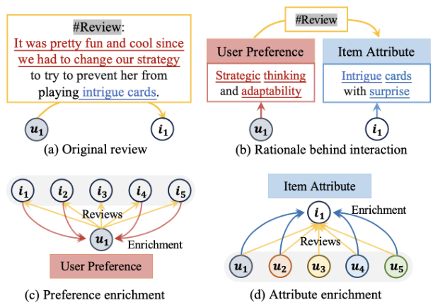
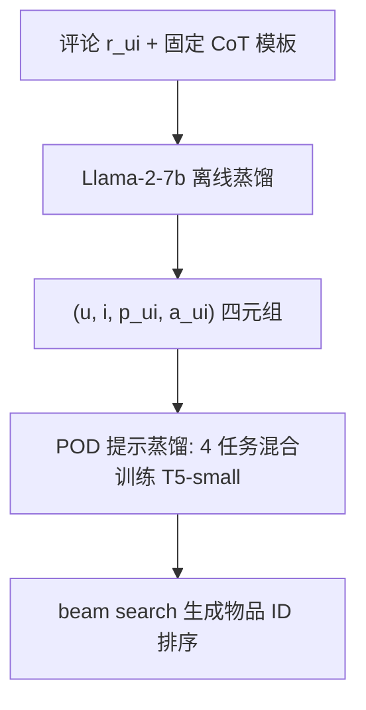
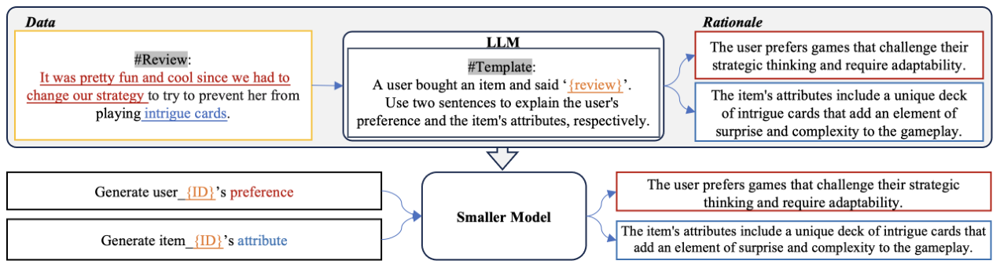
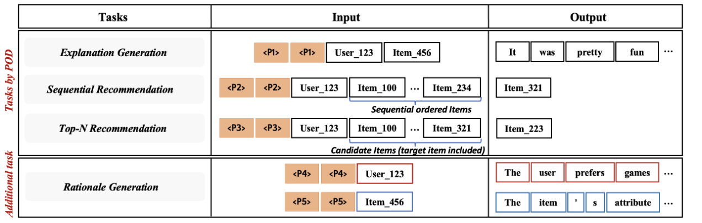

# RDRec: Rationale Distillation for LLM-based Recommendation (基于理由蒸馏的大模型推荐)

- **会议/期刊**: ACL 2024 (Main, Short Paper)
- **作者与机构**: Xinfeng Wang, Jin Cui, Yoshimi Suzuki, Fumiyo Fukumoto (University of Yamanashi)
- **推荐链路定位**: 端到端生成式（T5-small 词表级 beam search 直接生成物品 ID 排序）
- **研究方向**: 大语言模型推荐 / 序列推荐
- **论文原文**: [https://arxiv.org/abs/2405.10587v3](https://arxiv.org/abs/2405.10587v3)
- **开源代码**: [https://github.com/WangXFng/RDRec](https://github.com/WangXFng/RDRec)

## TL;DR (1分钟核心速览)

P5/POD 一类"提示蒸馏"范式把交互直接映射成 text-to-text 或连续提示向量，却完全丢弃了交互**背后**的语义理由（用户为什么买、物品是什么），且原始评论混杂噪声词，反而干扰画像。RDRec 用 Llama-2-7b 加 CoT 模板把每条评论蒸馏成"两句结构化理由"（用户偏好 $p_{u,i}$+ 物品属性$a_{u,i}$），再把"理由生成"作为第四个任务与序列推荐、Top-N 推荐、解释生成混合训练一个 T5-small。在 Amazon 三数据集、Leave-One-Out 生成式全库排序协议下，序列推荐较 POD 提升 1.6–9.8%，Top-N 推荐提升 12.1–42.2%（10 次 T 检验显著）。

## Background & Motivation (背景与核心矛盾)

- **主流范式**: 以 P5 为代表把用户 ID、物品 ID、评论、行为序列统一序列化成 text-to-text 提示，再由预训练 LM 直接生成目标物品 ID；POD 进一步把任务模板蒸馏成连续提示向量，用小模型（T5-small）复现大模型推理，显著降低延迟。
- **前人局限**: (1) 输入仍是**原始评论**，评论中同时纠缠主观偏好与具体物品细节，如"prevent her from playing intrigue cards"这类噪声词会把用户真正的"偏爱策略博弈"淹没；(2) 大 LM 知识只被用于"初始化/重排/表征增强"，没有进入**交互语义的中间推理层**，模型始终在学 ID→ID 的表面映射。
- **核心洞察 (Key Insight)**: 用户在评论里表达的是"我为什么喜欢"，物品则被描述为"我具备什么属性"——这两者是**天然解耦的两个语义维度**；把二者显式拆出来作为监督信号，比让模型自己在长评论里抓取更干净。
- **本文切入点**: 用 CoT 提示让大 LM 离线产出理由，作为额外的生成任务蒸馏进同一个紧凑推荐模型，实现"大模型出理由、小模型学理由"。

<figure class="paper-figure" markdown="span">
  <figcaption>图 1：我们的动机示意图。(a) 表示购买后的评论，(b) 表示由 LLMs 蒸馏得到的购买理由。(c) 和 (d) 分别表示偏好和属性增强。</figcaption>
</figure>

## Method (核心方法设计)

### 1. 整体框架 (Overall Architecture)

RDRec 采用两阶段流水线。**离线阶段**：对每条交互三元组 $(u,i,r_{u,i})$套用固定 CoT 模板——"A user bought an item and said '{review}'. Use two sentences to explain the user's preference and the item's attributes, respectively."——由 Llama-2-7b 生成$(u,i,p_{u,i},a_{u,i})$四元组。**在线/训练阶段**：沿用 POD 骨干，把序列推荐、Top-N 推荐、解释生成与新增的**理由生成**四个任务统一为"提示向量 + 任务模板$\to$ 目标词序列"，由同一个 T5-small 以对数似然混合训练；推理时用 beam search 在物品 ID 词表上生成并排序候选。

### 2. 关键设计拆解 (Key Designs)

1. **交互理由蒸馏（用 CoT 换取去噪画像）**：痛点是原始评论把偏好与属性混为一谈且夹带干扰词；本文的算子是"评论 $\to$偏好 + 属性"的确定性映射$(u,i,r_{u,i})\mapsto(u,i,p_{u,i},a_{u,i})$，其中$p_{u,i}$只保留用户需求，$a_{u,i}$ 只保留物品客观属性。其有效性来自"信息瓶颈"直觉：两句硬约束迫使大 LM 丢弃评论里的偶发细节（如"intrigue cards"），只保留可迁移的判别特征。

<figure class="paper-figure" markdown="span">
  <figcaption>图 2：通过思维链（CoT）提示使用 LLMs 进行理由蒸馏的示意图。</figcaption>
</figure>

2. **理由感知的提示蒸馏（第四个生成任务）**：在 POD 原有三个任务外新增两条模板 "Generate user_{#u}'s preference" 与 "Generate item_{#i}'s attribute"，各自蒸馏出连续提示向量 $\mathbf{P}_4,\mathbf{P}_5$；输入为$[\mathbf{x}_1,\dots,\mathbf{x}_{|X|},\mathbf{p}_1,\dots,\mathbf{p}_{|P|}]$叠加 **whole-word embedding**$\mathbf{w}$（把 "user_123" 的切分碎片强行视作整词单元），避免 ID 被 BPE 打散后语义漂移。这样推荐任务与理由生成任务共享同一套用户/物品表征，理由生成起到"表征正则化器"的作用。

<figure class="paper-figure" markdown="span">
  <figcaption>图 3：在提示蒸馏设置下，RDRec 的四个任务的输入与输出示意图。</figcaption>
</figure>

3. **训练目标、负采样与推理效率**：无负采样（生成式范式），总损失为四任务混合的逐 token 负对数似然：
$\mathcal{L}_{\Theta}=\frac{1}{|\mathcal{D}|}\sum_{(X,Y)\in\mathcal{D}}\frac{1}{|Y|}\sum_{t=1}^{|Y|}-\log p(y_t\mid Y_{<t},X)$四任务样本按比例$EG:RG:SR:TR$打乱混合。推理用 beam search 逐个解码物品 ID。复杂度为$O(L^2)$（$L$为词元数，取决于**交互数量**而非用户/物品规模），显著低于图卷积类方法依赖的$O((M+N)^2)$，因此适合大用户库部署。

## Experimental Setup & Evaluation Protocol (实验设置与评估协议)

- **数据集与预处理**: Amazon 三品类，按 POD 同源设定整理（未额外声明 5-core 过滤）：

| 数据集 | #Users | #Items | #Interactions | 稀疏度/密度 | 特征/场景说明 |
| :--- | :---: | :---: | :---: | :---: | :--- |
| Sports & Outdoors | 48,993 | 34,298 | 296,337 | 密度 0.0453% | 评论文本 + 行为序列 |
| Beauty | 22,363 | 12,101 | 198,502 | 密度 0.0734% | 评论文本 + 行为序列 |
| Toys & Games | 19,804 | 22,086 | 167,597 | 密度 0.0724% | 评论文本 + 行为序列 |

- **数据划分与防穿越 (Splitting Strategy)**: `Leave-One-Out`——最后一条交互为 test、倒数第二条为 validation、其余为 train；用户历史严格早于标签，无未来信息穿越。
- **排名评测协议 (Ranking Protocol)**: 生成式**全库打分**（词表覆盖全部物品 ID，beam search 解码出候选序列后按似然排序），不使用采样负例排序；指标 HR@k / NDCG@k，$k\in{1,5,10}$。
- **对比基线与超参设置**: 序列推荐对比 Caser / HGN / GRU4Rec / BERT4Rec / FDSA / SASRec / S³-Rec / P5 / RSL / POD（10 个）；Top-N 对比 MF / MLP / P5 / RSL / POD（5 个）。compact model 统一 T5-small，大 LM 为 Llama-2-7b，10-trial T 检验（$p<0.05$ 记 *）。

## Key Experimental Results (实验关键数据)

### 1. 主实验对比 (Main Results)

**序列推荐**（HR@10 / NDCG@10）：

| 模型 | Sports H@10 | Sports N@10 | Beauty H@10 | Beauty N@10 | Toys H@10 | Toys N@10 |
| :--- | :---: | :---: | :---: | :---: | :---: | :---: |
| SASRec | 0.0350 | 0.0192 | 0.0605 | 0.0318 | 0.0675 | 0.0374 |
| S³-Rec | 0.0385 | 0.0204 | 0.0647 | 0.0327 | 0.0700 | 0.0376 |
| P5 | 0.0460 | 0.0336 | 0.0664 | 0.0429 | 0.0709 | 0.0587 |
| RSL | 0.0512 | 0.0375 | 0.0667 | 0.0446 | 0.0712 | 0.0596 |
| POD | 0.0579 | 0.0422 | 0.0696 | 0.0471 | 0.0749 | 0.0601 |
| **RDRec (Ours)** | **0.0596** | **0.0433** | **0.0743** | **0.0504** | **0.0802** | **0.0605** |
| Improv.% (vs POD) | +2.8 | +2.5 | +6.7* | +7.1* | +7.1* | +0.7 |

**Top-N 推荐**（HR@1 / NDCG@10）：

| 模型 | Sports H@1 | Sports N@10 | Beauty H@1 | Beauty N@10 | Toys H@1 | Toys N@10 |
| :--- | :---: | :---: | :---: | :---: | :---: | :---: |
| MF | 0.0314 | 0.1220 | 0.0311 | 0.1224 | 0.0233 | 0.0940 |
| MLP | 0.0351 | 0.1296 | 0.0317 | 0.1215 | 0.0252 | 0.0988 |
| P5 | 0.0726 | 0.1627 | 0.0608 | 0.1332 | 0.0451 | 0.1114 |
| RSL | 0.0892 | 0.1703 | 0.0607 | 0.1302 | 0.0389 | 0.1028 |
| POD | 0.0927 | 0.1782 | 0.0846 | 0.1639 | 0.0579 | 0.1244 |
| **RDRec (Ours)** | **0.1285** | **0.2326** | **0.1203** | **0.2160** | **0.0660** | **0.1398** |
| Improv.% (vs POD) | +38.6* | +30.5* | +42.2* | +31.8* | +13.9* | +12.4* |

### 2. 消融实验 (Ablation Study)

以 H@10 计（UsP = 用户偏好蒸馏，ItA = 物品属性蒸馏）：

| 配置 | Seq-Sports | Seq-Beauty | Seq-Toys | TopN-Sports | TopN-Beauty | TopN-Toys |
| :--- | :---: | :---: | :---: | :---: | :---: | :---: |
| w/o UsP, ItA | 0.0566 | 0.0705 | 0.0768 | 0.2977 | 0.2777 | 0.2200 |
| +UsP only | 0.0581 | 0.0729 | 0.0787 | 0.3509 | 0.3080 | 0.2214 |
| +ItA only | 0.0573 | 0.0712 | 0.0788 | 0.3513 | 0.3275 | 0.2321 |
| **+UsP, ItA** | **0.0596** | **0.0743** | **0.0802** | **0.3683** | **0.3380** | **0.2375** |

### 3. 关键实验发现 (Key Findings)

1. **画像式理由对"全库判别"的增益远大于"下一项预测"**：Top-N 场景相对 POD 提升 12.1–42.2%（Sports H@1 +38.6%），而序列场景仅 1.6–9.8%。说明理由主要强化了"在整库中判别候选是否匹配画像"的能力；下一项预测仍更依赖行为转移模式本身。
2. **两种理由存在任务偏向性**：Beauty 的 Top-N H@10 上，单独加属性从 0.2777→0.3275（+17.9%），单独加偏好只到 0.3080（+10.9%），属性单独已接近满配；但序列任务上偏好的增益普遍略高于属性（Beauty 0.0705→0.0729 vs 0.0712）。即"属性判候选、偏好判序列"。
3. **理由生成样本配比对数据分布敏感**：在 Toys 上把理由生成比例提升到 1:1:1:3，Top-N H@10 由 0.2214 升至 0.2375（+7.3%）；而 Sports 在 1:1:1:1 时最优，更多序列样本反而拉低 Top-N。任务混采比例必须按业务场景调参，不存在通用最优。

## Highlights & Limitations (亮点、对比与审稿批判)

- **与代表作对比 (vs. Prior Work)**: 相比 **P5**，RDRec 不再"把评论原样喂给 LM"，而是引入一层显式语义分解；相比 **POD**，本文不改蒸馏机制而改**监督信号内容**，把大 LM 从"教师模型"进一步用作"数据标注器"，成本仅一次性离线；相比 **RLS/P5+RLS** 的知识注入路线，本文注入的是**样本级自然语言理由**而非参数级知识。
- **可迁移亮点**: (1) "固定双句模板 + CoT"是零训练成本的结构化标注方案，可直接迁移到评论/客服日志/短视频标题等场景产出"偏好-属性"解耦监督；(2) whole-word embedding 处理离散 ID 被 BPE 打散的技巧，对所有 ID-as-token 的生成式推荐通用。
- **审稿级局限批判**: (1) 只做 `Leave-One-Out` 单点划分，未报告时间戳切分或冷启动划分下的结果，"画像去噪对冷启动物品是否有用"这一最强卖点事实上未被验证；(2) 理由蒸馏完全离线依赖 Llama-2-7b，论文自己承认短评论会触发**幻觉**且存在"推理不忠实"（推荐对了但理由读反了用户态度），却未给出任何幻觉检测或过滤机制，导致数据质量不可控；(3) 序列任务提升幅度小且部分不显著（Sports $p=2.7\times10^{-1}$、Toys N@10$p=5.9\times10^{-1}$），短论文体量下证据强度有限。

## Rating (四维评分)

- **方法创新性 (Novelty)**: ⭐⭐⭐ （把 CoT 理由蒸馏搬进提示蒸馏框架属工程式增量，但"偏好/属性双解耦 + 第四生成任务"的设计简洁且直觉正确，无理论支撑）
- **评估协议与实验扎实度 (Protocol & Experiments)**: ⭐⭐⭐ （三数据集 + 10-trial T 检验 + 完整消融与配比分析合格，但仅 Leave-One-Out 单一划分，未做冷启动/时间切分，部分提升不显著）
- **写作与数学规范度 (Clarity & Rigor)**: ⭐⭐⭐⭐ （两阶段流程与四任务输入输出示例图清晰，损失与复杂度说明到位；公式量少但足以复现）
- **工业落地与复现价值 (Industrial & Practical Value)**: ⭐⭐⭐⭐ （代码开源；在线仅跑 T5-small、复杂度随交互数而非用户×物品增长，部署成本低；代价是需一次性大 LM 离线蒸馏全量评论）

