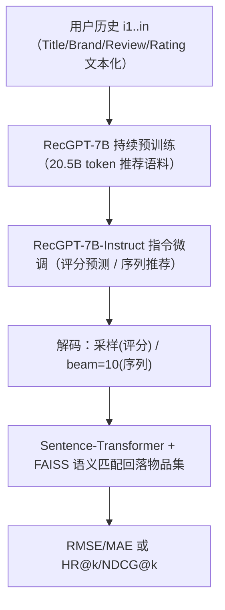

# RecGPT: Generative Pre-training for Text-based Recommendation (面向文本化推荐的全量生成式预训练模型)

- **会议/期刊**: ACL 2024 (Main Conference)
- **作者与机构**: Hoang Ngo, Dat Quoc Nguyen (VinAI Research, Vietnam)
- **推荐链路定位**: 端到端生成式（评分预测 + 序列下一物品生成）
- **研究方向**: 大语言模型推荐 / 序列与会话推荐
- **论文原文**: [https://arxiv.org/abs/2405.12715v1](https://arxiv.org/abs/2405.12715v1)
- **开源代码**: [https://github.com/VinAIResearch/RecGPT](https://github.com/VinAIResearch/RecGPT)（含模型与预训练/微调数据集权重）

## TL;DR (1分钟核心速览)

针对现有 LLM4Rec 工作（P5、GenRec）**仅用 ID 表征物品且从未在推荐领域做全量预训练**的痛点，本文把物品表示为「标题+品牌/作者+评论+评分」的自然语言文档，在 20.5B token 的跨 12 域推荐语料上从 MPT-7B 持续预训练得到 RecGPT-7B，再用 10 万+ 指令对做 SFT 得 RecGPT-7B-Instruct，并以 Sentence-Transformer+FAISS 语义匹配把自由生成文本回落到物品集合。在 4 个 5-core / Yelp 基准上，评分预测 RMSE 全面领先 MF/MLP/P5/ChatGPT，序列推荐 Toys 上 HR@5 相对 P5 提升 **138.9%**。

## Background & Motivation (背景与核心矛盾)

- **主流范式**: 传统 MF/MLP 挖交互矩阵，GRU4Rec/SASRec 编码物品 ID 序列；P5 将多任务统一为 T5 上的 ID→文本条件生成，GenRec 用 LoRA 微调 LLaMA 做序列生成。
- **前人局限 1（表征失配）**: P5 用纯 ID 表示用户与物品，与 LLM 的文本理解能力天然错位，冷启动物品与新域上语义知识完全无法迁移。
- **前人局限 2（无领域预训练）**: ChatGPT 在 Beauty 上 HR@5 仅 0.0135（P5 为 0.0350），说明通用语料缺乏域内物品共现知识；GenRec 仅 LoRA 微调、未见 20B 级推荐语料，Toys 上被全参微调全面压制。
- **前人局限 3（评测泄漏）**: 作者首次指出 P5 多任务训练的隐性泄漏——评分预测的 80/10/10 随机划分与序列推荐的 leave-one-out 划分共享交互，训练集与测试集交叉污染。
- **核心洞察 (Key Insight)**: 推荐场景中"用户集/物品集/交互"高度共享，因此可以把整条用户历史当作一篇**按时间排序的文本文档**做语言建模，让"预测下一物品"退化为"续写下一段物品描述"。
- **本文切入点**: 领域持续预训练（domain-adaptive CPT）+ 多任务指令微调 + 语义检索式解码，一条链路同时解决表征、知识、幻觉三个问题。

## Method (核心方法设计)

### 1. 整体框架 (Overall Architecture)

模型以 MPT-7B 为骨架（32 层、$d_{model}=4096$、32 heads、GPT-NeoX 50K 词表、`max_seq_len=2048`、FlashAttention + ALiBi 支持长度外推）。**预训练阶段**：每个用户历史被序列化为按时间升序的文档$i_1, i_2, \dots, i_n$，每项$i_k$ 展开为 `Title; Brand/Author; Review; Rating`，共 10.15M 用户 / 10.31M 物品 / 258.1M 交互、10M+ 文档、20.5B token；超长历史按 token 预算均分为多个子块视作独立用户。**微调阶段**：构造 10 万+ 指令对，评分预测任务遮蔽末项的 Rating 字段要求补全，序列推荐任务只保留 Title/Brand 要求生成下一项。**推理阶段**：评分预测用采样解码抽取数值，序列推荐用 beam search 生成 10 条候选，再经嵌入检索回落到真实物品集合。

### 2. 关键设计拆解 (Key Designs)

1. **文本化用户历史文档 + 领域持续预训练**：ID 表征让 LLM 的语义先验失效 $\to$把整条历史拼成单文档并以自回归语言建模目标训练$\mathcal{L}_{CPT}=-\sum_{t}\log p_\theta(y_t \mid y_{<t}, x_{<t})$（$x$为历史文档）$\to$ 直觉是模型在续写"下一个 Title 是什么"时被迫学到跨域的物品共现与偏好漂移规律，而评论/评分字段提供细粒度情感监督。
2. **双任务指令微调与字段遮蔽**：统一 prompt 模板 `### Instruction / ### Response`，评分任务把目标项的 Rating 字段留空、序列任务删除 Review 与 Rating 只留结构字段 $\to$同一模型在不同字段可见性下学到"补全数值"与"续写实体"两种能力$\to$ 遮蔽无关字段既缩短 prompt 也让任务信号更纯。
3. **语义相似度匹配解码（抗幻觉）**：LLM 生成的标题常与真实标题有微小偏差 $\to$用句嵌入$\mathbf{e}(\cdot)$做最近邻回落$\hat{i}=\arg\max_{i\in\mathcal{I}}\frac{\mathbf{e}(g)^{\top}\mathbf{e}(i)}{\lVert \mathbf{e}(g)\rVert\,\lVert \mathbf{e}(i)\rVert}$（FAISS 点积检索）$\to$ 把开放词表生成映射回闭集，幻觉从"推荐错误"降级为"轻度改写"。
4. **训练配置与开销**：LION 优化器 + FSDP 分片，全局 batch 128（260K token/步），峰值学习率 $2.5\times10^{-5}$、2 epoch、约 157K 步、8×A100-40G 上 18 天（3456 GPU 时，0.585 tCO$_2$eq）；SFT 用$1.0\times10^{-5}$，仅 4 小时（32 GPU 时）。**免负采样**，全部损失为 token 级交叉熵。

## Experimental Setup & Evaluation Protocol (实验设置与评估协议)

- **数据集与预处理**: 预训练混合 12 域（Amazon 29 子类、Goodreads、HotelRec、MovieLens、Netflix、Yelp、Steam、WikiRec、Anime、Food、BookCrossing），清洗规则为「丢弃无 title 物品、少于 5 条交互用户、全部人口统计学信息」。评测用 4 个基准：

| 数据集 | #Users | #Items | #Interactions | 密度 | 说明 |
| :--- | :---: | :---: | :---: | :---: | :--- |
| Amazon Beauty (2014) | 22,363 | 12,101 | 198,502 | 0.073% | 5-core，美妆 |
| Amazon Sports (2014) | 35,598 | 18,357 | 296,337 | 0.045% | 5-core，户外运动 |
| Amazon Toys (2014) | 19,412 | 11,924 | 167,597 | 0.072% | 5-core，玩具 |
| Yelp (2020) | 30,431 | 20,033 | 316,354 | 0.052% | 2019 全年交易 |

- **数据划分与防穿越**: 沿用 P5 划分——评分预测为 **80/10/10 随机比例划分**，序列推荐为 **Leave-One-Out**（末项测试、次末项验证）；但**显式剔除落入测试集的训练交互**以修复跨任务泄漏。关键设定：四个基准的 train/val 划分**只用于持续预训练**，不参与指令微调，以模拟真实冷场景。
- **排名评测协议**: 序列推荐采用 **Sampled-Free 的生成式 beam 排序**（beam=10，用 beam score 排序），并额外做语义匹配回落；未采用全库打分，故 HR@k 绝对值偏低但模型间可比。
- **对比基线**: MF、MLP、P5、OpenP5、GenRec(LoRA)、ChatGPT(GPT-3.5-turbo, few-shot)、以及关键的 **MPT-7B with SFT**（同数据同流程但无领域预训练，作为 CPT 消融）。

## Key Experimental Results (实验关键数据)

### 1. 主实验对比 (Main Results)

**评分预测（RMSE/MAE，越低越好）**

| Model | Beauty RMSE | Beauty MAE | Sports RMSE | Sports MAE | Toys RMSE | Toys MAE | Yelp RMSE | Yelp MAE |
| :--- | :---: | :---: | :---: | :---: | :---: | :---: | :---: | :---: |
| MF | 1.1973 | 0.9461 | 1.0234 | 0.7935 | 1.0123 | 0.7984 | 1.2645 | 1.0426 |
| MLP | 1.3078 | 0.9597 | 1.1277 | 0.7626 | 1.1215 | 0.8097 | 1.2951 | 1.0340 |
| P5 | 1.2843 | 0.8534 | 1.0357 | 0.6813 | 1.0544 | 0.7177 | 1.4685 | 1.0054 |
| ChatGPT (few-shot) | 1.0751 | 0.6977 | – | – | – | – | – | – |
| MPT-7B + SFT | 0.5637 | 0.2616 | 0.5446 | 0.2488 | 0.5565 | 0.2668 | 0.5620 | 0.2804 |
| **RecGPT-7B-Instruct** | **0.5316** | **0.2436** | **0.5208** | **0.2340** | **0.5361** | **0.2535** | **0.5203** | **0.2489** |
| Improv. vs 最强基线 | 5.7% | 6.9% | 4.4% | 6.0% | 3.7% | 5.0% | 7.4% | 11.2% |

**序列推荐（HR/NDCG）**

| Model | Beauty HR@5 | Beauty NDCG@5 | Beauty HR@10 | Toys HR@5 | Toys NDCG@5 | Toys HR@10 | Sports HR@5 | Sports HR@10 | Yelp HR@5 | Yelp HR@10 |
| :--- | :---: | :---: | :---: | :---: | :---: | :---: | :---: | :---: | :---: | :---: |
| P5 | 0.0350 | 0.0250 | 0.0480 | 0.0180 | 0.0130 | 0.0235 | 0.0107 | 0.0146 | – | – |
| OpenP5 | 0.0317 | 0.0239 | 0.0437 | – | – | – | – | – | – | – |
| GenRec | – | – | – | 0.0190 | 0.0136 | 0.0251 | – | – | – | – |
| ChatGPT (few-shot) | 0.0135 | 0.0135 | 0.0135 | – | – | – | – | – | – | – |
| MPT-7B + SFT | 0.0063 | 0.0041 | 0.0088 | 0.0088 | 0.0061 | 0.0133 | 0.0021 | 0.0033 | 0.0390 | 0.0453 |
| **RecGPT-7B-Instruct** | **0.0364** | 0.0236 | **0.0527** | **0.0430** | **0.0288** | **0.0606** | **0.0173** | **0.0255** | **0.0479** | **0.0603** |
| Improv.% vs 最强基线 | +4.0% | −5.6% | +9.8% | **+126.3%** | **+111.8%** | **+141.4%** | +61.7% | +74.7% | +22.8% | +33.1% |

### 2. 消融实验 (Ablation Study)

| 配置 | Beauty HR@10 | Toys HR@10 | Sports HR@10 | Yelp HR@10 | Beauty RMSE |
| :--- | :---: | :---: | :---: | :---: | :---: |
| MPT-7B + SFT（无 CPT） | 0.0088 | 0.0133 | 0.0033 | 0.0453 | 0.5637 |
| **RecGPT-7B-Instruct（+20.5B CPT）** | **0.0527** | **0.0606** | **0.0255** | **0.0603** | **0.5316** |
| 相对增益 | +498.9% | +355.6% | +672.7% | +33.1% | −5.7% |

### 3. 关键实验发现 (Key Findings)

1. **领域持续预训练是收益主引擎，且对序列任务远比对评分任务关键**：同一 SFT 流程下，加 CPT 后 Beauty HR@10 从 0.0088 涨到 0.0527（近 6 倍），而 RMSE 仅从 0.5637 降到 0.5316（−5.7%）。作者归因于 MPT-7B 的 1T 通用语料已含大量网评，评分预测近似"细粒度情感分类"，而"域内物品集合共现"只能从推荐语料中获得。
2. **跨域规模换来了玩具/运动等稀疏域的巨幅跃升**：Toys 仅 1.68 万交互却取得 HR@5 0.0430，相对 P5 的 0.0180 提升 126%（HR@10 提升 141%），说明 CPT 学到的不是单域记忆而是可迁移的物品语义-偏好映射；相对 LoRA 微调的 GenRec（0.0190）也翻倍，证明**全参 CPT 优于轻量适配**。
3. **在 Beauty 上增益最小且 NDCG@5 微降**：Beauty HR@5 0.0364 仅超 P5 4.0%，NDCG@5 反低 5.6%，说明 top-5 内部排序质量仍受 beam 生成粒度限制——命中率提升主要来自"候选召回变宽"，而非排序精度提升。

## Highlights & Limitations (亮点、对比与审稿批判)

- **与代表作对比**: 相比 P5（T5、纯 ID、多任务 prompt 混合、无领域预训练），本文换成 7B 解码器 + 文本化物品 + 20.5B 领域语料，并把 P5 的评测泄漏显式修掉；相比 GenRec（LLaMA + LoRA 只微调低秩参数），本文用全参 CPT 在 Toys 上 HR@5 提升 126%；相比 ChatGPT few-shot，域内训练数据把 HR@5 从 0.0135 拉到 0.0364。
- **可迁移亮点**: (1) 用**闭集语义检索回落**处理生成式推荐的幻觉，任何"生成 ID/标题"的端到端模型都可直接套用；(2) 长历史按 token 预算**分块视作多用户**，是在 2048 上下文中无损扩容训练样本的廉价手段。
- **审稿级局限批判**: (1) **推理开销与"生成式排序"合理性存疑**——7B 模型需 beam=10 次自回归解码才能产出 10 个候选，HR@k 绝对值（Beauty 3.6%）远低于传统 SASRec 类全库排序，文中未给延迟/吞吐数字；(2) **评测协议不可比与泄漏修补的对称性缺失**——训练划分仅用于 CPT 的设定虽"仿真"，却使基线（P5 用满训练集）与本文在数据预算上不对称，且仅在 Beauty 一处验证了泄漏修补后仍与 P5 可比，其余数据集的结论稳健性未做敏感性分析。

## Rating (四维评分)

- **方法创新性 (Novelty)**: ⭐⭐⭐⭐ （首个 20.5B token 级推荐领域全量 CPT 的 7B LLM，文本化历史文档建模思路干净；但 CPT+SFT+语义匹配的组合本身偏工程集成，缺少新的建模范式）
- **评估协议与实验扎实度 (Protocol & Experiments)**: ⭐⭐⭐⭐ （4 基准双任务、含 MPT-7B+SFT 的严格消融与泄漏修复，但缺显著性检验、缺延迟指标、序列推荐未做全库排序）
- **写作与数学规范度 (Clarity & Rigor)**: ⭐⭐⭐ （数据格式与训练超参交代详尽、附录完整，但正文数学形式极简、几乎无推导与复杂度分析）
- **工业落地与复现价值 (Industrial & Practical Value)**: ⭐⭐⭐⭐⭐ （模型权重、预训练语料、指令数据全部开源且提供 HuggingFace 链接，SFT 仅 32 GPU 时，语义匹配模块极易复用）

