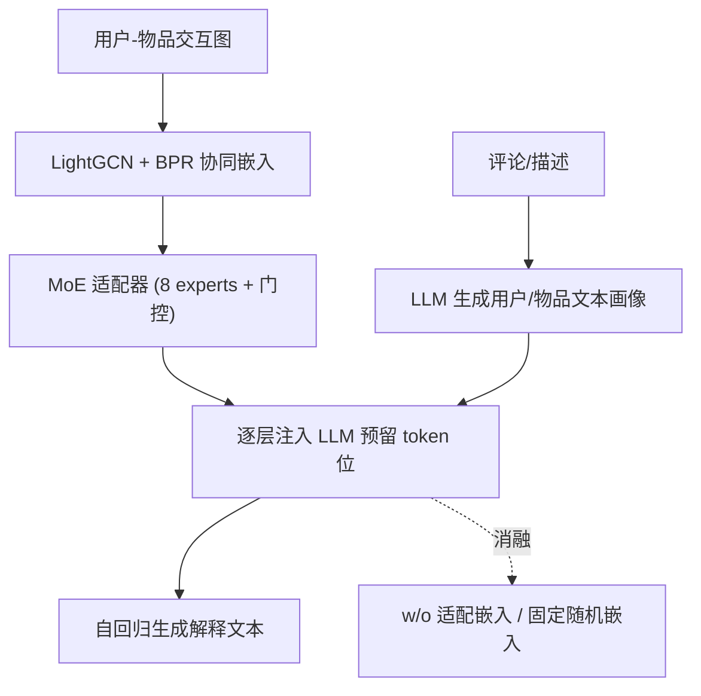
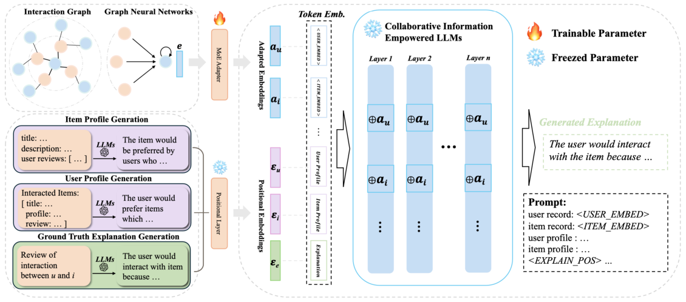
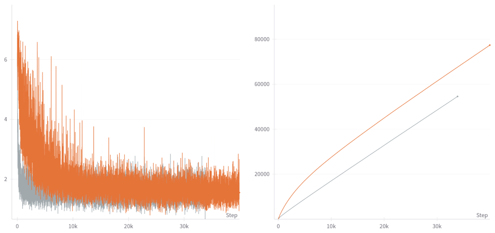

# Reproducibility Study of "XRec: Large Language Models for Explainable Recommendation" (XRec 可解释推荐框架的复现研究)

- **会议/期刊**: ACL 2024 原始工作（XRec, Ma et al.）；本文为 arXiv 2025 复现研究
- **作者与机构**: Ranjan Mishra, Julian I. Bibo, Quinten van Engelen, Henk Schaapman（University of Amsterdam）
- **推荐链路定位**: 端到端生成式（后验解释生成 / Post-hoc Explanation），不做召回排序
- **研究方向**: 大语言模型推荐 (LLM4Rec) / 对话推荐与智能体仿真（可解释理由生成）
- **论文原文**: [https://arxiv.org/abs/2510.06275v1](https://arxiv.org/abs/2510.06275v1)
- **开源代码**: [https://github.com/julianbibo/xrec-reproducibility](https://github.com/julianbibo/xrec-reproducibility)

## TL;DR (1分钟核心速览)

本文独立复现 ACL 2024 的 XRec——用 LightGCN 图嵌入经 MoE 适配器注入冻结 LLM、为推荐结果生成个性化解释的框架。作者以开源 Llama-3.1-8B 替换闭源 GPT-3.5-turbo 打分器（LlamaScore 替代 GPTScore），在 Amazon-books / Yelp / Google-reviews 三个数据集的文本对齐评测上逐条验证原文四条 Claim，并追加两个反事实扩展：删除 MoE 适配嵌入使 LlamaScore 从 67.09 跌至 57.81，用固定随机嵌入替换 GNN 输出则跌至 57.31 且 BERT F1 仅 0.2422（全表最低）。结论是：协同注入确实提分并稳住输出（Claim 4 成立），但 XRec 并未全面超越 PETER/PEPLER 等基线（Claim 1 被拒），解释质量高度依赖打分器选择。

## Background & Motivation (背景与核心矛盾)

- **主流范式**: 可解释推荐从 Att2Seq / NRT 的 RNN+Attention 生成评论，演进到 PETER（ID→文本映射）、PEPLER（prompt 学习），再到 XRec 把协同过滤图信号注入 LLM，实现"模型无关"的文本解释生成。
- **前人局限**: ① 解释监督数据稀缺，早期生成器语义质量差；② XRec 依赖 GPT-3.5-turbo 计算 GPTScore，闭源、不可复现，且四条核心 Claim 从未被第三方独立检验，其开源仓库还缺失 BARTScore / BLEURT 与"w/o profile"消融代码。
- **核心洞察 (Key Insight)**: "可解释性分数"本质是生成文本与伪标注解释的语义对齐度，与打分器强耦合；更换打分器即可让绝对分整体平移 15–20 分，因此必须区分"模型变好"与"打分器变了"。
- **本文切入点**: 用开源打分器重建可复现评测管线，并设计两组反事实输入（删适配嵌入、GNN 嵌入→固定随机嵌入）解剖 MoE 到底传递了什么信息。

## Method (核心方法设计)

### 1. 整体框架 (Overall Architecture)

XRec 三段式：LightGCN 在用户-物品二部图上做 $L$ 层邻居均值传播得到协同嵌入，用 BPR 优化；MoE 适配器把稠密协同向量投影到 LLM 的词嵌入空间，得到适配嵌入；GPT-3.5 离线从评论/描述蒸馏出用户与物品文本画像。推理时，适配嵌入被插入 LLM 每一层预留的 `<USER_EMBED>`/`<ITEM_EMBED>` 位置，与文本画像共同条件化冻结的 LLM，自回归生成解释。本文的"方法"贡献不在模型，而在复现协议：补齐缺失指标与消融实现、以 Llama-3.1-8B 做打分器、并把 batch 固定为 1 以保证生成质量。

<figure class="paper-figure" markdown="span">
  <figcaption>图 1</figcaption>
</figure>

### 2. 关键设计拆解 (Key Designs)

1. **MoE 协同适配器（被复现的核心算子）**：GNN 嵌入与词向量空间不同源，直接拼接会破坏 LLM 语义流。适配器用 $K=8$个线性专家加权：$\boldsymbol{e}^{\text{adapt}}=\sum_{k=1}^{K}g_k(\boldsymbol{e})\,\mathbf{W}_k\boldsymbol{e}$，其中$g(\boldsymbol{e})=\mathrm{Softmax}(\mathrm{TopK}(\mathbf{W}_g\boldsymbol{e}+\epsilon))$，$\epsilon\sim\mathcal{N}(0,0.01^2)$ 为门控噪声。直觉上稀疏门控让不同用户/物品子群走不同投影通道，避免单一线性映射被平均掉。
2. **逐层注入与冻结训练**：适配嵌入拼接到每层注意力输入 $\mathbf{H}^{(\ell)}=[\mathbf{h}^{\text{txt}};\boldsymbol{e}^{\text{adapt}}_u;\boldsymbol{e}^{\text{adapt}}_i]$，梯度可沿层间回流到 MoE。LLM 权重冻结，只训练适配器，损失为解释文本的负对数似然$\mathcal{L}=-\sum_t\log p_\theta(y_t\mid y_{<t},\boldsymbol{e}^{\text{adapt}}_u,\boldsymbol{e}^{\text{adapt}}_i,\mathcal{P}_u,\mathcal{P}_i)$，无需负采样。
3. **两组反事实扩展（本文真正的增量）**：① 完全移除适配嵌入，LLM 只看文本画像——检验协同信号的必要性；② 保留 MoE 但把逐样本 GNN 输入换成全数据集共用的一组固定随机嵌入——若性能仅小幅下降，说明适配嵌入只是"句法模板提示器"而非样例级信息载体。

## Experimental Setup & Evaluation Protocol (实验设置与评估协议)

- **数据集与预处理**: 沿用原作者已过滤版本（$k$-core + 未公开比例的子采样），未重新生成画像：

| 数据集 | #Users | #Items | #Interactions | 划分 (Train/Val/Test) | 场景说明 |
| :--- | :---: | :---: | :---: | :---: | :--- |
| Amazon-books | 15,349 | 15,247 | 360,839 | 95,841 / 11,980 / 3,000 | 图书评论 + 长文本解释 |
| Google-reviews | 22,582 | 16,557 | 411,840 | 94,663 / 11,833 / 3,000 | 地图商户元数据 |
| Yelp | 15,942 | 14,085 | 393,680 | 74,212 / 9,277 / 3,000 | 本地生活服务评论 |

- **数据划分与防穿越 (Splitting Strategy)**: 直接继承原作者固定的 `比例划分`（train/val/test 三份已隔离），画像由 GPT-3.5 离线预生成，不涉及测试集泄露；部分实验因算力限制仅取 `10%` 测试子集（$N=300$，表中标 †）。
- **排名评测协议 (Ranking Protocol)**: 本文**不做 Top-N 排序**，不涉及 Full-Ranking / Sampled Ranking；评测目标是生成文本与 ground-truth 解释的语义对齐，指标含 LlamaScore（替代 GPTScore）、BERTScore P/R/F1、BARTScore、BLEURT、USR（唯一句比），并以各指标标准差 $\sigma$ 度量"稳定性"（越低越稳）。
- **对比基线与超参设置**: 基线为 Att2Seq、NRT、PETER、PEPLER 四类生成式解释模型；MoE 8 专家、dropout 0.2、门控噪声 0.01、学习率 $10^{-4}$、权重衰减$10^{-6}$、batch size 1、1 epoch，早停基于 10 样本滚动窗的平均训练损失。

## Key Experimental Results (实验关键数据)

### 1. 主实验对比 (Main Results)

Amazon-books 上（`–` 表示该打分器未运行；†表示 10% 测试子集）：

| 模型 | GPT↑ | Llama↑ | BERT_P↑ | BERT_R↑ | BERT_F1↑ | BART↑ | BLEURT↑ | USR↑ | $\sigma_{\text{Llama}}$↓ |$\sigma_{\text{BERTF1}}$↓ |
| :--- | :---: | :---: | :---: | :---: | :---: | :---: | :---: | :---: | :---: | :---: |
| Att2Seq | 76.08 | – | 0.3746 | 0.3624 | 0.3687 | -3.9440 | -0.3302 | 0.7757 | 12.56 | 0.1275 |
| NRT | 75.63 | – | 0.3444 | 0.3440 | 0.3443 | -3.9806 | -0.4073 | 0.5413 | 12.82 | 0.1321 |
| PETER | 77.65 | – | **0.4279** | 0.3799 | 0.4043 | -3.8968 | -0.2937 | 0.8480 | 11.21 | 0.1098 |
| PEPLER | 78.77 | – | 0.3506 | 0.3569 | 0.3543 | -3.9142 | -0.2950 | 0.9563 | 11.38 | 0.0893 |
| XRec [O] | **82.57** | – | 0.4193 | **0.4038** | **0.4122** | -3.8035 | **-0.1061** | **1.0000** | **9.60** | **0.0800** |
| XRec [R] (Llama-3) | – | 67.09 | 0.3959 | 0.3990 | 0.3982 | **-3.0586** | -0.1242 | **1.0000** | 20.48 | 0.0790 |

跨数据集复现差值（XRec [O] → [R]，同一指标不可直接比较，仅看相对基线位置）：Yelp GPTScore 74.53 → LlamaScore 53.16（该实验仅 300 样本），Google-reviews 69.12 → 54.41；两处复现均低于 PEPLER 的 67.54 与 61.58（原 GPTScore 口径）。

### 2. 消融实验 (Ablation Study)

Amazon-books 统一 Llama 打分口径：

| 变体 | Llama↑ | BERT_F1↑ | BART↑ | BLEURT↑ | USR↑ | $\sigma_{\text{Llama}}$↓ |$\sigma_{\text{BERTF1}}$↓ |
| :--- | :---: | :---: | :---: | :---: | :---: | :---: | :---: |
| XRec (full) | **67.09** | **0.3982** | **-3.0586** | **-0.1242** | **1.0000** | **20.48** | **0.0790** |
| w/o profile | 64.94 | 0.3913 | -3.0855 | -0.2051 | 1.0000 | 21.86 | 0.0837 |
| w/o injection | 60.41 | 0.2684 | -3.2118 | -0.2625 | 0.9930 | 27.91 | 0.3357 |
| w/o prof. & inj.† | 60.04 | 0.3778 | -3.1284 | -0.3571 | 1.0000 | 24.63 | 0.0797 |
| w/o adapted embed. | 57.81 | 0.2707 | -3.3877 | -0.4551 | 0.9993 | 27.67 | 0.1020 |
| fixed MoE input† | 57.31 | 0.2422 | -3.2962 | -0.3125 | 1.0000 | 29.10 | 0.3081 |

### 3. 关键实验发现 (Key Findings)

1. **打分器决定结论方向**：原始 GPTScore 82.57 换成 LlamaScore 后仅 67.09（−18.7%），XRec 相对 PEPLER 的 +3.8 分优势反转为 −11.7 分，Claim 1（全面超越基线）不成立；而 BARTScore 与打分器无关，复现值 -3.0586 反而优于原文 -3.8035，说明"退步"主要来自生成文本的语义匹配口径而非生成能力本身。
2. **协同注入既提分又提稳**：去掉注入后 LlamaScore 60.41（−9.95%）、BERT F1 从 0.3982 跌到 0.2684（−32.6%），$\sigma_{\text{BERTF1}}$ 从 0.0790 膨胀到 0.3357（4.25 倍），并出现含数字串的破碎句子——与原文"注入改善梯度回流"的解释一致，Claim 4 成立。
3. **MoE 嵌入传递的是样例级信息而非模板**：固定单组输入时 LlamaScore 57.31（−14.6%）、BERT F1 0.2422 为全表最低，但仍能生成"句法结构高度贴近 ground truth"的解释；同时其训练损失与完整模型几乎重合（见 <figure class="paper-figure" markdown="span">
  <figcaption>图 3</figcaption>
</figure>），揭示训练损失不能作为该架构的模型选择指标，也说明 GNN 逐样本嵌入的"内容"才是解释语义的来源。

## Highlights & Limitations (亮点、对比与审稿批判)

- **与代表作对比 (vs. Prior Work)**: 与 Ma et al. (2024) 相比，本文不提出新模型，而是把"可解释性"从闭源打分器的黑箱中解放出来（LlamaScore 全开源）；与 PEPLER / PETER 这类纯文本解释器相比，XRec 的差异在于显式把 CF 图信号作为条件，但复现显示这一优势在同口径评测下被显著削弱；与常规复现论文相比，其"固定随机嵌入"探针提供了因果性更强的诊断视角。
- **可迁移亮点**: ① 用"固定共享嵌入 vs 逐样本嵌入"的对照分离"模板效应"与"信息效应"，可迁移到任意 adapter/prefix-tuning 推荐模型；② 跨打分器分数不可比的警示，直接适用于所有 LLM-as-Judge 的解释评测。
- **审稿级局限批判**: ① batch size 固定为 1，单次 Amazon 训练+生成需 9h54m + 8h19m（H100，6.74 kg CO$_2$eq），全部实验 35.84 kg，且 Yelp/Google 的多组实验只跑 300 条测试样本，缺乏显著性检验，结论稳健性存疑；② ground-truth 解释本身由 GPT-3.5 从评论改写，评测的是"与伪标注的语义对齐"而非解释的真实忠实度（faithfulness），且 XRec 与被解释的推荐系统完全解耦，无法保证解释反映真实决策路径。

## Rating (四维评分)

- **方法创新性 (Novelty)**: ⭐⭐⭐ （不提出新模型，但"固定嵌入"反事实探针与开源 LlamaScore 评测口径对领域有实质推动）
- **评估协议与实验扎实度 (Protocol & Experiments)**: ⭐⭐⭐ （三数据集、四条 Claim 逐条裁决、消融完整；但 10% 子集 + 单 epoch + 无显著性检验削弱说服力）
- **写作与数学规范度 (Clarity & Rigor)**: ⭐⭐⭐⭐ （Claim 驱动结构清晰、图表口径交代明确，公式精简但足以复现注入与损失）
- **工业落地与复现价值 (Industrial & Practical Value)**: ⭐⭐⭐ （开源代码与评测管线价值高，但 batch=1 的推理开销与对冻结大模型的依赖限制线上部署）

