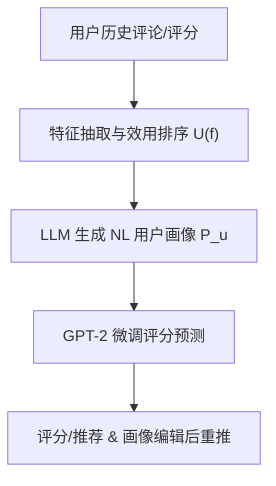
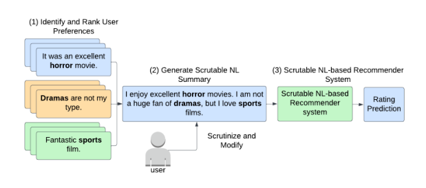

# Transparent and Scrutable Recommendations Using Natural Language User Profiles (使用自然语言用户画像的透明且可审视推荐)

- **会议/期刊**: ACL 2024 (Main)
- **作者与机构**: Jerome Ramos, Hossein A. Rahmani, Xi Wang, Xiao Fu, Aldo Lipani；University College London / University of Sheffield
- **推荐链路定位**: 评分预测（精排）
- **研究方向**: LLM推荐
- **论文原文**: [论文原文链接](https://arxiv.org/abs/2402.05810v2)
- **开源代码**: [开源代码仓库链接](https://github.com/jeromeramos70/user-profile-recommendation)

## TL;DR (1分钟核心速览)

针对协同过滤用户向量不可解释、用户难以审视和修改偏好的痛点，UPR 用 LLM 从历史评论中抽取并排序特征，生成自然语言用户画像，再仅以画像+物品标题微调 GPT-2 做评分预测。Amazon-MT/TripAdvisor 的 warm-start 8:1:1 划分、condensed-list 评测上，UPR(Mistral) 与 MF/PETER+ 等最强基线 RMSE 差距约 1.8%–2.3%，nDCG/MAP 差距 <1%，并以画像编辑实验验证可审视性。

## Background & Motivation (背景与核心矛盾)

- **主流范式**: 协同过滤/矩阵分解用不可解释的用户、物品 ID embedding 建模偏好，warm-start 下精度强，但用户无法理解“为什么被推荐”。
- **前人局限**: ① item-level 解释方法（PETER、PEPLER）只解释单个推荐，不暴露用户表征；② set-based/tag 画像需人工构造、粒度粗，Sanner et al. 仅验证 near-cold-start 的人类撰写画像。
- **核心洞察 (Key Insight)**: 用户评论中已含“特征—情感”信号，可先排序特征，再由 LLM 汇总成整体 NL 画像；文本画像天然可读、可改，可替代用户 embedding 作为推荐输入。
- **本文切入点**: 提出 UPR，用“特征效用排序 → LLM 画像生成 → 画像微调评分”三阶段，把透明性与可审视性做成推荐输入而非事后解释。

## Method (核心方法设计)

### 1. 整体框架 (Overall Architecture)

UPR 先从用户历史评论中抽取 feature word，按效用排序得到 top-k 偏好；再用 instruction-tuned LLM 将每个特征下的若干评论汇总为第一人称 NL 画像 $P_u$；最后把$P_u$与目标物品标题拼接，微调 GPT-2 做 1–5 星评分回归。全流程不使用 user/item ID，用户可直接编辑$P_u$ 并在推理时获得新推荐，无需重训。

<figure class="paper-figure" markdown="span">
  <figcaption>图1：UPR的整体架构。步骤1，我们从用户评论中识别并排序用户偏好。特征以粗体突出显示。步骤2，我们使用LLM根据用户最重要的特征生成个性化、可审视的自然语言（NL）画像。步骤3，我们使用生成的NL画像训练可审视的、基于NL的推荐系统，以预测用户对目标物品的评分。</figcaption>
</figure>
图1：UPR 的三阶段流程：偏好排序、LLM 画像生成、画像驱动评分预测。

### 2. 关键设计拆解 (Key Designs)

1. **特征效用排序 (Feature Utility Ranking)**：原始评论噪声大、特征重要性不明。对特征 $f$先算平均情感$\bar r_f=\frac{1}{|I_f|}\sum_{i\in I_f}r_i$，再用$U(f)=|\bar r_f|\cdot \operatorname{cov}(f)\cdot \operatorname{sig}(f)$排序，其中$\operatorname{cov}(f)=|I_f|/|I|$，$\operatorname{sig}(f)=\min(2,\frac{|\bar r_f|}{\sigma_f/\sqrt{|I_f|}})$。覆盖率奖励用户常提及的特征，显著性折扣抑制统计噪声，使 top-k 特征更稳定且保留正负偏好。
2. **LLM 画像生成 (NL Profile Generation)**：没有真实 NL 画像 ground truth，且手工收集昂贵。以 top-5 特征、每特征 5 条评论为 prompt，让 Llama2/Mistral-7B 生成 200 token 内的第一人称整体画像 $P_u=\operatorname{LLM}_{\text{instruct}}(\text{top-}k\text{ features/reviews})$。这样既保留用户原话语义，又把分散评论压缩成可读、可编辑的偏好摘要。
3. **无 ID 画像微调与推理**：传统 CF 依赖 ID embedding，用户无法直接改表征。UPR 将 $P_u$与物品标题输入 GPT-2，做 pointwise 回归：$\hat r_{u,i}=\operatorname{GPT-2}([P_u;\text{title}_i])$，损失为$\mathcal{L}=\frac{1}{|\mathcal{D}|}\sum_{(u,i)}(\hat r_{u,i}-r_{u,i})^2$；训练时将 1–5 星缩放到 0–1，评估时还原。无负采样、无 user/item ID；推理每个 user-item pair 一次 GPT-2 前向，排序时开销明显高于内积检索。

## Experimental Setup & Evaluation Protocol (实验设置与评估协议)

- **数据集与预处理**: 两个 explainable recommendation 数据集，过滤缺失标题记录；warm-start 设置要求每个 user/item 在 train/val/test 均至少出现一次，训练集每用户至少 5 条评论。

| 数据集 | #Users | #Items | #Interactions | 密度 | 特征/场景说明 |
| :--- | :---: | :---: | :---: | :---: | :--- |
| Amazon-MT | 4,811 | 5,459 | 288,693 | 1.10% | 5,114 features；Movies & TV |
| TripAdvisor | 9,765 | 6,280 | 320,023 | 0.52% | 5,069 features；酒店 |

- **数据划分与防穿越 (Splitting Strategy)**: 比例划分 8:1:1，**非全局时间戳切分**；warm-start 保证用户/物品在三个 split 均出现，但随机划分仍可能引入未来交互泄漏。
- **排名评测协议 (Ranking Protocol)**: RMSE/MAE 做评分预测；nDCG@10、MAP@10 在 **condensed list** 上计算——只考虑测试集中显式评分的物品，非 Full-Ranking 全库排序；MAP 相关性阈值 4.0。训练为评分回归 MSE，**无负采样**。
- **对比基线与超参设置**: 7 个基线：MostPop、UserKNN-BM25、Item-KNN-cosine、MF、NeuMF、PETER+、PEPLER-MLP；基线用 Cornac 默认参数。UPR 用 GPT-2，batch 8、AdamW、lr 3e-4、10 epochs、early stopping；论文未报告显著性检验。

## Key Experimental Results (实验关键数据)

### 1. 主实验对比 (Main Results)

| 模型 | Amazon RMSE | Amazon MAE | Amazon nDCG@10 | Amazon MAP | Trip RMSE | Trip MAE | Trip nDCG@10 | Trip MAP |
| :--- | :---: | :---: | :---: | :---: | :---: | :---: | :---: | :---: |
| MostPop | 1.505 | 0.962 | 0.896 | 0.815 | 1.277 | 0.902 | 0.932 | 0.857 |
| UserKNN | 0.960 | 0.707 | 0.935 | 0.864 | 0.836 | 0.634 | 0.952 | 0.883 |
| Item-KNN | 1.045 | 0.790 | 0.897 | 0.823 | 0.890 | 0.683 | 0.953 | 0.852 |
| MF | 0.925 | 0.686 | **0.941** | **0.870** | **0.786** | **0.599** | **0.960** | **0.891** |
| NeuMF | 0.943 | 0.694 | 0.936 | 0.866 | 0.819 | 0.634 | 0.955 | 0.886 |
| PETER+ | **0.924** | 0.685 | **0.941** | **0.870** | 0.803 | 0.621 | 0.958 | 0.889 |
| PEPLER-MLP | 0.925 | **0.672** | **0.941** | 0.869 | 0.793 | 0.606 | 0.959 | 0.889 |
| UPR (Mistral) | 0.941 | 0.679 | 0.940 | **0.870** | 0.804 | 0.610 | 0.952 | 0.887 |

UPR(Mistral) 相对各数据集最优基线：Amazon-MT RMSE +1.8%、MAE +1.0%；TripAdvisor RMSE +2.3%、MAE +1.8%；nDCG/MAP 差距 <1%。Llama2 版略低（Amazon RMSE 0.944，Trip RMSE 0.804），但趋势一致。

### 2. 消融实验 (Ablation Study)

| 分析项 | 设置 | 结果 | 归因 |
| :--- | :--- | :--- | :--- |
| 画像特征数 $k$|$k=1\to5$| 图2：RMSE/MAE 随$k$ 下降，边际收益递减 | 高秩特征有效；低秩特征过多会引入噪声 |
| 画像质量 (5人×50样本) | Amazon-MT / TripAdvisor | Fluency 95%/92%；Informativeness 86%/82%；Conciseness 75%/72%；Relevance 90%/87% | 画像可用但偏冗长，Fleiss κ=0.82 |
| 添加偏好 | 200 用户×5 种子，Coverage@10 | 所有目标特征的 Coverage@10 均上升 | 编辑画像即可改变推荐，且无需重训 |
| 反事实负偏好 | 同上，反转目标特征 | Coverage@10 小幅下降 | 训练画像正反馈偏斜，负偏好表达弱 |

### 3. 关键实验发现 (Key Findings)

1. **200 token 画像可保留大部分 warm-start 精度**：Amazon-MT 上 UPR(Mistral) RMSE 0.941 仅比 MF 0.925 差 1.7%，MAE 0.679 反优于 MF 0.686；TripAdvisor RMSE 0.804 比 MF 0.786 差 2.3%，但 nDCG/MAP 差距 <1%，说明“文本偏好压缩”未造成断崖式损失。
2. **特征排序有效但收益递减**：图2 中 $k$ 从 1 增至 5，RMSE/MAE 持续下降后趋缓；top-5 特征、每特征 5 条评论是性能/长度折中，继续加入低秩特征会污染画像并增加用户认知负担。
3. **可审视性可被量化验证**：向 200 个用户画像加入目标特征 $t$后，所有$t$ 的 Coverage@10 均上升；但反事实把正偏好改为负偏好时 Coverage@10 只小幅下降，根源是两数据集均分约 4.0/5，训练画像几乎全为正向偏好。

## Highlights & Limitations (亮点、对比与审稿批判)

- **与代表作对比 (vs. Prior Work)**: 相比 Sanner et al. (2023) 的 near-cold-start、人类撰写画像，UPR 面向 warm-start、自动生成画像并微调 GPT-2；相比 PETER+/PEPLER-MLP 的 item-level 解释与 ID embedding，UPR 把透明性前移到用户表征输入；相比 Mysore et al. 的可编辑概念画像，UPR 用自由文本整体画像并系统评估“编辑后推荐变化”。
- **可迁移亮点**: ① 用“特征情感均值×覆盖率×显著性”做可解释偏好排序，可迁移到评论驱动的画像构建；② 用“添加/反转画像偏好 → Coverage@10 变化”作为可审视性评测协议，比只做离线精度更贴近用户自主性。
- **审稿级局限批判**: ① 画像被 200 token 截断，性能受限于用户评论覆盖，且 GPT-2 推理延迟远高于 CF 内积；② 评测仅评分预测 + condensed list，非全库排序，且随机 8:1:1 划分 wam-start 不能证明时间泛化；③ 正反馈偏斜使负偏好编辑几乎无效，缺少真实用户在线信任/满意度实验。

## Rating (四维评分)

- **方法创新性 (Novelty)**: ⭐⭐⭐ （把 NL 画像作为推荐输入而非事后解释，思路清晰；但整体是 prompt+GPT-2 微调 pipeline，缺少理论/谱分析）
- **评估协议与实验扎实度 (Protocol & Experiments)**: ⭐⭐⭐ （两数据集、7 基线较完整；但仅 warm-start 评分预测、condensed-list 排序，无全库排序与显著性检验）
- **写作与数学规范度 (Clarity & Rigor)**: ⭐⭐⭐⭐ （三阶段流程、特征效用公式、prompt 与编辑协议交代清楚，复现细节充分）
- **工业落地与复现价值 (Industrial & Practical Value)**: ⭐⭐⭐ （代码与画像数据开放，透明可审视价值高；但 LLM 延迟、画像长度瓶颈与正反馈偏斜限制线上部署）

