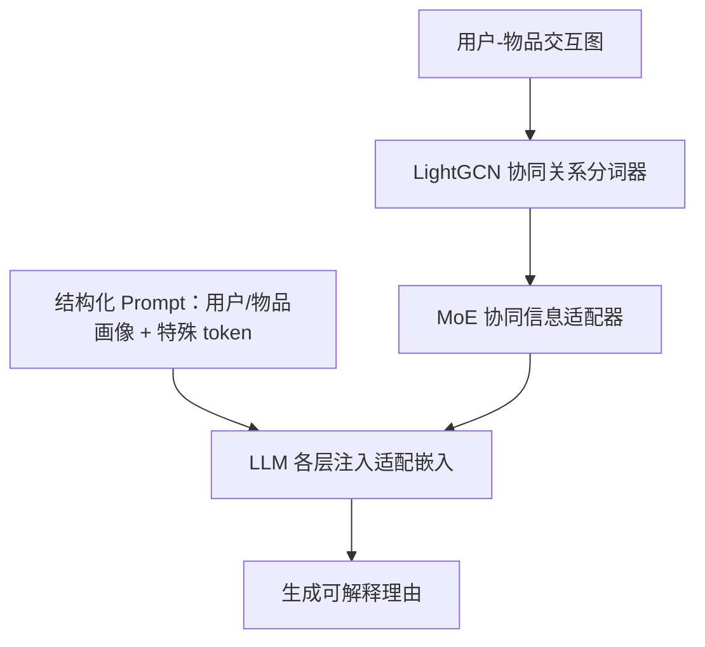
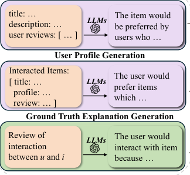

# XRec: Large Language Models for Explainable Recommendation (面向可解释推荐的大语言模型)

- **会议/期刊**: EMNLP 2024 Findings
- **作者与机构**: Qiyao Ma, Xubin Ren, Chao Huang；University of Hong Kong
- **推荐链路定位**: 解释生成 / 推荐后处理（非召回排序）
- **研究方向**: 大语言模型推荐 (LLM4Rec) / 图协同过滤
- **论文原文**: [论文原文链接](https://arxiv.org/abs/2406.02377v2)
- **开源代码**: [开源代码仓库链接](https://github.com/HKUDS/XRec)

## TL;DR (1分钟核心速览)

现有 GNN/SSL 协同过滤推荐准确但黑盒；Att2Seq/NRT/PETER/PEPLER 等 ID-based 解释器又受限于解释数据稀缺与新用户/物品泛化。XRec 将 LightGCN 学到的用户-物品高阶协同关系编码为“行为 token”，经 MoE 适配器对齐到语言空间，并注入 LLaMA2-7B 每一层，生成个性化解释。在 Amazon/Yelp/Google 上，GPTScore 相对最强外基线提升 4.82%/10.35%/6.08%，BERTScore-F1 提升 1.95%/22.21%/11.08%，USR≈1。

## Background & Motivation (背景与核心矛盾)

- **主流范式**: CF/GNN/SSL 推荐擅长建模高阶协同关系，但只输出分数，不解释“为何推荐”；可解释推荐则用 Attention/RNN/Transformer/GPT2 从评论中生成理由。
- **前人局限**: ID-based 解释器依赖用户/物品 ID embedding，面对零样本新用户、新物品和稀疏交互时泛化差；解释监督信号稀缺，生成文本易模板化、不稳定。
- **核心洞察 (Key Insight)**: 用户-物品交互图中的高阶协同模式本身可视为一种“行为级语义”，与 LLM 的语言先验互补；关键是把协同表征对齐并持续注入 LLM，而非仅拼接文本画像。
- **本文切入点**: 用 LightGCN 作协同关系分词器，MoE 适配到 LLM token 空间，多层注入协同 token 后生成解释。

## Method (核心方法设计)

### 1. 整体框架 (Overall Architecture)

XRec 先由 LightGCN 在用户-物品二部图上传播聚合，得到用户/物品协同嵌入；再通过 MoE 适配器把行为嵌入映射为 LLM 可接收的适配 token。结构化 prompt 中预留 `<USER_EMBED>`、`<ITEM_EMBED>`、`<EXPLAIN_POS>` 等特殊 token，用户/物品画像作为文本上下文。训练时冻结 LLaMA2-7B，仅训练 MoE 适配器与协同分词器；推理时由 LLM 在解释位置自回归生成理由。

<figure class="paper-figure" markdown="span">
  <figcaption>图 1：我们的 XRec 的整体架构。(i). 协同关系分词器：使用 GNNs 将复杂的用户-物品关系转换为潜在嵌入；(ii) 协同信息适配器：一个轻量级适配器，将协同信号集成到 LLM 中。(iii) 将 CF 与 LLM 统一：将协同过滤洞察直接集成到大型语言模型中，使其能够生成有洞察力的解释。</figcaption>
</figure>

### 2. 关键设计拆解 (Key Designs)

1. **协同关系分词器（Collaborative Relation Tokenizer）**：文本画像难以压缩大规模高阶共现关系，ID embedding 又泛化弱。XRec 用 LightGCN 传播并做层平均，把协同关系压成稠密行为 token：`$\boldsymbol{e}_u=\frac{1}{K+1}\sum_{k=0}^{K}\boldsymbol{e}_u^{(k)}$`，用 BPR 优化 `$\mathcal{L}_{BPR}=-\sum_{u}\sum_{i\in N_u}\sum_{j\notin N_u}\ln\sigma(\hat y_{ui}-\hat y_{uj})$`。这样既保留高阶协同，又避免把长评论直接塞入 prompt。

2. **MoE 协同信息适配器**：行为空间与语言 token 空间存在语义鸿沟。适配器由多个线性专家与可学习门控组成，按输入动态组合：`$\boldsymbol{a}_u=\sum_{m=1}^{M}g_m(\boldsymbol{e}_u)W_m\boldsymbol{e}_u$`。相比单一线性投影，MoE 可让不同用户/物品的协同模式走不同语义子空间，提升跨域解释泛化。

3. **多层注入与训练目标**：单个 `<USER_EMBED>` 只占一个 token，序列变长后注意力会被稀释。XRec 在每层 Q/K/V 投影中加回适配嵌入：`$f_{\{q,k,v\}}(x_i)\mathrel{+}=W_{\{q,k,v\}}\boldsymbol{a}_i$`，使协同信号贯穿 LLM 并让梯度回流 MoE。解释生成用 NLL：`$\mathcal{L}=-\frac{1}{N}\sum_{i=1}^{N}\sum_{c=1}^{C_i}y_{ic}\log\hat y_{ic}$`。LLM 参数冻结，训练负例来自用户未交互集合，具体采样分布未详述；无额外排序负采样。

## Experimental Setup & Evaluation Protocol (实验设置与评估协议)

- **数据集与预处理**: 三个公开评论数据集，未说明 `5-core` 等过滤细节：

| 数据集 | #Users | #Items | #Interactions | 稀疏度/密度 | 特征/场景说明 |
| :--- | :---: | :---: | :---: | :---: | :--- |
| Amazon-books | 15,349 | 15,247 | 360,839 | ≈0.154% | 图书购买+评论 |
| Yelp | 15,942 | 14,085 | 393,680 | ≈0.175% | 商户评论 |
| Google-reviews | 22,582 | 16,557 | 411,840 | ≈0.110% | Google Maps 地点评论 |

- **数据划分与防穿越 (Splitting Strategy)**: 原文未明确报告 `Leave-One-Out` 或比例切分；仅说明按用户训练频次划分 `tst1–tst5`，另设 zero-shot 用户集评估冷启动。
- **排名评测协议 (Ranking Protocol)**: 不是 `Full-Ranking` 或 `Sampled Ranking` 推荐排序，而是解释文本生成评测：GPTScore、BERTScore-P/R/F1、BARTScore、BLEURT、USR，并报告各指标标准差衡量稳定性。GPTScore 由 gpt-3.5-turbo 计算。
- **对比基线与超参设置**: 基线含 Att2Seq、NRT、PETER、PEPLER；嵌入维度 $d=64$，batch=1024，Recall@20 早停 patience=10；MoE 8 experts、dropout=0.2、router noise=0.01；LLM 为 LLaMA2-7B；解释长度≤50 词。未报告显著性检验。

## Key Experimental Results (实验关键数据)

### 1. 主实验对比 (Main Results)

| 方法 | Amazon GPT↑ | Amazon BERT-F1↑ | Amazon GPTstd↓ | Yelp GPT↑ | Yelp BERT-F1↑ | Yelp GPTstd↓ | Google GPT↑ | Google BERT-F1↑ | Google GPTstd↓ |
| :--- | :---: | :---: | :---: | :---: | :---: | :---: | :---: | :---: | :---: |
| Att2Seq | 76.08 | 0.3687 | 12.56 | 63.91 | 0.2379 | 15.62 | 61.31 | 0.3636 | 17.47 |
| NRT | 75.63 | 0.3443 | 12.82 | 61.94 | 0.1495 | 16.81 | 58.27 | 0.3496 | 19.16 |
| PETER | 77.65 | 0.4043 | 11.21 | 67.00 | 0.2513 | 15.57 | 65.16 | 0.3881 | 17.00 |
| PEPLER | 78.77 | 0.3543 | 11.38 | 67.54 | 0.3052 | 14.18 | 61.58 | 0.3546 | 17.17 |
| XRec w/o profile | 81.77 | 0.4106 | 9.60 | 71.81 | 0.3657 | 12.71 | **69.71** | 0.4310 | **14.09** |
| **XRec** | **82.57** | **0.4122** | **9.60** | **74.53** | **0.3730** | **11.45** | 69.12 | **0.4311** | 14.24 |

完整 XRec 相对最强外部基线：Amazon GPTScore **+4.82%**、BERT-F1 **+1.95%**；Yelp **+10.35%**、**+22.21%**；Google **+6.08%**、**+11.08%**。稳定性上，GPTstd 分别降低 **15.64%/19.25%/16.24%**；BERT-F1 std 降低 **10.41%/18.86%/6.11%**。Google 上 w/o profile 的 GPTScore/GPTstd 略优于完整模型，说明画像并非总增益。

### 2. 消融实验 (Ablation Study)

| 变体 | Amazon GPT↑ | Amazon BERT-F1↑ | Yelp GPT↑ | Yelp BERT-F1↑ | Google GPT↑ | Google BERT-F1↑ |
| :--- | :---: | :---: | :---: | :---: | :---: | :---: |
| XRec | **82.57** | **0.4122** | **74.53** | **0.3730** | 69.12 | **0.4311** |
| w/o profile | 81.77 | 0.4106 | 71.81 | 0.3657 | **69.71** | 0.4310 |
| w/o injection | 图3显著↓ | 图3显著↓ | — | — | 图3显著↓ | 图3显著↓ |
| w/o profile & injection | 图3最低 | 图3最低 | — | — | 图3最低 | 图3最低 |

### 3. 关键实验发现 (Key Findings)

1. **协同注入比单纯文本画像更关键**：Amazon/Yelp 上完整模型显著优于 PEPLER；Google 去除 profile 后 GPTScore 反升 0.59，但 F1 几乎不变，表明画像主要补稳定性，协同 token 才是解释语义提升核心。
2. **解释独特性接近满分**：USR 在三个数据集均≈1.000，远高于 PEPLER 的 0.9563/0.9143/0.8660，说明 XRec 能针对不同用户-物品对生成非模板化理由。
3. **零样本与稀疏用户鲁棒**：图4显示 zero-shot 用户上的表现接近 tst1–tst5，并优于 ID-based 基线；这与 LightGCN 协同 token 和 LLM 语言先验互补的设定一致。

## Highlights & Limitations (亮点、对比与审稿批判)

- **与代表作对比 (vs. Prior Work)**: Att2Seq/NRT 用 RNN/Attention 从属性生成解释，PETER 用 Transformer 连接 ID 与词，PEPLER 用 GPT2 做 prompt tuning；XRec 的本质区别是把 GNN 高阶协同表征作为连续 token 注入 LLM 各层，而非仅依赖 ID 或文本 prompt。
- **可迁移亮点**: ①特殊 token + MoE adapter 可迁移到任意结构化侧信息（价格、时序、KG）；②多层 Q/K/V 注入可缓解长 prompt 中单 token 信号稀释；③用 LLM 从原始评论蒸馏显式解释，缓解解释监督稀缺。
- **审稿级局限批判**: ①仅文本+图，未覆盖图像/视频多模态，作者亦承认；②评估依赖 GPTScore/BERTScore 等自动语义指标，缺少人类评分与排序准确性指标，且未报告数据划分细节、负采样规模与显著性检验；③7B LLM 逐层注入带来推理延迟，线上部署需缓存协同嵌入并做蒸馏/量化。

## Rating (四维评分)

- **方法创新性 (Novelty)**: ⭐⭐⭐⭐ （把 LightGCN 协同关系作为行为 token 注入 LLM 各层，较 ID-based 解释器有清晰增量。）
- **评估协议与实验扎实度 (Protocol & Experiments)**: ⭐⭐⭐ （三数据集+稳定性/稀疏性/零样本较完整，但缺划分细节、显著性检验和人工评估。）
- **写作与数学规范度 (Clarity & Rigor)**: ⭐⭐⭐⭐ （框架与公式简洁，BPR/NLL/多层注入表述清楚；负采样与切分细节略含糊。）
- **工业落地与复现价值 (Industrial & Practical Value)**: ⭐⭐⭐ （代码开源、模型无关；但 7B LLM 生成成本与每层注入开销限制大规模实时部署。）

